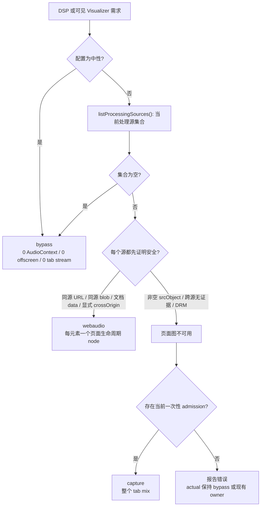

# Audio source admission

This document owns source evidence for SPECTRA's three physical audio states. It does not duplicate the capability matrix in [control architecture](../control/README.md) or wire/lifecycle contracts in [runtime architecture](runtime.md) and [protocols](../reference/protocols.md).

## Lowest-cost complete owner

The canonical order is `bypass -> webaudio -> capture`:



图中的两个"否"分支都不允许猜测：集合为空就是不需要处理器，admission 缺失就是
不可用。没有任何一条边可以从音量阈值直接走到 `capture`。

1. `bypass`: native page/DOM writers own neutral audio; no `AudioContext`, analyser, offscreen document, or tab stream exists.
2. `webaudio`: one isolated-world, page-lifetime `MediaElementAudioSourceNode` per element feeds the shared sparse graph. It is allowed only when every current processing source is proven safe before the first irreversible binding. `MediaRegistry.listProcessingSources()` owns this set: selected URL or non-null `srcObject`. An empty placeholder is not an output source. Playback, visibility, and mute do not exclude a selected source.
3. `capture`: one-shot extension-invocation admission acquires the complete tab mix when page coverage is incomplete, unsafe, protected, or binding/readback fails.

Processor demand never chooses an owner from a volume threshold alone. `resolveDesiredAudioMode()` combines explicit DSP/visible-Visualizer demand with the current registry's exact coverage evidence. A candidate becomes actual only after running context, `graphSignature`, `normalizedActualConfig`, `sourceCount`, document/generation, and revision readback.

## Explicit site processing routes

`SettingsRepository` is the single durable owner for a normalized site's
optional `direct | capture` override. The wire projection is the independent
additive `spectra.registry.*` v2 family; the strict full-settings v2 snapshot is
unchanged and contains no route state. Absence means `auto`:

- `auto` chooses proven page WebAudio first and admitted Capture only when the
  complete page graph is unsafe or unavailable;
- `direct` requires the page-lifetime WebAudio owner and never falls through to
  Capture. A failed page binding remains bypass/error instead of violating the
  user's route;
- `capture` skips a known-bad page graph, but it is only a routing preference.
  It cannot create Capture authority; a current one-shot `CaptureAdmission` is
  still mandatory.

The Background Settings repository owns normalization, the shared revision, capacity,
legacy `mediaRouteRegistry | restrictedRegistry | userRegistry` migration, and
projection. The current key is `siteProcessingRoutes`; migration verifies that
key before retiring legacy keys. User entries outrank automatic evidence, and
the most-specific parent-domain match wins. Popup is only a projection/editor
of this repository state and owns no route storage. Content's bounded
eligibility cache uses the narrower sender-bound `spectra.audio.route.get/record`
projection; Background derives its hostname and delegates to the same repository.
Content never imports Popup CRUD DTOs or writes Chrome storage directly.
Automatic records remain advisory history; only user-sourced entries are hard
route choices. Current-document evidence therefore corrects stale automatic
history without allowing an old `direct` record to suppress a necessary Capture.

Automatic detection answers whether SPECTRA needs Capture to control this page
successfully. It is not a detector for a page's own AudioContext usage. Detection
results and manual route constraints must remain distinct through policy
selection and execution: a proven automatic WebAudio candidate may still fail
at binding or readback and fall back to admitted Capture. Only a user-sourced
`direct` entry forbids that fallback. The route list shows automatic results and
manual choices with their source; a cached result does not claim Capture is
currently running. Actual activation requires the processor ACK described below.

| Automatic control decision | Required next step |
| --- | --- |
| No processing demand | Native bypass; no Capture acquisition |
| Complete safe source set | Try page WebAudio and verify physical readback |
| Unsafe/incomplete source set, or WebAudio binding/readback failure | Try Capture only with current invocation admission |
| Capture active ACK | Record `capture/auto` and project the acknowledged state |
| Missing admission or failed processor ACK | Report error and actual bypass/remaining owner; never claim successful control |

Resource selection changes re-evaluate this same source set. When a new unsafe
source invalidates an active page graph, the graph is neutralized before Capture
admission is checked; absence of admission cannot leave partial processing marked
active. Empty former sources disconnect from the graph while retaining their
page-lifetime binding identity for later reuse.

WebAudio initialization and graph application are asynchronous. The executor
re-reads the registry after initialization and verifies current source membership
and coverage before acknowledging the graph, including after retiring Capture.
A manual-direct failure retires any previous Capture through its stop ACK;
failed retirement retains the actual Capture owner in the error state. These
transitions never infer physical bypass merely from the requested route.

## MediaElement WebAudio evidence

`WebAudioController` may bind a source only when its current resource is one of:

- same-origin relative or absolute URL;
- same-origin `blob:` URL;
- `data:` URL owned by the document;
- cross-origin URL whose already-loaded element has explicit `crossOrigin` mode, metadata, no media error, and an exact current-resource evidence record from `media-registry.ts`.

The controller never mutates `crossOrigin`, guesses from analyser silence, binds a subset of current elements, retries a known failure for the same resource, or patches page prototypes. `MediaElementAudioSourceNode` identity is page-lifetime: source changes reuse the same binding; DOM removal/disposal disconnects it; a replacement Content runtime reconnects the existing source rather than creating a second node.

A non-null `srcObject` remains in the processing set and is not proven by a
leftover `src` URL or URL-specific CORS evidence; it requires the Capture path.

## Capture admission

Capture is an explicit tab/document-scoped fallback:

```mermaid
sequenceDiagram
  participant U as Popup 或当前文档快捷键
  participant BG as Background
  participant C as Content
  participant O as Offscreen host
  U->>BG: 扩展调用意图 (exact tab + document)
  BG->>BG: mint CaptureAdmission: oneShot + expiry + epochs
  BG-->>C: 一次性凭据
  C->>C: 消费一次; 导航/关闭/过期/错身份/重放即 fail-closed
  C->>O: capture intent
  O->>O: tab stream + AudioContext + 稀疏图, 一个 generation
  O-->>BG: active ACK: running + graphSignature + normalizedActualConfig
  BG-->>U: 仅匹配才发布 active; 否则保持上一 owner
```

1. The manifest declares `tabCapture` and `activeTab`; `getMediaStreamId({targetTabId})` requires the temporary invocation grant for that exact tab. A cold page reaches it through the manifest `volume_up` command: the bootstrap leaves an `Alt+Up` press to the browser only while the page media is already at its native ceiling and the document has no known invocation grant. Chrome invokes the command, and the same press may start Capture. The grant is latched for the document's lifetime once a Popup opens, a command is delivered, or a Capture session has started, so a session that ended at 100% does not send the next `Alt+Up` back to the command. Page-origin shortcuts and configured site bindings never grant it.
2. Background mints one `CaptureAdmission` bound to `tabId`, top frame, `documentId`, document/worker epochs, operation, expiry, and `oneShot: true`.
3. Content consumes the grant once. Navigation, close, expiry, wrong identity, malformed data, and replay fail before acquisition.
4. Offscreen creates the tab stream, `AudioContext`, stream source, commit gate, and `AudioGraphRouter` for one generation.
5. Active and idle ACKs must match the canonical identity/revision/graph readback; failure or stale completion never masquerades as a state transition.

Capture is never inferred from a status read, background card, page observation, or Visualizer demand. Target-only DSP cannot widen to full-tab Capture. A visible foreground Popup may request a proven safe MediaElement WebAudio analyser or observe Capture already required by non-neutral DSP. Unsafe neutral sources settle on bypass with empty frames; subscriptions never mint Capture admission or retain a volume-only Capture after returning to native volume.

## Owners

- `content/core/media-registry.ts`: current elements, source revisions, and exact preload-CORS evidence.
- `packages/features/audio-engine/src/web-audio-controller.ts`: page-lifetime binding registry, sparse graph, readback, analyser lease, and deterministic disconnect.
- `content/logic/mode-executor.ts`: serialized three-owner handoff; candidate ACK precedes old-owner release and failed handoff restores the acknowledged owner.
- `background/settings-repository.ts` + `media-route.contracts.ts`: durable site route, migration, exact guards, and parent-domain selection.
- `background/capture-admission.ts` + `handlers/capture.ts`: one-shot Capture authority, serialized transition, exact ACK validation, session commit, and bounded cleanup.
- `offscreen/audio-host.ts`: physical Capture graph and stream cleanup.
- Popup visualizer + `background/handlers/audio.ts`: visible-source lease, at most 15 Hz sampling, bounded fan-out/backoff, and final release.

Forbidden designs are partial page binding, synthetic spectrum, persistent analyser demand, all-tab acquisition, standing MAIN-world audio ownership, source-prototype interception, and optimistic processor state.
