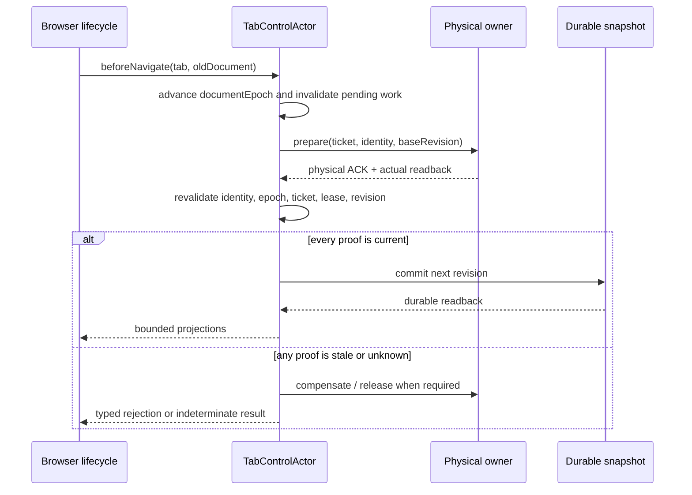
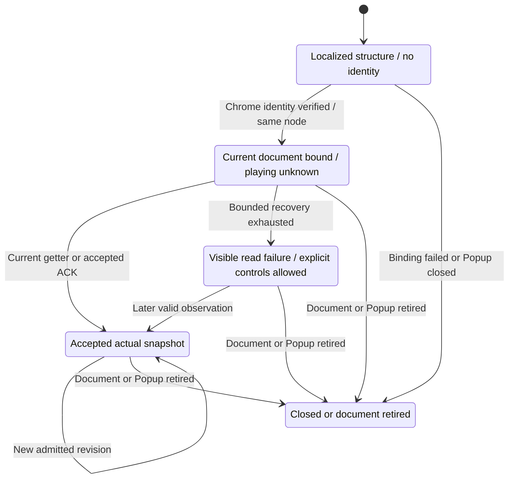
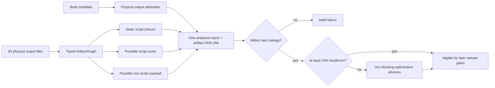

# SPECTRA runtime architecture

SPECTRA is a Chrome MV3 extension with explicit ownership across runtime contexts. Shared protocols/snapshots are in `@nexus/contracts`. Per-field behavior is in [control architecture](../control/README.md).

## Runtime ownership

| Context | Owns | Does not own |
| --- | --- | --- |
| Popup / Options | intent, local render, interaction | actual audio mode, direct storage, executor choice |
| Content, isolated | document identity, media registry, DOM/CSS writers, exact configured-site lean host, proven MediaElement WebAudio graph, Capture intent/readback projection | Capture construction, processor-active claims before physical readback, cross-tab hotkey target selection |
| MAIN bridges | fullscreen audio handoff, exact-element page-media getter/setter readback | generic dispatch, domain tables, cross-tab state |
| Background worker | routing, settings, snapshots, badge projection, runtime leases, per-document lean/full hotkey ownership and restart recovery | WebAudio nodes, optimistic UI |
| Unified offscreen host | actual Capture processors, authenticated remote sessions | direct document creation/closure |

`ControlSnapshot` owns actual media/video/DSP fields. `AudioSessionSnapshot` (keyed by document) owns processor mode/phase/config/error. Projections preserve this separation.


Every arrow is a validated port, not shared mutable state. UI and Remote submit intent; only the physical Content or offscreen owner can produce an actual-state fact, and only Background can commit that fact into the durable control model.

## Audio lifecycle

```text
mode: bypass | webaudio | capture
phase: idle | starting | active | stopping | error
```

Navigation/transition advances generation; late ACKs cannot update newer documents. Default is transparent bypass.
MediaElement WebAudio activates only after complete exact source coverage, running context, graph signature, normalized configuration, and source-count readback. Capture activates only after the offscreen host returns the equivalent tab-owned proof. Every transition neutralizes the candidate's competing route, verifies the candidate, switches ownership, and only then releases the previous owner; a failed handoff restores the last acknowledged owner. Content lifecycle events require the authoritative `documentId`, so a late event for an old document cannot mutate its replacement.

Revisioned Settings may pin a site to `direct` or `capture`; absence means
`auto`. `direct` never falls through from a failed page graph to Capture, while
`capture` remains only a preference and still requires a current one-shot
admission. Worker-restart projection replays the selected route to every
resident tab, and new Content pulls it with the additive
`spectra.audio.policy.get` request. The established
`spectra.audio.config.get -> AudioConfig` v2 response remains unchanged so old
resident Content and a new Background worker remain wire-compatible.

`audio-processor.contracts.ts` is the sole runtime owner of the processor DTO and
its exact guard. The full audio contract projects product configuration onto
that type, while the Offscreen protocol imports the leaf directly; Capture
startup therefore does not load persistence, migration, session, or page-native
audio validators that it cannot consume.



## Unified offscreen host

`offscreen.html` hosts Capture processors and remote sessions. `offscreen-coordinator.ts` exclusively owns `chrome.offscreen.createDocument()` / `closeDocument()`.

- Leases: `audio:<tabId>`, `remote:<sessionId>`
- Serialized creation/reconciliation/close decisions. Closes only after all leases released + 1-shot grace alarm.
- Remote controller is a deferred module. Status requests without runtime return an empty exact result. The first explicit session creation loads exactly one local `peerjs-vendor.js` ESM default export through the offscreen-local single-flight loader. That output is built from the same workspace-owned PeerJS 1.5.5-derived data-only source consumed by the checked-in Remote page: JSON serialization is mandatory, UTF-8 messages are capped at 16 KiB before parsing or sending, and MediaConnection, BinaryPack, Raw/binary serializers, package/CDN fallbacks, and global `Peer` ownership are absent. Capture-only work does not load the transport, and load timeout/disposal fences reject only the initiating request instead of installing a fallback.
- HELLO reconstructs processors/sessions after worker restart. Unresponsive hosts enter 30s grace.
- Content READY waits for Capture reconciliation to prevent duplicate Captures.

## MAIN bridges and page-native media semantics

No generic MAIN runtime or domain tables. Two version-guarded bridges own cross-world surface:
1. **Fullscreen V1**: Temporarily yields active audio pipeline around `requestFullscreen()`.
2. **Page-media V2**: Synchronously reads/writes `volumeBase`, `mediaMuted`, `speed` for exact target.

Page-media discovery walks composed-ancestors and declared bounded paths. Matches
require paired getter/setter. The [media-control owner](../control/06-media-and-video.md#speed-decision-and-failure)
defines speed value admission, physical ACK and proven baseline handoff, including
an already-owned speed field. The bridge retains no controller or polling loop;
declared data is owned by the registry, not by a second MAIN runtime.

Content creates a lazy isolated-world `AudioContext` only when a visible analyser or explicit DSP demand has complete proven coverage for every current media element. The controller owns one page-lifetime source binding per element, never mutates CORS state, and disconnects on element/runtime disposal. Page volume/mute remain native fields. Capture remains the complete-tab fallback; leaving either processor first acknowledges a transparent configuration before releasing its physical owner.

Physical Capture keeps an explicit `targetTabId` so an async transition can never capture whichever tab happens to become focused later. The manifest therefore owns `activeTab` together with `tabCapture`: a user action or registered Chrome command grants temporary authority for that exact active page, while Background still rechecks tab/document/generation before and after stream-ID acquisition. Programmatic Popup opening, page activity, restore, Remote, and background-tab work cannot manufacture that grant.

## Settings and hotkey target state

Background owns revisioned settings in `chrome.storage.local`. Revisions are written to physical storage before broadcast.
Per-tab control session is stored in `chrome.storage.session` (`tabId+documentId+origin+resourceUrl`), containing 20 refresh-restorable fields.

Control snapshots, control generations, audio-session snapshots, and the Popup card cache are durable in `chrome.storage.local`, the same area as MediaFacts: a browser restart or extension reload must not blank the Popup's background list, so these are retired by document navigation and tab removal, never by a TTL. `chrome.storage.session` remains only for session-scoped state — the per-tab control session, badge-usage markers, and the hotkey target — which is meant to vanish on restart.

The writers are separate because their failure modes differ. `control-coordinator.ts` publishes `spectra.control.tab.<tabId>` only after `chrome.storage.local.set` resolves, rolls the in-memory value back when the write fails, and keeps `spectra.control.generation.<tabId>` as the ordering authority that survives a worker. `audio-session-store.ts` owns `spectra_audio_session_<tabId>`: a 250 ms coalesced write that retries up to five times, a document fence (epoch plus current/retired document) that rejects late senders, and a bounded rejection ledger that records *why* a write was refused. Runtime-message and badge projections run on a separate per-tab queue, so a slow optional receiver can never delay the next physical or session ACK. The Popup card cache (`spectra.popup.card_cache.<tabId>`) is a forecast with no TTL: it is retired by a different document, never by elapsed time.

Settings commit and settings projection are separate authorities. A mutation ACK means the exact revision is durable and readable by a replacement worker; it does not claim every open tab has already observed the projection. `settings-projection.ts` owns one revision-coalescing queue for extension, Content, hotkey, shortcut, and restore projections. It preserves global/hotkey lanes while selecting the newest snapshot, retries real delivery failures on `50/200/800 ms`, records the last projected revision only after those lanes settle, and wakes from a Chrome alarm after a deferred failure. A destroyed or non-resident Content receiver is terminal for that document because its successor pulls the durable snapshot during bootstrap. Tab work is bounded to eight concurrent deliveries, and hotkey reconciliation reuses the already-enumerated tab snapshot. Global OSD, visualizer, language, and theme projection is presentation-only and never re-enters audio policy.

The `volume`, `volumeBase`, and `boost` fields form one canonical value object. Partial site/preset merges combine the validated patch with existing state before one canonicalization pass, so changing only base or boost cannot persist a contradictory effective volume.

| Patch source | Updates current-resource | Updates origin-portable |
| --- | --- | --- |
| Page observation | yes | removes those fields |
| Popup / remote / shortcut ACK | yes | yes |

Resource URL canonicalization:
- Same URL, new `documentId`: complete patch
- Same-origin, diff URL: origin-portable patch only
- Cross-origin: both retired

A separate monotonic per-tab record owns Action-badge stickiness, surviving worker replacements. The decision is recorded synchronously and painted by the newest decision, not by whichever asynchronous Action write happens to land first. Staged gesture inputs carry a monotonic stamp, so an input accepted while a projection is still resolving is newer than that projection regardless of the wall clock; the 600 ms bound only expires a stage whose acknowledgement never arrives. A staged tone changes the colour only — `isCapture` stays from the acknowledged lifecycle. The session-scoped global hotkey target is owned by `hotkey-target-repository.ts`; it is independent from media identity and never selects or activates an audio processor.

## Media discovery and identity

Content maintains media through an event-driven registry. Registration does one
viewport-geometry seed. Same-document navigation does not duplicate the registry.
Desired native settings replay only onto the current selected source, through
registration/play/selection events and the same Background coordinator; the
registry never binds an audio graph. The [media lifecycle owner](../control/06-media-and-video.md#closing-live-players-and-speed-inheritance)
defines hidden/detached live-player handoff, source retirement, Popup closure
and the distinction between route, document and media identity.
The document replay template has its own single restore lease, separate from a
source's physical field ownership. Initial restore, explicit control, worker
recovery and page-settings release follow the [template lifetime owner](../control/06-media-and-video.md#document-replay-intent-lifetime).
Status probes cannot recreate leases after navigation or an explicit release.
Passive bootstrap may do a bounded top-level getter. It observes `volumechange`/`ratechange` and submits complete actual pairs to Background without media identity. While the initial HELLO verdict is pending, it retains the latest observation without dispatching it. A lean verdict drains that observation; a heavy-runtime verdict discards it because the runtime owns observation. Restoration acquires the heavy runtime before writing media, so restored native events cannot be replayed by the lean bootstrap.

The bootstrap also owns the declared site's actual-speed toolbar projection for
its entire lifetime, including while the heavy runtime is resident. The
[media-control owner](../control/06-media-and-video.md#actual-speed-label) defines
the exact media/root binding and the independent menu witness. Initial DOM
ready/warm injection/pageshow reads do not wait for a rate event. Native media
signals discover player roots; only those roots receive a label-specific
MutationObserver for late/replaced UI. There is no document-wide topology watch,
polling, MAIN observer, or additional media writer. Bootstrap disposal releases
these observers and conditionally restores its text.

## Action Popup first frame

Chrome sizes an Action Popup from its document, and every open is a new realm.
`popup.js` is a module; asynchronous settings, identity and media-state reads
cannot establish the first visible structure or language. Waiting for them
leaves the primary stage empty; painting an English/default projection before
they settle causes a second visible presentation. Structure and actual-state
confirmation therefore have separate completion boundaries.

The render-critical appearance is announced before the document exists:

| Fact | Decided by | Read before the first paint from |
| --- | --- | --- |
| How many cards the Popup will draw | Background, `popup-frame.ts` | `popup.html?cards=N` |
| Whether this active tab has a primary card | Background's restricted-URL rule | `main=0/1` |
| Language and visualizer shape | committed global settings | `lang=...&viz=0/1` |
| The height that shape settled on | the previous open of the same shape | `spectra.popup.frame.<N>` |
| The colour the surface paints in | the last committed theme mode | `spectra.popup.themeMode` |

### Card-count announcement

`chrome.action.setPopup({ tabId, popup })` lets a tab carry its own Popup URL, so
the count travels in that URL instead of being discovered after the window is
visible. `popupCardCount` mirrors the Popup's own inventory rule: one card for a
controllable active tab, plus every other listed media tab.
`media-inventory-runtime.ts` exposes the single inventory instance that both the
`spectra.tab.visible.list` route and this count read, so the announcement and the
rendered list cannot disagree about scope.

`popup-frame.ts` re-announces whenever the answer can change: tab activation, a
committing or navigating document, `audible` transitions, media reports
(coalesced over 60 ms, because one report per tab would read the same inventory
several times for one visible change), tab removal, window focus, and worker
startup. A per-tab monotonic generation means a slow inventory read that began
before a tab switch cannot overwrite the newer announcement. When the count
cannot be decided, the bare `popup.html` is announced — the pre-announcement
behaviour, which costs one prediction and no correctness.

Global settings RPCs wait for an immediate active-tab appearance announcement
attempt before returning their durable ACK; they do not wait for the 60ms media
report timer or Content delivery. The projection queue also reconciles it.
An Action API failure cannot undo a durable settings commit and remains an
unannounced/fallback boundary, not a claimed first-frame proof.

The count is a projection, never a promise: a background tab paused past the
retention window is still listed by the inventory and then dropped by the card,
and a document can retire between the count and the open. A wrong count costs one
correction, and because the Popup records the height each **announced** count
settled on, the next open of that same state is already right.

### Bootstrap contract

`shared/popup-bootstrap.ts` owns every string in this contract: the query
parameter, the key prefix, the fallback keys, the theme key, the surface marker,
and Chrome's 600 px ceiling. The build substitutes them into
`public/frame-reserve.js` through `FRAME_HEIGHT_KEY_PLACEHOLDER`; the head script
carries no literal of its own, so it cannot read a key the Popup module does not
write.

`frame-reserve.js` is a classic render-blocking script. Before the first paint it:

1. paints `data-theme` from `spectra.popup.themeMode`, resolving `system` with the
   same `prefers-color-scheme` query the module uses;
2. marks `data-spectra-surface="action-popup"` when the document really is an
   Action Popup, so the reflow rules for tab-hosted pages stay out of the initial
   sizing pass;
3. reserves the height recorded for this open's announced count, then the most
   recent settled height, then the legacy single hint; clamps it to 600 px, sets
   `overflow-y: hidden`, and records `data-spectra-frame-reserved` together with
   `data-spectra-frame-source` (the key that answered) for the geometry specs.

The lookup order is deliberate: the nearest count's height is not an estimate of
this shape's height. Two cards are taller than one, but three are not necessarily
taller than two (a paused card keeps its whole card, an empty one does not), so
interpolation would trade one wrong number for another. A first open of a new
shape grows once, records its own height, and never grows again.

### Frame settlement

`frame-height.ts` retains synchronous first sizing, but ResizeObserver and
MutationObserver invalidations coalesce into one requestAnimationFrame before
writing ancestor root geometry. Writing the observed root during descendant
observer delivery creates undelivered shallower notifications. Release/retrack
cancels the queued frame and fences callbacks by tracking revision. The overlay
scrollbar owns only visual geometry and scrolling; its observers, listeners,
drag capture and paging timers belong to the existing Popup attempt disposer,
so bootstrap retry cannot stack them.

`popup/frame-height.ts` owns the document frame once the module starts. Until
`data-spectra-ready` is published — the inventory has committed every card this
open will draw — the frame is **pinned** at the reserved height, not floored by
it: a floor (`max(content, prediction)`) still lets every mounting card push the
window one step taller, and that sequence of resizes is the flicker. One open
therefore changes size at most once, when the inventory publishes, and not at all
when the prediction was right.

From the publish onwards the frame follows `.view-container`, enables the 160 ms
height transition before its single correction, and records the settled height
under the **announced** count rather than the count that ended up being drawn.
The announcement is what selects a height next time, so the height has to be
stored where the next announcement will look. The write happens one frame after
the publish, with a `pagehide` flush: measuring at the publish moment stores a
mid-layout height no open ever lands on, which is why every open used to reserve
the wrong height, measure, and jump. A failed bootstrap releases the reservation
(`releasePopupFrame`) so the error surface is not painted behind a stale frame.

### Card shape and inventory forecast

Two more late reads shaped the first frame:

- `popup/settings-forecast.ts` caches the last committed `GlobalSettings` and
  validates it on read. The visualizer band is part of every card's height, so a
  user who turned the visualizer off used to watch each card shrink after the
  settings snapshot landed — and the window followed. The forecast stands in
  until the authoritative projection arrives and is then overwritten, never
  merged.
- `popup/media-inventory-from-storage.ts` projects the card list from the durable
  media facts (`spectra.media-facts.v1`) and Chrome's `audible` flag, so the first
  list does not wait for a service-worker round trip. The
  `spectra.tab.visible.list` request still runs and remains the authority that
  reconciles a tab which navigated or reported media while the Popup was opening.

### Presentation and actual confirmation

`popup-first-paint.js` is a separate classic head script with `defer` and explicit
`blocking="render"`: parsing supplies the existing `#tmpl-card`, then the script
localizes and clones that sole template before rendering is unblocked. All nine
Popup-only dictionaries come from their existing typed source catalog. The
classic script publishes that immutable packaged catalog to the module realm;
Options and action catalogs remain separate. Build/integrity and both Popup
script-size measurements include this entry, rather than moving its bytes out
of the measured closure.

An announced primary card is an unbound, inert structure with no tab/document
identity or media actuals. Unknown playback is `aria-pressed=mixed`; volume and
speed have no invented actual. Missing/invalid appearance does not imply a main
card; restricted pages do not receive a guessed card. Chrome's current active
tab/document read then binds the same node. `readInitialCardSnapshot` reads only
document-fenced durable/cache presentation, strips cached `playing`, and never
waits for control/runtime/remote RPC. The existing messaging reducer and bounded
recovery confirm actual values. Background-card inventory keeps its existing
bounded read and retention policy.

The module initializes the announced dictionary synchronously, before settings
RPC; dynamic title/ARIA rendering cannot reintroduce English. Async metadata
has reserved line height. Temporary sync announcements do not add a layout band;
exhausted recovery has a visible status overlay with the same geometry. A bind
failure removes the unbound node, and Popup/document retirement disposes the
existing handlers. There is no HTML snapshot cache, second media state owner,
whole-page visibility delay, fade or repeated node replacement.

<!-- mermaid:id=popup-first-frame -->


The built-Chrome Popup spec attaches before document scripts, holds the module
response, verifies parsed localized/unbound structure, then records every
rendering frame while settings and actual-state RPC remain blocked. It requires
one card, the same node, current-language text and playback ARIA labels, unknown
playing and unchanged card height. A settled-DOM assertion alone is insufficient.

## Runtime loading and shortcuts

Manifest loads minimal isolated bootstrap + closed MAIN bridges. Heavy Content runtime is acquired via consumer tokens. Final consumer releases listeners. Cold-document built-in hotkeys use READY ensure and release their transient capability after the admitted operation.

The pre-injection runtime-status probe is an optional read bounded to 1 second.
Its settlement pool retains at most eight physical outstanding probes; observation
expiry does not pretend to cancel a browser request. An expired or unavailable
probe proceeds through the same document-scoped injection/READY transaction.
Late probe replies cannot restore source leases or publish READY. This boundary
does not time out or bypass restore writes: explicit controls still wait for the
document initialization decision. The aggregate counters exported by the
[local diagnostic port](#local-diagnostics) describe this boundary but never
influence it.
Offscreen events keep Chrome message channel open until Background settles, preventing suspension mid-event.

Built-in chords (`Alt+Arrow*/Alt+M`) are reserved, claimed at `document_start` before page handlers. Configured-site bindings yield to website claims. Keyup clears unconsumed repeat pulses but cannot revoke an admitted press. `chrome.commands` admits only non-coalescing actions.

### Load-time package integrity

Injected entrypoints — `content-runtime.js` (via `chrome.scripting.executeScript`), the manifest `content_scripts` files, and `background.js` — must physically exist in the loaded unpacked package. A package missing them produces one linked symptom chain: `Could not load file: 'content-runtime.js'` in the service worker; no media card for a page that is playing (no bootstrap means the document cannot report playable media, and nothing else is asked to guess); and `Effective volume requires an observable page or standard native volume` (no runtime means no `volumeBase` readback). Normal builds cannot emit a partial `dist/`: the build finishes with a `statSync` size check on every entry and fails on a missing outfile, and watch mode restores each entrypoint's last good output on a failed rebuild while printing an explicit `✗` instead of dropping the file silently. A partial package is therefore external mutation (interrupted build or manual cleanup). Two guards cover the residual paths: `bun run check:dist` validates that every build entrypoint and manifest-referenced file physically exists (exit 1 with the missing list otherwise), and `bun run build:dev` rebuilds the package before reloading the unpacked extension.

### Configured-site lean hotkeys

A configured site may avoid a document-lifetime heavy Content Runtime hotkey lease only when **every live binding** is exactly page-default-equivalent: `speed_up`, `speed_down`, `volume_up`, `volume_down`, or `volume_mute`, with no custom parameters. Disabled, explicit no-op, or otherwise unavailable bindings do not own runtime work. One live non-equivalent binding makes the entire site `full`. The most-specific configured domain is authoritative: an explicitly disabled child suppresses an enabled parent rather than falling through.

Ownership is split into three layers:

1. `site-hotkey-loader-adapter.ts` resolves URL + settings into `none | lean | full` and owns exact heavy-listener suspend/resume projection.
2. `site-hotkey-owner.ts` is the sole Background owner for one `tabId+documentId`. It serializes reconciliations and owns Worker epoch/configuration generation, injection single-flight, lifecycle fencing, and full capability bookkeeping.
3. `content-site-hotkeys.js` is the minimal isolated-world physical input host. It has no settings authority and accepts only exact document configuration.

The exact lean configuration message is:

```text
spectra.content.site-hotkeys.configure
{ epoch, generation, bindings }
```

Rules:

- Every ownership transition starts with an exact **empty lean barrier**. A confirmed missing receiver means the document is already lean-empty. Any other transport/protocol failure is fail-closed.
- For `lean` or `none`, Background then sends an exact-document heavy `spectra.hotkeys.changed` projection with `sites:{}` before releasing any remembered hotkey lease or enabling lean. The heavy runtime may remain resident for restore/observation/control without retaining configured-site keyboard ownership.
- A broad real `spectra.hotkeys.changed` settings publication happens **before** ownership reconciliation. It updates heavy settings, but it is never lean-host configuration authority; the later exact suspend/resume projection determines heavy configured-site ownership for that document.
- A surviving lean host from a previous MV3 worker ACKs the new worker's empty barrier. A new Worker epoch supersedes the old epoch even when its numeric generation restarts lower.
- After injection, a nonempty lean projection must receive the exact `{epoch,generation}` ACK. Missing receiver after successful injection is an error, not a safe no-op.
- The lean host exposes a revision-2 read-only `active` marker in the same isolated-world realm. `getActiveHotkeySettings()` projects `sites:{}` while that marker is active. This physical fence prevents a transient heavy runtime loaded for control/feedback from claiming configured-site repeats during the READY-to-exact-suspend window.
- Per-document transitions serialize across HELLO, settings, History/navigation and lifecycle races. `forget()` increments the lifecycle token without deleting in-flight work; every async continuation proves the same lifecycle before publishing another side effect. A stale full ensure releases the capability it acquired.
- Lifecycle tombstones remain only while an injected host, full capability, injection promise, or transition is observable; retired idle keys are removed.

### Sender-document execution, repeat, and feedback

Lean bindings reuse the existing `spectra.content.default-hotkey.trigger` request with one additional validated disposition:

```text
{ action, phase, gesture, repeated, disposition: 'site-page' }
```

Absent `disposition` retains shipped default/global-hotkey-target semantics. `site-page` bypasses `hotkeyTargetRepository`; Background validates the sender and constructs `origin:'site-page'` with `foreground` and `target` equal to that exact top-level `tabId+documentId`.

The lean host owns only physical gesture admission and identity. Background owns bounded repeat coalescing (`runPageGestureBurst`); completion never self-drains queued pulses, and release discards unconsumed repeats. `volume_mute` is non-repeatable but still preserves the physical repeated fact through release.

Feedback reuses the existing scalar gesture channel and transient shortcut runtime. The same gesture is replayed to the heavy feedback owner if it loads after the first press, so speed/volume/mute retain actual OSD behavior. RPC failures use the existing Content toast. The transient runtime is released after the action/feedback path settles; this is not a document-lifetime hotkey lease.

The lean host survives BFCache `pagehide` when `event.persisted === true`: it releases held gestures but keeps its exact host/listeners in the retained realm. A real page retirement disposes it. Extension-context invalidation also disposes the host so stale code cannot keep calling `preventDefault()` after messaging becomes unavailable.

### MV3 worker-restart heavy-runtime recovery

A service-worker restart loses Background's in-memory runtime leases while an old heavy Content Runtime may survive in a page. `runtime-restart-startup.ts` is wired from the Background entry and recovers each current HTTP top document in this order:

1. exact runtime-status probe;
2. if a current-revision heavy runtime survived, acquire a fixed temporary `worker-restart-recovery` lease through the normal runtime loader;
3. reconstruct source ownership from `ownedSources`;
4. reconstruct the canonical restore capability from the exact tab-session identity/resource hostname;
5. reconcile current configured-site hotkey ownership (`none | lean | full`);
6. release only the temporary recovery lease.

Actual orphan disposal remains inside the normal runtime-loader lease authority, which rechecks concurrent/transient leases before sending RELEASE. Restore/hotkey reconstruction failure deliberately retains the temporary safety lease. Both per-document failures and discovery failures (settings/tab enumeration) use the same bounded retry schedule: `250 ms`, `1 s`, `4 s`. If no heavy runtime survived, recovery does not create one merely because a persistent restore plan exists.

This model removes document-lifetime heavy **hotkey ownership** for eligible sites. It does not promise that an admitted control operation or another independent consumer can never load the heavy runtime transiently.

## Remote control

Optional, capability-bound, authenticated. Requires an HMAC-SHA-256 nonce challenge. Allowlisted commands are bound to `sessionId + sessionEpoch + commandId + sequence + tabId + generation`. Offscreen is the sole live session/Peer owner; Background serializes admitted commands per session and revalidates the dispatch ticket after every await. Receipt retention and recovery are bounded, and a delayed connection/open/close callback cannot retire a newer Peer.

Remote generation advances in Background only after the authoritative offscreen host accepts the exact state. The host caches accepted state while unauthenticated or disconnected and sends it in the authenticated handshake; a hard send rejection leaves the last accepted generation unchanged, so the next command for that generation is not silently consumed. Out-of-order acknowledgements may advance but never regress accepted generation.

Runtime RPC `source` is a claim, never authority by itself. Popup and page sources must match their physical sender; page mutations require the exact current top document; `remote` and `system` are internal-only and are rejected from runtime messages. The retired Content legacy mutation adapter no longer relabels itself as Popup.

## Protocol and envelope ownership

The extension-internal v2 release line has one SPECTRA envelope owner. `@nexus/contracts`
owns the typed `SpectraRequestEnvelope` / `SpectraEventEnvelope` schema and runtime
validators. Common envelope/RPC primitives live in `spectra.protocol-primitives.ts`;
canonical Background route guards live in `spectra.background-runtime.ts` and are reused
by the generic protocol. `background-rpc.ts` owns only the allowlist derived from the
routes Background actually registers. It does not copy payload fields, DTOs, error
codes, or the full protocol table. `shared/spectra-client.ts` owns general request
construction, delivery, and response validation. Focused UI clients are typed transport
facades, not alternate protocol owners. The wire value remains the single
`SPECTRA_PROTOCOL_VERSION` contract constant, including for the minimal document-start
bootstrap boundary.

Discrete Popup controls continue to use that v2 request/response envelope. Continuous
volume/DSP uses one private typed Popup port whose Background-owned latest slot invokes
the same coordinator; it neither changes the public v2 wire nor creates another mutation
owner. A `stage` message carries the coalesced input revision, the effective volume, the
exact tone the card is painting, and at most two coverage groups. The Background repaints
the Action badge from that tone in the same turn, so the two surfaces cannot disagree about
a route the card is already showing. Port disconnect retires the Popup response channel
after Background admission, not an already accepted latest intent.

That constant versions the extension-internal RPC only. The authenticated
Remote transport has its own v3 protocol/version owner. Diagnostic errors must
name the endpoint and request type; a generic “Peer returned invalid v2” message
is forbidden because it hides whether Background or Content violated which
route contract.

A top-level `action:` message object is the retired V1 runtime protocol and is forbidden
in every production sender. `action` may occur only inside a validated hotkey payload
(`payload.action`), where it is a domain value carried by the typed envelope. The retired
kernel action table, `createRouter` / `router.on` / `router.listen`, and
`GLOBAL_SETTINGS_UPDATE` are not SPECTRA runtime paths. Listeners own exact request-type
sets and reject unknown or malformed envelopes before a handler sees them.

## Boundary projections

Favicon/QR are UI/security boundaries, not media capabilities. Exact-element, PiP, fullscreen bridge semantics handled separately.

## Local diagnostics

Diagnostics exist to answer "which owner is stuck" without exporting anything
that could identify a user. The contract is split so that no surface can widen
it by accident.

| Layer | Owner | Responsibility |
| --- | --- | --- |
| Shape and redaction | `@nexus/kernel/diagnostics.ts` | Bundle schema, token grammar, sender authentication, port lifetime |
| Fact collection | `src/background/diagnostics.ts` | Reads existing Background owners and reports scalars |
| User gesture | `src/options/diagnostics.ts` | One export button; collects, downloads, reports success or failure |

Collection is **pull-only**. Nothing in the service worker intercepts the
console, installs a telemetry timer, polls an owner, or owns a diagnostic
storage key. The Options button opens the private port
`nexus.local-diagnostics.v1`; Background answers with one bundle and retires
the port. Both sides give the exchange five seconds, and a port that outlives
that budget is disconnected rather than left open.

A port is admitted only when `isLocalDiagnosticSender` proves the sender is
this extension: `sender.id` must equal `chrome.runtime.id`, `sender.url` must
parse as a `chrome-extension:` URL whose hostname is that same id with no
credentials and no port, and `sender.origin`, when present, must be the exact
`chrome-extension://<id>` origin. A caller-supplied identity in the payload is
never consulted — the browser metadata is the authority, so a page cannot ask
for diagnostics by claiming to be a surface.

### What the bundle may contain

`DiagnosticOwnerSummary` values are `boolean`, finite `number` or `null`, and
keys must match `^[A-Za-z0-9_.:-]{1,64}$`. That single rule is what makes the
export safe: a scalar has nowhere to hide a URL, a storage payload, a document
id, a session token or a page title. A field with no honest reading is reported
as `null`, never as an invented `0` — "the Offscreen host did not answer" and
"the host answered with zero processors" must stay distinguishable.

The bundle also carries the manifest version, the Chromium major version
(parsed from the user agent, which is never included itself), the granted
permission names, an origin *count* plus one `broadGrant` flag, per-context-type
counts, and at most 64 recent events. Events are `{ sequence, timestamp, level,
scope, code }` with token-only scope and code — a message is not a field. No
page URL, tab id, window id, document id, request id or storage value is
exported.

### What Background reports

| Group | Fields | Meaning |
| --- | --- | --- |
| Surface | `backgroundSurfaceActive` | The worker answered at all, so the rest of the bundle has an owner behind it |
| Content routes | `contentRpc:<type>:pending`, `contentRpc:<type>:busyMs` | A route appears only while it has a request in flight; `busyMs` is the age of the oldest of them. The entry is deleted when the last reply settles, so an idle route is absent rather than zero |
| Popup input | `popupControlReceivedInputs`, `popupControlPendingBatches`, `popupControlFailedBatches` | Coalescing health on the private Popup port |
| Popup settlement | `popupControlSettleSamples`, `popupControlSettleP50Ms`, `popupControlSettleP95Ms`, `popupControlSettleMaxMs` | Bounded ring of input-to-paint latencies; percentiles are computed over the retained sample set, not over the session |
| Runtime loading | `runtimeProbePendingCount`, `runtimeLoadingCount`, `runtimeReadyWaiterCount`, `runtimeReadyDocumentCount`, `runtimeDisposingCount` | The pre-injection probe pool and the READY transaction described above |
| Inventory | `audibleTabCount`, `mediaFactCount`, `mediaTabStateCount`, `badgeStateCount`, `captureStateCount`, `activeCaptureCount` | Owner sizes. `captureStateCount` counts tabs with any recorded capture flag and `activeCaptureCount` only those whose flag is `true`, so the pair separates "the map was touched" from "a capture is running" |
| Offscreen | `offscreenLeaseCount`, `offscreenHostStateUnknown`, `offscreenReadSucceeded`, `offscreenHostPresent`, `offscreenAudioProcessorCount`, `offscreenRemoteSessionCount` | Read through one `OFFSCREEN_HOST_HELLO`; the four host facts are `null` together when that read failed, so a dead host is never reported as an empty one |
| Permission | `userScriptsPermissionGranted` | `null` when `chrome.permissions.contains` rejected, rather than a guessed `false` |

Reading these facts observes existing owners. Collection never creates,
restores or reconciles Offscreen authority; a diagnostic export is not an
opportunity to repair state that the product would otherwise leave alone.

## Production performance budgets

`scripts/check-production-artifacts.ts` is the executable owner. Its graph accepts only manifest/HTML/CSS references, static imports, deferred imports, declared runtime-loader edges, and the explicit vendor-module edge. An arbitrary string cannot make a file reachable.



Terms are deliberately non-interchangeable:

- **Physical output bytes** are bytes of one file on disk, counted once in total JS/dist. `outputAttribution: measured` means build metafiles assigned emitted bytes to their producing inputs; `not-measured` is explicit and cannot support module-contribution claims.
- **Static script closure** is the set-union of JavaScript reachable without a deferred/runtime edge from an entry. It is a loading-topology measurement, not parsed heap or CPU time.
- **Possible script union** adds every admitted deferred/runtime/vendor JavaScript edge and counts each file once. It is an upper bound on code the surface can request over its lifetime, not startup residency, simultaneous residency, or memory use.
- **Possible non-script payload** is the same possible closure's bytes excluding JavaScript, such as reachable locale assets. **Possible payload** is possible script plus those non-script bytes.
- Residency, CPU, IPC, allocation, and latency claims require a named Chrome scenario trace. Artifact reachability alone cannot prove them.

Measured candidate bytes and hashes are dated evidence, not runtime architecture. The 2026-08-29 v1.4.2 snapshot is preserved in the [historical evidence archive](../_archive/2026-Q3/production-artifact-evidence-2026-08-29.md). Current values and hard ceilings come only from the executable owner and the receipt bound to the exact candidate. A missing 15% planning target remains a non-blocking optimization advisory; hiding graph edges, weakening protocol guards, or relabelling possible closure as non-resident corrupts measurement rather than improving the product.

All tab-set operations use bounded concurrency. Settings and visualizer projection use eight workers, remote restoration uses four, and Capture/runtime-restart flows use their declared bounded fan-out owners. On failure, the fan-out owner stops admitting new items but waits for every live worker to retire before rejecting, so an immediate retry cannot overlap the previous generation and exceed the bound. A new tab-wide `Promise.all` is a release regression unless the owner proves a smaller physical bound.

Release and cross-platform lanes build the production SPECTRA candidate exactly once before Chrome integration. The build computes the analysis once, prints that same report, and binds its artifact hash; a second analysis of a changing directory is not equivalent evidence. `test:chrome:dist` consumes the receipt-bound existing `dist` when release orchestration supplies a CandidateReceipt. Standalone use requires a clean exact tree and creates a temporary receipt instead of accepting arbitrary ignored output. The developer convenience command `test:chrome` alone may prepend a development build. Capacity passes when every absolute ceiling passes in the matching receipt; 15% headroom remains advisory.

## Current implementation ownership

| Concern | Owner | Invariant |
| --- | --- | --- |
| Tab control order | `control-coordinator.ts` + pure `control-coordinator-values.ts` helpers | One serialized actor per tab; synchronous navigation fence; post-await identity/epoch/revision validation |
| Hotkey target persistence | `hotkey-target-repository.ts` | One serialized session-scoped tab target; stale tabs are cleared |
| Audio mode classification | `@nexus/contracts/audio.contracts.ts` + current registry evidence | `bypass`, proven `webaudio`, or admitted `capture`; neutral hidden work never acquires a processor |
| Capture admission | `capture-admission.ts` | One-shot document/worker fence expires or is consumed before acquisition |
| Processor lifecycle | `offscreen/audio-host.ts` + Capture handler | Only exact host ACK drives status |
| Cold native refresh | bootstrap/coordinator | Targetless 4-field obs; no badge-use fact |
| Built-in shortcut readiness | shared keyboard arbiter + transient READY lease | Exclusive ownership of 5 defaults; no document-lifetime default-hotkey lease |
| Configured-site lean ownership | `site-hotkey-owner.ts` + exact lean host + heavy projection adapter | Empty lean barrier; heavy exact suspend; revision-2 physical fence; sender-document execution |
| Worker-restart heavy recovery | `runtime-restart-startup.ts` + runtime-loader leases | Rebuild durable owners before orphan disposal; bounded retry; no direct RELEASE guess |
| Toast/OSD | Content feedback modules | One feedback owner on Popover; lean reuses existing gesture/feedback path |
| Page media semantics | page-media bridge/native executor | Exact-element readback, DOM fallback, no polling |
| PiP/fullscreen | fullscreen bridge/native executor | Actual native lifecycle preservation |
| Visualizer | Popup scheduler + subscriber registry + `popup-visualizer-source.ts`/Content demand lease | Only visible foreground card owns safe page analyser demand; observes Capture only while non-neutral DSP requires it; unsafe neutral sources settle on bypass without Capture admission or acquisition retry; background cards are passive; bounded heartbeat/tombstone/release retry |
| Media inventory truth | `media-inventory.ts` projection over `media-facts.ts` + lifecycle navigation pruning | A tab is listed only because Chrome's `audible` flag is true or its own current document reported playable media; the list is read in one pass and never injects into a tab to find out, so a tab that never loaded cannot claim anything and there is no pending state to report; facts name one document and are retired by the navigation event, never by a worker-local counter; no remembered or recently-audible tab list is consulted |
| Popup card lifecycle | `popup/card/snapshot.ts` + `sessionBelongsToCard` + `acknowledgedProcessorLifecycle` + `messaging.ts` bounded probe | The route colour comes from the control snapshot's own processor ACK; a newer session/runtime observation may only make it fresher, never make it exist; a durable session that names this card's own document is retained even when the control read is slow or missing; a snapshot restored from the Popup's cache is a forecast confirmed once, silently, by the control projection, and may not override the durable control/session record; both the control projection and the processor lifecycle are retried on one bounded budget and settle into an explicit state instead of an endless "syncing" line |
| Card view reads | `control-coordinator.ts` `getControlViewSnapshot` + `spectra-tab-client.ts` `readSpectraTabPassively` | A view read is one-way: it asks the document's lean bootstrap what it already observes (`PASSIVE_FIELDS`) and never acquires the Content runtime, so painting a card for a tab the user is not looking at cannot wake that tab; a passive observation may not overwrite a field the extension is currently controlling, because for such a field the DOM value is the processor's input, not the effective output |
| Popup view geometry | `popup.css` + `views/navigation.ts` | The main view follows intrinsic card content and only `settings-view-active` owns the 600 px settings scroll viewport; navigation switches a mode class and never reads `offsetHeight`, writes inline height or calls `resizeTo`; `#empty-state` is an inventory result, never an initial view; the blank under the last card has one owner (`#view-main`'s asymmetric bottom padding, with the last card's own margin zeroed), so it is the same 24 px in every state; above Chrome's ceiling the whole document scrolls as one surface, never a nested list, so that 24 px is on screen when the content fits and exactly one scroll away when it does not |
| Action Popup frame | `popup-frame.ts` + `shared/popup-bootstrap.ts` + `public/frame-reserve.js` + `popup/frame-height.ts` | The Background states the card count in the tab's Popup URL; the render-blocking head script opens the window at the height that exact shape settled on; the frame is pinned at that prediction until `data-spectra-ready`, corrected at most once, and only a settled published height is recorded — under the announced count, so the next open of that shape needs no correction |
| Action Popup first frame | `public/frame-reserve.js` + `popup-first-paint.ts` + `shared/popup-bootstrap.ts` | Announced appearance and packaged Popup dictionary establish structure/text before async actual confirmation; same-node binding; theme/height remain with their existing owners |
| Popup inventory forecast | `popup/media-inventory-from-storage.ts` + `media-facts.ts` | The first card list is projected from durable media facts plus Chrome's `audible` flag, so it needs no worker round trip; `spectra.tab.visible.list` still runs and reconciles any drift; the forecast is never a second authority |
| Favicon/QR | Popup/remote renderers | Validated payload, no undeclared capability |
| Remote transport/session | `vendor/peerjs/peerjs.min.js` + `offscreen-remote/peerjs-loader.ts` + `remote-host.ts` | One extension-owned JSON/DataChannel-only transport source projected to the static page, one lazy extension output, one Offscreen session/Peer owner, 16 KiB wire cap; epoch/command receipt/recovery remain bounded |
| UI event projection | `popup/ui-event-hub.ts` + surface/session stores | One Chrome runtime listener; subscriber isolation; identity/revision/session-token monotonicity |
| Locale assets | surface catalogs + `shared/i18n/locale-sections.ts` | Popup/Options/Actions fetch only their surface; settled loads clear; two-locale LRU bound |
| Local diagnostics | `@nexus/kernel/diagnostics.ts` + `background/diagnostics.ts` + `options/diagnostics.ts` | Pull-only collection behind an authenticated private port; scalar-only facts, `null` for an unreadable owner, no page/tab/document/request identity and no diagnostic storage owner |
| Artifact evidence | `scripts/check-production-artifacts.ts` | Typed reachability, exact set-union closures, one physical file count, measured attribution when metafiles exist, absolute hard ceilings plus non-blocking 15% planning advisories |

## Actual browser launch evidence

All SPECTRA Puppeteer launches use `scripts/browser-driver.ts`, which selects
the current or floor driver through the existing replay policy and records the
runtime version plus the actual spawned process command. In a formal release
context, each physical launch writes a separate receipt bound to the exact
head, tree, run and attempt. Repeated launches by one test owner receive stable
execution sequence numbers instead of overwriting or rejecting valid samples.

Receipts retain sanitized effective arguments and declared profile-construction
metadata, never a temporary profile path. An executable digest is informational
evidence derived from the process actually returned by Puppeteer. If that
process identity is absent or unreadable, the receipt says `unknown`; a user
override path cannot substitute for an observed launch identity.
