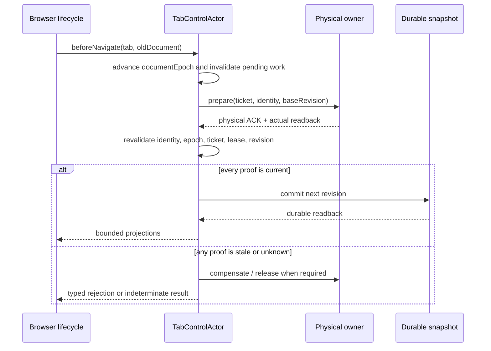
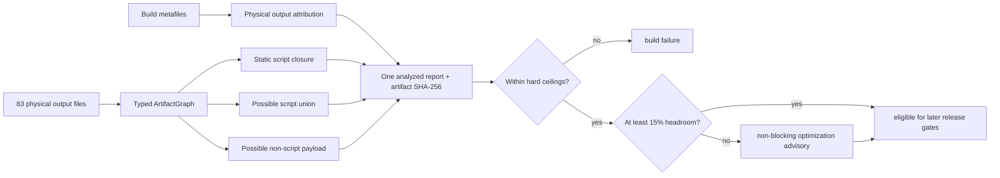

# SPECTRA runtime architecture

SPECTRA is a Chrome MV3 extension with explicit ownership across runtime contexts. Shared protocols/snapshots are in `@nexus/contracts`. Per-field behavior is in [control architecture](../control/README.md).

## Runtime ownership

| Context | Owns | Does not own |
| --- | --- | --- |
| Popup / Options | intent, local render, interaction | actual audio mode, direct storage, executor choice |
| Content, isolated | document identity, media registry, DOM/CSS writers, exact configured-site lean host, proven MediaElement WebAudio graph, Capture intent/readback projection | Capture construction, processor-active claims before physical readback, cross-tab hotkey target selection |
| MAIN bridges | fullscreen audio handoff, exact-element page-media getter/setter readback | generic dispatch, domain tables, cross-tab state |
| Background worker | routing, settings, snapshots, badge projection, runtime leases, per-document lean/full hotkey ownership and restart recovery | WebAudio nodes, optimistic UI |
| Unified offscreen host | actual Capture processors, authenticated remote sessions | direct document creation/closure |

`ControlSnapshot` owns actual media/video/DSP fields. `AudioSessionSnapshot` (keyed by document) owns processor mode/phase/config/error. Projections preserve this separation.


Every arrow is a validated port, not shared mutable state. UI and Remote submit intent; only the physical Content or offscreen owner can produce an actual-state fact, and only Background can commit that fact into the durable control model.

## Audio lifecycle

```text
mode: bypass | webaudio | capture
phase: idle | starting | active | stopping | error
```

Navigation/transition advances generation; late ACKs cannot update newer documents. Default is transparent bypass.
MediaElement WebAudio activates only after complete exact source coverage, running context, graph signature, normalized configuration, and source-count readback. Capture activates only after the offscreen host returns the equivalent tab-owned proof. Every transition neutralizes the candidate's competing route, verifies the candidate, switches ownership, and only then releases the previous owner; a failed handoff restores the last acknowledged owner. Content lifecycle events require the authoritative `documentId`, so a late event for an old document cannot mutate its replacement.

Revisioned Settings may pin a site to `direct` or `capture`; absence means
`auto`. `direct` never falls through from a failed page graph to Capture, while
`capture` remains only a preference and still requires a current one-shot
admission. Worker-restart projection replays the selected route to every
resident tab, and new Content pulls it with the additive
`spectra.audio.policy.get` request. The established
`spectra.audio.config.get -> AudioConfig` v2 response remains unchanged so old
resident Content and a new Background worker remain wire-compatible.

`audio-processor.contracts.ts` is the sole runtime owner of the processor DTO and
its exact guard. The full audio contract projects product configuration onto
that type, while the Offscreen protocol imports the leaf directly; Capture
startup therefore does not load persistence, migration, session, or page-native
audio validators that it cannot consume.



## Unified offscreen host

`offscreen.html` hosts Capture processors and remote sessions. `offscreen-coordinator.ts` exclusively owns `chrome.offscreen.createDocument()` / `closeDocument()`.

- Leases: `audio:<tabId>`, `remote:<sessionId>`
- Serialized creation/reconciliation/close decisions. Closes only after all leases released + 1-shot grace alarm.
- Remote controller is a deferred module. Status requests without runtime return an empty exact result. The first explicit session creation loads exactly one local `peerjs-vendor.js` ESM default export through the offscreen-local single-flight loader. That output is built from the same workspace-owned PeerJS 1.5.5-derived data-only source consumed by the checked-in Remote page: JSON serialization is mandatory, UTF-8 messages are capped at 16 KiB before parsing or sending, and MediaConnection, BinaryPack, Raw/binary serializers, package/CDN fallbacks, and global `Peer` ownership are absent. Capture-only work does not load the transport, and load timeout/disposal fences reject only the initiating request instead of installing a fallback.
- HELLO reconstructs processors/sessions after worker restart. Unresponsive hosts enter 30s grace.
- Content READY waits for Capture reconciliation to prevent duplicate Captures.

## MAIN bridges and page-native media semantics

No generic MAIN runtime or domain tables. Two version-guarded bridges own cross-world surface:
1. **Fullscreen V1**: Temporarily yields active audio pipeline around `requestFullscreen()`.
2. **Page-media V2**: Synchronously reads/writes `volumeBase`, `mediaMuted`, `speed` for exact target.

Page-media discovery walks composed-ancestors. Matches require paired getter/setter. Mismatch restores baseline. Admits one `dom-native` fallback before ownership. Bridge retains no controller, domain table, or polling loop.

Content creates a lazy isolated-world `AudioContext` only when a visible analyser or explicit DSP demand has complete proven coverage for every current media element. The controller owns one page-lifetime source binding per element, never mutates CORS state, and disconnects on element/runtime disposal. Page volume/mute remain native fields. Capture remains the complete-tab fallback; leaving either processor first acknowledges a transparent configuration before releasing its physical owner.

Physical Capture keeps an explicit `targetTabId` so an async transition can never capture whichever tab happens to become focused later. The manifest therefore owns `activeTab` together with `tabCapture`: a user action or registered Chrome command grants temporary authority for that exact active page, while Background still rechecks tab/document/generation before and after stream-ID acquisition. Programmatic Popup opening, page activity, restore, Remote, and background-tab work cannot manufacture that grant.

## Settings and hotkey target state

Background owns revisioned settings in `chrome.storage.local`. Revisions are written to physical storage before broadcast.
Per-tab control session is stored in `chrome.storage.session` (`tabId+documentId+origin+resourceUrl`), containing 20 refresh-restorable fields.

Settings commit and settings projection are separate authorities. A mutation ACK means the exact revision is durable and readable by a replacement worker; it does not claim every open tab has already observed the projection. `settings-projection.ts` owns one revision-coalescing queue for extension, Content, hotkey, shortcut, and restore projections. It preserves global/hotkey lanes while selecting the newest snapshot, retries real delivery failures on `50/200/800 ms`, records the last projected revision only after those lanes settle, and wakes from a Chrome alarm after a deferred failure. A destroyed or non-resident Content receiver is terminal for that document because its successor pulls the durable snapshot during bootstrap. Tab work is bounded to eight concurrent deliveries, and hotkey reconciliation reuses the already-enumerated tab snapshot. Global OSD, visualizer, language, and theme projection is presentation-only and never re-enters audio policy.

The `volume`, `volumeBase`, and `boost` fields form one canonical value object. Partial site/preset merges combine the validated patch with existing state before one canonicalization pass, so changing only base or boost cannot persist a contradictory effective volume.

| Patch source | Updates current-resource | Updates origin-portable |
| --- | --- | --- |
| Page observation | yes | removes those fields |
| Popup / remote / shortcut ACK | yes | yes |

Resource URL canonicalization:
- Same URL, new `documentId`: complete patch
- Same-origin, diff URL: origin-portable patch only
- Cross-origin: both retired

A separate monotonic per-tab record owns Action-badge stickiness, surviving worker replacements. The session-scoped global hotkey target is owned by `hotkey-target-repository.ts`; it is independent from media identity and never selects or activates an audio processor.

## Media discovery and identity

Content maintains media through an event-driven registry. Registration does one viewport-geometry seed. Deduplicated on same-document navigation. Every element independently receives native configuration upon registration/play/selection; the registry never binds an audio graph.
Passive bootstrap may do bounded top-level getter. Background captures `volumechange`/`ratechange`, submits complete actual pairs without media identity.

## Runtime loading and shortcuts

Manifest loads minimal isolated bootstrap + closed MAIN bridges. Heavy Content runtime is acquired via consumer tokens. Final consumer releases listeners. Cold-document built-in hotkeys use READY ensure and release their transient capability after the admitted operation.
Offscreen events keep Chrome message channel open until Background settles, preventing suspension mid-event.

Built-in chords (`Alt+Arrow*/Alt+M`) are reserved, claimed at `document_start` before page handlers. Configured-site bindings yield to website claims. Keyup clears unconsumed repeat pulses but cannot revoke an admitted press. `chrome.commands` admits only non-coalescing actions.

### Load-time package integrity

Injected entrypoints — `content-runtime.js` (via `chrome.scripting.executeScript`), the manifest `content_scripts` files, and `background.js` — must physically exist in the loaded unpacked package. A package missing them produces one linked symptom chain: `Could not load file: 'content-runtime.js'` in the service worker; persistent `mediaInventoryPartial` in the Popup (no content bootstrap means no media probe); and `Effective volume requires an observable page or standard native volume` (no runtime means no `volumeBase` readback). Normal builds cannot emit a partial `dist/`: the build finishes with a `statSync` size check on every entry and fails on a missing outfile, and watch mode restores each entrypoint's last good output on a failed rebuild while printing an explicit `✗` instead of dropping the file silently. A partial package is therefore external mutation (interrupted build or manual cleanup). Two guards cover the residual paths: `bun run check:dist` validates that every build entrypoint and manifest-referenced file physically exists (exit 1 with the missing list otherwise), and `bun run build:dev` rebuilds the package before reloading the unpacked extension.

### Configured-site lean hotkeys

A configured site may avoid a document-lifetime heavy Content Runtime hotkey lease only when **every live binding** is exactly page-default-equivalent: `speed_up`, `speed_down`, `volume_up`, `volume_down`, or `volume_mute`, with no custom parameters. Disabled, explicit no-op, or otherwise unavailable bindings do not own runtime work. One live non-equivalent binding makes the entire site `full`. The most-specific configured domain is authoritative: an explicitly disabled child suppresses an enabled parent rather than falling through.

Ownership is split into three layers:

1. `site-hotkey-loader-adapter.ts` resolves URL + settings into `none | lean | full` and owns exact heavy-listener suspend/resume projection.
2. `site-hotkey-owner.ts` is the sole Background owner for one `tabId+documentId`. It serializes reconciliations and owns Worker epoch/configuration generation, injection single-flight, lifecycle fencing, and full capability bookkeeping.
3. `content-site-hotkeys.js` is the minimal isolated-world physical input host. It has no settings authority and accepts only exact document configuration.

The exact lean configuration message is:

```text
spectra.content.site-hotkeys.configure
{ epoch, generation, bindings }
```

Rules:

- Every ownership transition starts with an exact **empty lean barrier**. A confirmed missing receiver means the document is already lean-empty. Any other transport/protocol failure is fail-closed.
- For `lean` or `none`, Background then sends an exact-document heavy `spectra.hotkeys.changed` projection with `sites:{}` before releasing any remembered hotkey lease or enabling lean. The heavy runtime may remain resident for restore/observation/control without retaining configured-site keyboard ownership.
- A broad real `spectra.hotkeys.changed` settings publication happens **before** ownership reconciliation. It updates heavy settings, but it is never lean-host configuration authority; the later exact suspend/resume projection determines heavy configured-site ownership for that document.
- A surviving lean host from a previous MV3 worker ACKs the new worker's empty barrier. A new Worker epoch supersedes the old epoch even when its numeric generation restarts lower.
- After injection, a nonempty lean projection must receive the exact `{epoch,generation}` ACK. Missing receiver after successful injection is an error, not a safe no-op.
- The lean host exposes a revision-2 read-only `active` marker in the same isolated-world realm. `getActiveHotkeySettings()` projects `sites:{}` while that marker is active. This physical fence prevents a transient heavy runtime loaded for control/feedback from claiming configured-site repeats during the READY-to-exact-suspend window.
- Per-document transitions serialize across HELLO, settings, History/navigation and lifecycle races. `forget()` increments the lifecycle token without deleting in-flight work; every async continuation proves the same lifecycle before publishing another side effect. A stale full ensure releases the capability it acquired.
- Lifecycle tombstones remain only while an injected host, full capability, injection promise, or transition is observable; retired idle keys are removed.

### Sender-document execution, repeat, and feedback

Lean bindings reuse the existing `spectra.content.default-hotkey.trigger` request with one additional validated disposition:

```text
{ action, phase, gesture, repeated, disposition: 'site-page' }
```

Absent `disposition` retains shipped default/global-hotkey-target semantics. `site-page` bypasses `hotkeyTargetRepository`; Background validates the sender and constructs `origin:'site-page'` with `foreground` and `target` equal to that exact top-level `tabId+documentId`.

The lean host owns only physical gesture admission and identity. Background owns bounded repeat coalescing (`runPageGestureBurst`); completion never self-drains queued pulses, and release discards unconsumed repeats. `volume_mute` is non-repeatable but still preserves the physical repeated fact through release.

Feedback reuses the existing scalar gesture channel and transient shortcut runtime. The same gesture is replayed to the heavy feedback owner if it loads after the first press, so speed/volume/mute retain actual OSD behavior. RPC failures use the existing Content toast. The transient runtime is released after the action/feedback path settles; this is not a document-lifetime hotkey lease.

The lean host survives BFCache `pagehide` when `event.persisted === true`: it releases held gestures but keeps its exact host/listeners in the retained realm. A real page retirement disposes it. Extension-context invalidation also disposes the host so stale code cannot keep calling `preventDefault()` after messaging becomes unavailable.

### MV3 worker-restart heavy-runtime recovery

A service-worker restart loses Background's in-memory runtime leases while an old heavy Content Runtime may survive in a page. `runtime-restart-startup.ts` is wired from the Background entry and recovers each current HTTP top document in this order:

1. exact runtime-status probe;
2. if a current-revision heavy runtime survived, acquire a fixed temporary `worker-restart-recovery` lease through the normal runtime loader;
3. reconstruct source ownership from `ownedSources`;
4. reconstruct the canonical restore capability from the exact tab-session identity/resource hostname;
5. reconcile current configured-site hotkey ownership (`none | lean | full`);
6. release only the temporary recovery lease.

Actual orphan disposal remains inside the normal runtime-loader lease authority, which rechecks concurrent/transient leases before sending RELEASE. Restore/hotkey reconstruction failure deliberately retains the temporary safety lease. Both per-document failures and discovery failures (settings/tab enumeration) use the same bounded retry schedule: `250 ms`, `1 s`, `4 s`. If no heavy runtime survived, recovery does not create one merely because a persistent restore plan exists.

This model removes document-lifetime heavy **hotkey ownership** for eligible sites. It does not promise that an admitted control operation or another independent consumer can never load the heavy runtime transiently.

## Remote control

Optional, capability-bound, authenticated. Requires an HMAC-SHA-256 nonce challenge. Allowlisted commands are bound to `sessionId + sessionEpoch + commandId + sequence + tabId + generation`. Offscreen is the sole live session/Peer owner; Background serializes admitted commands per session and revalidates the dispatch ticket after every await. Receipt retention and recovery are bounded, and a delayed connection/open/close callback cannot retire a newer Peer.

Remote generation advances in Background only after the authoritative offscreen host accepts the exact state. The host caches accepted state while unauthenticated or disconnected and sends it in the authenticated handshake; a hard send rejection leaves the last accepted generation unchanged, so the next command for that generation is not silently consumed. Out-of-order acknowledgements may advance but never regress accepted generation.

Runtime RPC `source` is a claim, never authority by itself. Popup and page sources must match their physical sender; page mutations require the exact current top document; `remote` and `system` are internal-only and are rejected from runtime messages. The retired Content legacy mutation adapter no longer relabels itself as Popup.

## Protocol and envelope ownership

The content-runtime v3 release line has one SPECTRA envelope owner. `@nexus/contracts`
owns the typed `SpectraRequestEnvelope` / `SpectraEventEnvelope` schema and runtime
validators. Common envelope/RPC primitives live in `spectra.protocol-primitives.ts`;
canonical Background route guards live in `spectra.background-runtime.ts` and are reused
by the generic protocol. `background-rpc.ts` owns only the allowlist derived from the
routes Background actually registers. It does not copy payload fields, DTOs, error
codes, or the full protocol table. `shared/spectra-client.ts` owns general request
construction, delivery, and response validation. Focused UI clients are typed transport
facades, not alternate protocol owners. The wire value remains the single
`SPECTRA_PROTOCOL_VERSION` contract constant, including for the minimal document-start
bootstrap boundary.

That constant versions the extension-internal RPC only. The authenticated
Remote transport has its own v3 protocol/version owner. Diagnostic errors must
name the endpoint and request type; a generic “Peer returned invalid v2” message
is forbidden because it hides whether Background or Content violated which
route contract.

A top-level `action:` message object is the retired V1 runtime protocol and is forbidden
in every production sender. `action` may occur only inside a validated hotkey payload
(`payload.action`), where it is a domain value carried by the typed envelope. The retired
kernel action table, `createRouter` / `router.on` / `router.listen`, and
`GLOBAL_SETTINGS_UPDATE` are not SPECTRA runtime paths. Listeners own exact request-type
sets and reject unknown or malformed envelopes before a handler sees them.

## Boundary projections

Favicon/QR are UI/security boundaries, not media capabilities. Exact-element, PiP, fullscreen bridge semantics handled separately.

## Production performance budgets

`scripts/check-production-artifacts.ts` is the executable owner. Its graph accepts only manifest/HTML/CSS references, static imports, deferred imports, declared runtime-loader edges, and the explicit vendor-module edge. An arbitrary string cannot make a file reachable.



Terms are deliberately non-interchangeable:

- **Physical output bytes** are bytes of one file on disk, counted once in total JS/dist. `outputAttribution: measured` means build metafiles assigned emitted bytes to their producing inputs; `not-measured` is explicit and cannot support module-contribution claims.
- **Static script closure** is the set-union of JavaScript reachable without a deferred/runtime edge from an entry. It is a loading-topology measurement, not parsed heap or CPU time.
- **Possible script union** adds every admitted deferred/runtime/vendor JavaScript edge and counts each file once. It is an upper bound on code the surface can request over its lifetime, not startup residency, simultaneous residency, or memory use.
- **Possible non-script payload** is the same possible closure's bytes excluding JavaScript, such as reachable locale assets. **Possible payload** is possible script plus those non-script bytes.
- Residency, CPU, IPC, allocation, and latency claims require a named Chrome scenario trace. Artifact reachability alone cannot prove them.

The integrated Windows production analysis for the current local v1.4.2 candidate produced artifact SHA-256 `6504eedd91e19794b8c94694583c808ec5e15adf750f72e3b474596e8a44ecf3`, `84/84` reachable files, zero byte-identical duplicates, `outputAttribution: measured`, 618,332 JavaScript bytes, and 709,960 total bytes:

| Executable surface | Current bytes | Hard ceiling | 85% target max | Status |
| --- | ---: | ---: | ---: | --- |
| Service-worker wake | 231,774 | 262,144 | 222,822 | headroom deficit 8,952 |
| `document_start` | 19,704 | 24,576 | 20,889 | within target by 1,185 |
| Content bootstrap static script | 12,496 | 14,336 | 12,185 | headroom deficit 311 |
| Lean site-hotkey static script | 9,693 | 11,264 | 9,574 | headroom deficit 119 |
| Offscreen Capture-only script | 20,127 | 28,672 | 24,371 | within target by 4,244 |
| Offscreen Remote possible script | 50,505 | 73,728 | 62,668 | within target by 12,163 |
| Popup static script | 106,668 | 147,456 | 125,337 | within target |
| Popup possible script | 133,790 | 155,648 | 132,300 | headroom deficit 1,490 |
| Popup possible payload | 145,305 | informational | — | script plus reachable non-script assets |
| Content runtime possible script | 159,324 | 180,224 | 153,190 | headroom deficit 6,134 |
| Video-effects possible script | 10,444 | 12,288 | 10,444 | at target boundary |
| Options possible script | 34,146 | 40,960 | 34,816 | within target by 670 |
| Options possible payload | 43,655 | informational | — | script plus reachable non-script assets |
| Total production JavaScript | 618,332 | 696,320 | 591,872 | headroom deficit 26,460 |
| Total production artifact | 709,960 | 798,720 | 678,912 | headroom deficit 31,048 |

All hard ceilings pass; this proves the build is structurally valid. The 85% values are optimization targets, not release authority: deficits are reported as non-blocking advisories and may guide owner-local work, while only an exceeded absolute ceiling is a capacity failure. Hiding graph edges, weakening protocol guards, or relabelling possible closure as non-resident remains forbidden because it corrupts measurement rather than improving the product.

All tab-set operations use bounded concurrency. Settings and visualizer projection use eight workers, remote restoration uses four, and Capture/runtime-restart flows use their declared bounded fan-out owners. On failure, the fan-out owner stops admitting new items but waits for every live worker to retire before rejecting, so an immediate retry cannot overlap the previous generation and exceed the bound. A new tab-wide `Promise.all` is a release regression unless the owner proves a smaller physical bound.

Release and cross-platform lanes build the production SPECTRA candidate exactly once before Chrome integration. The build computes the analysis once, prints that same report, and binds its artifact hash; a second analysis of a changing directory is not equivalent evidence. `test:chrome:dist` consumes the receipt-bound existing `dist` when release orchestration supplies a CandidateReceipt. Standalone use requires a clean exact tree and creates a temporary receipt instead of accepting arbitrary ignored output. The developer convenience command `test:chrome` alone may prepend a development build. Capacity passes when every absolute ceiling passes in the matching receipt; 15% headroom remains advisory.

## Current implementation ownership

| Concern | Owner | Invariant |
| --- | --- | --- |
| Tab control order | `control-coordinator.ts` + pure `control-coordinator-values.ts` helpers | One serialized actor per tab; synchronous navigation fence; post-await identity/epoch/revision validation |
| Hotkey target persistence | `hotkey-target-repository.ts` | One serialized session-scoped tab target; stale tabs are cleared |
| Audio mode classification | `@nexus/contracts/audio.contracts.ts` + current registry evidence | `bypass`, proven `webaudio`, or admitted `capture`; neutral hidden work never acquires a processor |
| Capture admission | `capture-admission.ts` | One-shot document/worker fence expires or is consumed before acquisition |
| Processor lifecycle | `offscreen/audio-host.ts` + Capture handler | Only exact host ACK drives status |
| Cold native refresh | bootstrap/coordinator | Targetless 4-field obs; no badge-use fact |
| Built-in shortcut readiness | shared keyboard arbiter + transient READY lease | Exclusive ownership of 5 defaults; no document-lifetime default-hotkey lease |
| Configured-site lean ownership | `site-hotkey-owner.ts` + exact lean host + heavy projection adapter | Empty lean barrier; heavy exact suspend; revision-2 physical fence; sender-document execution |
| Worker-restart heavy recovery | `runtime-restart-startup.ts` + runtime-loader leases | Rebuild durable owners before orphan disposal; bounded retry; no direct RELEASE guess |
| Toast/OSD | Content feedback modules | One feedback owner on Popover; lean reuses existing gesture/feedback path |
| Page media semantics | page-media bridge/native executor | Exact-element readback, DOM fallback, no polling |
| PiP/fullscreen | fullscreen bridge/native executor | Actual native lifecycle preservation |
| Visualizer | Popup scheduler + subscriber registry + coordinator/Content demand lease | Only visible foreground card owns analyser demand; proven page WebAudio precedes exact-document Capture fallback; background cards are passive; bounded heartbeat/tombstone/release retry |
| Popup vertical geometry | `popup.css` + `views/navigation.ts` | Main view follows intrinsic card content; only `settings-view-active` owns the 600px settings viewport; navigation never writes inline height |
| Favicon/QR | Popup/remote renderers | Validated payload, no undeclared capability |
| Remote transport/session | `remote-site/vendor/peerjs.min.js` + `offscreen-remote/peerjs-loader.ts` + `remote-host.ts` | One workspace-owned JSON/DataChannel-only transport source, one lazy extension output, one Offscreen session/Peer owner, 16 KiB wire cap; epoch/command receipt/recovery remain bounded |
| UI event projection | `popup/ui-event-hub.ts` + surface/session stores | One Chrome runtime listener; subscriber isolation; identity/revision/session-token monotonicity |
| Locale assets | surface catalogs + `shared/i18n/locale-sections.ts` | Popup/Options/Actions fetch only their surface; settled loads clear; two-locale LRU bound |
| Artifact evidence | `scripts/check-production-artifacts.ts` | Typed reachability, exact set-union closures, one physical file count, measured attribution when metafiles exist, absolute hard ceilings plus non-blocking 15% planning advisories |

## Actual browser launch evidence

All SPECTRA Puppeteer launches use `scripts/browser-driver.ts`, which selects
the current or floor driver through the existing replay policy and records the
runtime version plus the actual spawned process command. In a formal release
context, each physical launch writes a separate receipt bound to the exact
head, tree, run and attempt. Repeated launches by one test owner receive stable
execution sequence numbers instead of overwriting or rejecting valid samples.

Receipts retain sanitized effective arguments and declared profile-construction
metadata, never a temporary profile path. An executable digest is informational
evidence derived from the process actually returned by Puppeteer. If that
process identity is absent or unreadable, the receipt says `unknown`; a user
override path cannot substitute for an observed launch identity.
