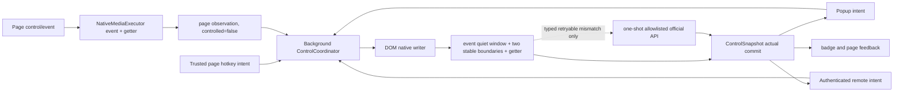

# SPECTRA control architecture

This document is the single owner for SPECTRA media, audio, video, site-adapter and remote-control behavior. Runtime code, protocol contracts, tests and static architecture checks must conform to it. Other documents may link here but must not restate control rules.

## Product semantics

- The webpage, Popup, authenticated remote controller and hotkeys are peers that submit intents to one coordinator.
- Every control field is planned independently. There is no page-wide native/WebAudio/Capture mode that may silently determine unrelated controls.
- The user interface never asks users to choose native, WebAudio, MAIN or Capture.
- `100%` volume and `1x` speed are literal values. They do not mean "release control". Releasing a field is a separate restore-page-settings intent.
- Every user surface exposes exactly one effective-volume value, `0–800%`. The
  coordinator alone splits it into page-native `volumeBase 0–100` and hidden
  processor `boost 1–8`; those implementation fields are never separate UX.
- A successful response describes read-back actual state. Storage acceptance, setter completion or a requested value echoed by the executor is not an application acknowledgement.

## Control flow and state ownership

Volume and speed use the same bidirectional transaction. The page is a peer,
not a lower-priority source, and no surface writes another surface's local
prediction:



`ControlSnapshot` is the only field-level actual authority. It owns the
acknowledged `volumeBase + boost` components that compile to effective volume,
plus mute, speed, transport, DSP parameters and video fields.
It carries separate `activeMedia` and `activeVideo` identities. Audio/transport
controls follow the former; screenshot, PiP, fullscreen and presentation
effects follow the latter. A playing audio element therefore cannot steal the
video side panel's target, and merely reading either target never changes the
other selection.
`AudioSessionSnapshot` contributes only processor lifecycle
(`desiredMode/actualMode/phase/generation/error`); Popup initialization and
session events must never use `actualConfig` to overwrite or fill control
fields. Page `volumechange` and `ratechange` observations commit exactly once
and never echo a second DOM write. A page-side volume gesture owns the new
public effective-volume value, so any non-neutral hidden Boost is reset to 1 in
the same coordinator transaction; otherwise a page move to 50% would be
misreported as `50 × previous Boost`.

Color is also actual state, not a value threshold. Muted/zero is gray; native
or Media WebAudio is blue; purple is permitted only when the matching
`AudioSessionSnapshot` has `actualMode:'capture'` and `phase:'active'` for the
same tab, document and origin. Its processor generation and the
`ControlSnapshot` field/document generation are independent monotonic clocks;
each stream rejects its own stale revisions instead of comparing unrelated
generation numbers. Starting, stopping, error and stale Capture sessions remain
blue. Popup, badge and authenticated remote consume the shared
`AudioVolumeState = silent | native | capture` projection, so numeric volume
thresholds cannot drift into color policy.

The concrete projection points are:

| Location | Ownership and purpose |
| --- | --- |
| `src/background/control-coordinator.ts` | serialize intents and commit the single actual snapshot |
| `src/content/logic/native-media-executor.ts` | sole standard-media writer; event/quiet/stable getter ACK and page observation |
| `src/content/core/media-registry.ts` | pure, independent active-media/active-video selection and source revision ownership |
| `src/popup/card/types.ts::initialControlConfig` | initialize fields from neutral defaults plus `ControlSnapshot` only |
| `src/popup/card/messaging.ts` | apply control revisions independently from audio lifecycle generations |
| `packages/contracts/src/audio.contracts.ts::resolveAudioVolumeState` | own the constant-time gray/blue/purple truth table and tab/document/origin lifecycle join |
| `src/popup/side-panel/video-controls.ts` | route every video operation to `activeVideo`, never to an audio-only `activeMedia` |
| `src/background/remote-commands.ts`; `remote-service.ts` | call the same serialized coordinator directly inside Background, cache a side-effect-free actual projection before authentication, then push only after HMAC succeeds; never self-RPC or predict a result |

## Strategy order

For each capability, the planner removes candidates that cannot cover the requested scope or cannot return actual readback, then follows that capability's own order. In this release the only official page-world adapter covers YouTube `volumeBase`, `mediaMuted` and `speed`, and it runs only after the corresponding standard DOM write/readback fails. No other capability may claim site-native support until its adapter and readback tests land with the contract entry.

```text
OBSERVE
  -> CAPABILITY-SPECIFIC NATIVE CANDIDATES
       (SITE_NATIVE / DOM_NATIVE / CHROME_NATIVE)
  -> CAPABILITY-AUDITED CONTROLLED AUGMENTATION
       (EXTENSION_STATE / CSS / OVERLAY / SAFE_MEDIA_WEBAUDIO / CAPTURE)
  -> UNSUPPORTED
```

`SITE_NATIVE` can use a document-scoped MAIN adapter when an official player object exists only in the page world and standard DOM control is incomplete. Current adapters are single-player `active-target` strategies and are never admitted for a `full` request. This is API adaptation, not permission for generic monkey-patching. There is no generic MAIN fallback.

### Forbidden generic MAIN behavior

Production code must not replace or redefine:

- `window.AudioContext` or `webkitAudioContext`;
- an `AudioContext` instance's `destination` or `close`;
- `window.Audio`;
- `document.createElement` or `createElementNS`;
- `HTMLMediaElement` prototype descriptors;
- History API methods from an isolated-world runtime.

MAIN execution is limited to allowlisted site adapters loaded on demand by the background `MainRuntimeManager`.

### Native, augmentation and forbidden hijack

The implementation must not hide invasive behavior under the word "native". Every selected strategy belongs to one of these classes:

| Class | Strategies | Meaning |
| --- | --- | --- |
| observe | `observe` | Read authoritative events/getters without acquiring control. |
| native | `site-native`, `dom-native`, `chrome-native` | Use an official site API or a browser-owned API/property with readback. |
| controlled augmentation | `extension-state`, `extension-css`, `extension-overlay`, `media-webaudio`, `capture` | Add a reversible extension-owned capability only when complete native control is unavailable. |
| unsupported | `unsupported` | Preserve the page and return a structured capability error. |

Generic constructor, prototype, descriptor, setter, `createElement`, History API and page-AudioContext interception are forbidden hijacks. They are not planner candidates. A controlled augmentation must have a bounded owner, actual readback, a disposer and a restore rule; otherwise it is unsupported.

### Strategy admission and performance gates

`CONTROL_STRATEGY_RULES` is the executable owner of these gates. A strategy is not admitted merely because a setter exists.

| Strategy | Required proof before selection | Idle/runtime cost | Disallowed escalation |
| --- | --- | --- | --- |
| `observe` | authoritative getter/event, or an explicit subscription to an already-active processor | zero; subscription uses the existing processor only | must not create a content runtime, AudioContext, offscreen lease or MAIN code on a read |
| `site-native` | allowlisted official player API, single capability writer and privileged one-shot `executeScript` getter result | one invocation per failed DOM intent; no listener, disposer or audio graph | cannot repeat the same DOM setter in MAIN, install a standing bundle or trust page-authored message payloads as ACK |
| `dom-native` | standard per-element property/method, target identity, bounded event/getter readback | write/event only | no prototype/descriptor patch and no user-activation workaround |
| `chrome-native` | Chrome API supports the exact scope and a Chrome getter/event confirms actual state | command/event only | no optimistic response before `tabs.get`, native event or operation result |
| `extension-state` | data belongs to SPECTRA and is keyed to document/media/source as required | zero while unowned; event/timer only while owned | cannot masquerade as page-native state |
| `extension-css` | extension-owned attribute/variable, computed-style readback and removal disposer | zero while neutral | cannot overwrite or restore guessed site inline styles |
| `extension-overlay` | extension-owned shadow host, geometry readback and complete disposer | one coalesced rAF only while visible/owned | cannot change the target's position/z-index or synthesize focus/hover |
| `media-webaudio` | every required source is proven eligible before irreversible binding, requested coverage is complete and graph actual state is readable | one lazy document context; only active DSP nodes | unknown CORS, silence, DRM or inaccessible media are not probeable fallbacks |
| `capture` | explicit intent, permission/activation, current-generation offscreen candidate and normalized processor ACK | one lazy offscreen processor while leased | cannot activate from a status read or replace a stable path before candidate commit |
| `unsupported` | every less-invasive complete strategy failed its admission gate | zero | preserve the page and return a structured error |

### Production loading topology and bundle ownership

Control completeness must not turn into default-page cost. The manifest loads
only `content-bootstrap.js`; its runtime imports come exclusively from
`@nexus/contracts/bootstrap`, a minimal protocol boundary that validates HELLO,
status, passive native read and release messages. It must not import the full
request map, the generic RPC client, the media registry or any control/DSP
executor. A target-bound or augmentation read returns
`content_runtime_not_loaded`, so Background acquires `content-runtime.js`
through the document lease/READY transaction instead of widening a passive
getter.

`build.mjs` keeps the bootstrap, main Content runtime and video-enhancement
Content artifacts isolated because Chrome injects them into page-specific
isolated worlds. The video artifact is a dynamic-URL web-accessible module but
is imported only after an explicit video enhancement intent. Background,
Popup, Options and offscreen are extension-origin ES modules and may share
deterministic production chunks; those private chunks are not web-accessible
resources. Development builds stay standalone for readable Chrome smoke
diagnostics.

The contracts, audio-engine and kernel packages declare `sideEffects:false`.
They are pure runtime libraries: this lets production tree shaking remove
unused barrel exports instead of charging every extension context for protocol
families it cannot execute. The architecture checker requires those package
flags so a metadata edit cannot silently reintroduce duplicated control code.

`scripts/check-production-artifacts.mjs` computes each entry's complete static
and dynamic dependency closure and the Background + bootstrap startup closure,
but it does not freeze historical byte ceilings. Its invariant is zero
avoidable production redundancy: every artifact must be reachable from the
manifest/HTML/CSS/module graph; byte-identical files, repeated modules within a
shareable build domain, bare or escaping imports, source/test/debug artifacts,
diagnostic calls and source-map references fail the build. Replication is
reported but allowed only across Chrome runtime domains that cannot share a
module instance. Current bytes and top module contributions remain measured
release evidence rather than an arbitrary product baseline.

Production property mangling is restricted by external ownership. Chrome API
dictionary keys, every emitted ESM export name and every versioned `__SPECTRA_*__`
cross-context singleton key are reserved before Terser processes the separate
files. Internal names may still shrink, but a caller chunk, Chrome API, injected
script or upgrade probe can never observe a renamed boundary key. The extracted
ZIP smoke is the executable proof for this post-bundle invariant.

### Failure-directed escalation

Escalation is decided from the failure of the attempted capability, never from
the hostname, a silent analyser, a timeout alone, or the page-wide audio mode.
The executable owner is `CONTROL_RETRYABLE_STRATEGY_FAILURES` /
`CONTROL_TERMINAL_STRATEGY_FAILURES` in `control.contracts.ts`.

| Failure class | Codes | Decision |
| --- | --- | --- |
| capability gap | `capability-unavailable`, `write-unsupported`, `readback-mismatch`, `coverage-incomplete`, `source-binding-ineligible`, `strategy-runtime-failed` | Dispose or bypass the failed candidate and try only the next strategy listed for that capability. |
| browser/security boundary | `user-activation-required`, `permission-denied`, `cors-or-drm-protected`, `protected-content`, `closed-shadow-inaccessible`, `stale-document`, `stale-media-source`, `policy-denied` | Stop. Return a structured error and preserve the stable path. MAIN or Capture must not disguise the boundary. |

The retryable flag in a wire error is descriptive; it cannot grant a strategy
that the capability policy does not list. In particular, `site-native` is not a
generic MAIN fallback, and Capture is not a fallback for activation, permission,
DRM or stale-target failures.

No strategy may bypass transient user activation, CORS, DRM or inaccessible closed-shadow media. `CONTROL_STRATEGY_RULES` fixes both flags to `false` for every current and future strategy.

## Complete control algorithm matrix

This matrix is exhaustive for the persisted fields and momentary operations exported by `control.contracts.ts`. Adding a UI button, hotkey, remote command or protocol action without first adding or mapping an entry here is an architecture violation.

### Persistent and observable fields

| Capability | Required scope | Selection order | Acknowledgement and fallback |
| --- | --- | --- | --- |
| Audio enabled | document | coordinator state expansion | Expands to per-field acquire/release intents; it is never a page-wide processing mode. |
| Internal native component `volumeBase 0–100` | target or all requested media | `HTMLMediaElement.volume` -> allowlisted official getter/setter only after proven DOM write/readback or coverage failure | DOM uses `volumechange` plus getter; the one-shot official path uses a bounded quiet window plus stable getter. A genuine page gesture also neutralizes a stale hidden Boost in the same commit. Capture is never this field's writer. |
| Internal processor component `boost 1–8x` | explicit full audio output | safe shared Media WebAudio -> Capture | Gain-node/processor readback; native volume is never raised above 100%. This field has no independent UI and target-only requests fail rather than widening to the tab. |
| Media mute | target or all requested media | `HTMLMediaElement.muted` -> allowlisted official API only after proven DOM write/readback or coverage failure | DOM uses `volumechange`; the official path uses a bounded quiet window plus stable getter. Numeric volume is preserved and Capture is never this field's writer. |
| Tab mute | tab | `chrome.tabs.update({muted})` | `tabs.onUpdated`/`tabs.get` readback; never aliases media mute. |
| Playback speed | active target | `playbackRate` -> site API when DOM coverage is incomplete | DOM uses `ratechange` plus getter; the one-shot official path uses a bounded quiet window plus stable getter and installs no persistent MAIN interception. |
| Preserve pitch | active target | standard `preservesPitch` property only | Property/getter readback; unsupported when the property is absent. |
| Playing | active target | awaited standard `play()`/`pause()` only | `playing`/`pause` event; autoplay rejection is returned, not bypassed. |
| Current time | active target | seekable standard media timeline only | Clamp to `TimeRanges`; acknowledge `seeked` and getter, never setter return. |
| Whole-media loop | active target | standard `HTMLMediaElement.loop` only | Getter/readback; does not share state with A/B. |
| Picture-in-Picture | active video | standard Picture-in-Picture API only | enter/leave event and `pictureInPictureElement`; no user-activation workaround. |
| Fullscreen | active video | standard Fullscreen API only | `fullscreenchange` and `fullscreenElement`; no synthetic gesture or site-adapter claim. |
| Rotation | active video | extension CSS individual `rotate` | Computed-style readback; remove only extension owner state. |
| Mirror | active video | extension CSS individual `scale` | Computed-style readback; never overwrite the site's `transform`. |
| Fill/crop | active video | extension `object-fit:cover` owner rule | Computed `object-fit`; disabling removes the owner attribute. |
| Filter enabled/values | active video | extension CSS filter composition | Computed-style readback; compose without replacing source inline style. |
| Dim enabled/opacity | active video | extension closed-shadow four-region overlay | Overlay geometry/opacity readback; never rewrite video position or z-index, and switching the dim target preserves every independent effect still owned on the previous video. |
| A/B state | `mediaId + sourceRevision` | extension state + native seek executor | Points validate `0 <= A < B`; boundary seek ACK updates the same target only. |
| Tab pinned | tab | `chrome.tabs.update({pinned})` | `tabs.onUpdated`/`tabs.get` readback. |
| EQ / Bass / Compressor / Mono / Pan / Delay | explicit full audio output | safe shared Media WebAudio -> Capture | Processor parameter/topology readback; Capture is the only opaque full-output fallback and target-only requests fail before activation. |
| Visualizer subscription | existing processor only | analyser tap on active processor | Per-Popup `subscriberId + generation` lease; 5-second heartbeat expiry and bounded tombstone prevent abnormal-exit leaks or delayed-message resurrection. The last live subscriber releases the analyser and cannot create an AudioContext or Capture lease. |

### Momentary and compound operations

| Operation | Native-first algorithm | Controlled augmentation or result |
| --- | --- | --- |
| Restore page settings | coordinator releases each owned field | Restores captured per-target baselines; does not translate 100%/1x into release. |
| Effective volume `0–800` | compile current actual, split desired value, use DOM/official native volume first | Within `0–100`, write only native base; within `100–800`, write only hidden Boost; crossing 100 writes both in one rollback-capable coordinator transaction. An identical actual value performs zero Content IPC, revision and storage work. |
| Play/pause toggle | read actual state, then execute the `playing` field plan | Commits only the resulting play/pause event. |
| Relative seek | resolve target and seekable ranges, then execute `currentTime` | Structured unavailable/not-seekable result. |
| Frame step | source-scoped cadence evidence followed by a standard DOM seek | Reuses a recent `requestVideoFrameCallback` cadence or measures bounded consecutive rendered frames while playing; always reports `approximate:true`. A paused source with no cached cadence is unsupported rather than guessed. |
| Screenshot | Chrome `captureVisibleTab` plus verified active-video geometry | A short content-owned capture token is checked before and after browser capture against the same document/source/geometry. There is no second path; protected/hidden/zero-size/unavailable or moving targets return structured errors. |
| Marker add/remove/list | extension state keyed by media/source | No page write. Label and count are bounded. |
| Marker jump/previous/next | marker lookup then native seek plan | Uses the same `currentTime` ACK path. |
| A/B skip | native seek to the verified end boundary | Uses the same target and source revision as the loop. |
| Audio reset | one atomic per-field patch | Returns effective volume to 100%, neutralizes owned DSP and media mute, and releases hidden Boost. Playback speed and pitch preservation are read only as processor context and are never written by reset. |
| Video effects toggle/reset | one atomic patch for extension-owned video fields | Never touches native playback/audio state or site-authored CSS. |
| Show info | snapshot read | Side-effect-free OSD projection. |
| Open Popup/Options | Chrome extension UI APIs | The operation itself only opens browser UI. A rendered foreground Popup may then acquire an observation-only document lease for live page-to-Popup synchronization; that lease never admits MAIN, AudioContext or offscreen processing. |
| Run user script | explicit `userScripts` permission and sandbox | Not a media strategy and never promoted to MAIN adapter access. |
| Open URL | browser navigation with `http/https` allowlist | Not a media strategy; invalid schemes fail closed. |

### Disabled legacy algorithms

- Pitch shift hotkeys remain disabled because preserve-pitch is not pitch shifting and no pitch DSP exists.
- `capture_toggle` is a transport implementation leak. Existing bindings migrate to disabled legacy diagnostics.

### Surface action normalization

UI labels and protocol commands are aliases of the 51 canonical capabilities,
not additional executors. `HOTKEY_ACTION_DESCRIPTORS` exhaustively maps every
persisted hotkey, including disabled Pitch/Capture legacy actions.
`REMOTE_COMMAND_DESCRIPTORS` does the same for every authenticated phone
command; its values are the only owner of remote step sizes.

Each hotkey descriptor also owns one feedback policy. `actual-osd` means the
field executor renders acknowledged effective-volume/speed state;
`handler-result` means the operation handler renders its semantic result;
`listener-label` permits one generic post-ACK label; `none` is silent. The
listener may not maintain a second action list or add a toast for another
owner. This prevents volume/speed and Marker/A-B actions from producing two
success notifications.

| Remote command family | Canonical capability and transform |
| --- | --- |
| `volume_up/down`, `volume_100`, `volume_max` | `effective-volume`: `+10/-10/set 100/set 800`, clamped `0–800` |
| legacy `boost_up/down/reset/max` | aliases of `effective-volume`: `+10/-10/set 100/set 800`; retained for one release and never exposed as a second state |
| `mute` | `mediaMuted`: toggle; numeric effective volume is preserved |
| `play_pause` | `playback-toggle` |
| `seek_forward/backward*` | `seek-relative`: signed `10s/30s` delta |
| `speed_up/down/reset` | `speed`: `+0.25/-0.25/set 1` |
| `fullscreen`, `pip` | native-only `fullscreen` / `pip` toggle |

Every surface must submit the descriptor's canonical intent. A surface may
coalesce deltas for responsiveness, but it cannot choose another native/MAIN,
CSS, WebAudio or Capture executor.

The current shared media graph and Capture processor both own full output, not a
single selected source. Therefore `audioEnabled`, hidden Boost and every DSP field are
accepted only with `requestedCoverage:'full'`. This is checked again in the
content runtime before configuration mutation, so a malformed/internal
active-target request cannot silently widen itself into whole-tab Capture.

### Per-capability native and augmentation ledger

This ledger is deliberately one row per contract capability. `CONTROL_ALGORITHM_ADJUDICATIONS` is its executable owner. `native-only` means no CSS, processor, Capture or generic MAIN fallback exists. `hybrid-extension-native` means extension-owned state performs only bounded selection or estimation before the standard DOM API remains the sole page writer. `augmentation-only` means the product capability has no equivalent page/browser primitive; it does not grant generic interception. Every row preserves zero idle work unless the final column names an owned, subscribed or post-binding browser lifetime.

The exhaustive result is 17 native-only capabilities, six hybrid
extension/native capabilities, 26 augmentation-only capabilities and two
observation-only capabilities. These counts are release-gated: changing a
capability family requires changing the executable adjudication, its source
algorithm anchor, the mirror below and the contract tests in the same commit.

| Contract capability | Native adjudication | Controlled augmentation admission | Success proof and performance boundary |
| --- | --- | --- | --- |
| `audioEnabled` | augmentation-only; there is no page-wide native mode | coordinator-owned session gate only | gate ACK plus expanded actual state for every dependent DSP field; disabling marks retained DSP settings idle and releases all runtime work |
| `volumeBase` | native-only: DOM `volume` first, then a complete official player API if DOM cannot write/read back | none; whole-tab output gain is a different capability and Capture cannot impersonate the page slider | DOM `volumechange` plus getter, or official quiet-window stable getter; no audio runtime for `0–100` native control |
| `boost` | augmentation-only; native volume cannot exceed 100% | proven safe shared media graph, otherwise authorized full-tab Capture | normalized processor gain readback; graph/offscreen exists only while Boost is non-neutral |
| `effective-volume` | hybrid-extension-native: one public value uses DOM/official native base first | hidden Boost is admitted only for the portion above 100 through safe Media WebAudio or acknowledged Capture | one compound ACK returns effective/base/Boost actuals; same-region changes touch one writer, threshold crossings compensate both, repeated actual values do no IPC or persistence |
| `mediaMuted` | native-only: DOM `muted` first, then a complete official player API if DOM cannot write/read back | none; Media WebAudio and Capture are never mute writers or mirrors | official stable getter or `volumechange` getter; numeric volume remains unchanged |
| `tabMuted` | native-only through Chrome tab state | none | `tabs.get`/tab event readback; event-driven only |
| `speed` | native-only: DOM `playbackRate` first, then an official player rate only after proven DOM incompleteness | none | `ratechange` getter or official quiet-window stable getter; no reassert loop |
| `preservePitch` | native-only through standard DOM `preservesPitch` | none | property/getter readback; unsupported rather than echoed intent |
| `playing` | native-only through awaited standard media `play`/`pause` | none | `playing`/`pause` event plus getter; activation rejection is terminal |
| `currentTime` | native-only through a seekable standard media timeline | none | `seeked` plus getter on the same media/source revision |
| `loop` | native-only through standard DOM `loop` | none | authoritative getter; no A/B state alias |
| `pip` | native-only through the standard Picture-in-Picture API | none | enter/leave event and `pictureInPictureElement`; no gesture synthesis |
| `fullscreen` | native-only through the standard Fullscreen API on the selected video | none | `fullscreenchange` and `fullscreenElement`; no CSS fullscreen claim |
| `rotation` | augmentation-only; no implemented native or official adapter exists | reversible extension CSS individual `rotate` | computed style; a never-owned neutral write is DOM-free, while owner removal restores the captured cascade |
| `mirrored` | augmentation-only; no implemented native or official adapter exists | reversible extension CSS individual `scale` | computed style; site `transform` is never replaced |
| `fill` | augmentation-only; no implemented native or official adapter exists | extension-owned `object-fit` rule | computed style; disabling removes ownership rather than guessing a restore value |
| `filterEnabled` | augmentation-only; no implemented native or official adapter exists | reversible composed CSS | computed style; no work while disabled |
| `filter` | augmentation-only; no implemented native or official adapter exists | reversible composed CSS | captures the computed site baseline at acquisition and composes it with SPECTRA values; disabling removes ownership and reveals the site's current cascade |
| `dimEnabled` | augmentation-only; no page/browser dim primitive | extension-owned closed-shadow four-region overlay | overlay geometry readback; one coalesced frame only while enabled; target handoff releases only the previous dim owner and preserves its independent CSS effects |
| `dimOpacity` | augmentation-only; part of the owned dim layer | same owned overlay only | computed/owned opacity readback; no overlay while dim is disabled |
| `abLoop` | augmentation-only metadata; boundary motion still uses native seek | media/source-keyed extension state | coordinator state plus native seek ACK; one scheduler only while enabled |
| `tabPinned` | native-only through Chrome tab state | none | `tabs.get`/tab event readback; event-driven only |
| `eqValues` | augmentation-only; no complete native EQ primitive | proven safe shared media graph or authorized explicit full-tab Capture | processor topology/parameter readback; neutral bands allocate no filters |
| `bass` | augmentation-only; no complete native bass primitive | proven safe shared media graph or authorized explicit full-tab Capture | processor topology/parameter readback; disabled node is absent |
| `compressor` | augmentation-only; no complete native compressor primitive | proven safe shared media graph or authorized explicit full-tab Capture | topology readback; candidate-lane crossfade only during changes |
| `mono` | augmentation-only; no complete native mono primitive | proven safe shared media graph or authorized explicit full-tab Capture | processor matrix/topology readback; disabled splitter/merger path is absent |
| `pan` | augmentation-only; no complete native pan primitive | proven safe shared media graph or authorized explicit full-tab Capture | panner readback; neutral panner is absent |
| `delay` | augmentation-only; no complete native delay primitive | proven safe shared media graph or authorized explicit full-tab Capture | `0–500ms` processor readback; zero delay node is absent |
| `visualizer` | observation-only | explicit subscription to an already-active processor only | subscription state; never creates a graph, Capture lease or hidden Popup IPC |
| `restore-page-settings` | augmentation-only coordinator operation | release each extension-owned field; native fields restore captured baselines through their sole successful writer | site-native baselines survive service-worker restart in session storage; final per-field ACK releases all leases/disposers |
| `playback-toggle` | native-only: observe `playing`, then execute its native plan | none | resulting native play/pause event, not toggle request echo |
| `seek-relative` | native-only: compute against actual time/seekable ranges | none | same native seek ACK used by direct time control |
| `frame-step` | hybrid-extension-native: extension cadence estimation selects an approximate delta, then standard DOM seek remains the only writer | at most eight `requestVideoFrameCallback` observations for the current media/source; require at least three valid deltas and use their median | `seeked` readback and mandatory `approximate:true`; stable samples may finish early, VFR uses the bounded median, and a paused uncached source is unsupported rather than guessed |
| `screenshot` | Chrome-native visible-tab capture, verified crop and completed download ACK | none; browser capture is not DOM/MAIN interception | active/visible geometry, current frame and download-complete readback; no image crosses extension IPC |
| `marker-add` | augmentation-only metadata | bounded media/source-keyed extension state | coordinator snapshot; zero recurring work |
| `marker-remove` | augmentation-only metadata | bounded media/source-keyed extension state | coordinator snapshot; zero recurring work |
| `marker-jump` | hybrid-extension-native: extension state selects one same-source marker, then standard DOM seek is the only writer | bounded marker lookup keyed by media/source | same-source native seek ACK |
| `marker-jump-previous` | hybrid-extension-native: extension state performs a binary predecessor lookup, then standard DOM seek is the only writer | bounded marker lookup keyed by media/source | same-source native seek ACK; no linear full-list scan |
| `marker-jump-next` | hybrid-extension-native: extension state performs a binary successor lookup, then standard DOM seek is the only writer | bounded marker lookup keyed by media/source | same-source native seek ACK; no linear full-list scan |
| `ab-set-a` | augmentation-only media/source-keyed state | bounded A/B state plus one scheduler only after both points are valid | operation result; no page write until an enabled loop reaches B |
| `ab-set-b` | augmentation-only media/source-keyed state | bounded A/B state plus one scheduler only after both points are valid | operation result; rejects `B <= A` and stale source identity |
| `ab-clear` | augmentation-only state release | dispose the owned timer/video-frame callback and remove the same-source points | operation result; recurring work is zero before ACK |
| `ab-skip` | hybrid-extension-native: extension state selects B from the same-source loop, then standard DOM seek is the only writer | bounded A/B state lookup only | same-source native seek ACK |
| `audio-reset` | augmentation-only coordinator compound operation | atomically neutralize/release owned audio fields | per-field snapshot ACK; the native base/media mute writers restore effective volume 100 while hidden Boost is released; speed, pitch preservation and video state are untouched |
| `video-effects-toggle` | augmentation-only coordinator compound operation | acquire/release only extension-owned video fields | per-field computed/overlay readback; no native playback writes |
| `video-effects-reset` | augmentation-only coordinator compound operation | remove only extension-owned CSS/overlay state | restored current cascade readback; zero idle work |
| `show-info` | observation-only | none | authoritative snapshot projection; status read acquires no runtime lease |
| `open-popup` | native-only Chrome extension UI operation | none | operation result; no content runtime |
| `open-options` | native-only Chrome extension UI operation | none | operation result; no content runtime |
| `run-user-script` | augmentation-only sandbox operation | explicit `userScripts` permission and isolated sandbox only | sandbox operation result; never inherits site-adapter MAIN authority |
| `open-url` | native-only browser navigation | none | HTTP(S)-validated operation result; no content emulation |

#### Executable adjudication mirror

This compact mirror is checked against both `CONTROL_ALGORITHM_ADJUDICATIONS`
and `CONTROL_ALGORITHM_POLICIES`. The descriptive ledger above owns the
reasoning; this table prevents prose from silently changing strategy order,
MAIN admission, ACK evidence or the lifetime of recurring work.

| Capability | Native preference | Augmentation admission | Ordered strategies | MAIN policy | ACK evidence | Recurring work |
| --- | --- | --- | --- | --- | --- | --- |
| `audioEnabled` | `augmentation-only` | `extension-owned-capability` | `extension-state` | `forbidden` | `coordinator-snapshot` | `none` |
| `volumeBase` | `native-only` | `none` | `dom-native -> site-native` | `site-adapter-only` | `dom-event-getter + official-stable-getter` | `none` |
| `boost` | `augmentation-only` | `proven-safe-source-or-explicit-full-output` | `media-webaudio -> capture` | `forbidden` | `processor-readback` | `page-lifetime-after-media-binding` |
| `mediaMuted` | `native-only` | `none` | `dom-native -> site-native` | `site-adapter-only` | `dom-event-getter + official-stable-getter` | `none` |
| `tabMuted` | `native-only` | `none` | `chrome-native` | `forbidden` | `chrome-event-getter` | `none` |
| `speed` | `native-only` | `none` | `dom-native -> site-native` | `site-adapter-only` | `dom-event-getter + official-stable-getter` | `none` |
| `preservePitch` | `native-only` | `none` | `dom-native` | `forbidden` | `dom-stable-getter` | `none` |
| `playing` | `native-only` | `none` | `dom-native` | `forbidden` | `dom-event-getter` | `none` |
| `currentTime` | `native-only` | `none` | `dom-native` | `forbidden` | `dom-event-getter` | `none` |
| `loop` | `native-only` | `none` | `dom-native` | `forbidden` | `dom-stable-getter` | `none` |
| `pip` | `native-only` | `none` | `dom-native` | `forbidden` | `dom-event-getter` | `none` |
| `fullscreen` | `native-only` | `none` | `dom-native` | `forbidden` | `dom-event-getter` | `none` |
| `rotation` | `augmentation-only` | `extension-owned-capability` | `extension-css` | `forbidden` | `computed-style` | `none` |
| `mirrored` | `augmentation-only` | `extension-owned-capability` | `extension-css` | `forbidden` | `computed-style` | `none` |
| `fill` | `augmentation-only` | `extension-owned-capability` | `extension-css` | `forbidden` | `computed-style` | `none` |
| `filterEnabled` | `augmentation-only` | `extension-owned-capability` | `extension-css` | `forbidden` | `computed-style` | `none` |
| `filter` | `augmentation-only` | `extension-owned-capability` | `extension-css` | `forbidden` | `computed-style` | `none` |
| `dimEnabled` | `augmentation-only` | `extension-owned-capability` | `extension-overlay` | `forbidden` | `overlay-readback` | `while-owned` |
| `dimOpacity` | `augmentation-only` | `extension-owned-capability` | `extension-overlay` | `forbidden` | `overlay-readback` | `while-owned` |
| `abLoop` | `augmentation-only` | `extension-owned-capability` | `extension-state` | `forbidden` | `coordinator-snapshot + dom-event-getter` | `while-owned` |
| `tabPinned` | `native-only` | `none` | `chrome-native` | `forbidden` | `chrome-event-getter` | `none` |
| `eqValues` | `augmentation-only` | `proven-safe-source-or-explicit-full-output` | `media-webaudio -> capture` | `forbidden` | `processor-readback` | `page-lifetime-after-media-binding` |
| `bass` | `augmentation-only` | `proven-safe-source-or-explicit-full-output` | `media-webaudio -> capture` | `forbidden` | `processor-readback` | `page-lifetime-after-media-binding` |
| `compressor` | `augmentation-only` | `proven-safe-source-or-explicit-full-output` | `media-webaudio -> capture` | `forbidden` | `processor-readback` | `page-lifetime-after-media-binding` |
| `mono` | `augmentation-only` | `proven-safe-source-or-explicit-full-output` | `media-webaudio -> capture` | `forbidden` | `processor-readback` | `page-lifetime-after-media-binding` |
| `pan` | `augmentation-only` | `proven-safe-source-or-explicit-full-output` | `media-webaudio -> capture` | `forbidden` | `processor-readback` | `page-lifetime-after-media-binding` |
| `delay` | `augmentation-only` | `proven-safe-source-or-explicit-full-output` | `media-webaudio -> capture` | `forbidden` | `processor-readback` | `page-lifetime-after-media-binding` |
| `visualizer` | `observation-only` | `existing-processor-only` | `observe` | `forbidden` | `subscription-state` | `while-subscribed` |
| `restore-page-settings` | `augmentation-only` | `extension-owned-capability` | `extension-state` | `forbidden` | `coordinator-snapshot` | `none` |
| `effective-volume` | `hybrid-extension-native` | `proven-safe-source-or-explicit-full-output` | `dom-native -> site-native -> extension-state -> media-webaudio -> capture` | `site-adapter-only` | `dom-event-getter + official-stable-getter + processor-readback` | `none` |
| `playback-toggle` | `native-only` | `none` | `dom-native` | `forbidden` | `dom-event-getter` | `none` |
| `seek-relative` | `native-only` | `none` | `dom-native` | `forbidden` | `dom-event-getter` | `none` |
| `frame-step` | `hybrid-extension-native` | `extension-owned-capability` | `dom-native` | `forbidden` | `dom-event-getter` | `none` |
| `screenshot` | `native-only` | `none` | `chrome-native` | `forbidden` | `operation-result` | `none` |
| `marker-add` | `augmentation-only` | `extension-owned-capability` | `extension-state` | `forbidden` | `coordinator-snapshot` | `none` |
| `marker-remove` | `augmentation-only` | `extension-owned-capability` | `extension-state` | `forbidden` | `coordinator-snapshot` | `none` |
| `marker-jump` | `hybrid-extension-native` | `extension-owned-capability` | `dom-native` | `forbidden` | `dom-event-getter` | `none` |
| `marker-jump-previous` | `hybrid-extension-native` | `extension-owned-capability` | `dom-native` | `forbidden` | `dom-event-getter` | `none` |
| `marker-jump-next` | `hybrid-extension-native` | `extension-owned-capability` | `dom-native` | `forbidden` | `dom-event-getter` | `none` |
| `ab-set-a` | `augmentation-only` | `extension-owned-capability` | `extension-state` | `forbidden` | `operation-result` | `none` |
| `ab-set-b` | `augmentation-only` | `extension-owned-capability` | `extension-state` | `forbidden` | `operation-result` | `none` |
| `ab-clear` | `augmentation-only` | `extension-owned-capability` | `extension-state` | `forbidden` | `operation-result` | `none` |
| `ab-skip` | `hybrid-extension-native` | `extension-owned-capability` | `dom-native` | `forbidden` | `dom-event-getter` | `none` |
| `audio-reset` | `augmentation-only` | `extension-owned-capability` | `extension-state` | `forbidden` | `coordinator-snapshot` | `none` |
| `video-effects-toggle` | `augmentation-only` | `extension-owned-capability` | `extension-state` | `forbidden` | `coordinator-snapshot` | `none` |
| `video-effects-reset` | `augmentation-only` | `extension-owned-capability` | `extension-state` | `forbidden` | `coordinator-snapshot` | `none` |
| `show-info` | `observation-only` | `none` | `observe` | `forbidden` | `coordinator-snapshot` | `none` |
| `open-popup` | `native-only` | `none` | `chrome-native` | `forbidden` | `operation-result` | `none` |
| `open-options` | `native-only` | `none` | `chrome-native` | `forbidden` | `operation-result` | `none` |
| `run-user-script` | `augmentation-only` | `extension-owned-capability` | `extension-state` | `forbidden` | `operation-result` | `none` |
| `open-url` | `native-only` | `none` | `chrome-native` | `forbidden` | `operation-result` | `none` |

### Native versus interception adjudication for every algorithm

The two matrices above are exhaustive: 28 persistent snapshot fields plus 23 momentary
operations. The following adjudication explains when each family stays native,
when controlled augmentation is admitted, and which apparent fallback is
forbidden. It is normative together with `CONTROL_ALGORITHM_POLICIES`.

The exhaustive totals are part of the review result, not a loose summary:

- **17 native-only** capabilities may use only standard DOM, an allowlisted
  official player API, or a Chrome/browser API. A failure never promotes them
  to CSS, WebAudio, Capture or generic MAIN interception.
- **6 hybrid-extension-native** capabilities combine a native writer with
  bounded extension-owned coordination. Five source/timeline operations still
  end in standard DOM seek; effective volume adds hidden processor gain only
  above the native ceiling and never exposes the implementation split.
- **26 augmentation-only** capabilities have no implemented equivalent native primitive.
  They are admitted only to their named extension-state, overlay, safe media
  processor, authorized full-output Capture or sandbox owner; this category is
  not permission for generic page interception.
- **2 observation-only** capabilities may read a snapshot or an already-owned
  analyser subscription and must never acquire a writer or processing lease.

These four sets total all 51 contract capabilities. Any future capability must
enter exactly one set through `CONTROL_ALGORITHM_ADJUDICATIONS`, receive its own
ordered strategy/readback/lifetime policy, and add the exact mirror row above
before compilation and architecture verification can pass.

| Capability family | Native completeness test | Controlled augmentation admission | Forbidden hijack/fallback |
| --- | --- | --- | --- |
| Audio enable/restore/reset | no page primitive; expand one coordinator transaction into owned fields | `extension-state` only, releasing or neutralizing each owned field with readback | page-wide mode flags, optimistic badge/UI state, starting audio on a read |
| Effective volume and media mute | one public `0–800` value compiles to native base plus hidden Boost; mute remains a separate native boolean | Boost above 100 uses proven safe shared Media WebAudio, otherwise acknowledged Capture; mute has no processor fallback | Capture inferred from value, simultaneous native writers, changing numeric volume to implement mute, page AudioContext destination interception |
| EQ, Bass, Compressor, Mono, Pan, Delay | no complete browser-native primitive | proven safe shared Media WebAudio; otherwise authorized Capture when full/opaque scope is requested | binding unknown cross-origin media as a probe, generic MAIN DSP, silent-output CORS inference |
| Tab mute and pin | Chrome API write plus `tabs.get`/event readback | none | content DOM emulation or optimistic Chrome ACK |
| Speed and pitch preservation | speed may fall back to the implemented YouTube official API; pitch preservation is standard DOM-only | none beyond the registered speed adapter | prototype/setter patching, default-speed reassert loops, echoing requested pitch as actual |
| Play/pause, seek, whole-media loop | awaited standard media operation on the resolved media/source only | A/B and markers may own metadata, but their jumps still call the same native seek executor | nonexistent site-adapter promises, autoplay/activation bypass, direct timeline writers in helpers, hard-coded frame rate presented as exact |
| PiP and fullscreen | standard browser API plus native event/getter only | none | nonexistent site-adapter promises, synthetic hover/focus, fabricated user activation, CSS theater mode reported as fullscreen |
| Rotate, mirror, fill and filters | no implemented native candidate in this release | reversible extension-owned CSS attributes/variables with computed-style readback; Filter captures a baseline because CSS has no additive Filter primitive | hypothetical site-native entries without an adapter, inline-style replacement, guessed restoration, claiming dynamic site Filter composition while owned, MAIN style patching |
| Dim background | no native primitive | four-region closed-shadow overlay while owned, with one coalesced geometry frame | mutating target `position`/`z-index`, permanent observer/rAF, fullscreen audio reapply |
| A/B and markers | native media time/readback is used only for the final seek | extension state keyed by `mediaId + sourceRevision`, bounded scheduler only while A/B is enabled | document-global state, direct `currentTime` writes, timers/listeners after release |
| Visualizer | observe an existing processor only | analyser tap while explicitly subscribed | creating WebAudio/Capture for visualization, per-card IPC/rAF, analyser allocation per sample |
| Screenshot | verified Chrome `captureVisibleTab` crop for the visible active video | no fallback after browser capture/readback failure | canvas-from-media CORS probing, DRM patching, image IPC, or claiming success before download completion |
| Open UI/URL, tab actions | Chrome/browser primitive and operation result | none | content emulation, unvalidated URL schemes |
| User script | no media-native primitive | explicit userScripts sandbox and permission only | sharing site-adapter MAIN authority or treating arbitrary script execution as a control strategy |
| Show info and all getters | authoritative snapshot/getter observation | none | acquiring runtime, observer, MAIN, AudioContext, offscreen lease or writer ownership |

Every individual capability still follows its own row in
`CONTROL_ALGORITHM_POLICIES`; sharing a family in this explanation never permits
one field's strategy to select a page-wide mode for another field.
- Frame stepping must not retain the fixed `1/30s` approximation as an asserted exact result.
- `fx_toggle`, resets and other compound actions expand into typed field intents; they never bypass the planner.

#### Algorithm entry points and implementation anchors

The 51 capabilities intentionally do not all enter through `ControlPatch`.
`CONTROL_FIELDS` contains 28 snapshot fields and `CONTROL_OPERATIONS` contains
23 momentary operations. Of the fields, `CONTROL_DIRECT_FIELDS` contains the 26
ordinary patch/read/mutation fields. `abLoop` can change only through the typed
`ab-*` operations, and `visualizer` can change only through its subscription
protocol. Runtime validation rejects either field in an ordinary patch before
an executor runs. This distinction prevents a valid algorithm from drifting
into a generic unsupported path merely because it is represented in the shared
snapshot.

The following locations are normative implementation anchors. A change that
moves responsibility must update this list, the executable matrices, tests and
`check-spectra-control.js` in the same commit.

| Location and symbol | Owned decision | Purpose / drift prevented |
| --- | --- | --- |
| `packages/contracts/src/control.contracts.ts::CONTROL_DIRECT_FIELDS` and validators | Which snapshot fields may use direct patch/read/mutation | Keeps A/B operations and Visualizer subscriptions out of generic field execution. |
| `packages/features/audio-engine/src/CapabilityPlanner.ts::plan` | Per-capability ordered strategy and admission | Requires explicit full coverage for the current shared Media WebAudio graph; neither safe media nor Capture may widen an active-target DSP intent. |
| `src/content/logic/audio-runtime-control-delegate.ts::createAudioRuntimeControlDelegate` | Full-output DSP intent compilation and actual field expansion | Defines `audioEnabled` as a coordinator session gate, exposes dependent startup errors, and reports dependent fields idle on disable without deleting saved values. |
| `src/background/main-runtime-manager.ts::applyMainSiteControl` | One allowlisted MAIN setter/getter call | Captures official pre-write and post-write values without installing a bridge, wrapper, listener or descriptor patch. |
| `src/background/control-coordinator.ts::applySiteNativeFallback` and `restoreSiteNativeFields` | Site-native baseline lifetime and restore ordering | Persists the first official baseline by tab/document/generation, absorbs exact reflected events, restores through the same writer and prevents DOM restore from competing. |
| `src/background/control-coordinator.ts::applyChromeTabObservation` | Browser-side tab mute/pin observation | Absorbs events reflected by the coordinator's own Chrome write and publishes genuine Chrome UI changes as `controlled:false`, so Popup/remote stay synchronized without polling. |
| `src/content/logic/native-media-executor.ts::releasePageSettings` | DOM/CSS/overlay release | Skips fields owned by a successful official adapter and removes only extension-owned presentation state. |
| `src/content/core/media-registry.ts::refreshSource` and `fullscreenListener` | Media/source identity and page-side fullscreen observation | Reused elements emit logical remove/register around `sourceRevision`; removed-source owners dispose immediately, while fullscreen enter/exit is attributed to the actual media rather than whichever target was previously active. |
| `src/content/video/video-effects-controller.ts::apply` and `assertOwnerReadback` | Reversible CSS/overlay ownership | Positive effects require computed/overlay readback; disabling rotation, scale, fill and filter requires owner attributes and variables to be absent before ACK. |
| `src/content/logic/control-operation-executor.ts::executeControlOperation` | Contract-scoped target resolution and momentary operation truth | `active-video` operations resolve the independent video registry target while media/source operations resolve active media; missing marker/media/A-B targets reject instead of returning an `ok` envelope with a false action result. |
| `src/background/control-coordinator.ts::executeFieldOperation` | Compound operation transaction | Playback, seek, video toggle/reset and audio reset require every relevant field phase to be `applied` before returning operation success. |
| `packages/contracts/src/control.contracts.ts::isControlStrategyAdmittedForCapability` and ACK validators | Capability-specific cross-process strategy admission | Reject a known strategy name when it belongs to another capability, so stale or drifting executors cannot report Capture volume, CSS fullscreen or extension-state screenshot success. |
| `packages/contracts/src/spectra.ui-runtime.ts::SPECTRA_UI_REQUEST_TYPES` and `SPECTRA_UI_EVENT_TYPES` | Closed protocol surface for Popup, Options and remote UI | The 23 request types and six event types are explicit tuples. UI clients are compile-time limited to that subset; success, error and event envelopes reuse canonical control/settings/audio/remote validators. `test/ui-runtime-contract.spec.ts` proves parity and rejects internal types even when they carry a syntactically valid shared error. |

`audioEnabled.actual` is derived from the requested configuration and actual
processor state. A neutral enabled configuration may report `true` while the
runtime remains `bypass`, because no processor is required. When any non-neutral
Boost/DSP field is requested, `audioEnabled.actual` becomes `true` only after a
Media WebAudio or Capture processor returns complete actual readback. Processor
startup failure reports `audioEnabled.actual:false`, `phase:error` together with
the failing DSP field; no desired value is copied into actual state.

### Complete hotkey algorithm mapping

`HOTKEY_ACTION_DESCRIPTORS` is exhaustive for every persisted shortcut. It maps the UI label to a canonical field/operation, repeat policy, parameter schema and activation requirement before a handler is exposed.

| Shortcut family | Exact mappings | Repeat/activation decision |
| --- | --- | --- |
| Playback | `play_pause -> playback-toggle`; each `seek_*_5s/10s/30s -> seek-relative`; each `seek_frame_* -> frame-step` | seek/frame deltas coalesce at 20 Hz; play toggle ignores repeat and preserves the trusted key event for native `play()` |
| Speed | `speed_up/down/reset/set -> speed` | up/down coalesce at 20 Hz; reset/set ignore repeat; `speed_set` requires validated parameter |
| Volume | `volume_up/down/set -> effective-volume`; `volume_mute -> mediaMuted` | up/down/set accept `0–800`, coalesce at 20 Hz and use the same atomic split as Popup/remote; identical values are dropped before IPC; mute ignores repeat |
| Audio DSP | `audio_reset -> audio-reset`; legacy `gain_up/down/reset -> effective-volume`; `delay_* -> delay`; `pan_* -> pan`; `mono_toggle -> mono` | gain aliases no longer own product state; continuous deltas coalesce at 20 Hz; resets/toggles ignore repeat |
| Video | `fullscreen_toggle -> fullscreen`; `pip_toggle -> pip`; `rotate_cw/ccw -> rotation`; `mirror_toggle -> mirrored`; `screenshot -> screenshot`; `dim_background -> dimEnabled` | PiP/fullscreen/screenshot require a real user-activation-capable entry and never escalate around rejection; screenshot is single-fire |
| Timeline | `marker_add -> marker-add`; `marker_jump_prev/next -> marker-jump-previous/next`; `ab_set_a/b/clear -> abLoop`; `ab_skip -> ab-skip`; `loop_toggle -> loop` | jumps/skips coalesce; state mutations and loop toggle ignore repeat and remain bound to media/source identity |
| Effects | `fx_toggle/reset -> video-effects-toggle/reset` | one typed compound patch; ignores repeat |
| Tab | `tab_pin -> tabPinned`; `tab_mute -> tabMuted` | Chrome-native readback; ignores repeat |
| Utility | `show_info -> show-info`; `open_popup/options -> open-popup/options`; `run_js -> run-user-script`; `open_url -> open-url` | single operation; script/URL require validated parameters and URL is limited to HTTP(S) |
| Legacy/no-op | `pitch_up/down/reset`, `capture_toggle -> disabled-legacy`; `none -> no-op` | existing bindings migrate disabled; Capture remains automatic and Pitch DSP remains outside scope |

## Audited source algorithms and dispositions

`CONTROL_ALGORITHM_POLICIES` in `packages/contracts/src/control.contracts.ts` is the executable form of the two matrices above. It is an exhaustive `Record<ControlCapability, ControlAlgorithmPolicy>` containing scope, algorithm kind, ordered strategies, ACK source, MAIN policy and recurring-work rule. `CapabilityPlanner` must consume that record instead of maintaining a second set of field lists. Adding a field or operation without a policy is a compile failure.

The following audit records the source present at the start of this redesign and
the landed disposition. Deleted locations are intentionally retained as
historical evidence and are labelled retired; normative current ownership lives
in the implementation-anchor tables above and below. Locations identify symbols
rather than relying only on line numbers, so the rationale remains useful as
files move.

### Audio and processing algorithms

| Current source/symbol | Current algorithm | Decision and target algorithm |
| --- | --- | --- |
| retired `src/content/audio/dom-volume.ts::applyToElement`; retired mode-local native writers | Wrote both `volume` and `muted`, then could also write a site API and processor. | Replaced with one selected native writer. `volumeBase` writes only site API or `media.volume`; `mediaMuted` writes only site API or `media.muted`. `AudioProcessorConfig` has neither mute nor zero-gain admission: its only level field is `boostGain: 1–8`. |
| `src/popup/card/events.ts::handleVolume`; `hotkey-helpers.ts::sendVolumeAction/sendAudioAdjustment`; `remote-commands.ts::executeCommand` | Historically gave Popup, hotkeys and remote different native/Boost delta rules. | All surfaces now submit one typed `effective-volume 0–800` operation. Only the coordinator splits internal base/Boost writers; legacy gain/Boost actions are aliases. |
| `src/injector/webaudio-hijack.ts` | Replaces `AudioContext`, redirects `destination`, creates booster plus an implicit limiter and supports only volume for future contexts. | Remove from production. It cannot prove existing-context coverage or ACK mute/EQ/other DSP. Known official page-player objects use a capability adapter; opaque output uses Capture. No implicit limiter remains. |
| retired `packages/features/audio-engine/src/webaudio/node-factory.ts::createAudioGraph` | Created gain, Bass, compressor, analyser, ten EQ nodes, panner and delay for every media element, including neutral features. | Replaced by `AudioGraphRouter`: one document mix graph; one page-lifetime source per safe media; only non-neutral nodes exist. Neutral state is a transparent route with no DSP nodes. |
| `WebAudioController::attachNode` and retired `cors-checker.ts` | Previously set `crossOrigin` after source selection, irreversibly bound, then inferred CORS from analyser silence. | Current controller proves resource eligibility before `createMediaElementSource`. Same-origin or pre-load verified CORS may bind; unknown cross-origin goes directly to Capture. Silence is never a CORS test. |
| `WebAudioController::applyParamsToNode`; `offscreen/audio-host.ts::applyConfig` | Gain is `volume/100`; Mono mutates master `channelCount`; Bass is +10 dB at 200 Hz; ten peaking filters use Q 1.4; compressor is fixed; panner and delay are permanent. | Master media route is `nativeBase × boost`. Bass and non-zero EQ keep their existing explicit parameters. Mono becomes `M=.5L+.5R; L'=R'=M`; Pan follows Mono; Delay is 100% wet `0–500ms`. Disabled nodes are physically absent. |
| `setCompressorEnabled/setCompressorPath` | Physically bypasses compressor, but rewires the active route immediately. | Retain physical bypass; topology changes build a candidate lane and about 40 ms **linear constant-gain-sum** crossfade before releasing the old lane, preventing clicks and double gain. |
| retired Capture startup sequence; current `offscreen/audio-host.ts::startCapture` | The old path disposed the stable processor before the candidate was connected and returned no normalized graph readback. | Current candidate connects and reaches `running`, commits only after `AudioGraphRouter` returns `generation`, `controlRevision`, `phase`, `contextState`, `graphSignature` and `normalizedActualConfig`; the old processor is released afterward. Failed candidates preserve the last stable processor. |
| `getVisualizerData/getVisualizerFrame`; `popup/visualizer/loop.ts`; `background/visualizer-subscriber-registry.ts` | The retired path let graph cleanup and a global tab set own analyser lifetime, so one Popup could release another and bypass could leave a 15 Hz wake-up loop. | One generation-aware subscriber token owns each lease; Background aggregates tokens, Popup schedules at most one in-flight batch, and render/visibility changes explicitly wake or stop it. A master analyser tap exists only while subscribed to an already-active processor. Graph cleanup never owns the subscription, and Visualizer never starts WebAudio/Capture. |

The canonical standard-media formula is:

```text
nativeGain = volumeBase / 100
nativeMuteGate = mediaMuted ? 0 : 1
processorBoost = processorExists ? boost : 1
effectiveOutput = nativeGain * nativeMuteGate * processorBoost
```

`volumeBase` and `mediaMuted` are resolved before the processor boundary through
their sole native writer. The processor wire contract exposes only
`boostGain: 1–8`; it cannot encode page volume, mute or a zero-gain substitute.
For Capture over otherwise controllable media, native volume/mute remain the
page-visible base and Capture applies Boost/DSP only. Mixed or opaque
page-AudioContext output cannot make a page slider represent the entire tab
mix; the snapshot must report `coverage: opaque` and must not claim the page UI
is synchronized to opaque output.

### Media, video and timeline algorithms

| Current source/symbol | Current algorithm | Decision and target algorithm |
| --- | --- | --- |
| `media-utils.ts::getPrimaryVideo`; `media-control.ts::getMedia` | Repeated area scans/100ms cache select the largest video and omit audio from transport. | `MediaRegistry` is the only target resolver. Stable `mediaId + sourceRevision`, trusted interaction, play recency and cached intersection determine a sticky active media without command-time layout scans. |
| `media-control.ts::setSpeed/applySpeed`; `media-observer.ts` | Site API, isolated DOM, generic MAIN message and new-media observer can all write playback rate; preserve-pitch is echoed without durable state. | One writer: `playbackRate` first, with the implemented YouTube official API only after DOM failure; `preservesPitch` remains DOM-only. ACK follows the matching getter/event. New media restoration goes through the same executor and revision. |
| retired `media-control.ts::togglePlay` | Controlled only the largest video and reported play success before the `play()` promise settled. | Current executor targets the active `HTMLMediaElement`; it awaits `play()`, the `playing`/`pause` event and stable getter. Autoplay rejection is a structured result and never a MAIN fallback. |
| `media-control.ts::seekVideo`; direct writes in `hotkey-helpers.ts`, `ab-loop.ts`, `time-marker.ts` | Clamps against duration only, hardcodes frame step to 1/30 s and has several `currentTime` writers. | One seek executor clamps to `seekable` ranges and ACKs `seeked`. Relative seek, markers and A/B call it. Frame step uses measured video timing and always marks approximation. |
| retired `media-control.ts::togglePip`; retired fullscreen/focus-recovery helpers | Used native APIs but converted errors to false and fired synthetic hover/focus retries. | Current executor keeps the standard DOM APIs only, has no synthetic event retry, ACKs native enter/leave events and exposes user-activation/disabled/unsupported errors. |
| `video-transform.ts::apply/toggleCrop`; `video-filter.ts::apply` | Overwrites site inline `transform`, `objectFit` and `filter`, then restores guessed values such as `none`/`contain`. | Extension-owned attributes, CSS variables and individual `rotate`/`scale`; disable by removing ownership. Computed-style readback confirms results while the current site cascade remains intact. |
| `video-filter.ts::toggleDimBackground` | One global overlay changes the video's `position` and `z-index`. | Closed-shadow four-region overlay around the selected video. Resize/scroll work is rAF-coalesced only while enabled; no site layout style is changed. |
| retired `video-transform.ts::takeScreenshot` implementation | Used `toDataURL`, base64 IPC, no origin/DRM distinction and incorrect rotated dimensions. | Current `video-transform.ts` only verifies the active frame/geometry and requests one Chrome `captureVisibleTab` crop. Background returns metadata only after download completion; hidden, zero-size, protected and unverified frames fail explicitly. |
| `ab-loop.ts` | Global state, coarse `timeupdate`, direct seek and no source/navigation disposer. | State is per media/source. Maintain at most one boundary timer; near B use `requestVideoFrameCallback` for video, then the unique seek executor. Disabled loop has zero timer/rAF/listener. |
| `time-marker.ts`; marker helpers | Global unbounded array, linear previous/next and direct seek on whichever video is currently largest. | Per media/source bounded sorted markers, `crypto.randomUUID`, binary search and the unique seek executor. Audio targets are supported. |
| `HTMLMediaElement.loop` writes in hotkey helpers | Correct native primitive but video-only and unacknowledged. | Apply/read back `loop` on the active audio or video target; A/B remains a separate extension-owned field. |

### Entry, synchronization and site-adapter algorithms

| Current source/symbol | Current algorithm | Decision and target algorithm |
| --- | --- | --- |
| Popup card update, content hotkey helpers, Chrome commands and `remote-commands.ts` | Four entry paths read different stale state, use different steps and call different RPCs; remote pulls three state sources after each command. | Every entry emits a typed intent to `ControlCoordinator`. Relative operations are calculated serially against its latest snapshot. All surfaces consume snapshot push; no command-triggered stale re-pull. |
| `remote-commands.ts::executeCommand/syncState`; `remote-service.ts::createSessionOnce/restoreSessions` | Background previously sent `chrome.runtime.sendMessage` to its own MV3 Service Worker and waited for the coordinator listener, a delivery pattern Chrome does not guarantee; the first authenticated controller could receive an auth ACK but no state. | Background calls exported serialized coordinator functions directly. Session create/restore performs one bounded actual read and stores the sanitized projection in offscreen before authentication; the host sends nothing while unauthenticated and emits the cached state immediately after HMAC success. Cross-context callers continue to use protocol v2. |
| retired `volume-observer.ts::settingByPlugin`; retired YouTube bridge caches | Correlated echoes with booleans/time windows, so page events could be dropped or stale writes mistaken for user changes. | Current executor uses per-target/per-field pending token `{intentId, revision, expected, tolerance}`. Matching events ACK the write; non-matching trusted/native events become page intents. |
| `NativeMediaExecutor::handleMediaEvent`; `ControlCoordinator::applyPageObservation` | A native page event used to be submitted as an intent and routed back to Content, causing a redundant DOM write and false ownership. | A verified native event/getter commits actual state directly with `controlled:false`, increments the shared revision and publishes one snapshot. It never re-enters an executor. An exact event reflected by the current site-native writer is absorbed without another revision. `loop` reuses the active MutationObserver because it has no DOM event; `preservesPitch` is read on `ratechange` and explicit status/control readback because no independent event exists. No polling or descriptor patch is admitted. |
| retired `site-bridge/youtube-bridge.ts`; `injector/youtube-adapter.ts` | The old standing adapter used raw page messages, listeners and DOM reassertion, allowing concurrent writers. | Delete the standing bridge. After a precise DOM failure, Background may execute one allowlisted YouTube setter/getter in MAIN for `volumeBase`, `mediaMuted` or `speed`; the same invocation reads the pre-write baseline and actual result. Background persists the first baseline by document/generation, restores it through the same official API and explicitly excludes the losing DOM writer. No page listener survives. |
| `hotkey-listener.ts` | Permanent document listener and linear binding scan; repeat policy is implicit; handlers return void before async result. | Install only for configured sites, compile bindings to a key map, declare repeat/coalescing/user-activation policy in the action descriptor, and return the coordinator result. Toggle actions ignore repeat. |
| retired runtime-coexistence phase; current `runtime-loader.ts` and manifest bootstrap | During migration the lazy loader temporarily coexisted with legacy runtime writers. | Landed: reads remain bootstrap-only and side-effect free. Explicit control/restored non-default state acquires one document runtime lease; READY handshake replaces sleeps. Last lease disposes observers/listeners. |

The rows above preserve the migration rationale, not live dual paths. Release is blocked unless static checks prove every retired writer symbol and generic MAIN path is absent from production reachability.

### Source algorithm adjudication catalog

Capability policy answers what a user may control; the source algorithm catalog
answers how the implementation may calculate, route, observe or mutate it. The
executable owner is
`scripts/verify/spectra-control-algorithm-catalog.mjs`, deliberately outside all
extension bundles. `check-spectra-control.js` verifies every source/symbol
anchor, the decision/admission/lifetime vocabulary, sequential IDs and complete
coverage of all 51 capabilities. A source move, new algorithm or changed owner
therefore requires the catalog, this table and the implementation to change in
one release-gated commit.

The catalog boundary is every production unit reachable from a control surface
(page, Popup, authenticated remote, hotkey or Chrome lifecycle) that selects a
strategy, calculates a target/value, mutates native or extension state, observes
actual state, synchronizes a consumer, owns a lease/disposer, or gates a
privileged boundary. Small value-formatting helpers outside those paths are not
separate control algorithms. Under that definition the inventory contains 50
source algorithms, including the cross-cutting state, identity, observation,
handoff and bundle-admission algorithms that the earlier 34-row implementation
catalog did not name separately.

`pure-computation` and `intent-routing` have no page mutation authority.
`observation-only` may subscribe only to an existing native/owned source.
`native-control` may call only the named DOM/Chrome/official API.
`hybrid-state-native` may calculate or store a target, but the final page write
still uses the canonical native executor. `controlled-augmentation` and
`lifecycle-orchestration` may own only the explicitly named extension resource;
neither class admits a constructor/prototype/descriptor/createElement/History
or page-AudioContext interception. The one `site-adapter-only` entry is the
bounded official player call after a retryable DOM failure.

| Algorithm ID | Source algorithm | Decision | Native / controlled-augmentation judgment | Success and performance boundary |
| --- | --- | --- | --- | --- |
| `ALG-001` | Per-capability planner | pure computation | Selects only a capability-owned candidate; never executes or grants a fallback. | One bounded candidate pass per intent; coverage and admission are part of the result. |
| `ALG-002` | Cross-process ACK admission | pure computation | Rejects known strategy names when the exact field/operation does not admit them. | Constant policy lookup at every snapshot/apply/operation boundary. |
| `ALG-003` | Standard media writer/readback | native control | `HTMLMediaElement`/PiP/Fullscreen APIs only; native failure cannot become CSS/WebAudio/Capture/MAIN. | Temporary event/getter window on the same media/source; a matching getter without the required event is not an ACK; no retained work. |
| `ALG-004` | Allowlisted official player fallback | native control | One official YouTube API invocation only after retryable DOM failure; this is the sole MAIN admission. | Reads official before/actual values in the invocation and leaves no bridge/listener. |
| `ALG-005` | Chrome tab mute/pin | native control | Chrome `tabs.update` plus browser getter/event only. | One write/get pair; later synchronization reuses Chrome events. |
| `ALG-006` | Audio session gate | lifecycle orchestration | Extension state may acquire/release an admitted processor, but cannot write native media fields. | Neutral configuration allocates nothing; dependent actual/error fields prove startup. |
| `ALG-007` | Processor-needs predicate | pure computation | Boost/EQ/Bass/Compressor/Mono/Pan/Delay share one predicate; Visualizer is excluded. | Constant bounded config scan; Policy and UI prediction cannot drift. |
| `ALG-008` | DSP mode selection | lifecycle orchestration | Transparent bypass first, safe complete Media WebAudio second, authorized full-output Capture last. | Stateless selection; processor allocation follows only after admission. |
| `ALG-009` | Prospective media eligibility | pure computation | Same-origin/origin-owned/preloaded-CORS evidence only; no binding or silence probe. | One registry-sized pass before any irreversible source creation. |
| `ALG-010` | MediaElementSource singleton | controlled augmentation | Safe media graph only; no generic page AudioContext interception. | WeakMap gives one source per element; the minimal route lasts only to navigation after first bind. |
| `ALG-011` | Sparse shared DSP topology | controlled augmentation | Adds only explicitly enabled Web Audio nodes to an admitted processor. | Snapshot reports normalized config/signature/source count; neutral lane has no DSP nodes. |
| `ALG-012` | Latest DSP apply/crossfade | controlled augmentation | Parameter changes reuse nodes; topology changes build one gated candidate. | One active plus one latest pending apply; Boost/EQ/Pan/Delay ramp in place. |
| `ALG-013` | Capture processor handoff | controlled augmentation | Full-tab Capture only for explicit full/opaque scope; never a target/native-field fallback. | Candidate is running/read back behind zero gain before atomic gate switch; previous stable processor survives failure. |
| `ALG-014` | Capture Visualizer sampling | observation only | Analyser may attach only to an existing processor. | One analyser per processor, cached at no more than 15 Hz while subscribed. |
| `ALG-015` | Media identity/target selection | observation only | Native DOM/events provide identities and facts; no page write or scan-based pseudo-control. | Mutation/Intersection/native events only; sticky target scoring uses cached data. |
| `ALG-016` | Page-native synchronization | observation only | Genuine page events commit actual state directly; reflected extension events are absorbed. | Reuses registry events and the loop attribute observer; fullscreen has no second lifecycle `applyState`, polling or descriptor patch. |
| `ALG-017` | Frame cadence and step | hybrid state/native | Extension estimates a bounded median delta; canonical native seek is the only writer. | At most eight rVFC samples/750ms, source-revision cache, result always marked approximate. |
| `ALG-018` | Rotation/mirror/fill | controlled augmentation | Owned individual CSS `rotate`/`scale`/`object-fit`; never replaces site `transform`. | Owner plus computed-style readback; ResizeObserver only for an owned 90/270-degree rotation. |
| `ALG-019` | Video filter composition | controlled augmentation | Captures current computed filter, composes owned functions and removes ownership on disable. | Computed-filter readback; no observer, inline replacement or MAIN style patch. |
| `ALG-020` | Dim overlay geometry | controlled augmentation | Closed-shadow four-region overlay; never rewrites target layout/z-index or releases another effect when the dim target changes. | One coalesced rAF on resize/scroll only while enabled, with geometry/opacity readback and per-effect owner release. |
| `ALG-021` | A/B scheduler | hybrid state/native | Source-keyed points and scheduling are extension-owned; boundary jump uses canonical seek. | One timer plus near-boundary rVFC only for a complete playing loop; all disposed on release. |
| `ALG-022` | Time marker index/jump | hybrid state/native | Marker metadata is extension-owned; every jump remains native seek. | 1,000-marker/source bound and binary lookup; no recurring work. |
| `ALG-023` | Screenshot verify/crop/save | native control | Chrome visible-tab capture is the only frame acquisition; no media canvas/CORS/DRM workaround. | Target/geometry verified twice and download must reach complete; no image IPC. |
| `ALG-024` | Page settings release | lifecycle orchestration | Restores only baselines SPECTRA actually owns and defers official fields to their adapter. | Explicit registry-sized pass with per-field readback/rollback; no retained work. |
| `ALG-025` | Compound reset/toggle transaction | lifecycle orchestration | Expands into typed field algorithms; cannot bypass per-field strategy. | Serialized per tab; every field applies before commit and compensation preserves the previous stable snapshot. |
| `ALG-026` | Info OSD projection | observation only | Reads media/snapshot facts and writes extension UI only. | One projection per action; acquires no processing or writer lease. |
| `ALG-027` | Popup/options/URL browser actions | native control | Chrome UI/navigation APIs only; URL remains HTTP(S)-validated. | One browser result per explicit operation; no content emulation. |
| `ALG-028` | userScripts execution | controlled augmentation | Explicit permission and isolated userScripts sandbox only; no shared site-adapter MAIN authority. | Bounded script/tab validation and one sandbox result; no recurring work. |
| `ALG-029` | Hotkey normalization | intent routing | Key handlers only build canonical intents; they never become another writer. | Compiled O(1) key map and one configured-site listener; descriptor owns repeat/coalescing/activation rules. |
| `ALG-030` | Popup latest-value patching | intent routing | Optimistic presentation has no authority; coordinator actual ACK replaces it. | Continuous sends cap at 20 Hz, identical values are dropped before IPC, and storage trails at 250ms with flush. |
| `ALG-031` | Remote command routing | intent routing | Authenticated commands use the same coordinator and cannot choose strategy or tab fallback. | Event-driven actual snapshot push; no post-command multi-source polling. |
| `ALG-032` | Remote authentication/replay boundary | lifecycle orchestration | HMAC/sequence/generation/fixed-tab gate precedes all state and command traffic. | One authenticated controller; only bounded pairing/reconnect timers. |
| `ALG-033` | Offscreen host lease lifecycle | lifecycle orchestration | One extension-owned offscreen document for audio and remote; modules cannot close it directly. | Serialized creation/handshake/recovery; closes 30s after final lease release. |
| `ALG-034` | Popup Visualizer scheduler | observation only | Visible subscribed cards read one existing processor batch; no processing acquisition. | One rAF scheduler and one in-flight IPC batch; stops immediately when hidden/unsubscribed. |
| `ALG-035` | Authoritative per-tab control transaction | lifecycle orchestration | Serializes every surface into one actual snapshot commit; no caller becomes a second state owner. | One bounded queue task per intent/event, one revision commit, no polling. |
| `ALG-036` | Document generation and target invalidation | observation only | Navigation and typed target/source events invalidate identity; they never emulate control. | Event-driven generation/identity update; stale intent/ACK cannot commit. |
| `ALG-037` | Multi-consumer Content runtime lease | lifecycle orchestration | Loads only the isolated runtime owned by explicit control/restore/hotkey/observation/source tokens. | READY handshake, one runtime/document, final-token disposer; default bootstrap remains minimal. |
| `ALG-038` | Native baseline ownership and warm handoff | lifecycle orchestration | A page-lifetime WeakMap remembers only SPECTRA-owned native fields; no setter/descriptor interception. | Restore is O(owned fields) and writes only when current actual still equals the last SPECTRA ACK. |
| `ALG-039` | Trusted activation native fast path | native control | Page keydown executes play/PiP/fullscreen in the trusted stack using only the standard API. | One native call plus bounded event/getter ACK; Popup/remote cannot synthesize activation. |
| `ALG-040` | Cross-mode WebAudio/Capture handoff | lifecycle orchestration | Old DSP becomes unity, candidate actual is verified, then the retired lease is released or restored. | One serialized transition, no full-gain overlap, duplicate source or stale commit. |
| `ALG-041` | Popup live observation lease | lifecycle orchestration | Foreground Popup acquires event observation only; no MAIN/audio/Capture authority. | One token/card while visible, released on pagehide; page changes push without polling. |
| `ALG-042` | Single UI actual projection with dual clocks | observation only | `ControlSnapshot` owns fields; the independent audio clock owns processor lifecycle only. | One accepted event/render per domain revision; no cross-domain max-generation suppression. |
| `ALG-043` | Authenticated remote observation lease | lifecycle orchestration | Only the fixed authenticated tab/session can retain page observation and receive state. | Event-driven snapshot push for one controller; released on close/replacement/reconnect expiry. |
| `ALG-044` | Multi-consumer Visualizer subscriber registry | observation only | Subscriber token/generation union observes only existing processors; no consumer can release another. | Bounded lease map and tombstones; final release removes analyser work and periodic IPC. |
| `ALG-045` | Configured-site hotkey runtime admission | lifecycle orchestration | A normalized host with an enabled handled binding may own one listener runtime; other sites remain bootstrap-only. | O(1) chord lookup; no default-site listener or command-time binding scan. |
| `ALG-046` | Source-scoped Marker/A-B runtime ownership | lifecycle orchestration | Source-keyed extension state retains runtime without changing the native writer boundary. | One token/source feature; source removal/final clear releases all work and survives worker restart reconciliation. |
| `ALG-047` | Lazy video enhancement module admission | lifecycle orchestration | Video CSS/overlay implementation loads only after an explicit non-native enhancement intent. | Native-only/default pages omit the module; neutral reads/writes remain DOM-free. |
| `ALG-048` | Extension-UI protocol allowlist | pure computation | Popup/remote can send only the 23 exported request types and accept only six events; Options is further restricted to ten settings/registry requests and one settings event. Both successful and failed responses reject non-surface types. | Canonical focused validators own nested semantics and mutation parity tests prevent lightweight wire-shape drift; Options never loads control/audio/remote validators and privileged router code stays out of every UI bundle. |
| `ALG-049` | Popup atomic Filter latest-value transport | intent routing | Filter value and its ownership bit are one typed intent; the UI merges only the coordinator's actual ACK and never predicts a partial filter state. | One request in flight plus one latest pending value, capped at 20 sends/second; no per-slider IPC stream. |
| `ALG-050` | Atomic effective-volume transaction | hybrid native/controlled augmentation | One public `0–800` value uses native base first and hidden processor Boost only above 100; only actual Capture active may color it purple. | Same-region writes touch one owner, threshold crossings compensate both, and an identical actual value produces zero Content IPC/revision/storage work. |

## Control state

The background `ControlCoordinator` owns intent ordering, per-field revisions and the authoritative snapshot. Content owns the current document's media registry and executes document APIs. Offscreen owns acknowledged Capture processors. Site adapters own only their official API calls.

```ts
interface ControlFieldState<T> {
  desired: T | null;
  actual: T | null;
  revision: number;
  phase: 'idle' | 'applying' | 'applied' | 'error';
  strategy:
    | 'observe'
    | 'site-native'
    | 'dom-native'
    | 'chrome-native'
    | 'extension-state'
    | 'extension-css'
    | 'extension-overlay'
    | 'media-webaudio'
    | 'capture'
    | 'unsupported';
  coverage: 'full' | 'active-target' | 'partial' | 'opaque';
  controlled: boolean;
  intentId?: string;
  lastError: ControlError | null;
}
```

Every intent and ACK is bound to `tabId + documentId + generation + revision + intentId`. A late result cannot commit to a newer document or field revision.

Every intent also carries `requestedCoverage: 'active-target' | 'full'`.
The executor cannot infer or widen it from the current audio mode. Native page
observations are always `active-target`; a target-level request cannot enter
Capture. `full` admits only a strategy that proves full/opaque coverage and is
explicitly listed for that capability.

### Echo correlation

DOM and site writes use per-target, per-field tokens:

```text
{ intentId, fieldRevision, expectedValue, tolerance }
```

A matching event is the acknowledgement of the pending write. A non-matching page event is a new page intent and receives a new revision. Time-window booleans such as `settingByPlugin` are forbidden.

### Processor handoff without double processing

The authoritative state transition is transactional, but Chrome cannot promise a
sample-accurate crossfade between a page `AudioContext` and `tabCapture`.
Acquiring a tab stream can redirect local tab output before an offscreen graph is
ready, and leaving the old DSP active would feed already-processed audio into the
new Capture DSP. The product guarantee is therefore no double gain/DSP, no false
active ACK, bounded neutral handoff, and restoration of the last stable actual
configuration on failure.

For Media WebAudio -> Capture:

1. Record the last acknowledged Media WebAudio configuration.
2. ACK a transparent WebAudio route before requesting the whole-tab stream, so
   Capture cannot receive already-processed audio.
3. Build the Capture graph behind a closed gate, verify its stream, context,
   graph signature and normalized actual configuration, then open the gate.
4. Commit `actualMode=capture` only after the current-generation host ACK.
5. On failure, reapply and verify the recorded Media WebAudio configuration; if
   restoration also fails, expose bypass plus a structured error.

For Capture -> Media WebAudio, ACK Capture at unity first, prove complete
registry coverage, bind/reuse every page-lifetime source, apply and verify the
candidate graph, then stop Capture. While Capture still owns tab output it acts
as a unity relay for the candidate WebAudio route, so the DSP is applied exactly
once. Capture -> Capture replacement is the only transition with two independent
offscreen gates; both gates receive the same near-future wall-clock cutoff and
the old processor is disposed only after that boundary. This is a best-effort
hard handoff, not a sample-synchronous crossfade claim.

Capture follows the existing generation tombstone and offscreen lease rules. A processor is never active before the current-generation host ACK.

## Volume and mute

The product exposes one effective volume while persistent control state keeps
the two writer domains explicit internally:

```text
volumeBase = 0..100
boost = 1..8
AudioConfig.volume = clamp(volumeBase * boost, 0, 800)
effective output ~= volumeBase / 100 * boost
```

- Site API or DOM owns `volumeBase` and `mediaMuted`; only one selected native writer applies each field.
- Popup, remote and hotkeys submit only `effective-volume 0–800`; the coordinator performs the split and atomic rollback.
- A page volume change updates the public effective volume and resets a non-neutral hidden Boost to 1 in the same commit.
- Media mute preserves the numeric volume and is applied only through the selected media/site-native writer; processor state remains unchanged.
- Tab mute is a separate Chrome-native field and never changes media mute.
- `volume_up/down/set` and one-release `gain/boost` aliases all change the same effective-volume state.
- Same-region changes touch one writer; only a crossing of the native 100% boundary touches both. Repeated acknowledged values do no Content IPC, revision or storage write.
- No strategy inserts an implicit limiter. Compressor is an explicit user capability.

Legacy values migrate idempotently:

- `volume <= 100`: `volumeBase=volume`, `boost=1`;
- `volume > 100`: `volumeBase=100`, `boost=volume/100`.

## Audio processing

EQ, Bass, Compressor, Mono, Pan, Delay and Boost have no generic HTMLMediaElement implementation.

- If every source in the requested scope is safe to bind, use one document DSP graph fed by page-lifetime-unique `MediaElementSourceNode` instances.
- If any required source is unsafe, inaccessible or opaque, use Capture.
- Never set `crossOrigin` after resource selection and never call `createMediaElementSource()` as a probe.
- Same-origin, `data:`, origin-owned `blob:`/MediaSource and the exact resource successfully loaded with pre-load CORS mode can be safe. A site-native control adapter is never source-binding evidence; unknown cross-origin media goes directly to Capture.
- A bound `MediaElementSourceNode` is never closed and rebound. Exit returns it to a transparent route.

### Media WebAudio complete-coverage admission

Media WebAudio success is a three-stage proof over one immutable registry snapshot:

1. `assessMediaSourceCoverage` prospectively evaluates every registered media element. An empty registry, one unselected resource, or any unsafe resource means full coverage is false; one safe source cannot hide an unknown sibling.
2. `WebAudioController.ensureAttached` must confirm the unique page-lifetime source for every element. An already-bound active source is success, not a failed second attach. A source-creation exception is remembered for that current resource so the next policy evaluation selects Capture instead of retrying forever.
3. `hasCompleteCoverage` confirms that every prospectively safe element is actually connected to the shared router before `applyConfig` may ACK active. `sourceCount >= 1` alone is never coverage evidence.

`MediaRegistry` registration, removal, `loadedmetadata` and play events trigger policy reconciliation. Therefore an SPA that adds an unselected/unsafe media element immediately invalidates Media WebAudio full coverage and moves to Capture or a structured error. Removing an element disconnects its source node from the shared input to eliminate unnecessary DSP work; reinsertion reconnects the same page-lifetime node and never calls `createMediaElementSource()` a second time.

Concrete ownership and purpose:

| Location | Purpose |
| --- | --- |
| `packages/features/audio-engine/src/webaudio/controller.ts` | Own prospective source assessment, unique binding, actual complete-coverage readback, current-resource failure memory and route disconnect/reconnect. |
| `src/content/logic/policy-executor/index.ts` | Treat the legacy internal `NATIVE_WEBAUDIO` token as Media WebAudio only when the entire current registry is prospectively safe and has no known bind failure; otherwise select Capture. The name grants no native or MAIN authority. |
| `src/content/logic/mode-executor.ts` | Recheck the registry immediately before transition, confirm every source after binding, bypass partial graphs and preserve/restore the stable Capture path on failure. |
| `src/content/core/lifecycle/media-observer.ts` | Reconcile policy from event-driven registry changes; no command-time document scan or polling. |
| `packages/features/audio-engine/src/AudioGraphRouter.ts` | Count only currently connected sources and allow a page-lifetime source node to reconnect after registry reinsertion. |

The shared graph creates only active features:

```text
sources -> mix bus -> master gain
                    -> [Bass]
                    -> [non-zero EQ bands]
                    -> [Compressor]
                    -> [Mono mixer]
                    -> [StereoPanner]
                    -> [Delay]
                    -> output
                    -> optional analyser tap
```

Canonical DSP parameters are product behavior, not executor-local defaults:

| Algorithm | Exact definition |
| --- | --- |
| Boost | linear master `boostGain` `1–8`; media mute never enters the processor contract and no gain-zero substitute or implicit limiter exists |
| 10-band EQ | peaking filters at `32/64/125/250/500/1000/2000/4000/8000/16000Hz`, `Q=1.4`, each `-12..+12dB`; zero bands allocate no node |
| Bass | one `lowshelf`, `200Hz`, `+10dB`; disabled allocates no node |
| Compressor | threshold `-24dB`, knee `30dB`, ratio `12:1`, attack `0.003s`, release `0.25s`; disabled is a physical bypass |
| Mono | `M=0.5L+0.5R`, then `L'=M`, `R'=M`; disabled allocates no splitter/merger |
| Pan | browser equal-power `StereoPanner`, `-1..1`, after Mono; zero allocates no panner |
| Delay | `0–500ms`, 100% wet; zero allocates no delay node |
| Visualizer | post-processor master tap, `fftSize=256`/128 byte bins, only while explicitly subscribed |

Topology signatures include enabled Bass/Compressor/Mono, non-zero EQ band
indices, and zero/non-zero Pan and Delay. Parameter-only EQ, Pan, Delay and
Boost changes reuse the lane and ramp for `15ms`. Topology changes build a
candidate and use a `40ms` complementary linear crossfade
(`old + candidate = 1`) before destroying the old lane; this is not
an equal-power mix and cannot double gain.

- Mono is deterministic and Pan remains after Mono.
- Non-zero Delay amount changes ramp the existing `DelayNode`; only the
  zero/non-zero boundary allocates or removes the node through a candidate
  lane/crossfade. The 20 Hz input cap plus 15ms ramp bounds modulation work.
- Compressor-off is a physical bypass. No neutral feature node remains in the main chain.
- Analyser is a subscription tap, never a permanent output node. A visualizer subscription cannot start an otherwise absent processor.

## Active media

Each registered media element has a document-scoped target:

```ts
interface MediaTarget {
  frameId: number;
  documentId: string;
  mediaId: string;
  sourceRevision: number;
  kind: 'audio' | 'video';
}
```

`sourceRevision` increments on source replacement. Active selection is sticky and changes only for a stronger event, removal or source change:

1. explicit `mediaId` target;
2. most recent trusted interaction;
3. most recent play;
4. currently playing media;
5. cached IntersectionObserver visibility/area;
6. registration order.

The current product scope is the top-level document only (`frameId: 0`). Same-origin
and cross-origin iframe media are not silently treated as covered; adding them
requires frame-scoped runtime leases, routing, navigation invalidation and Chrome
integration evidence before the manifest may enable `all_frames`.

Once the optional runtime is leased, control commands resolve only through the
event-driven registry and never rescan the document or force layout. Before that
runtime exists, a passive Popup/remote snapshot read may perform one bounded
top-level `video,audio` lookup in the lightweight bootstrap. That one-shot getter
creates no observer, stable media ID, mutation, timer or processing path; all
writes and subscriptions acquire the registry runtime first. Audio-only pages
support speed, pitch preservation, play/pause, seek, loop, markers and A/B.
Video-only features are disabled only when no independent `activeVideo` exists;
an audio `activeMedia` does not hide or receive video controls.

The identity and selection edge cases are part of the algorithm contract, not
implementation trivia:

| Edge | Required result | Owner and purpose |
| --- | --- | --- |
| Repeated `load()` with the same URL | The first `emptied`/`loadstart` opens one logical load epoch and increments `sourceRevision`; the paired event does not increment again, and `loadedmetadata` closes the epoch. | `MediaRegistry::refreshSource`; prevents source-scoped Marker/A-B/CSS/DSP state from leaking into a restarted resource while avoiding a double revision for one browser load. |
| `srcObject` replacement | Object identity participates in the source key, so each distinct stream increments `sourceRevision` even when URL getters stay empty. | `MediaRegistry::sourceIdentity`; gives MediaStream playback the same stale-ACK protection as URL media. |
| Framework reparent | Removal is finalized in a microtask only when `isConnected` remains false; remove+add in one mutation turn preserves `mediaId` and `sourceRevision`. | `MediaRegistry::queueRemovalTree`; avoids tearing down listeners/graph ownership during a layout-only move. |
| Snapshot/target read | `peek`, `resolve` and `resolveVideo` are pure. Only `select` or a stronger native event changes sticky selection. | `MediaRegistry::selectRecord`; opening UI or reading status cannot retarget playback. |
| Fullscreen player container | Exact media ownership wins; otherwise a contained sticky video wins, then the best contained video, before any contained audio fallback. Exit is attributed to the remembered entry target. | `MediaRegistry::fullscreenRecord`; page-owned container fullscreen updates `activeVideo` without letting an audio element steal the video ACK. |

### ACK target projection

`ControlApplyAck.target` and `ControlOperationAck.target` identify the source that
actually executed an algorithm. They are not a third state owner and must not be
copied into both active identities. Background projects the acknowledged target
from the capability scope in `CONTROL_ALGORITHM_POLICIES`:

| Contract scope | `activeMedia` projection | `activeVideo` projection | Reason |
| --- | --- | --- | --- |
| `active-media`, `media-source`, `requested-audio-scope` | replace with the actual ACK target | also replace only when that target is video | transport/audio actions establish the media source they actually controlled |
| `active-video` | preserve | replace only with an actual video ACK target | PiP, fullscreen, frame step, CSS/overlay and screenshot must not steal an independently playing audio target |
| `tab`, `document`, `extension-ui`, `sandbox` | preserve | preserve | tab mute/pin, session gates, UI and sandbox operations have no media-selection authority |

An explicit registry `selected` event is the only scope-free selection input: it
updates `activeMedia`, and additionally `activeVideo` when the selected target is
a video. Source release clears only the matching identity. A pure snapshot read
may return a fresher view of both targets but does not persist, publish, acquire a
runtime or increment a revision. Popup video surfaces preserve their local
`activeMedia` while merging a video ACK; the next authoritative snapshot push
remains the final UI truth.

Because the v2 ACK carries one actual `target`, a single request that mixes
media-scoped and video-scoped fields is accepted only with one explicit video
target that can truthfully own both results. A null-target mixed request is
rejected before any page read/write; callers split independent media and video
controls into serialized intents instead of letting active-audio selection
silently route a video field to the wrong element.

## Media controls

| Field | Preferred implementation | Escalation |
| --- | --- | --- |
| speed | `playbackRate` with `ratechange` readback | implemented YouTube official API only after proven DOM incompleteness; otherwise unsupported |
| preserve pitch | `preservesPitch` capability/readback | unsupported when the standard property is absent |
| play/pause | awaited `play()` / `pause` event | unsupported on native failure; never bypass autoplay |
| seek | seekable `TimeRanges` + `seeked` readback | unsupported when the standard timeline is unavailable |
| frame step | cached or bounded live `requestVideoFrameCallback` cadence, then native seek | always reports approximate; paused-without-evidence and unmeasurable cadence are unsupported rather than guessed |
| whole-media loop | `media.loop` readback | unsupported |
| PiP | Picture-in-Picture API + enter/leave events | no MAIN workaround |
| fullscreen | Fullscreen API on the active video | unsupported on native failure; no gesture workaround |

PiP and fullscreen failures distinguish unsupported, disabled and user-activation-required. A Popup or remote command cannot manufacture page transient activation.

A/B state and markers are keyed by `mediaId + sourceRevision`. A/B uses one
boundary timer, optionally switching to `requestVideoFrameCallback` near B;
one parallel near-boundary timer preserves the boundary when a hidden tab stops
delivering frame callbacks. Explicit skip suppresses re-entry until playback
returns below B. Boundary, skip and every Marker jump publish the exact native
seek readback rather than the stored marker/point value. No timer/rAF/listener
remains when the loop is disabled.

## Video effects and screenshot

- Rotate and mirror use individual CSS `rotate`/`scale` properties owned through extension attributes/variables; they do not overwrite site `transform`.
- Fill uses an extension-owned `object-fit:cover` rule. Disabling removes the owner attribute instead of writing `contain`.
- Filters never replace the site's inline source style. At acquisition they capture the computed baseline and compose SPECTRA values; CSS has no additive Filter primitive, so site Filter changes while owned are not claimed as live-synchronized. Disable, removal, navigation and handoff remove only extension-owned attributes/variables and reveal the site's then-current cascade.
- Popup Filter editing sends `{filter, filterEnabled:true}` as one intent. Input presentation updates locally, transport is capped at 20 Hz with one in-flight and one latest pending value, and only the actual ACK replaces the UI snapshot; a slider can never acquire ownership in a separate partial transaction.
- Dim uses four fixed overlays in a closed shadow host around the active video. It never changes the video's `position` or `z-index`.
- Every applied style is confirmed with computed-style readback and has one disposer.
- Screenshot has one Chrome-native algorithm: verify the complete active video is visible and has a current frame, call `captureVisibleTab`, crop inside Background, then ACK only after the Chrome download reports `complete`. It returns metadata, never image bytes through extension IPC. DRM/protected, zero-size, hidden-tab and unavailable-frame cases return structured errors.

## Runtime loading and performance

The manifest contains only a lightweight ISOLATED bootstrap. While idle it installs
only a versioned HELLO/message boundary and pagehide cleanup; it does not read
settings, scan media, create observers or write DOM markers. A passive
`spectra.control.actual.read` may run one bounded top-level media getter and one
bounded top-level video getter so first-open state does not collapse the two
targets, but it still does not persist state or acquire a runtime/processing
lease.

Heavy document runtime leases are limited to explicit control, restored non-default settings, an observation subscription, authenticated remote use or configured site hotkeys. Status reads never acquire a processing lease. The last lease releases every observer/listener when no controlled field remains.

Remote pairing creation does one passive actual projection through the same
bootstrap/registry read path and caches it in the existing offscreen session.
Caching does not acquire a processing lease and does not expose state before
authentication. After authentication, a remote observation lease keeps later
page events synchronized; disconnect or session destruction releases only that
consumer. Background modules call the coordinator's serialized functions
directly and must not route work back through `chrome.runtime.sendMessage` to
the originating Service Worker.

Once the heavy runtime already exists, `spectra.control.actual.read` resolves only
through the event-maintained `MediaRegistry` and pure controller getters. It does
not scan the document, install listeners, initialize an observed baseline, create
default video-owner state or change target selection. Event-correlation baselines
are initialized when the runtime acquires the existing registry and whenever a
new media/source is registered. The bounded bootstrap getter described above is
the sole scan exception and still has no write, subscription or persistent state.

`runtime-loader.ts` represents the document reference count as the size of a
`Set<reason:capability>`. Re-acquiring the same consumer token is idempotent;
releasing any one token cannot affect another; only deletion of the final
unique token schedules the acknowledged runtime disposer. The 250ms handoff
window permits Popup/remote/control ownership transfer without unload/reload
churn and is cancelled immediately by a new lease.

MAIN site-adapter leases are keyed by `tabId + documentId + generation + capability`. The background manager is the only production source allowed to execute MAIN code.

Default invariant:

```text
0 extension AudioContext
0 offscreen lease
0 MAIN runtime
0 media MutationObserver
0 recurring timer/rAF/IPC
```

The invariant above applies before the user explicitly acquires Media WebAudio.
After `createMediaElementSource()` succeeds, the browser owns an irreversible
page-lifetime binding: closing that context would make the element impossible to
rebind without risking silence. Release therefore switches the shared router to
a unity lane, removes every optional DSP/analyser node and stops extension IPC,
but retains the smallest source -> gain -> destination route until navigation.
Capture does not have this exception and releases its offscreen lease normally.

## Implementation ownership and migration map

These locations are architectural owners, not suggestions. A future implementation must update this section before moving a responsibility.

| Location | Target responsibility | Purpose of the migration |
| --- | --- | --- |
| `packages/contracts/src/control.contracts.ts` | exhaustive fields/operations, strategy classes, intent/snapshot/ACK guards | Keep Popup, remote, content, background and tests on one semantic vocabulary. |
| `packages/contracts/src/spectra.bootstrap.ts`; `src/content/core/bootstrap.ts` | minimal always-on protocol constants, validators and passive read boundary | Prevent the complete v2 action/validator graph from becoming default-page parse cost while preserving strict runtime validation. |
| `packages/features/audio-engine/src/CapabilityPlanner.ts` | pure least-invasive per-capability selection | Make native/augmentation admission deterministic and unit-testable without browser side effects. |
| `src/background/control-coordinator.ts` | intent ordering, per-field revision, stable snapshot and rollback | Establish the only authority that commits actual state. |
| `src/background/runtime-loader.ts` | document-scoped heavy-runtime lease and READY handshake | Preserve the zero-work default and remove fixed injection sleeps. |
| `src/background/main-runtime-manager.ts` | one-shot allowlisted site API calls only | Delete the generic MAIN runtime while retaining the three implemented official page-world controls without a standing lease. |
| `src/content/core/bootstrap.ts` | lightweight HELLO/message/pagehide boundary plus bounded passive native getter | Keep idle injection side-effect-free while allowing first-open UI/remote actual state without installing the heavy registry. |
| `src/content/core/media-registry.ts` | `mediaId`, `sourceRevision`, cached visibility and sticky active target | Remove document scans/layout reads from command hot paths. |
| `src/content/logic/native-media-executor.ts` | sole DOM writer, registration-time event baseline and pure registry-backed readback | Replace concurrent `media-control.ts`, `dom-volume.ts` and bridge writes while preventing status reads from initializing mutable correlation state. |
| `src/content/core/media-registry.ts`; `src/background/control-coordinator.ts::handleTargetChanged` | explicit media/source selection synchronization | Commit a new active target only after a sender-bound one-shot actual readback confirms the same `mediaId + sourceRevision`. |
| `src/background/control-coordinator.ts::projectControlTarget`; Popup card/side-panel target selection | ACK target projection into independent active identities | Use the exhaustive contract scope to stop video, tab and document operations from stealing or clearing the unrelated media/video target. |
| `packages/contracts/src/control.contracts.ts::SITE_NATIVE_ADAPTER_DESCRIPTORS`; `src/background/main-runtime-manager.ts` | exact site-native capability allowlist and one-shot implementation | Ensure only implemented site APIs can follow a failed DOM attempt and no standing bridge can drift back in. |
| `packages/features/audio-engine/src/webaudio/*` | page-lifetime source registry and one lazy shared graph | Prove eligibility before irreversible binding and create only active nodes. |
| `src/content/video/video-effects-controller.ts` | media-keyed CSS/overlay owner with runtime-random selector token and pure snapshot | Restore the site's exact pre-existing attributes/custom properties, make a neutral never-owned write DOM-free, and prevent a site-authored `data-spectra-*` name from matching extension CSS. |
| `src/content/video/ab-loop.ts`; `time-marker.ts` | media/source-keyed A/B and marker algorithms with disposers | Prevent state leaking across source revisions, suppress skip re-entry, use a hidden-tab boundary timer and return actual seek readback for every marker jump. |
| `src/background/handlers/screenshot.ts`; `src/content/video/video-transform.ts` | token-bound target verification, visible-tab capture, crop and download-complete orchestration | Keep one Chrome-native writer, verify source/geometry on both sides of capture, avoid image IPC and expose structured capability failures. |
| `src/content/input/*`; `packages/contracts/src/hotkeys.contracts.ts` | translate hotkeys into typed coordinator intents and assign one feedback owner | Remove direct media writes, transport-specific capture toggles and duplicate success OSD/toasts. |
| `src/background/visualizer-subscriber-registry.ts`; `src/background/handlers/audio.ts` | generation-aware per-consumer analyser leases, heartbeat expiry and bounded tombstones | Preserve independent Popup consumers, reclaim abnormal exits and prevent delayed batches from reviving released analysers. |
| `src/popup/card/types.ts`; `src/popup/card/init.ts`; `src/popup/card/messaging.ts` | field projection from `ControlSnapshot`; lifecycle projection from `AudioSessionSnapshot` | Prevent two actual authorities and keep control/audio generation domains independent. |
| `src/background/control-coordinator.ts`; `src/background/handlers/user-scripts.ts` | source-window browser operations and document-bound sandbox execution | Prevent multi-window commands or navigation races from acknowledging work against another tab/document. |
| `packages/contracts/src/spectra.protocol.ts` | v2 control apply/get/subscribe wire definitions | Make all surfaces receive one snapshot and actual ACK shape. |
| `packages/contracts/src/spectra.ui-runtime.ts`; `spectra.ui-settings-runtime.ts`; `src/shared/ui-*-spectra-client.ts` | surface-specific UI protocol allowlists and runtime guards | Keep canonical validation while preventing the Options settings editor from loading Popup control ACK/snapshot and audio/remote validator code. |
| `scripts/verify-architecture.js` | `SCTRL-*` static enforcement | Turn this owner document into a release gate instead of advisory prose. |
| `build.mjs`; `scripts/check-production-artifacts.mjs` | isolated content artifacts, extension-origin shared ESM chunks and zero-redundancy production graph | Measure real entry/startup closures and reject unreachable, duplicate, debug, source/test or shareable repeated artifacts without freezing historical byte ceilings. |

### Implementation status ledger

Every row is release-gated as landed. Reintroducing `partial` or `pending` is a
build failure; changing a status requires source and test evidence in the same
change.

| Status | Location | Concrete change and purpose |
| --- | --- | --- |
| landed | deleted `src/injector/*`; manifest/build; `src/background/main-runtime-manager.ts` | Remove generic constructor/descriptor/element interception and default MAIN cost. A failed DOM readback may invoke the allowlisted YouTube official setter/getter once through privileged `executeScript`; a bounded quiet window and stable getter complete the ACK, and no adapter bundle or page listener remains. |
| landed | `packages/features/audio-engine/src/AudioGraphRouter.ts`; `webaudio/controller.ts`; `offscreen/audio-host.ts` | Share one sparse graph, require prospective and actual full-registry coverage before Media WebAudio ACK, reconnect rather than recreate page-lifetime sources, provide normalized graph/Capture readback and preserve the stable processor during candidate failure. The contract records the minimal unity route that must remain after an irreversible media binding. |
| landed | `src/content/core/bootstrap.ts`, `background/runtime-loader.ts`, `content/core/media-registry.ts` | Keep default pages bootstrap-only and make the optional runtime/document target identity explicit. |
| landed | `packages/contracts/src/spectra.bootstrap.ts`; `build.mjs`; `scripts/check-production-artifacts.mjs` | Reduce the always-on content boundary to the four required message families, share production code only between extension-origin module contexts, measure every real closure and reject all avoidable production redundancy. |
| landed | `build.mjs`; `scripts/external-boundary-properties.mjs`; `src/offscreen-remote/peerjs-vendor.ts`; `test/release-tooling.spec.ts`; production Chrome smoke | Preserve Chrome/browser dictionaries, transport payload keys, dynamic ESM exports and versioned singleton members before property mangling. Build PeerJS as an opaque local vendor artifact whose public/signaling/WebRTC ABI is never application-mangled; only its underscore-prefixed private members may be shortened. This prevents production-only loss of `currentWindow`, Capture constraints, remote HMAC proof and cross-injection runtime methods while keeping SPECTRA-owned properties optimized. |
| landed | `src/content/logic/native-media-executor.ts`; `scripts/verify/check-spectra-control.js` | Centralize the only direct standard-media property assignments, including volume, mute, speed, pitch preservation, seek and loop; make a second direct property writer a release error. |
| landed | `src/content/core/media-registry.ts`; `src/content/logic/native-media-executor.ts`; `src/background/control-coordinator.ts` page-observation path | Commit verified page-side volume, mute, speed, pitch, transport, seek, loop, PiP and fullscreen facts to the shared snapshot without echoing a second DOM write; reuse events/one existing observer and add no polling. |
| landed | `src/content/audio/media-detection.ts`; `content/core/lifecycle/media-observer.ts`; `content/utils/pause-tracker.ts`; `content/logic/native-media-executor.ts` | Make status/read paths pure registry projections: no listener installation, DOM fallback, synthetic registry event or read-triggered correlation state. Pause retention is updated only by registry events. |
| landed | `src/content/video/video-effects-controller.ts`; `video-transform.ts` | Own reversible attributes/variables and a closed-shadow dim overlay without overwriting site inline transform/filter/layout values; a neutral value on a never-owned video is a DOM-free no-op. Keep `video-transform.ts` screenshot-only and remove the duplicate `video-filter.ts` facade. |
| landed | `src/content/video/video-effects-controller.ts`; `test/video-effects-controller.spec.ts` | Scope CSS selectors with a runtime-random owner token, capture the site's attribute/custom-property values, keep neutral dim writes from deleting site state and separate stylesheet lifetime from generic effect state. |
| landed | `packages/contracts/src/control.contracts.ts`; `src/background/control-coordinator.ts`; `src/content/core/media-registry.ts`; `src/popup/side-panel/video-controls.ts` | Keep `activeMedia` and `activeVideo` as separate actual identities. Audio/transport and video-only controls no longer steal or misroute one another's target, while all surfaces still submit typed mutations or operations to the serialized coordinator. |
| landed | deleted `src/content/logic/media-control.ts`, `media-message-handler.ts`, `audio/dom-volume.ts`, `audio/volume-observer.ts`; `logic/mode-executor.ts` | Retire competing media writers. The remaining audio-topology compatibility layer delegates native fields to the canonical executor and cannot write volume, mute, speed, seek, pitch or loop. |
| landed | `scripts/verify/check-spectra-control.js`; `src/content/logic/native-media-executor.ts` | Enforce one direct writer module, forbid indirect legacy writer imports/calls and fail when generic MAIN, raw cross-world messages or retired control modules return. |
| landed | deleted `src/content/logic/site-bridge/*` and `src/injector/*`; `background/main-runtime-manager.ts` | Replace raw page messages, echo caches and permanent listeners with one allowlisted official setter/getter invocation whose result is returned directly by Chrome. |
| landed | `src/content/video/ab-loop.ts`; `time-marker.ts` | Bind A/B and markers to `mediaId + sourceRevision`, use one bounded A/B scheduler, binary marker lookup and the unique acknowledged seek executor. |
| landed | `src/content/input/hotkey-actions.ts`; `hotkey-helpers.ts`; `hotkey-listener.ts`; `background/shortcuts.ts` | Translate every enabled shortcut through its exhaustive descriptor into a typed coordinator intent/operation; preserve repeat/coalescing and activation rules without direct media writes. |
| landed | `src/background/remote-commands.ts`; `remote-service.ts`; `offscreen-remote/remote-host.ts`; Popup card/side-panel modules | Remote and extension UI submit canonical coordinator mutations, consume snapshot pushes, reject stale generations/revisions and roll optimistic rendering back to the latest stable actual snapshot. Background uses a direct serialized coordinator gateway rather than unreliable worker self-RPC; create/restore privately seeds actual state so HMAC success can deliver the first projection immediately. Popup fields initialize from `ControlSnapshot` only; `AudioSessionSnapshot` owns processor lifecycle only. |
| landed | `src/background/visualizer-subscriber-registry.ts`; standard-media/offscreen subscription; Popup shared scheduler | Hold independent generation-aware analyser leases only while visible cards consume them, expire abnormal exits after 5 seconds, retain bounded anti-resurrection tombstones, reuse one analyser per active processor and keep sampling batched at 15 Hz. |
| landed | `packages/contracts/src/hotkeys.contracts.ts`; `src/content/input/hotkey-listener.ts` | Assign every action exactly one feedback owner so acknowledged actual OSD, semantic handler results and generic labels never overlap. |
| landed | `src/content/video/video-transform.ts`; `src/background/handlers/screenshot.ts`; `spectra.protocol.ts` | Bind screenshot capture to a random token and verify the same document/source/geometry before and after `captureVisibleTab`, then ACK only after download completion. |
| landed | `packages/contracts/src/audio.contracts.ts`; `packages/features/audio-engine/src/AudioGraphRouter.ts`; Capture/WebAudio readback adapters | Encode processor level only as `boostGain: 1–8` and remove processor mute. This makes the native page volume/mute writer boundary structural rather than relying on callers to force an unused DSP mute field off. |

The static checker enforces direct and indirect writer ownership, forbidden
generic MAIN behavior, the one-shot allowlist boundary, 51-row strategy parity
and a fully landed ledger. Release promotion also runs integration coverage for
the cross-surface synchronization path.

## Cross-world site adapters

Adapter descriptors report per field:

```text
observe / write / coverage / readback / ready-state
```

An official API setter is followed by its official getter or authoritative event. Site API and DOM are never simultaneous writers for one field.

There is no standing adapter bridge or page `postMessage` channel. Background performs one allowlisted `executeScript` call for the exact field, validates document/generation/intent identity around the call, and accepts only the official getter value returned directly by Chrome. A stale document or unsupported official API fails closed.

## User experience

- Main controls show page volume, media mute, speed, playback and target media.
- Boost and advanced DSP are separate controls.
- Multiple-media pages use independent sticky media and video targets based on trusted interaction, playback and cached visibility. The current release does not claim a manual target selector; an active audio element no longer disables or receives video-only controls when an eligible video remains selected.
- Actual state updates every open Popup and authenticated remote controller through snapshot push; remote commands do not immediately pull potentially stale state.
- Capture selection is automatic. Legacy `capture_toggle` bindings move to disabled diagnostics rather than exposing a transport implementation as a product feature.
- Errors rollback optimistic UI to the last stable snapshot and explain the missing capability without technical mode choices.

## Static invariants

- `SCTRL-001`: untouched pages preserve native constructor and descriptor identity and have zero processing work.
- `SCTRL-002`: planning is per field; no page-wide mode owns unrelated controls.
- `SCTRL-003`: one writer exists for each `{document, media, field}`.
- `SCTRL-004`: generic MAIN monkey-patching is forbidden.
- `SCTRL-005`: only readback actual state may be acknowledged.
- `SCTRL-006`: intent and ACK identity includes document, generation, revision and intent ID.
- `SCTRL-007`: 100% and 1x are literal controlled values.
- `SCTRL-008`: MediaElementSource eligibility is proven before irreversible binding.
- `SCTRL-009`: extension CSS removal restores the site's current cascade; dim-target handoff releases only dim ownership and preserves independent effects on the previous video.
- `SCTRL-010`: transport/video state is bound to media ID and source revision.
- `SCTRL-011`: Capture is last-resort; processor handoff never double-applies DSP, never ACKs before actual readback and restores the last stable configuration after candidate failure.
- `SCTRL-012`: status reads do not write settings, badge, page state or activate processing.
- `SCTRL-013`: neutral DSP and unsubscribed analysis create no nodes.
- `SCTRL-014`: page, Popup, remote, hotkeys and badge project one snapshot.
- `SCTRL-015`: MAIN cannot bypass user activation, CORS, DRM or inaccessible media.
- `SCTRL-016`: product UX exposes outcomes, not implementation modes.
- `SCTRL-017`: a page-native observation commits actual state once and never echoes a second write.
- `SCTRL-018`: top-level-only scope is explicit; passive bootstrap readback is bounded and cannot become a mutation/subscription path.
- `SCTRL-019`: one visualizer IPC owns the next schedule; a slow request cannot create an empty 15 Hz wake-up loop.
- `SCTRL-020`: Popup fields project only `ControlSnapshot`; audio session data owns lifecycle only.
- `SCTRL-021`: visualizer ownership is per subscriber, expires abnormal exits and retains a bounded generation tombstone.
- `SCTRL-022`: every hotkey has exactly one feedback owner; generic listener feedback is contract-gated.
- `SCTRL-023`: screenshot source and geometry are token-verified on both sides of browser capture.
- `SCTRL-024`: document runtime ownership counts unique consumer tokens; only the last token may dispose it.
- `SCTRL-025`: `activeMedia` and `activeVideo` are independent actual identities; every video-only surface routes to the latter.
- `SCTRL-026`: a neutral CSS value on a never-owned target is a DOM-free no-op and cannot acquire or delete owner state.
- `SCTRL-027`: a site-native ACK is one-shot and requires a bounded quiet window plus stable official getter.
- `SCTRL-028`: default pages have zero audio work; after explicit irreversible Media WebAudio binding only the minimal unity route may survive until navigation.
- `SCTRL-029`: an ACK target is projected only through its contract scope; video-only and tab/document operations cannot overwrite or clear the unrelated active identity.
- `SCTRL-030`: runtime status/read is a pure projection: it installs no listener, performs no document scan, changes no selection/correlation/owner state and emits no synthetic event; only the bounded bootstrap getter may scan before runtime acquisition.
- `SCTRL-031`: extension-UI, tab, sandbox and document-scoped operations that execute no media writer acknowledge `target:null`; they cannot borrow the currently active media identity.
- `SCTRL-032`: processor configuration exposes only `boostGain: 1–8`; page volume, media mute and a zero-gain mute substitute cannot cross the WebAudio/Capture boundary.
- `SCTRL-033`: Background control consumers invoke the serialized coordinator directly; MV3 worker self-RPC is forbidden, and remote state is cached privately before authentication then exposed only after HMAC success.
- `SCTRL-034`: the default content bootstrap uses only the minimal bootstrap contract; production extension pages may share private ESM chunks, and artifact integrity measures transitive entry/default-startup closures while rejecting unreachable or avoidably duplicated output.
- `SCTRL-035`: native event-driven writes install their bounded listener before the setter and cannot ACK until the event/quiet/stabilized getter boundary completes.
- `SCTRL-036`: strategy escalation consumes only canonical typed failure codes; activation, permission, stale identity, CORS and protected-content failures are terminal.
- `SCTRL-037`: processor actual state comes only from normalized graph/host readback (`graphSignature`, actual config, source count and context state), never from desired input echo.
- `SCTRL-038`: WebAudio/Capture transitions neutralize the old DSP, verify the candidate actual path and only then release; failure restores the previous stable route.
- `SCTRL-039`: visible Popup and authenticated remote synchronization requires independent document observation tokens; ordinary status reads acquire none.
- `SCTRL-040`: successful per-media desired replay is separate from page observation; a page event cannot become a document-global restore template.
- `SCTRL-041`: user-activation-bound APIs execute only inside a trusted page event stack or return the native activation error; no cross-process gesture emulation exists.
- `SCTRL-042`: video enhancement implementation is a lazy capability-owned module; native-only/default control does not load or instantiate it.
- `SCTRL-043`: Popup, Options and remote use a restricted protocol validator and cannot import or execute the Background request router.
- `SCTRL-044`: production property mangling stops at every external ABI. Browser/Chrome dictionaries, transport payloads, ESM exports and versioned singleton members retain their names; PeerJS is a separately isolated local vendor artifact with only private underscore members eligible for mangling.

## Migration and release gate

The migration order is contracts/coordinator, runtime loaders, unique native writer, site adapters, per-field planner, safe audio graph, media/video executors, UI projection, then removal of old compatibility code. The static checker becomes mandatory before the old path is removed from the release branch.

Chrome integration must prove constructor/descriptor identity on untouched pages, side-effect-free reads, one writer per field, actual ACK ordering, page-to-Popup/remote synchronization, safe CORS decisions, source uniqueness, user-activation errors, CSS restoration, no hidden visualizer IPC and clean disposal after navigation/update.
