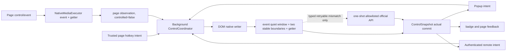

# 01. Foundations (Product semantics & Control flow)

> 主题 owner 段: §1 Product semantics · §2 Control flow and state ownership
> 完整目录: [README.md](README.md)

## §1 Product semantics

- Webpage, Popup, remote controller, and hotkeys are peers submitting intents to one coordinator.
- Control fields are planned independently. No page-wide mode silently determines unrelated controls.
- UI never asks users to choose native internals, MAIN-world bridges, or Capture.
- `100%` volume and `1x` speed are literal values, not "release control". (Releasing uses restore-page-settings).
- UI exposes one effective-volume (`0–800%`). The coordinator first offers the exact value to an exact page controller. A controller-confirmed value keeps `boost=1` and needs no Capture; the portable fallback uses DOM `volumeBase 0–100` plus hidden `boost 1–8` only when the page cannot acknowledge the requested value. Once that fallback is acknowledged for the document, later above-100 adjustments stay on the existing Capture owner instead of stopping it to repeat a probe that already failed.
- Successful responses describe read-back actual state, not storage acceptance or echoed intent.

## §2 Control flow and state ownership

Volume and speed use a bidirectional transaction. No surface writes another's prediction.

`ControlSnapshot` is the only field-level actual authority. It owns acknowledged `volumeBase + boost` components, mute, speed, transport, DSP, and video fields. It carries separate `activeMedia` (audio) and `activeVideo` (visual) identities.
`AudioSessionSnapshot` contributes processor lifecycle (`desiredMode/actualMode/phase/generation/error`). It never overwrites control fields.

Page `volumechange`/`ratechange` observations commit once and never echo DOM writes. Page volume gestures reset non-neutral Boost to 1 to avoid misreporting.

Tab-session record is a persistence projection of the last acknowledged refresh-restorable fields (`CONTROL_SESSION_FIELDS` owns exactly 20 fields). It stores actual values only, never defaults.
Effective-volume projects the complete acknowledged pair (`volumeBase + boost`). Non-restorable fields (time, A/B, visualizer) belong to the old document. Tab mute/pin are Chrome-owned.

Projection durability: `merge` and `rebind` return only after `chrome.storage.session` confirms. Settings revisions broadcast only after `chrome.storage.local.set`. Memory/timers are cleanup aids, not durability.

The record separates current-resource actual fields from origin-portable extension intent. Page observations are resource-scoped; explicit Popup/remote/shortcut ACKs are origin-scoped.
Full exact-resource replacement rebinds projection; same-origin different URL keeps portable fields; cross-origin retires all. Same-document SPA state remains valid.
Initialization chooses retained projection, then site preset, then global preset.

Colour is a presentation of the route, not a second state source:

- Gray = muted or zero.
- Blue = the non-Capture path: native, page-native, or MediaElement WebAudio; also
  a Capture that is starting, stopping or in error.
- Purple = an acknowledged active Capture (`actualMode:'capture'`,
  `phase:'active'`) for the same tab/document/origin. It owns the tone at every
  volume, so a step from 100 to 110 changes nothing.

One narrow exception may run ahead of the acknowledgement: while a volume gesture
is live, on a document whose own scale cannot absorb a value above the native
ceiling (`dom-native`), a value above 100 shows purple immediately. A settled
frame never predicts, and `page-native`, an acknowledged `media-webaudio` Boost
route, or an unanswered route never predict. Purple therefore never means "the
number passed 100".

`resolveVolumeTone` is the single predicate behind both the Popup slider and the
Action badge. `resolveAudioVolumeState` remains the acknowledged
silent/capture/native truth table used by OSD, hotkey feedback and the Remote
projection; it never predicts.

Concrete projection points:

| Location | Ownership and purpose |
| --- | --- |
| `control-coordinator.ts` | serialize lifecycle and intents; persist, publish, compensate, and commit actual snapshots |
| `control-coordinator-values.ts` | pure intent/default/mutation, target-scope, ACK, reset, and session projection values; no Chrome or storage authority |
| `extension-invocation.ts` | extension invocation origin, foreground/target document identity, and stale-document rejection |
| `popup-visualizer-source.ts` | document-scoped Popup observation lease; borrows the coordinator queue and snapshot, never writes revisions or admits Capture |
| `native-media-async.ts` | sole physical standard-media async setter/readback primitives, source-scoped cancellation, and frame-cadence cache |
| `native-media-executor.ts` | registry/target orchestration, native ownership, page fallback, rollback, and page observation |
| `media-registry.ts` | pure active-media/video selection, source revision |
| `popup/card/types.ts` | initialize fields from neutral defaults + `ControlSnapshot` |
| `popup/ui-event-hub.ts` | one Popup runtime listener; tab routing, subscriber isolation, and final-listener teardown |
| `popup/control-snapshot-order.ts` | generation-before-identity and revision-monotonic UI admission |
| `popup/card/messaging.ts` | sole card audio/config projection; apply control revisions independently from audio generations |
| `audio.contracts.ts::resolveAudioVolumeState` | acknowledged silent/capture/native truth table; consumes an ACK, never predicts |
| `volume-presentation.contracts.ts::resolveVolumeTone` | the one presentation tone for Popup slider and Action badge, including the single live-gesture prediction case |
| `audio.contracts.ts::isActiveCaptureLifecycle` | the acknowledged `capture + active` predicate both layers share |
| `side-panel/video-controls.ts` | route every video/filter intent to `activeVideo` through one per-tab transport tail |
| `settings-value-normalization.ts` / `settings-repository.ts` | pure canonical values followed by one revisioned durable storage transaction |
| `remote/operation-queue.ts` | bounded keyed serialization without session or protocol authority |
| `remote-commands.ts` / `remote-service.ts` | call coordinator inside Background, cache projection, push only after Remote V3 authority validation |
