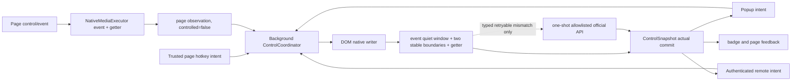

# 01. Foundations (Product semantics & Control flow)

> 主题 owner 段: §1 Product semantics · §2 Control flow and state ownership
> 完整目录: [README.md](README.md)

## §1 Product semantics

- Webpage, Popup, remote controller, and hotkeys are peers submitting intents to one coordinator.
- Control fields are planned independently. No page-wide mode silently determines unrelated controls.
- UI never asks users to choose native, WebAudio, MAIN, or Capture.
- `100%` volume and `1x` speed are literal values, not "release control". (Releasing uses restore-page-settings).
- UI exposes one effective-volume (`0–800%`). Coordinator splits it into `volumeBase 0–100` and hidden `boost 1–8`.
- Successful responses describe read-back actual state, not storage acceptance or echoed intent.

## §2 Control flow and state ownership

Volume and speed use a bidirectional transaction. No surface writes another's prediction.

`ControlSnapshot` is the only field-level actual authority. It owns acknowledged `volumeBase + boost` components, mute, speed, transport, DSP, and video fields. It carries separate `activeMedia` (audio) and `activeVideo` (visual) identities.
`AudioSessionSnapshot` contributes processor lifecycle (`desiredMode/actualMode/phase/generation/error`). It never overwrites control fields.

Page `volumechange`/`ratechange` observations commit once and never echo DOM writes. Page volume gestures reset non-neutral Boost to 1 to avoid misreporting.

Tab-session record is a persistence projection of the last acknowledged refresh-restorable fields (`CONTROL_SESSION_FIELDS` owns exactly 20 fields). It stores actual values only, never defaults.
Effective-volume projects the complete acknowledged pair (`volumeBase + boost`). Non-restorable fields (time, A/B, visualizer) belong to the old document. Tab mute/pin are Chrome-owned.

Projection durability: `merge` and `rebind` return only after `chrome.storage.session` confirms. Settings revisions broadcast only after `chrome.storage.local.set`. Memory/timers are cleanup aids, not durability.

The record separates current-resource actual fields from origin-portable extension intent. Page observations are resource-scoped; explicit Popup/remote/shortcut ACKs are origin-scoped.
Full exact-resource replacement rebinds projection; same-origin different URL keeps portable fields; cross-origin retires all. Same-document SPA state remains valid.
Initialization chooses retained projection, then site preset, then global preset.

Color is actual state:
- Gray = muted/zero
- Blue = native/Media WebAudio, or starting/stopping/error Capture
- Purple = active Capture (`actualMode:'capture'`, `phase:'active'`) for the same tab/document/origin.

Concrete projection points:

| Location | Ownership and purpose |
| --- | --- |
| `control-coordinator.ts` | serialize intents, commit actual snapshot |
| `native-media-executor.ts` | sole standard-media writer; getter ACK/page observation |
| `media-registry.ts` | pure active-media/video selection, source revision |
| `popup/card/types.ts` | initialize fields from neutral defaults + `ControlSnapshot` |
| `popup/card/messaging.ts` | apply control revisions independently from audio generations |
| `audio.contracts.ts::resolveAudioVolumeState` | constant-time gray/blue/purple truth table |
| `side-panel/video-controls.ts` | route video operations to `activeVideo` |
| `remote-commands.ts` / `remote-service.ts` | call coordinator inside Background, cache projection, push after HMAC |
