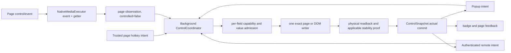

# 01. Foundations (Product semantics & Control flow)

> 主题 owner 段: §1 Product semantics · §2 Control flow and state ownership
> 完整目录: [README.md](README.md)

## §1 Product semantics

- Webpage, Popup, remote controller, and hotkeys are peers submitting intents to one coordinator.
- Control fields are planned independently. No page-wide mode silently determines unrelated controls.
- UI never asks users to choose native internals, MAIN-world bridges, or Capture.
- `100%` volume and `1x` speed are literal values, not "release control". (Releasing uses restore-page-settings).
- UI exposes one effective-volume (`0–800%`).
- The coordinator offers the exact value to an exact page controller first.
- A controller-confirmed value keeps `boost=1` and needs no Capture.
- Only when the page cannot acknowledge the value does the portable fallback use DOM `volumeBase 0–100` plus hidden `boost 1–8`.
- Once that fallback is acknowledged for the document, later above-100 adjustments stay on the existing Capture owner.
- They must not stop that owner to repeat a probe that already failed.
- Successful responses describe read-back actual state, not storage acceptance or echoed intent.

## §2 Control flow and state ownership

Volume and speed use a bidirectional transaction. No surface writes another's prediction.

`ControlSnapshot` is the only field-level actual authority. It owns acknowledged `volumeBase + boost` components, mute, speed, transport, DSP, and video fields. It carries separate `activeMedia` (audio) and `activeVideo` (visual) identities.
`AudioSessionSnapshot` contributes processor lifecycle (`desiredMode/actualMode/phase/generation/error`). It never overwrites control fields.

The [field/proof state machines](05-control-state.md#field-transaction-state)
distinguish transaction state from detached write proof. The
[speed decision owner](06-media-and-video.md#143-speed-decision-and-failure) defines
value admission, page/DOM handoff and terminal errors; the overview does not
imply a DOM-first or controller-only ACK policy.

Page `volumechange`/`ratechange` observations commit once and never echo DOM writes. Page volume gestures reset non-neutral Boost to 1 to avoid misreporting.

Tab-session record is a persistence projection of the last acknowledged refresh-restorable fields (`CONTROL_SESSION_FIELDS` owns exactly 20 fields). It stores actual values only, never defaults.
Effective-volume projects the complete acknowledged pair (`volumeBase + boost`). Non-restorable fields (time, A/B, visualizer) belong to the old document. Tab mute/pin are Chrome-owned.

Projection durability: `merge` and `rebind` return only after `chrome.storage.session` confirms. Settings revisions broadcast only after `chrome.storage.local.set`. Memory/timers are cleanup aids, not durability.

The record separates current-resource actual fields from origin-portable extension intent. Page observations are resource-scoped and never revoke an origin-portable field; only an explicit Popup/remote/shortcut ACK replaces the configured intent.
Full exact-resource replacement rebinds projection; same-origin different URL keeps portable fields; cross-origin retires all. Same-document SPA state remains valid.
Initialization chooses the retained tab projection, then the origin session, then the site preset, then the global preset.

Colour is a presentation of the route, not a second state source:

- Gray = muted or zero.
- Blue = the non-Capture path: native, page-native, or MediaElement WebAudio; also
  a Capture that is starting, stopping or in error.
- Purple = an acknowledged active Capture (`actualMode:'capture'`,
  `phase:'active'`) for the same tab/document/origin **and** a value above the
  native ceiling. At or below the ceiling every split is Boost 1, so a processor
  that has not released yet is passthrough: the colour follows the ceiling in
  both directions, and 110 -> 100 turns blue on the same gesture frame.

One narrow exception may run ahead of the acknowledgement: while a volume gesture
is live, on a document whose own scale cannot absorb a value above the native
ceiling (`dom-native`), a value above 100 shows purple immediately. A settled
frame never predicts, and `page-native`, an acknowledged `media-webaudio` Boost
route, or an unanswered route never predict. Purple still requires a Capture
route, so the number alone never makes a frame violet.

`resolveVolumeTone` is the single predicate behind both the Popup slider and the
Action badge. `resolveAudioVolumeState` remains the acknowledged
silent/capture/native truth table used by OSD, hotkey feedback and the Remote
projection; it never predicts.

Concrete projection points are not restated here. The single ownership table is
[07 §17.1 File owners](07-runtime-and-performance.md#171-file-owners); this file used to keep a
partial copy that disagreed with it about `native-media-async.ts` and omitted several
files outright. One owner, one table.
