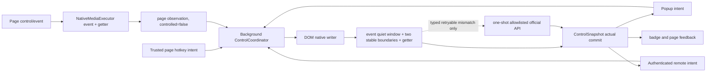

# 01. Foundations (Product semantics & Control flow)

> 主题 owner 段: §1 Product semantics · §2 Control flow and state ownership
> 完整目录: [control-architecture.md](../control-architecture.md)

## §1 Product semantics

- The webpage, Popup, authenticated remote controller and hotkeys are peers that submit intents to one coordinator.
- Every control field is planned independently. There is no page-wide native/WebAudio/Capture mode that may silently determine unrelated controls.
- The user interface never asks users to choose native, WebAudio, MAIN or Capture.
- `100%` volume and `1x` speed are literal values. They do not mean "release control". Releasing a field is a separate restore-page-settings intent.
- Every user surface exposes exactly one effective-volume value, `0–800%`. The
  coordinator alone splits it into page-native `volumeBase 0–100` and hidden
  processor `boost 1–8`; those implementation fields are never separate UX.
- A successful response describes read-back actual state. Storage acceptance, setter completion or a requested value echoed by the executor is not an application acknowledgement.

## §2 Control flow and state ownership

Volume and speed use the same bidirectional transaction. The page is a peer,
not a lower-priority source, and no surface writes another surface's local
prediction:

`ControlSnapshot` is the only field-level actual authority. It owns the
acknowledged `volumeBase + boost` components that compile to effective volume,
plus mute, speed, transport, DSP parameters and video fields.
It carries separate `activeMedia` and `activeVideo` identities. Audio/transport
controls follow the former; screenshot, PiP, fullscreen and presentation
effects follow the latter. A playing audio element therefore cannot steal the
video side panel's target, and merely reading either target never changes the
other selection.
`AudioSessionSnapshot` contributes only processor lifecycle
(`desiredMode/actualMode/phase/generation/error`); Popup initialization and
session events must never use `actualConfig` to overwrite or fill control
fields. Page `volumechange` and `ratechange` observations commit exactly once
and never echo a second DOM write. A page-side volume gesture owns the new
public effective-volume value, so any non-neutral hidden Boost is reset to 1 in
the same coordinator transaction; otherwise a page move to 50% would be
misreported as `50 × previous Boost`.

The tab-session record is a persistence projection of the last acknowledged
audio control fields, not another actual-state authority. A same-origin full
document replacement may rebind that projection to the new `documentId`; a
cross-origin replacement retires it. Document initialization chooses this
same-tab projection before site/global presets, then restores through the same
coordinator. Explicit Popup, remote and shortcut intents wait for that one
document-scoped decision, so a late preset replay cannot overwrite the user's
first control on the new document.

Color is also actual state, not a value threshold. Muted/zero is gray; native
or Media WebAudio is blue; purple is permitted only when the matching
`AudioSessionSnapshot` has `actualMode:'capture'` and `phase:'active'` for the
same tab, document and origin. Its processor generation and the
`ControlSnapshot` field/document generation are independent monotonic clocks;
each stream rejects its own stale revisions instead of comparing unrelated
generation numbers. Starting, stopping, error and stale Capture sessions remain
blue. Popup, badge and authenticated remote consume the shared
`AudioVolumeState = silent | native | capture` projection, so numeric volume
thresholds cannot drift into color policy.

The concrete projection points are:

| Location | Ownership and purpose |
| --- | --- |
| `src/background/control-coordinator.ts` | serialize intents and commit the single actual snapshot |
| `src/content/logic/native-media-executor.ts` | sole standard-media writer; event/quiet/stable getter ACK and page observation |
| `src/content/core/media-registry.ts` | pure, independent active-media/active-video selection and source revision ownership |
| `src/popup/card/types.ts::initialControlConfig` | initialize fields from neutral defaults plus `ControlSnapshot` only |
| `src/popup/card/messaging.ts` | apply control revisions independently from audio lifecycle generations |
| `packages/contracts/src/audio.contracts.ts::resolveAudioVolumeState` | own the constant-time gray/blue/purple truth table and tab/document/origin lifecycle join |
| `src/popup/side-panel/video-controls.ts` | route every video operation to `activeVideo`, never to an audio-only `activeMedia` |
| `src/background/remote-commands.ts`; `remote-service.ts` | call the same serialized coordinator directly inside Background, cache a side-effect-free actual projection before authentication, then push only after HMAC succeeds; never self-RPC or predict a result |
