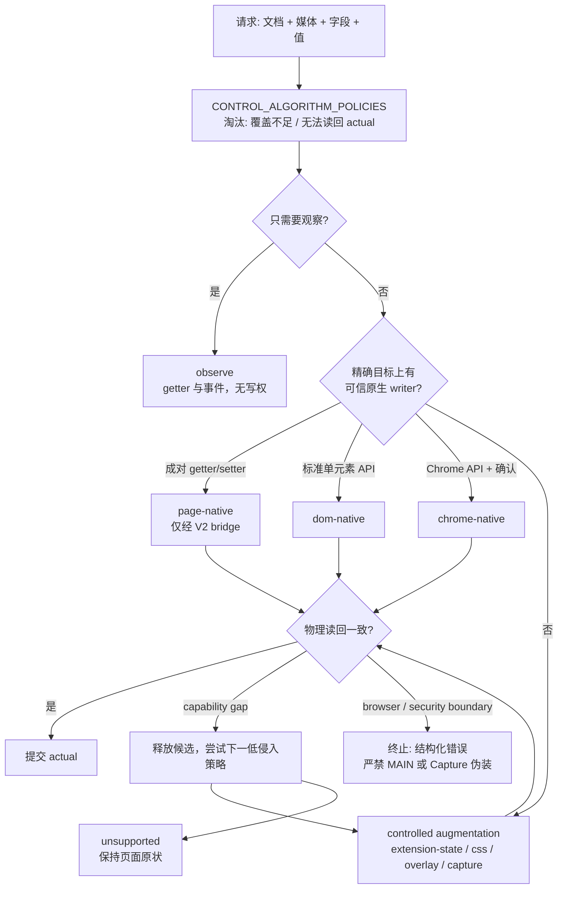
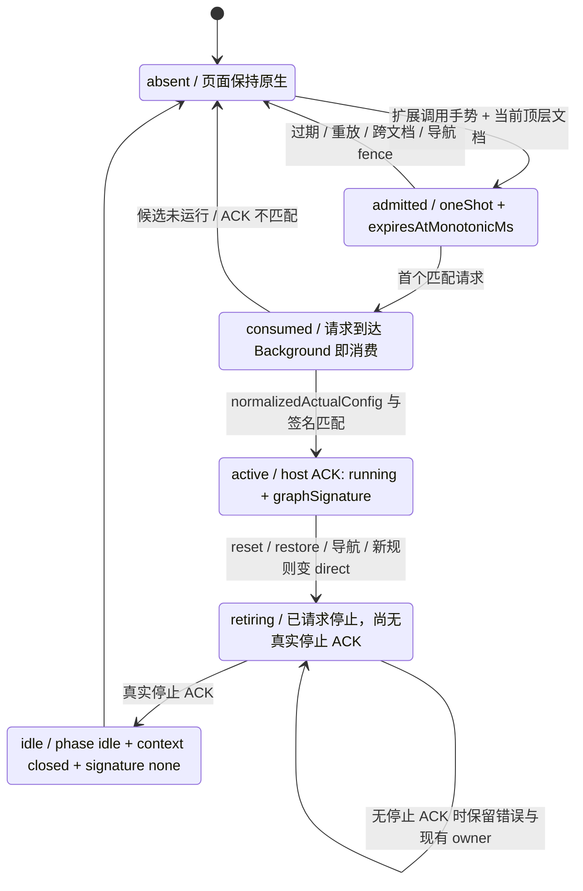
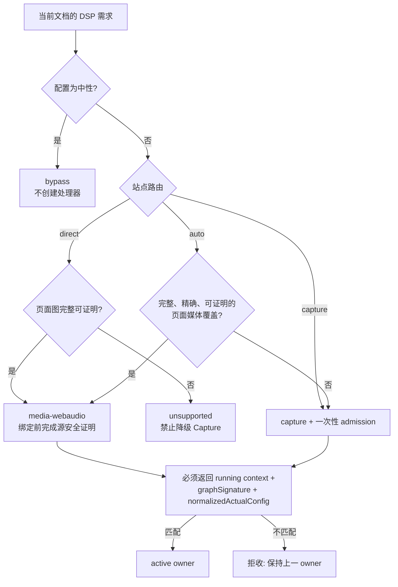
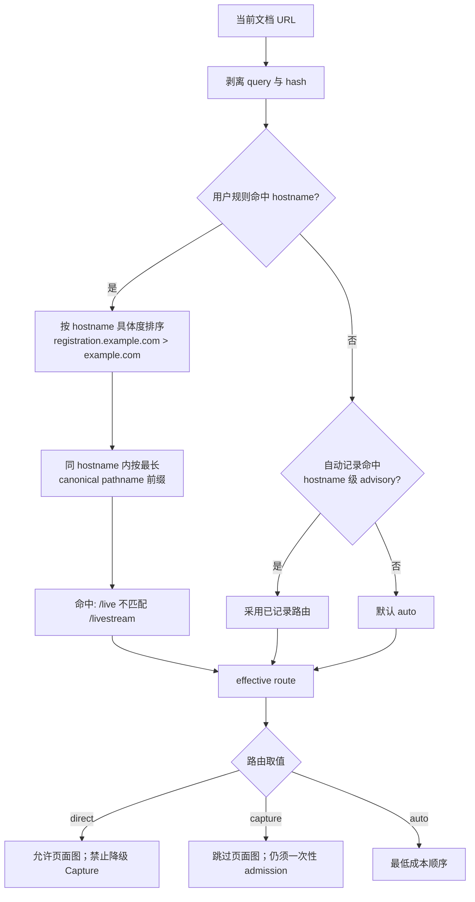

# 02. Strategy order & Runtime (Capability order, runtime, bridges)

> 主题 owner 段: §3 Strategy order · §4 Capture admission · §5 Runtime ownership · §6 Exact-element page media, PiP & fullscreen
> 完整目录: [README.md](README.md)
>
> **TL;DR**: canonical policy 按 `observe -> native -> controlled-augmentation -> unsupported` 顺序选策略；处理器增强优先使用已证明完整覆盖的页面 WebAudio，必要时才使用有一次性 admission 的 Capture；五组内置快捷键在 `document_start` 独占。

**本篇符号**（只解释名字之间的关系，不改变任何规则）：

| 符号 | 一句话职责 | 谁用它 |
| --- | --- | --- |
| `CONTROL_ALGORITHM_POLICIES` | 每个能力的顺序策略、ACK 来源与 MAIN 策略；缺条目即编译失败 | 选路与静态门禁 |
| `resolveDesiredAudioMode` | 把 DSP 需求与当前覆盖证据折成 `bypass` / `webaudio` / `capture` | Content 模式执行器 |
| `CaptureAdmission` | 一次性凭据，绑定 tab、顶层 frame、document、epoch 与过期时间 | Background 签发，Content 消费 |
| `selectMediaProcessingRoute` | hostname 级的用户/自动路由投影 | 路由查询与记录 |

## §3 Strategy order

`CONTROL_ALGORITHM_POLICIES` 过滤无法覆盖请求范围或无法读回 actual 的候选者，随后遵循特定能力固有顺序:

```text
OBSERVE -> CAPABILITY-SPECIFIC NATIVE (PAGE_NATIVE / DOM_NATIVE / CHROME_NATIVE) -> CONTROLLED AUGMENTATION (EXTENSION_STATE / CSS / OVERLAY / CAPTURE) -> UNSUPPORTED
```



图中的升级方向是"更低侵入优先"，不是"失败就加码"：`browser / security boundary`
一类失败直接终止，因为它们描述的是浏览器或页面权限，不是能力缺口。

### §3.1 Forbidden generic MAIN behavior

生产代码严禁重定义或覆盖以下全局对象:
- `window.AudioContext` / `webkitAudioContext` / `AudioContext.prototype.destination` / `close`
- `MediaElementAudioSourceNode` / `createMediaElementSource()` / `HTMLMediaElement` 的音频输出链路
- `window.Audio` / `document.createElement` / `createElementNS` / `HTMLMediaElement.prototype` / `History` API

MAIN 执行严格限定于 manifest `document_start` 注入的两个闭合 bridge:
1. Fullscreen V1 Bridge (`content-fullscreen-bridge.js`): 包装原生全屏入口以协调增强音频手势。
2. Page-Media V2 Bridge (`content-page-media-bridge.js`): 仅在目标元素上处理 `volumeBase`、`mediaMuted` 与 `speed`。

### §3.2 Native, augmentation and forbidden hijack

| Class | Strategies | Meaning |
| --- | --- | --- |
| observe | `observe` | 只读事件与 getter，无控制权。 |
| native | `page-native`, `dom-native`, `chrome-native` | 精确读回的原生 API/属性。`page-native` 仅通过 V2 bridge 准入。 |
| controlled augmentation | `extension-state`, `extension-css`, `extension-overlay`, `media-webaudio`, `capture` | 原生控制不可用时添加的可逆扩展能力（必须有明确 owner、readback、disposer 与 restore 规则）。处理器增强先使用完整可证明的页面图，否则才进入 Capture admission。 |
| unsupported | `unsupported` | 保持页面原状并返回结构化能力错误。 |

## §4 Capture admission and target identity

Capture 不是站点路由或状态探针，而是一次绑定当前顶层文档的扩展调用。Background 的 `CaptureAdmission` 是唯一激活凭据，内存状态按文档隔离:

```ts
type CaptureAdmission = {
  kind: 'capture-start' | 'capture-resume';
  document: { tabId: number; frameId: 0; documentId: string };
  documentEpoch: number;
  workerEpoch: string;
  expiresAtMonotonicMs: number;
  oneShot: true;
};
```



`retiring` 不是"已经释放"：没有 `phase:'idle'` 与 `contextState:'closed'` 的真实 ACK
就不得乐观投影为已停止。图示的 `Absent` 也不表示页面被改写——它表示扩展没有任何
处理器，页面保持它自己的声音。

- **调用边界**: Popup、浏览器命令（媒体处于原生上限且当前文档尚无扩展调用授权时，那一次 `Alt+Up` 会交给 manifest 的 `volume_up` 命令）或经过校验的当前文档快捷键调用才可请求 `capture-start`；继续已有 Capture 只可使用其一次性 `capture-resume`。
- **消费边界**: admission 在 Content 请求到达 Background 时消费，错误、重放、过期、跨文档或导航 fence 均 fail-closed。
- **处理器边界**: Content 只提交 Capture intent；offscreen host 才能创建处理器，且仅在候选实际运行并返回归一化配置后发布 active。
- **目标边界**: `tabId + documentId + frameId: 0` 是处理器和快照身份；独立的 `hotkey-target-repository.ts` 只维护全局快捷键目标，不参与音频模式选择。

### §4.1 Three-owner processor admission



显式非中性全音频 DSP 需要处理器时按覆盖质量选路：

- 完整且精确的媒体覆盖 → `resolveDesiredAudioMode()` 选 `webaudio`；否则选 `capture`。
- 没有文档输出需求的中性配置保持 `bypass`。
- 仅前台 Visualizer 可以使用已证明安全、且路由允许的页面 `webaudio`；观察需求不得启动或保留 Capture。

站点路由（`SettingsRepository` 持久化、`spectra.registry.*` v2 独立 Popup 投影）只改变候选选择：

- `direct` 禁止降级到 Capture；
- `capture` 跳过页面图，但仍必须携带一次性 admission；
- `auto` 使用上面的最低成本顺序。

严格的 `spectra.settings.*` v2 响应不含路由字段。Content 只能经 sender-bound
`spectra.audio.route.get/record` 查询或记录当前文档的证据：不能命名其他站点，也不直接读写持久状态。

手动路由可以限定为 hostname，也可以限定为该 hostname 下的 canonical pathname 前缀。

- 现有 hostname key 与 `spectra.registry.*` v2 的 domain-only shape 保持不变。
- `spectra.media-route.rules.*` 是 Popup-only 的完整规则投影。
- 两者由同一个 `SettingsRepository`、同一 revision 与同一容量边界持有。

匹配顺序：

1. 用户规则优先于自动记录；
2. 再按最具体 hostname；
3. 再按最长路径段前缀。

query 与 hash 不参与匹配，`/live` 不匹配 `/livestream`。



图示的裁决顺序只有三级：用户规则先于自动记录，hostname 具体度先于路径长度，
路径段前缀先于其它一切。SPA 导航会在 policy 串行队列中重跑这张图，规则变化本身
不能创建 Capture admission。

- 自动检测只记录 hostname 级 advisory evidence，不从动态页面 URL 推断持久路径。
- Background 用 sender 文档身份核对浏览器当前 frame URL。
- SPA 导航在 policy 串行队列中刷新规则；旧 Capture 因新规则变为 `direct` 时必须退休。
- 导航本身不能创建 Capture admission。

**音量边界由实际 owner 决定。**

- 原生音频只在高于 100% 的 Boost 需要处理器；回到 0–100% 时释放 Capture，等真实停止 ACK 后再投影原生状态。
- 释放后再次越界需要新的显式准入。
- 文档输出 owner 在 0% 与 100% 仍承担有效的静音或单位增益需求，不能把这两个数值解释为释放。
- 它只由内部 `releaseDocumentOutput: true`（reset / restore-page-settings）、禁用或现有导航生命周期撤销，且仅在独立 DSP 也无需求后真实停止。
- `documentOutput` 是运行期需求，不是持久化偏好，也不是“曾经超过 100%”的保活锁存。
- Visualizer 只能观察已有 Capture，不能延长其生命周期；路由记录、Popup 打开与历史值都不产生需求。
- 旧 v2 `processorHold` 与 Visualizer demand 的 `admission` 只保留解码兼容；生产端不得据此保活或启动 Capture。
- 不能安全获取页面 analyser 时稳定为 `bypass/idle` 并返回空帧，不重新申请 Capture。
- 回归必须在同一文档内验证增益、静音、明确释放与真实停止，不靠 reload 重置。

隐式文档音量请求每次先读取当前 runtime 选中的原生 volume/mute 对。只有精确 source 的 `srcObject instanceof MediaStream` 且 video track 大于零、audio track 为零，才能发布 `nativeAudioAbsent`；`Infinity`、hostname、canvas、`blob:` 或历史 snapshot 均不能替代此证据。该事实或当前已确认的 Capture output owner 允许显式全输出意图使用现有 Capture，仍需一次性 admission。`resolveDesiredAudioMode()` 对 `documentOutput` 选择 Capture，不能绑定没有音轨的视频代替真实输出。明确指定的媒体 target 不得扩成全标签；手动 `direct` 返回不可用且保持页面图不变。未知 source 继续原生策略，不添加站点适配器、全局音频 hook 或猜测写者。
- MediaElement WebAudio 必须在首次不可逆绑定前证明所有当前 source 的同源/blob/data 或精确 preload-CORS 证据，并在 ACK 中返回 running context、graph signature、normalized actual config 与 source count。
- `captureAdmission` 只能随已验证的 extension-invocation intent 进入内部 coordinator，普通 `ControlSubmitRequest` 不能伪造该字段。
- host `active` ACK 必须同时证明 `tabId`、`generation`、`controlRevision`、`phase:'active'`、`contextState:'running'`、`graphSignature` 与 `normalizedActualConfig`；文档输出参数还须在增益 ramp 后跨渲染时钟边界稳定读回真实 AudioParam。签名或参数不匹配即拒收，配置对象回声不算物理 ACK。
- Capture 停止必须收到 `phase:'idle'`、`contextState:'closed'`、`graphSignature:'none'` 和 `normalizedActualConfig:null`，否则保留错误状态与现有 owner，不得乐观释放。

### §4.2 SPECTRA extension envelope owner and V1 retirement

Content runtime 只有一个 SPECTRA envelope owner：`@nexus/contracts` 的
`SpectraRequestEnvelope` / `SpectraEventEnvelope` 类型与 runtime validators 定义
唯一 schema，`shared/spectra-client.ts` 定义通用 request transport。Popup、Options
等 focused client 只能携带这个 typed envelope，不能恢复另一套 action/router 协议；
document-start bootstrap 的最小请求边界也必须继续使用同一个
`SPECTRA_PROTOCOL_VERSION`，不能引入兼容分叉。

顶层 `action:` envelope 属于已退役的 V1 runtime，生产发送端禁止出现。快捷键
领域值 `payload.action` 是合法的 typed payload，不是 V1 envelope。`createRouter`、
`router.on`、`router.listen` 与 `GLOBAL_SETTINGS_UPDATE` 同样属于禁止的旧 runtime
路径；每个 listener 只接受其明确的 request/event type allowlist。扩展内部
envelope 当前为 v2；Remote 的 v3 是独立、带 session epoch 的外部线协议，二者
不能用同一个“v3”名称混淆。既有 v2 route 只允许保持 ABI 或新增 route，不允许
在同一 type 下替换 response shape。

## §5 Runtime, shortcut and feedback ownership

冷文档首个快捷键先完成 identity-bound Runtime ensure，等待 READY 屏障后提交，无需先打开 Popup。

### 五组默认快捷键 (document_start 独占)

| Chord | Action | Delta |
| --- | --- | --- |
| `Alt+ArrowLeft` | speed down | `-0.1` |
| `Alt+ArrowRight` | speed up | `+0.1` |
| `Alt+ArrowDown` | volume down | `-10` |
| `Alt+ArrowUp` | volume up | `+10` |
| `Alt+M` | toggle mute | 单次物理按压 |

- `Alt+Up` 注册为 Manifest 命令 `volume_up`：只有当页面媒体已经在原生上限（`media.volume === 1`）且当前文档没有已知的扩展调用授权时，这次 `Alt+Up` 才不阻止默认行为，交给 Chrome 作为命令加速器执行，这次 invocation 授予该标签页 `activeTab`，让同一个按键在跨越 100% 时能合法启动 Capture。Bootstrap 仍在 capture 阶段 `stopImmediatePropagation`，阻止页面 handler 取消该和弦。调用授权是**文档生命周期**事实而不是 Capture 会话事实：Popup 打开、命令送达或任一次成功启动的 Capture 都会把授权锁存到本文件导航为止；因此从 110% 回到 100% 后即使 Capture 会话已结束，下一次 `Alt+Up` 仍由 Bootstrap 在 `document_start` 独占并走 Content 路径，不需要新命令。上限以下同样始终走 Content 路径，保留连发合并与页面优先级；命令不可用或页面吞掉该键时，按键在 0–100% 区间和已授权文档中照常工作。其余四组始终由 Bootstrap 独占。
- 所有 `coalesce-20hz` 动作排除在可配置 Chrome command 槽之外。

### 网站自定义按键与 Toast 反馈
- 网站自定义按键遵循 **Website-First** 规则（原生 handler 优先）。
- Toast 仅由显式快捷键/操作触发，同一快捷键仅一个 feedback owner。全屏下 Toast 通过 Popover top-layer 挂载以避免被 DOM 全屏覆盖。

## §6 Exact-element page media, PiP and fullscreen

- 精确媒体的 `volumeBase`, `mediaMuted`, `speed` 使用 `page-native -> dom-native`。音量/静音只有在上述全输出准入后才能增加 `capture` 策略；`speed` 不扩展到 Capture。
- V2 Bridge 限制在 12 层祖先与 96 个挂载属性内发现同步 controller，明确关联优先于距离。
- 页面 controller 必须具备成对 getter/setter 与稳定 readback。写入失败退回 DOM。
- PiP 与 Fullscreen 操作限制在当前 `activeVideo`，只能使用标准 API 与真实 user activation。
