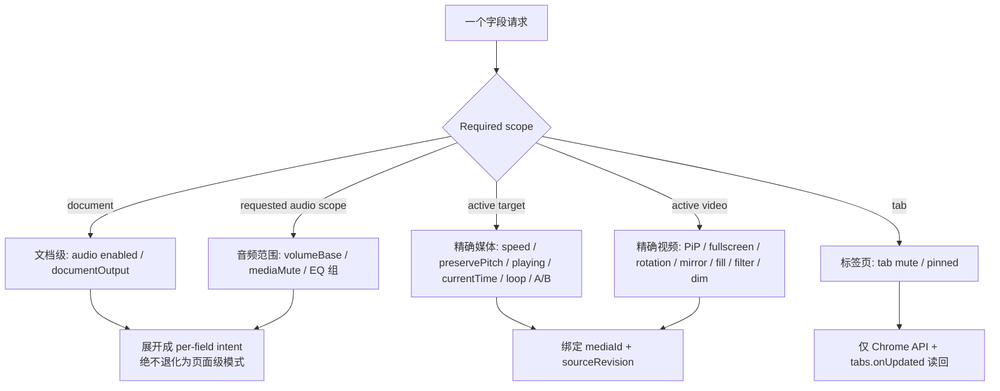

# 04a. Algorithm Matrix (§8 Complete control algorithm matrix)

> 主题 owner 段: §8 Complete control algorithm matrix
> 完整目录: [04-algorithm-matrix.md](04-algorithm-matrix.md)

**本篇符号**（只解释名字之间的关系，不改变任何规则）：

| 符号 | 一句话职责 | 谁用它 |
| --- | --- | --- |
| `CONTROL_ALGORITHM_POLICIES` | 能力 → 作用域、策略顺序、ACK 证据与 MAIN 策略的唯一表 | 运行时选路与静态门禁 |
| `CONTROL_CAPABILITIES` | 51 个能力的规范清单，表格行必须与它等长 | 合同与审计投影 |
| `CONTROL_SESSION_FIELDS` | 可持久化到会话的字段集，决定"哪些值能跨文档留下" | 持久化与恢复 |

## §8 Complete control algorithm matrix

Exhaustive matrix for fields and operations in `control.contracts.ts`. Adding features without an entry here violates architecture.

读这张表之前先认清一件事：**作用域不是优先级**。它回答"这个字段描述谁"，因此决定
了什么能写、什么必须读回、换了元素之后这份状态还算不算数。

`active target` 与 `active video` 是两条独立身份：视频效果不会因为音量的目标变了
而跟着换台，反过来也一样。图中两个 `Keyed` 入口共享同一条身份规则，但各自持有自己
的选择，所以在同一页面上可以一边控制 A 元素的声音、一边给 B 元素加滤镜。

### §8.1 Persistent and observable fields

| Capability | Required scope | Selection order | Acknowledgement and fallback |
| --- | --- | --- | --- |
| Audio enabled | document | coordinator state expansion | Expands to per-field intents; never page-wide processing mode. |
| Internal `volumeBase 0–800` | requested audio scope | exact page controller, DOM (`0–100`), then admitted document-output Capture | Native values require paired getter/setter or event/getter ACK. A source-bound video-only MediaStream proves the video cannot control audio; only an implicit full-output intent may use Capture. Existing output ownership remains at 0/100 until explicit release. |
| Internal processor `boost 1–8x` | explicit full audio | proven MediaElement WebAudio, then admitted full-tab Capture | Graph-signature/readback ACK. Used for effective volume above 100 only when the exact page controller cannot acknowledge the value; no independent UI and target-only requests fail. |
| Media mute | requested audio scope | exact page controller, DOM, then admitted document-output Capture | Explicit unmute reaches the existing writer and browser policy decides permission; automatic restoration retains activation protection. Capture-owned mute uses independent processor mute with stable parameter readback and preserves numeric volume. Exact-target scope never expands. |
| Tab mute | tab | `chrome.tabs.update({muted})` | `tabs.onUpdated`/`tabs.get` readback; never aliases media mute. |
| Playback speed | active target | exact page controller, then `playbackRate` | Actual is physical `playbackRate`. Page ACK requires controller and physical convergence; both must prove baseline restoration before DOM fallback, including an owned speed handoff. |
| Preserve pitch | active target | standard `preservesPitch` only | Property/getter readback; unsupported if absent. |
| Playing | active target | single standard `play()`/`pause()` write | stable physical `!paused`; pending play cannot block ACK; autoplay rejection returned. |
| Current time | active target | seekable standard media timeline only | Clamp to `TimeRanges`; acknowledge `seeked` and getter. |
| Whole-media loop | active target | standard `HTMLMediaElement.loop` only | Getter/readback; independent of A/B state. |
| Picture-in-Picture | active video | standard Picture-in-Picture API only | Popup click runs ISOLATED script synchronously. Success requires native enter/leave event and `pictureInPictureElement`. |
| Fullscreen | active video | standard Fullscreen API only | `fullscreenchange` and `fullscreenElement`; no synthetic gesture. |
| Rotation | active video | extension CSS `rotate` | Computed-style readback; removes owner state only. |
| Mirror | active video | extension CSS `scale` | Computed-style readback; never overwrites site `transform`. |
| Fill/crop | active video | extension `object-fit:cover` | Computed `object-fit`; disable removes owner attribute. |
| Filter enabled/values | active video | extension CSS filter composition | Computed-style readback; composes without replacing inline style. |
| Dim enabled/opacity | active video | extension closed-shadow 4-region overlay | Overlay readback; never rewrites video `position`/`z-index`. Target switch preserves prior effects. |
| A/B state | `mediaId + sourceRevision` | extension state + native seek executor | Validates `0 <= A < B`; updates same target only. |
| Tab pinned | tab | `chrome.tabs.update({pinned})` | `tabs.onUpdated`/`tabs.get` readback. |
| EQ/Bass/Compressor/Mono/Pan/Delay | explicit full audio | proven MediaElement WebAudio, then admitted full-tab Capture | Processor readback; page binding is allowed only with complete exact source coverage, otherwise Capture owns the full mix. |
| Visualizer subscription | visible foreground Popup + current top-level document | analyser tap on proven safe MediaElement WebAudio or Capture already required by DSP/document-output demand; unsafe source without such demand settles on bypass | Per-Popup `subscriberId + generation + sourceTabId` lease; 5s heartbeat. Background cards remain passive. Subscription cannot start or retain Capture; final release removes page analyser demand. |

### §8.2 Momentary and compound operations

| Operation | Native-first algorithm | Controlled augmentation or result |
| --- | --- | --- |
| Restore page settings | coordinator releases owned fields | Restores captured baselines; doesn't translate 100%/1x to release. |
| Effective volume `0–800` | fresh current-target volume/mute pair, then native-first planning | Page ACK keeps Boost unity. Above-100 native fallback uses portable base plus processor Boost. Source-proven absent native audio or acknowledged document-output ownership uses admitted full-output Capture instead. Every request reads the current pair; equal proven values may skip setters, never the read by trusting an old snapshot. |
| Play/pause toggle | read actual state, execute `playing` plan | Commits stable physical getter for the still-selected exact source. |
| Relative seek | resolve target/seekable, execute `currentTime` | Structured unavailable result. |
| Frame step | source-scoped cadence -> standard DOM seek | Uses recent `requestVideoFrameCallback` or bounded median. Always `approximate:true`. |
| Screenshot | Chrome `captureVisibleTab` + verified geometry | Capture token checked before/after against document/source/geometry. Fails on hidden/moving targets. |
| Marker add/remove/list | extension state by media/source | No page write. Bounded label/count. |
| Marker jump/prev/next | marker lookup -> native seek plan | Uses same `currentTime` ACK path. |
| A/B skip | native seek to verified boundary | Uses same target/source revision. |
| Audio reset | atomic per-field patch | Effective volume 100%, neutralizes DSP/mute and releases Boost; internal `releaseDocumentOutput: true` withdraws output demand and requires real stop ACK when no independent demand remains. |
| Video effects toggle/reset| atomic patch for extension-owned video fields | Never touches native state or site CSS. |
| Show info | snapshot read | Side-effect-free OSD projection. |
| Open Popup/Options | Chrome extension UI APIs | Opens browser UI. A visible Popup may acquire an observation-only analyser lease; it creates no processor while hidden and never uses MAIN-world graph ownership. |
| Run user script | explicit `userScripts` permission/sandbox | Not media strategy; no MAIN access. |
| Open URL | browser navigation, `http/https` allowlist | Fails closed on invalid schemes. |

### §8.3 Disabled legacy algorithms

- Pitch shift hotkeys disabled (preserve-pitch is not pitch shifting).
- `capture_toggle` migrates to disabled diagnostic.

### §8.4 Surface action normalization

UI labels and protocol commands alias the 51 canonical capabilities. `HOTKEY_ACTION_DESCRIPTORS` and `REMOTE_COMMAND_DESCRIPTORS` exhaustively map every action/remote command. Feedback policies (`actual-osd`, `handler-result`, `listener-label`, `none`) prevent double notifications.

| Remote command family | Canonical capability and transform |
| --- | --- |
| `volume_*` | `effective-volume`: clamped `0–800` |
| `mute` | `mediaMuted`: toggle |
| `play_pause` | `playback-toggle` |
| `seek_*` | `seek-relative`: signed delta |
| `speed_*` | `speed`: `+0.1/-0.1/set 1` |
| `fullscreen`, `pip` | native toggle |

Surfaces must submit canonical intents. Audio enabled and DSP fields require `requestedCoverage:'full'`, checked in runtime to prevent unauthorized whole-tab Capture. Visualizer has a separate foreground-subscription admission: only the trusted Popup may name its currently active top-level tab, and the demand is never persisted as DSP configuration.

### §8.5 Per-capability native and augmentation ledger

One row per capability in `CONTROL_ALGORITHM_ADJUDICATIONS`. 15 native-only, 8 hybrid, 26 augmentation-only, 2 observation-only. Changing families requires updating adjudication, anchors, mirror, and tests.

`WebAudioController` and `offscreen/audio-host.ts` are the two processor owners behind one three-state policy: `bypass -> webaudio -> capture`. MediaElement WebAudio is admitted only when every current source has exact same-origin/blob/data or preload-CORS evidence; Capture is the fallback for incomplete/unsafe coverage. An active processor is publishable only after matching document/generation/revision, running context, graph signature, normalized actual config, and exact source-count readback. Visualizer is a read-only lease over whichever acknowledged processor is active; synthetic spectrum is forbidden.

| Contract capability | Native adjudication | Controlled augmentation admission | Success proof and performance boundary |
| --- | --- | --- | --- |
| `audioEnabled` | augmentation-only | coordinator session gate only | gate ACK + expanded actual state; disable releases all work |
| `volumeBase` | hybrid: exact-element page (`0–800`), then DOM (`0–100`) | admitted Capture for explicit full-output demand with source evidence | native getter/event or stable processor parameter/render-clock readback; Capture only while output demand is owned |
| `boost` | augmentation-only | proven MediaElement WebAudio, then admitted Capture | normalized processor gain readback; exists only while non-neutral |
| `effective-volume` | hybrid-extension-native | proven native Boost path or source-proven document-output Capture | compound ACK returns current owner actuals; each request reads the current native pair before any setter no-op |
| `mediaMuted` | hybrid: exact-element page then DOM | admitted Capture for explicit full-output demand with source evidence | native getter/event or independent processor mute readback; preserves numeric volume |
| `tabMuted` | native-only via Chrome tab | none | `tabs.get`/tab event readback |
| `speed` | native-only: exact-element page, then DOM | none | page getter plus physical `playbackRate` convergence; DOM stable readback; all observations use physical actual |
| `preservePitch` | native-only via DOM `preservesPitch` | none | property readback; unsupported if absent |
| `playing` | native-only via single `play`/`pause` | none | stable physical `!paused`, independent of intercepted events |
| `currentTime` | native-only via seekable timeline | none | `seeked` + getter |
| `loop` | native-only via DOM `loop` | none | authoritative getter; no A/B alias |
| `pip` | native-only via PiP API | none | enter/leave event + `pictureInPictureElement` |
| `fullscreen` | native-only via Fullscreen API | none | `fullscreenchange` + `fullscreenElement` |
| `rotation` | augmentation-only | reversible CSS `rotate` | computed style; removal restores cascade |
| `mirrored` | augmentation-only | reversible CSS `scale` | computed style |
| `fill` | augmentation-only | extension-owned `object-fit` | computed style |
| `filterEnabled`/`filter`| augmentation-only | reversible composed CSS | computed style; composes over site baseline |
| `dimEnabled`/`dimOpacity`| augmentation-only | closed-shadow 4-region overlay | overlay geometry readback; handoff preserves independent effects |
| `abLoop` | augmentation-only metadata | media/source-keyed state | coordinator state + native seek ACK; 1 scheduler while enabled |
| `tabPinned` | native-only via Chrome tab | none | `tabs.get`/tab event readback |
| `eqValues`/`bass`/`compressor`/`mono`/`pan`/`delay` | augmentation-only | proven MediaElement WebAudio, then admitted Capture | processor topology/parameter/source-count readback; disabled nodes absent |
| `visualizer` | observation-only | trusted visible-foreground subscription uses proven safe MediaElement WebAudio or observes Capture required by DSP/document-output demand; background cards are passive | exact subscriber/document/processor ACK; max 15 Hz; no Capture admission or retention; unsafe sources without processing demand settle without retry; hide, close, navigation, expiry, disconnect, or final release retires analyser demand |
| `restore-page-settings` | augmentation-only | release extension-owned fields; native restores baseline | final per-field ACK releases leases |
| `playback-toggle` | native-only: observe `playing`, execute plan | none | stable physical `!paused` for the selected source |
| `seek-relative` | native-only: compute against time/ranges | none | same native seek ACK |
| `frame-step` | hybrid-extension-native: approx delta -> DOM seek | max 8 `requestVideoFrameCallback` obs -> median | `seeked` readback, `approximate:true` |
| `screenshot` | Chrome-native capture, verified crop/ACK | none | active geometry/download readback; no image IPC |
| `marker-*` | hybrid-extension-native/augmentation | bounded media/source-keyed state | same-source native seek ACK |
| `ab-set-a/b`, `ab-clear` | augmentation-only | bounded A/B state | operation result |
| `ab-skip` | hybrid-extension-native | A/B state lookup -> DOM seek | same-source native seek ACK |
| `audio-reset` | augmentation-only | neutralize/release audio fields | per-field snapshot ACK |
| `video-effects-toggle/reset` | augmentation-only | extension-owned video fields | computed/overlay readback |
| `show-info` | observation-only | none | snapshot projection |
| `open-popup/options`, `open-url`| native-only | Chrome UI/navigation | operation result |
| `run-user-script` | augmentation-only | sandbox | operation result |

#### §8.5.1 Executable adjudication mirror

Compact mirror checked against `CONTROL_ALGORITHM_ADJUDICATIONS` and `CONTROL_ALGORITHM_POLICIES`. Prevents prose from silently changing strategy/MAIN admission.

| Capability | Native pref | Augmentation | Ordered strategies | MAIN policy | ACK evidence | Recurring work |
| --- | --- | --- | --- | --- | --- | --- |
| `audioEnabled` | `augmentation-only` | `extension-owned-capability` | `extension-state` | `forbidden` | `coordinator-snapshot` | `none` |
| `volumeBase` | `hybrid-extension-native` | `explicit-full-output-only` | `page-native -> dom-native -> capture` | `exact-element-page-bridge` | `page-controller-getter + dom-event-getter + processor-readback` | `while-owned` |
| `boost` | `augmentation-only` | `explicit-full-output-only` | `media-webaudio -> capture` | `forbidden` | `processor-readback` | `while-owned` |
| `mediaMuted` | `hybrid-extension-native` | `explicit-full-output-only` | `page-native -> dom-native -> capture` | `exact-element-page-bridge` | `page-controller-getter + dom-event-getter + processor-readback` | `while-owned` |
| `tabMuted` | `native-only` | `none` | `chrome-native` | `forbidden` | `chrome-event-getter` | `none` |
| `speed` | `native-only` | `none` | `page-native -> dom-native` | `exact-element-page-bridge` | `page-controller-getter + dom-event-getter` | `none` |
| `preservePitch` | `native-only` | `none` | `dom-native` | `forbidden` | `dom-stable-getter` | `none` |
| `playing` | `native-only` | `none` | `dom-native` | `forbidden` | `dom-stable-getter` | `none` |
| `currentTime` | `native-only` | `none` | `dom-native` | `forbidden` | `dom-event-getter` | `none` |
| `loop` | `native-only` | `none` | `dom-native` | `forbidden` | `dom-stable-getter` | `none` |
| `pip` | `native-only` | `none` | `dom-native` | `forbidden` | `dom-event-getter` | `none` |
| `fullscreen` | `native-only` | `none` | `dom-native` | `forbidden` | `dom-event-getter` | `none` |
| `rotation` | `augmentation-only` | `extension-owned-capability` | `extension-css` | `forbidden` | `computed-style` | `none` |
| `mirrored` | `augmentation-only` | `extension-owned-capability` | `extension-css` | `forbidden` | `computed-style` | `none` |
| `fill` | `augmentation-only` | `extension-owned-capability` | `extension-css` | `forbidden` | `computed-style` | `none` |
| `filterEnabled` | `augmentation-only` | `extension-owned-capability` | `extension-css` | `forbidden` | `computed-style` | `none` |
| `filter` | `augmentation-only` | `extension-owned-capability` | `extension-css` | `forbidden` | `computed-style` | `none` |
| `dimEnabled` | `augmentation-only` | `extension-owned-capability` | `extension-overlay` | `forbidden` | `overlay-readback` | `while-owned` |
| `dimOpacity` | `augmentation-only` | `extension-owned-capability` | `extension-overlay` | `forbidden` | `overlay-readback` | `while-owned` |
| `abLoop` | `augmentation-only` | `extension-owned-capability` | `extension-state` | `forbidden` | `coordinator-snapshot + dom-event-getter` | `while-owned` |
| `tabPinned` | `native-only` | `none` | `chrome-native` | `forbidden` | `chrome-event-getter` | `none` |
| `eqValues` | `augmentation-only` | `explicit-full-output-only` | `media-webaudio -> capture` | `forbidden` | `processor-readback` | `while-owned` |
| `bass` | `augmentation-only` | `explicit-full-output-only` | `media-webaudio -> capture` | `forbidden` | `processor-readback` | `while-owned` |
| `compressor` | `augmentation-only` | `explicit-full-output-only` | `media-webaudio -> capture` | `forbidden` | `processor-readback` | `while-owned` |
| `mono` | `augmentation-only` | `explicit-full-output-only` | `media-webaudio -> capture` | `forbidden` | `processor-readback` | `while-owned` |
| `pan` | `augmentation-only` | `explicit-full-output-only` | `media-webaudio -> capture` | `forbidden` | `processor-readback` | `while-owned` |
| `delay` | `augmentation-only` | `explicit-full-output-only` | `media-webaudio -> capture` | `forbidden` | `processor-readback` | `while-owned` |
| `visualizer` | `observation-only` | `explicit-foreground-subscription` | `safe-media-webaudio / existing-dsp-capture-observe` | `forbidden` | `subscription-state` | `while-subscribed` |
| `restore-page-settings` | `augmentation-only` | `extension-owned-capability` | `extension-state` | `forbidden` | `coordinator-snapshot` | `none` |
| `effective-volume` | `hybrid-extension-native` | `explicit-full-output-only` | `page-native -> dom-native -> extension-state -> media-webaudio -> capture` | `exact-element-page-bridge` | `page-controller-getter + dom-event-getter + processor-readback` | `none` |
| `playback-toggle` | `native-only` | `none` | `dom-native` | `forbidden` | `dom-stable-getter` | `none` |
| `seek-relative` | `native-only` | `none` | `dom-native` | `forbidden` | `dom-event-getter` | `none` |
| `frame-step` | `hybrid-extension-native` | `extension-owned-capability` | `dom-native` | `forbidden` | `dom-event-getter` | `none` |
| `screenshot` | `native-only` | `none` | `chrome-native` | `forbidden` | `operation-result` | `none` |
| `marker-add` | `augmentation-only` | `extension-owned-capability` | `extension-state` | `forbidden` | `coordinator-snapshot` | `none` |
| `marker-remove` | `augmentation-only` | `extension-owned-capability` | `extension-state` | `forbidden` | `coordinator-snapshot` | `none` |
| `marker-jump` | `hybrid-extension-native` | `extension-owned-capability` | `dom-native` | `forbidden` | `dom-event-getter` | `none` |
| `marker-jump-previous` | `hybrid-extension-native` | `extension-owned-capability` | `dom-native` | `forbidden` | `dom-event-getter` | `none` |
| `marker-jump-next` | `hybrid-extension-native` | `extension-owned-capability` | `dom-native` | `forbidden` | `dom-event-getter` | `none` |
| `ab-set-a` | `augmentation-only` | `extension-owned-capability` | `extension-state` | `forbidden` | `operation-result` | `none` |
| `ab-set-b` | `augmentation-only` | `extension-owned-capability` | `extension-state` | `forbidden` | `operation-result` | `none` |
| `ab-clear` | `augmentation-only` | `extension-owned-capability` | `extension-state` | `forbidden` | `operation-result` | `none` |
| `ab-skip` | `hybrid-extension-native` | `extension-owned-capability` | `dom-native` | `forbidden` | `dom-event-getter` | `none` |
| `audio-reset` | `augmentation-only` | `extension-owned-capability` | `extension-state` | `forbidden` | `coordinator-snapshot` | `none` |
| `video-effects-toggle` | `augmentation-only` | `extension-owned-capability` | `extension-state` | `forbidden` | `coordinator-snapshot` | `none` |
| `video-effects-reset` | `augmentation-only` | `extension-owned-capability` | `extension-state` | `forbidden` | `coordinator-snapshot` | `none` |
| `show-info` | `observation-only` | `none` | `observe` | `forbidden` | `coordinator-snapshot` | `none` |
| `open-popup` | `native-only` | `none` | `chrome-native` | `forbidden` | `operation-result` | `none` |
| `open-options` | `native-only` | `none` | `chrome-native` | `forbidden` | `operation-result` | `none` |
| `run-user-script` | `augmentation-only` | `extension-owned-capability` | `extension-state` | `forbidden` | `operation-result` | `none` |
| `open-url` | `native-only` | `none` | `chrome-native` | `forbidden` | `operation-result` | `none` |

### §8.6 Native versus interception adjudication for every algorithm

15 native-only, 8 hybrid, 26 augmentation-only, 2 observation-only. Total 51 capabilities.

| Capability family | Native completeness test | Controlled augmentation admission | Forbidden hijack/fallback |
| --- | --- | --- | --- |
| Audio enable/restore/reset | N/A | `extension-state` only | page-wide mode flags, optimistic UI |
| Effective vol / media mute | exact page controller may acknowledge `0–800`; standard DOM covers `0–100` only for audio carried by the target | native Boost uses proven MediaElement WebAudio then Capture; source-proven absent native audio uses admitted document-output Capture with independent level/mute | simultaneous writers, exact-target scope expansion, absent-track inference from hostname, mute by overwriting numeric volume |
| EQ/Bass/Comp/Mono/Pan/Delay| N/A | proven MediaElement WebAudio, then admitted Capture | partial page binding, mutation-based CORS guessing, generic MAIN DSP |
| Tab mute and pin | Chrome API | none | DOM emulation |
| Vol/mute/speed page-native | paired page getter/setter; a declared site adapter may name the setter/getter the generic probe does not know | none | resident page-UI sync, prototype patch |
| Pitch preservation | DOM `preservesPitch` | none | echoing pitch, treating as pitch shift |
| Declared site adapter (`declared-official`) | the declared getter must answer; the UI projection must be readable for a row to author a write | allowlisted `SiteAdapterEntry` data consumed by the existing page-media bridge | a second MAIN injection, a new `ControlStrategy` value, a write with no readable UI witness |
| Play/seek/loop | awaited standard media operation | A/B markers use seek executor | autoplay bypass |
| PiP and fullscreen | standard API | bounded page-click prompt | CSS theater mode |
| Rotate/mirror/fill/filters | N/A | CSS `rotate`/`scale`/`object-fit` | inline-style replacement, MAIN style |
| Dim background | N/A | 4-region closed-shadow overlay | mutating `z-index` |
| A/B and markers | N/A | state keyed by `mediaId+sourceRevision` | document-global state |
| Visualizer | observe an acknowledged processor | one trusted visible-foreground subscriber uses exact-coverage safe MediaElement WebAudio or Capture required by DSP/document-output demand; all background cards are passive | observation-only Capture acquisition/retention, partial source binding, synthetic bars, all-tab acquisition, unbounded retry, or persistence of analysis demand |
| Screenshot | `captureVisibleTab` | none | canvas CORS probing |
| Actions/URL | Chrome API | none | content emulation |
| User script | N/A | `userScripts` sandbox | sharing MAIN authority |
| Getters/info | snapshot | none | acquiring runtime |

#### §8.6.1 Algorithm entry points and implementation anchors

28 snapshot fields (`CONTROL_FIELDS`), 23 momentary operations (`CONTROL_OPERATIONS`).

| Location and symbol | Owned decision | Purpose / drift prevented |
| --- | --- | --- |
| `CONTROL_DIRECT_FIELDS` | Direct patch/read/mutation | Keeps A/B operations and Visualizer out of generic fields |
| `audio.contracts.ts::requiresAudioProcessor/resolveDesiredAudioMode` | Processor predicate and mode | Keeps neutral hidden work on bypass and selects proven MediaElement WebAudio before Capture |
| `page-media-bridge.ts::findCapability/transact` | Exact-element discovery | Prevents outer controller from becoming 2nd writer |
| `audio-runtime-control-delegate.ts` | DSP intent compile | Defines `audioEnabled` as session gate |
| `control-coordinator.ts::applyChromeTabObservation` | Browser tab observation | Absorbs reflected events |
| `native-media-executor.ts::releasePageSettings` | DOM/CSS/overlay release | Removes extension-owned state only |
| `media-registry.ts::refreshSource` | Media identity | Removes/registers around `sourceRevision` |
| `video-effects-controller.ts::apply` | CSS/overlay ownership | Positive effects require readback |
| `control-operation-executor.ts::executeControlOperation`| Target resolution | Resolves active video/media |
| `control-coordinator.ts::executeFieldOperation` | Compound transaction | Requires every phase `applied` |
| `control.contracts.ts::isControlStrategyAdmittedForCapability`| Strategy admission | Rejects known strategy for wrong capability |
| `spectra.ui-runtime.ts::SPECTRA_UI_REQUEST_TYPES` | Closed protocol surface | 23 requests/6 events; compile-time limited |

### §8.7 Complete hotkey algorithm mapping

`HOTKEY_ACTION_DESCRIPTORS` maps UI labels to canonical fields.

| Shortcut family | Exact mappings | Repeat/activation decision |
| --- | --- | --- |
| Playback | `play_pause->playback-toggle`; `seek_*->seek-relative`; `seek_frame_*->frame-step` | 20 Hz coalesce |
| Speed | `speed_*->speed` | Coalesce pulses |
| Volume | `volume_*->effective-volume`; `volume_mute->mediaMuted` | Coalesce pulses, mute ignores repeat |
| Audio DSP | `audio_reset->audio-reset`; `gain_*->effective-volume`; DSP->DSP fields | 20 Hz coalesce |
| Video | `fullscreen/pip/rotate/mirror/dim` | Requires user activation |
| Timeline | `marker_*/ab_*/loop_toggle` | Jumps coalesce, mutations ignore repeat |
| Effects | `fx_toggle/reset->video-effects-toggle/reset` | Ignores repeat |
| Tab | `tab_pin->tabPinned`; `tab_mute->tabMuted` | Ignores repeat |
| Utility | `show_info/open_popup/run_js/open_url` | Validated parameters |
| Legacy | `pitch_*/capture_toggle->disabled-legacy` | Migrates disabled |
