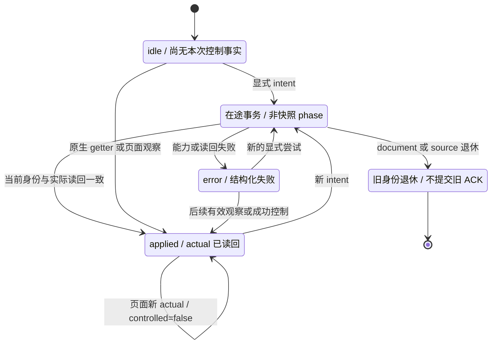
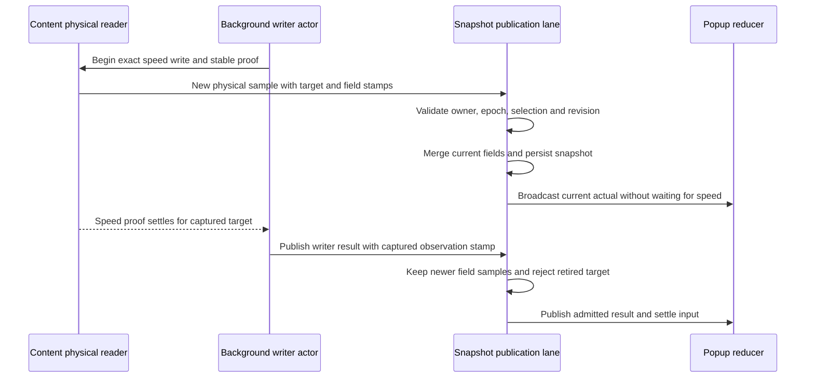
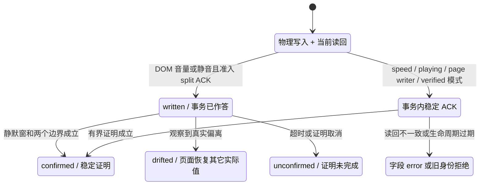
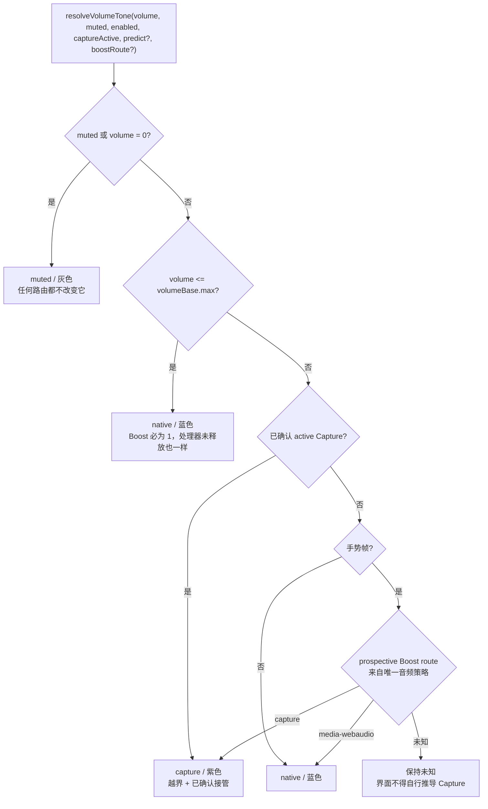

# 05. Control state (Field states, volume/mute, audio processing)

> 主题 owner 段: §10 Control state · §11 Volume and mute · §12 Audio processing
> 完整目录: [README.md](README.md)

## §10 Control state

`ControlCoordinator` 负责意图排序与快照权威。全字段绑定 `tabId + documentId + generation + revision + intentId`:

### Business ownership and regression boundary

修复任一控制入口都必须保留同一套业务；不得为通过新用例改写既有呈现或复用规则。

| 职责 | 唯一 owner | 必须保持的验收 |
| --- | --- | --- |
| 意图排序、目标与事务结算 | `ControlCoordinator` | 当前 document/target/source 的物理 ACK；旧事务不得覆盖新事实 |
| 原生写入、document desired、场景 speed | `NativeMediaExecutor` | 新目标继承；旧场景返回恢复自己的 speed；同访问不覆盖页面新手势；显式释放清模板 |
| 音频处理器路由与实际生命周期 | 既有 mode policy / audio-session store | 原生优先；完整安全图优先；Capture 准入和实际 ACK；音频时钟独立 |
| toast、音量条、角标色调 | `resolveVolumeTone` | 相同手势相同路由事实；越过原生上限且已知 Capture 首帧紫；安全页面图蓝；静音/零灰 |
| 在途显示的生命周期 | 现有 Popup Port / shortcut feedback | 同 token 开始和结算；更晚输入优先；失败回实际值；导航退休；不伪造成功 |

`test:unit` 包含 `popup-coalescing`、`badge-volume-state`、`card-snapshot`、
`native-media-executor`、`volume-tone-sync` 的相反顺序与生命周期用例。浏览器规格
同时核对真正的音量读回、OSD 首帧/后续帧、滑条和 Action badge，不能仅凭各组件
静态颜色测试宣称跨上下文同步。新修复不得把业务断言改为接受先蓝后紫或延迟旧值。

媒体身份还包含创建它的 registry epoch：`media:<epoch>:<sequence>`。同一 document 的 Content registry 重建不能重用旧媒体 ID；`sourceRevision` 只描述该 registry 中的源变化，不能代替 registry 身份。隐式音量请求优先从当前 runtime 重新解析目标。额外读取失败时，完整且同目标的快照只可作为写入规划基线；仍须由 Content 精确目标校验和实际 writer ACK 证明完成，不能凭旧元素编号返回成功。

```ts
interface ControlFieldState<T> {
  desired: T | null;
  actual: T | null;
  restoreBaseline?: T;
  revision: number;
  phase: 'idle' | 'applied' | 'error';
  writeState?: 'written' | 'confirmed' | 'drifted' | 'unconfirmed';
  strategy: 'observe' | 'capture-observe' | 'page-native' | 'dom-native' | 'chrome-native' | 'extension-state' | 'extension-css' | 'extension-overlay' | 'media-webaudio' | 'capture' | 'unsupported';
  coverage: 'full' | 'active-target' | 'partial' | 'opaque';
  controlled: boolean;
  mediaObservation?: MediaObservationStamp;
  intentId?: string;
  lastError: ControlError | null;
}
```

### Field transaction state

`ControlFieldPhase` 的闭合集合由 contracts 拥有；没有 `applying` phase。
下图的 `InFlight` 是正在执行的串行事务，不是已发布的快照状态。运行中的请求
不能覆盖最后一次 actual；身份/epoch/revision 过期的 ACK 不能提交到新目标。



`applied` 不等于扩展仍持有字段：页面观察、目标切换读回和释放页面设置也可以
产生 `applied + controlled=false`。失败字段可用 `actual:null` 表达没有本次成功
证据，`restoreBaseline` 是补偿线索，不能当作失败后已确认的 current actual。
`ControlSnapshot`、native field ownership、document desired 模板与 tab session
是四个不同职责：快照投影实际值，ownership 保管精确源 baseline，desired 只驱动
允许的后继目标重放，session 持久化已确认且可恢复的字段。后两者不是 actual。

- **Echo Correlation Token**: `{ intentId, fieldRevision, expectedValue, tolerance }`（禁止时间窗口布尔标记）。
- **Playback actual**: 被动读回的 `playing` 始终优先于历史 controlled ACK；每次
  toggle 在当前事务内重新读原生 baseline。字段未知也要触发既有有界恢复。
  详见 [播放按钮与缓冲](06-media-and-video.md#141-playback-button-and-buffered-play)。
- **Stale-base-revision recovery**: Background 拒绝 `baseRevision` 与权威快照 revision 不一致的 intent/operation，返回 `control_stale_revision`。Popup 先刷新权威投影；允许重试的赋值操作只按原意图有界重试。`playback-toggle` 不得把旧点击盲目重放给另一个目标；当前媒体的读取、toggle 和稳定证明见 [播放按钮](06-media-and-video.md#141-playback-button-and-buffered-play)。
- **Continuous Popup transport**: 离散 intent/operation 保持上述 v2 RPC 合同。连续 volume/DSP 只使用一条私有 typed Popup→Background 通道；Background 按目标/字段保留 latest slot，以 50 ms 窗口合并后调用同一 `ControlCoordinator`。Popup 断连只退役返回通道，不取消已被 Background 接收的最新意图，也不建立第二个状态 owner。
- **Disconnected flush**: 通道关闭时拒绝所有尚未结算的等待；关闭后对未结算 revision 的 `flush` 同样立即拒绝，不得创建无人结算的 waiter。已结算 revision 保持完成语义。保存、全局预设与重置必须能从该失败退出，不能永久停留在等待状态。
- **Channel readiness**: 私有连续通道必须收到匹配 session 的 `ready` 确认；5 秒内未收到则明确报告后台未就绪并断开。旧后台仅接受 Port 连接不代表支持控制。通道失效时清除未确认字段、恢复最后实际值并显示错误，不得无限保留乐观数字。
- **Settlement ordering**: 通道确认的 `throughRevision` 必须结束对应本地输入的 pending，即使其 ACK 比已接受的页面 snapshot 更旧。旧 ACK 不能覆盖较新的实际值；也不能让已结算输入永久遮挡后续页面音量。更晚的本地输入继续保留各自 revision 的乐观投影。
- **Failure presentation**: 通道通知、待完成 flush 和后续 stage 共享同一个失败对象；卡片负责一次回滚、提示与权威状态刷新，按钮消费者不得重复呈现该失败。主动销毁先移除监听与就绪计时器，再断开 Port，不投影断线错误。
- **Card transient-unknown recovery**: 结构、绑定与 actual 有不同完成点。无身份预绘制节点保持 inert，未知 actual 不伪造音量或播放状态。绑定后的 `controlSnapshotKnown` 是瞬时闩锁：被接受的广播、恢复读取或已提交 ACK 都可把它变为已知；失败须可见并使用现有有界恢复。冻结、丢弃或 unloaded 成员是 availability 分支，不是重试读取分支：只保留元数据，Chrome 恢复为 runnable 后才重新绑定控制。详见 [首帧 owner](../architecture/runtime.md#presentation-and-actual-confirmation)。
- **Processor Handoff (three-owner)**: 无双重增益/DSP，无虚假 active ACK。MediaElement WebAudio/Capture 候选必须先得到 running/readback ACK；旧 owner 先中性化，候选验证成功后才释放，失败则恢复最后一个已确认 owner。

### Ordered physical observations

全局 snapshot revision 排序已发布投影，不替代媒体采样顺序。完整 Content runtime
对当前选择发出 `mediaObservation: { owner, epoch, selection, revision }`；每个实际
字段保留自己的 `mediaObservation` stamp。新 runtime 的 epoch、新选择访问和采样 revision 分别
防止旧 owner、旧播放器与旧字段样本回流。同 epoch 不同 owner 是冲突，不以时间戳
猜胜者；document、generation 和完整 `MediaTarget` fence 仍须同时成立。
冷态 bootstrap 与完整 registry 共用 `chooseInitialMedia`，不能在第一次读取与
runtime 接管时选中两个不同播放器。协议形状由 [protocols](../reference/protocols.md#ordered-media-observations-and-restore-tokens) 拥有。

Background 的短 snapshot publication lane 校验、合并、持久化并广播物理样本；
长时间 speed writer 仍由事务 actor 串行执行。页面新音量、暂停或速度样本不必等待
无关 speed ACK。writer 结束时按目标与各字段 `mediaObservation` 合并，不能用旧 ACK
覆盖期间已接受的较新 actual；控制意图的结算与物理事实的采纳也不能相互冒充。

Native executor 在每个字段完成实际读回时立即保存该字段的观察 stamp。后续解除
静音等异步 sibling stage 不能把旧音量重新标记为新样本。Popup 连续通道结算也复用
同一字段观察顺序：即使 control revision 相等，较新的页面音量仍优先于旧 ACK；
pending 必须正常结束，旧 `effectiveVolume` 结果不能覆盖已合并的较新实际值。

复合操作必须保留每个物理 stage 原有的字段 stamp，并透传最新 producer sample；
Background 不能为收集到的字段重造观察序号，也不能在合成 `effective-volume` 时丢掉
顶层证明。最终 ACK、音量结果和 OSD 读取已提交字段，不能把尚未进入 canonical
snapshot 的 prepared 值冒充提交结果。连续增减音量在没有页面事件回声时也必须闭环。

<!-- mermaid:id=physical-observation-lanes -->


## §11 Volume and mute

```text
control.volumeBase = page-native 0..800 | standard DOM 0..100
AudioConfig.volumeBase = portable fallback 0..100
boost = 1..8
AudioConfig.volume = clamp(volumeBase * boost, 0, 800)
effective output ~= volumeBase / 100 * boost
```

- **原生优先分配**: 协调器先把 `0–800` 的精确值交给 exact page controller。setter + getter ACK 一致时提交 `volumeBase=actual, boost=1`，不创建处理器。标准 `HTMLMediaElement.volume` 只承接 `0–100`；高于 100 且页面拒绝时，在同一事务内回退为 `volumeBase=100, boost=desired/100`，完整安全媒体覆盖使用低成本 MediaElement WebAudio，只有覆盖不完整/不安全或绑定失败才使用 Capture。
- **增强请求必须保留原意图**: 当前顶层文档的已验证快捷键保留 invocation identity，可经同一 Background owner 取得一次性 Capture admission；实际浏览器授权仍由 `tabCapture` 获取时检查。`site-page` 来源不能证明此前没有扩展调用授权，`mediaWebAudio === false` 也只否定页面图，不否定 Capture。不得在反馈或执行层把请求夹到 100 或把 Boost 改成 1 后报告成功；不能应用时保留原 desired，发布真实 actual 与结构化错误。跨标签页、旧文档及未验证来源仍不能获得准入。
- **音量步进不跨过原生上限**: `effective-volume` 的 delta 是手势步进，不是任意跳变。除跨越 100 的那一步外，结果就是当前值与 delta 的直接相加（73→83、87→77），不吸附任何网格；一次跨过 100 的步进直接落在 100（95→100、105→100，按住累计的 +30 从 90 只到 100，下一次手势再从 100 继续）；0/800 仍是端点。Popup 滚轮和 OSD 预测必须调用同一个步进函数，否则反馈会先显示一个协调器不会写入的数字。
- **Mute**: 原生 owner 修改原生静音属性；已准入的文档输出 owner 修改独立 processor mute。两者均保留数值音量，不借归零覆盖用户档位。
- **音量手势即“我要听到”**: `effective-volume` 提升到大于 0 时，同一事务把 `mediaMuted: false` 一起下发。显式 Popup/hotkey/Remote 请求到达既有 page/DOM writer，扩展不以 `hasBeenActive === false` 自行拒绝；浏览器仍拥有自动播放策略，writer 通过稳定读回和播放状态检查报告真实失败，不强制 `play()`。自动 restore、dispose 和 rollback 保留原激活保护；本次手势不能变成下次访问的静音重放（SCTRL-055）。
- **每次手势复核当前事实**: `effective-volume` 尝试从当前 runtime 解析隐式目标并读取同一次 source 的 `volumeBase/mediaMuted` 对，再规划 setter。额外读取不能成为 main 原有暖态音量写入的硬性前提：已有同目标、完整的基础音量/Boost/静音基线时，读取失败仍可进入原 writer；冷态或另一明确目标不得借用该基线。读取失败时必须实际执行并取得 writer ACK，包括同值、page-native 放大和回退到 Boost 的分支；相同缓存数字不构成成功。读取成功时继续采用最新目标和实际值，processor ACK 仍由其生命周期 owner 提供。
- **Reset**: 同一协调器事务把音量恢复到 100%、取消静音、速度恢复到 1，并释放 DSP；内部 `releaseDocumentOutput: true` 同时撤销文档输出需求。速度由原生 writer 确认；无独立需求后必须收到真实停止 ACK 才释放 Capture。处理器阶段失败时，速度与音量一起补偿回重置前的实际值。
- **无隐式 Limiter**: 禁用隐式限幅器，Compressor 为独立显式能力。

### Document-output ownership

`nativeAudioAbsent` 是当前 target/source 的严格能力事实：精确视频的实际
`MediaStream` 有 video track 且没有 audio track。它只证明该视频的 volume/mute
不能控制文档音频，不宣称文档正在出声。未知源、时长、域名和历史值不能签发此事实。
隐式全输出音量/静音意图可据此通过既有 admission 选择 Capture；明确 target 的
请求不得扩 scope，手动 `direct` 拒绝而不改变网页音频图。无媒体元素不自动获得
此证明，也不虚构目标来绕过准入。

`AudioConfig.documentOutput?: true` 只持有当前运行期需求，偏好解码拒收它。
逻辑上仍保存 `volumeBase + boost`；`audioConfigToProcessorConfig` 把有效音量
映射为 `outputLevel.gain = volume / 100`（`0..8`）和独立 `outputLevel.muted`，
物理 `boostGain` 固定为 1，防止同一音量被乘两次。原生模式不把页面 volume/mute
送入处理器。文档输出在 0、100 和超过 100 时都是有效控制需求，不能数值回到
中性就停掉；reset / restore-page-settings 用内部 `releaseDocumentOutput: true`
撤销，禁用和导航遵循同一现有生命周期，独立 DSP 需求单独决定是否继续运行。

Capture actual 必须来自运行上下文、签名一致的 processor snapshot、稳定
AudioParam 与推进过 ramp 边界的渲染时钟；读回配置对象不能当作声音变化证明。
正式信号回归独立验证输出 RMS、静音和恢复；真实站点与用户已打开的 document
仍按各自实测范围报告，不从夹具 PASS 推导全站兼容。

### §11.1 写入与确认分离 (Split acknowledgement)

对原生字段，**物理写入**与**稳定证明**是两个不同事实。当前仅 optimistic 模式
的标准 DOM `volumeBase` / `mediaMuted` 可以分开作答；`speed` 是离散设置，始终
在同一事务内等待稳定证明，避免把源切换抹掉的值当作成功。

```text
desired -> 物理写入(同步) -> written
                          -> 稳定证明(可取消后台任务) -> confirmed | drifted | unconfirmed
```

### Native write proof state



- `written`：setter 已执行且元素当前反映请求值。事务据此作答。
- `confirmed`：经过事件静默窗（`NATIVE_EVENT_QUIET_MS = 64`）与两个渲染边界后值仍成立。
- `drifted`：页面在我们写入后恢复了别的值。这是静默窗存在的理由，现在作为**可观测信号**输出，而不是被当作延迟花掉。
- `unconfirmed`：稳定化未结束（生命周期中止 / DRM 不触发事件 / 超时）。**不是失败**：不报错、不补偿。

约束：

- `phase` 保持原义（`applied` 表示读回判定）；表达写入阶段必须 `ControlWriteState`，**不得复用 `applied`**。
- 证明在事务作答之后运行；更新的写入取消上一个写入的证明，避免乱序覆盖。
- `drifted` 回写 observed actual，并按站点计入 ledger；窗口内累计达阈值即降级为历史 verified 路径（先证明后作答）。`unconfirmed` 不计 drift。策略归属 `native-write-policy.ts`，证明的挂起与取消归属 `native-write-confirmation.ts`。
- 稳定证明发现 drift 时，必须通过同一原生事件处理入口发布当前相干 volume/mute 对，经过目标、pending 与 ownership 检查；不能只更新内部 observed 缓存，否则下一次事件会被误认为重复而丢失。
- 写入仍串行；被降级的是**等待**，不是**顺序**。
- 适用边界：仅获准 split ACK 的标准 DOM 音量/静音字段。speed、page controller 的能力发现与回退、Capture/WebAudio 增益、处理器生命周期、跨 100 路由边界**仍完全事务化**。`confirmed` write state 不能冒充菜单、音频处理器或实际视频时间推进的证明；各自证据由相应 owner 负责。
- 播放/暂停（`playing`）同样不在适用边界内。页面可以在我们按下暂停后自己恢复播放，并且用 `stopImmediatePropagation` 吞掉 `pause` 事件，所以同步的 `paused` 取值只是**写入**，不是确认：`writePlaybackWithStableAck` 让物理 setter 与稳定窗赛跑，回放、换源、丢失选中都在事务内作为真实失败上报（`SCTRL-005`）。先答 `written` 会把一次没生效的暂停报告为成功，再靠后续观察翻回，正是「按了暂停却还在放」的观感来源。
- 数值显示永不冻结：`resolveVolumePresentation` 的数值恒取 `state.config` 的实时值。路由事务只管辖**色调**（`actualMode` / `phase`）与 `muted`，避免新数值配上一条未确认路由的色调。冻结数值曾使 0–800 滑块在跨过 100 后整个手势停在起始值。

页面观察从当前文档的 MediaRegistry 就绪时开始，不依赖此前执行过控制请求或
绑定过 tabId。与冷态 bootstrap 一样，Content 不自报 page observation 的 tabId；
Background 从 Chrome sender 确认 tab、顶层 frame 与精确 target document。完整
runtime 接替 bootstrap 后仍须持续发布页面变化。回归证据见
[直播音量与 Popup 修复记录](../../../../docs/research/2026-11-01-spectra-live-volume-popup-repair.md)。

「有媒体」本身就是观察运行时的加载边界：文档上报 `hasMediaElement` 时，
`ensureMediaObservation` 以 `document-media-observation` 能力确保重运行时存在，
与是否存在待写入模板、是否已显式使用无关；没有媒体的文档不会因此加载重运行时，
导航与显式 release 之后也不会被下一次媒体上报复活。运行时 attach 到已有选中的
文档时立即发布一次该选中（携带观测戳），并把页面上已经存在的物理值（音量、静音、
速度、音高保持、播放状态）作为页面观察一并提交；无选中则不发布，但**紧随其后的
第一次选中**会补完这次发布且只补一次。SPA 路由切换（`/follow` →
`/follow/live/<id>`）在同一文档内选中另一个播放器元素时同样发布该元素自己的
物理值；仅在同一元素上变化身份（mediaId / sourceRevision）的选中保持只发布目标。
观察不追随控制所有权：新播放器已经呈现并播放、但选中尚未迁移时，它自己的原生
音量/静音变化仍以该元素的 target 提交页面观察；隐藏预览不观察，控制所有权也不因
属性事件移动。否则 `volumechange` 会被"非当前目标"过滤，角标停在旧播放器的数字，
直到用户手动暂停/播放一次或打开 Popup。判断"是否呈现"时几何不是唯一证据：直播页
常用 canvas 绘制画面而让 `<video>` 保持 0×0 布局盒，因此无面积但持有无界时间线且
已缓冲数据的元素同样算呈现（`isLiveMedia`）；有限时间线（DVR 窗口、切片高光）则用
"正在出声"证明——未暂停、未静音、音量大于 0。静音、零音量或暂停的节点仍是隐藏
预载，不观察。
否则新文档或新播放器在首次原生变化或被显式读取前没有任何字段快照，看起来就像
"必须点开 Popup 才同步"。
同步照常成立，角标是否可见仍只由本节下方的显式使用决定——同步、使用、隐藏三件事
不互相门闩。`/follow` 与 `/follow/live/<id>` 同源且同 tab session，切换文档不涉及
跨 origin 会话迁移。

### §11.2 Tone ownership

三个调色板面（Popup 音量条、Action 角标、快捷键 OSD 药丸）共用同一个判决 `resolveVolumeTone`，但证据分为两层：

符号表（"音量该显示什么颜色"这一件事一共八个符号，之前只散落在四处叙述里）：

| 符号 | 一句话职责 | 谁调用它 |
| --- | --- | --- |
| `resolveVolumeTone` | 唯一的色调判决：`volume`/`muted`/`enabled`/`captureActive`（+ 手势前瞻）→ `muted`/`native`/`capture` | `handlers/badge.ts`（两处）、`shortcuts.ts`、`hotkey-volume-tone.ts`，以及 `resolveAudioVolumeState` 内部 |
| `resolveAudioVolumeState` | 已确认的 silent/capture/native 真值表，作为线格式对外 | 由 `volumeToneToAudioVolumeState(resolveVolumeTone(…))` 组合而成，不是第二套规则 |
| `volumeToneToAudioVolumeState` / `audioVolumeStateToVolumeTone` | 两个词表之间的互逆翻译，只改名不改判定 | 前者在 `resolveAudioVolumeState` 内；后者在 `content/ui/osd.ts` 把已确认反馈还原成 tone |
| `resolveVolumePresentation` | Popup 滑条与读数的呈现值：tone、数字、呈现类名 | `popup/card/render.ts` |
| `resolveHotkeyVolumeTone` | 手势进行中的 tone（允许唯一前瞻） | `hotkey-listener.ts` 按住阶段 |
| `resolveSettledVolumeTone` | 结算后的 tone，只消费已确认事实 | `hotkey-listener.ts` 的 repaint 回调 |
| `refreshHotkeyVolumeTone` | 让当前 OSD/热键反馈按最新快照重绘一次的入口 | `hotkey-listener.ts`、`logic/message-handler.ts` |

判据仍在下表；符号表只回答"这八个名字是什么关系"，不改变任何规则。

| Layer | Owner | Predicts |
| --- | --- | --- |
| Acknowledged volume state (silent / native / capture) | `resolveAudioVolumeState` | never |
| Presentation tone (muted / native / capture) | `resolveVolumeTone` | only for a live gesture |

`resolveAudioVolumeState` 不再是第二套规则：它等于「不预测的 tone」+「wire 标签」。两个词表（`AudioVolumeState` 与 `VolumeTone`）只差一个 `silent`/`muted` 改名，映射函数（`volumeToneToAudioVolumeState` / `audioVolumeStateToVolumeTone`）在契约里互为逆，任何一面都不可能单独长出第四种状态。

`resolveVolumeTone` 输入 `volume`、`muted`、`enabled`、`captureActive`（已确认 lifecycle），以及可选的 `predict`、`boostRoute`：

1. 静音或 0 → `muted`；
2. 数值不超过 `CONTROL_VALUE_LIMITS.volumeBase.max` → `native`。该区间每次拆分都是 Boost 1，处理器即使尚未释放也只是 passthrough，所以 110→100 的手势当帧就变蓝，不必等待释放 ACK；
3. 已确认 active Capture → `capture`；
4. 非手势帧 → `native`；
5. 手势使用唯一音频策略发布的 prospective Boost route；已确认 Boost 为后备事实。`capture` → `capture`，`media-webaudio` → `native`；
6. 未知事实不能由界面自行推导 Capture。安全页面图或页面自身放大保持蓝色；未越过原生上限的紫色不存在。



图的判定顺序就是规则顺序，尤其是第一条：静音/零先于一切。一个已确认的 Capture 在
0 音量时显示灰色而不是紫色，因为"没有声音"比"声音走哪条路"更接近用户看到的事实。
第二条保证颜色在原生上限两侧对称：跨上 110 在当帧变紫，回到 100 也在当帧变蓝，
不再让回落一侧停在"处理器还没拆完"的旧紫色上。

计划路由绑定当前 target/source，随实际读取发布，目标更换即失效。它只决定手势
呈现，不证明处理器已 active。Popup 将同一手势的数字、静音、tone 同时交给自身
render 与私有 Port；已知需要 Capture 的首帧直接紫色，禁止先冻结旧蓝色再等 ACK。
更新的手势替换旧呈现，结算/失败按输入 revision 退休。预显示不能写 actual、
usage、成功记录或持久设置。空字段 ACK 同样必须保留更高观察序号的物理音量，
完整已合并 volumeBase/boost 对优先于 ACK 中可能过期的 effectiveVolume 结果。

#### 快捷键 OSD 的三份事实

OSD 保留本地即时反馈；实际目标由既有 shortcut route 决定。固定目标可能不是发出键盘事件的标签页，因此 Content 不能根据 sender tab 猜测目标并广播角标或 Popup 颜色。

| 到达时刻 | 事实源 | 判决 |
| --- | --- | --- |
| keydown（同一任务） | 手势目标 + 内容侧已发布的路由事实 | `resolveHotkeyVolumeTone`（`predict: true`） |
| 手势 ACK | `audioVolume.volumeState` | `audioVolumeStateToVolumeTone` |
| 策略结算 / capture 生命周期 | 已确认 mode、phase 和 Boost owner | `resolveSettledVolumeTone` |

- **路由事实由唯一写者发布，不由画它的面猜**。`state.volumeRoute` 来自原生写者（`read()` 观察到的 `volumeBase` 出处）与 `putState` 的写入策略；`state.boostRoute` 来自 audio runtime delegate 已确认的 Boost 策略；`state.mediaWebAudio` 是 `canAttachAll` 的原始结论（不是第二个模式判决）。
- **不在显示层重做路由选择**。prospective route 复用已有 `resolveDesiredAudioMode`，没有证据时保持未知，不根据 hostname 或数字越界单独猜测 Capture。首次 crossing 与回到 100 后再次 crossing 使用同一规则。
- **显示目标与执行目标同源**。快捷键音量增减的 Background pending 呈现取自 coordinator 串行槽内完成当前媒体读取后的 `desiredEffective`，路由取自同次读取；禁止在入队前另读快照重算 delta。前一次 90→100 尚未完成时，下一次的实际 110 不能配上提前计算的 100/蓝色。Content 本地输入仍即时预测；后台一旦规划本次 writer，就向现有 Toast、卡片和角标通道发布同一数值与色调。
- **数值与色调作为一对采纳**。OSD 只绘制当前 payload 的 value/tone；旧 pending token 负责结算，不能借其色调覆盖新目标。同手势重复输入时，旧值的 stage/ACK 不得把旧 tone 拼到新值上；完整 ACK 留作释放结算，失败或拒绝时仍回到真实整对值。固定到其他标签页的 OSD 只接受那个目标的反馈，前台页的路由事件不能重新上色。
- **结算复用已有反馈**。`refreshHotkeyVolumeTone` 在 `applyCurrentState` 完成和 Capture 生命周期变化时刷新本地显示。跨 runtime 的 `hotkey-tone-stage`、其 500ms 去重和 Popup 全局 DOM 涂色 listener 已删除；真实目标的 snapshot 与既有 shortcut feedback 负责同步。
- **已退场的药丸不再复活**。ACK 迟到时只更新手势事务，不重绘已隐藏的面；`frozen` 分支保留完整结算值，不重绘。

`test/smoke/hotkeys.spec.ts` 使用生产扩展暂停真实 writer 请求，检查首个和后续
110% DOM 帧、Popup 数字/滑条和 Action badge 在 ACK 前后的颜色；必须覆盖前一
100% writer 尚未结束的连续输入，不能只测空闲态首次跨界。真实 OSD 模块另覆盖
同手势旧 stage、旧 ACK、释放时真实回落与其他标签页路由隔离。

### §11.3 Badge projection route

角标是**已采纳事实的投影**，不是第二个 owner（`SCTRL-052`）。两条完全不同的路径都会到达它，因此组合逻辑只有一个入口 `projectBadgeFromSnapshot`：

| Route | Writes `tabSession` | Badge projection source |
| --- | --- | --- |
| Extension intent ACK | yes (per-origin durable session) | latest admitted snapshot fields; durable row only fills unknown fields |
| Page-native event | exact-resource only; never origin-portable | latest admitted snapshot fields; durable row only fills unknown fields |
| Passive actual read | no | latest admitted snapshot fields; durable row only fills unknown fields |

- 页面事件与被动读取都走 `admitPhysicalObservation` → `publishSnapshot` → 同一有界观察投影队列；角标不能只挂在显式控制的保存尾任务上。页面事件中真正变化且已采纳的字段还经过既有 `persistControlProjection(..., 'resource')`，保留非零音量和倍速的同资源刷新复用；被动读取只刷新呈现。`SCTRL-017` 禁止回声写入，不禁止 `SCTRL-055` 要求的资源记录。
- 控制投影按 `(documentId, generation, revision)` 定序；相等 revision 仍可包含新页面事实。生命周期投影读取唯一 audio-session store 的当前事实，不能把音频 generation 与 control generation 比大小，也不能用音频 generation 覆盖角标的 control identity。
- 观察路径的投影以持久会话为基座再叠加已采纳字段：页面只报告它自己改过的字段，而让这些字段「听得见」的 Boost 在持久行里。只读采样会让角标在基量与有效音量之间来回跳（40 ↔ 60）。
- 观察路径用 `scheduleObservationProjection` 而非 `await`：同一 tab 只保留最新待投影快照与已变化字段，资源记录和角标共用现有尾任务。完整采样中未变化的字段不得撤销既有 portable 偏好；尚未重新观察到的 Boost/DSP 从同文档资源行补足，不能因只收到原生字段而清掉。异步读取资源行后、写入前重新检查导航 fence。
- 保存尾任务和导航重绘也必须在异步读取完成后取当前 snapshot 并检查 document/generation；用户上次保存的偏好不能覆盖页面较新的 actual。页面样本不推进 control revision，因此单靠 revision 相等放行不能保证值正确。
- 手势呈现覆盖层与 `badgeState` 实际值分离，由相同 writer 绘制。每个 tab 只留最新 token；Popup 使用 session/inputRevision，快捷键使用真实目标与本次执行 token。旧结算不能清新手势，失败清对应呈现，导航同步退休。覆盖层不点亮 sticky usage，只有 canonical 成功控制记录使用。固定目标的输入只能更新已验证的目标角标。
- usage 的异步读取完成后重新读取当前 audio-session lifecycle；不同 document/origin 或已退休 identity 拒绝投影。Popup 首帧只在音频观测之间比较 audio generation，control generation 不得冒充音频时钟。
- Popup 连续通道结算附带当前 audio-session-store 的同文档事实，在同一次 render 前按音频自己的 generation/configRevision 接纳，然后撤下 pending。已有可信生命周期时，control ACK 不再覆盖它；无音频事实才使用字段 ACK 兜底。迟到的 Capture ACK 不能复活更晚的停止状态，首次成功 Capture 也不因广播稍迟而闪回旧蓝色。
- `observationOnly` 下若该 tab 没有已点亮的角标，投影直接返回：未触碰的页面不会因为页面自己调音量而凭空出现角标。
- 三件事互相独立，不能互为门闩。**同步**是事实：`admitPhysicalObservation` 与资源行写入永远发生，与角标是否存在无关。**使用**只由显式来源（`popup` / `hotkey` / `remote`）的成功 ACK 记录；自动恢复 `restore`、页面观测 `page` 和系统 `system` 都不是显式使用，不得点亮 sticky usage。**隐藏**只由 usage 决定：没有显式使用的 tab 角标保持空。首次显式使用发生时，`markBadgeUsedForTab` 与 `reprojectBadgeForCurrentDocument` 直接用已同步的规范快照投影，不需要重新观察页面。「插件没打开前原生音量不同步」不是靠把恢复当使用来修的——那条路会让未使用的页面凭空出现角标；真正的契约是同步无条件、可见性按显式使用。
- 「已点亮」的判据是**持久事实**，不是 worker 的内存：`isBadgeProjected` 先看 `badgeState`，再退回 `hasBadgeUsage`（`chrome.storage.session`）。MV3 worker 随时可能被回收，回收后 `badgeState` 是空的，而 Chrome 仍持有 tab 级 Action 投影、usage 记录也还在。只查内存会让重启后的每一次原生音量手势都被静默拦掉，角标永远停在死掉的那个 worker 最后画的值——这就是「原生调音量后角标不同步」在长生命周期标签页上的第二种形态。
- `boost` 缺失按中性 1 合成：页面只报告 0–100 的自身档位，从未 ACK 过 Boost 不等于没有音量。两者都缺才表示「尚无 ACK」。
- `paintBadge` 记住最后一次真正送达 Action API 的 `{text, color, documentId, generation}`；值未变则不重复调用。Chrome 会在整页导航时自行清除 tab 投影，所以 `reprojectBadgeForCurrentDocument` 先 `invalidatePaintedBadge` 再重画——缓存从不假设屏幕状态。
- 有界绘制缓存与投影序号在 `clearTabDocumentState` 的异步清理开始前同步退休；退休中的 Action 调用不能回填缓存。

### Remote observation ordering

Remote 复用同一快照，但不能把相等 control revision 当成重复：页面音量、播放和倍速观察有独立 `mediaObservation` 顺序。队列合并和最终发布均复用逐字段观察合并规则，旧字段与旧 selection 不能回流。Audio lifecycle 按 document/origin 匹配，按自己的 generation/configRevision/phase 接纳；不与 control generation 比较。最终 wire state 完成事实合并后才可去重，待发队列保持有界。

## §12 Audio processing

所有显式 DSP 都走同一稀疏图语义，完整精确媒体覆盖用 MediaElement WebAudio，否则用 Capture。原生音量、静音和倍速由原生 writer 负责；经上节准入的文档输出音量/静音由现有 Capture owner 负责，不创建第二套图。可见前台 Popup Visualizer 是独立、非持久化的安全页面 analyser demand，只能观察已有 DSP 或文档输出需求所需的 Capture，不能单独启动或保留 Capture；后台卡片与普通状态读取无权触发 analyser 或 Capture。

### §12.1 Media WebAudio / Capture admission and ACK

1. `CaptureAdmission` 必须绑定 `tabId`、`frameId: 0`、`documentId`、`documentEpoch`、`workerEpoch`、过期时间和 `oneShot: true`。普通页面状态不能伪造或续用它。
2. `WebAudioController` 是完整安全媒体的页面处理器 owner；`offscreen/audio-host.ts` 是全标签 Capture owner。两者共享同一 `AudioGraphRouter` 语义，但不共享物理 source。
3. candidate 先构造图，再确认上下文 `running`、`graphSignature`、`normalizedActualConfig` 和所需 source coverage/count。文档输出还须确认实际增益和独立 mute 的 AudioParam 在 ramp 与渲染时钟边界后稳定。未通过 readback 不得发布 active。
4. Background 只接受同时匹配 `tabId`、`generation`、`controlRevision`、`phase: 'active'`、`contextState: 'running'` 且 `audioGraphSignature(normalizedActualConfig) === graphSignature` 的 ACK。
5. 停止只接受 `phase: 'idle'`、`contextState: 'closed'`、`graphSignature: 'none'` 和 `normalizedActualConfig: null`。错误或 stale ACK 保留原有实际状态并可重试。
6. `AudioSessionSnapshot` 是 Popup、Badge、Content 和 Remote 的生命周期事实源；兼容 Capture 事件只能在 snapshot commit 之后发送。`generation`、`configRevision`、`phase` 和 document identity 必须单调且一致。

### §12.2 DSP 节点与精确参数

```text
tab capture -> commit gate -> mix bus -> master gain -> [Bass] -> [non-zero EQ] -> [Compressor] -> [Mono] -> [Pan] -> [Delay] -> output (+ optional analyser)
```

Sparse-topology changes hand off graph lanes with a `40ms` complementary linear crossfade; parameter-only changes ramp in place and do not allocate a second lane. Replacing a ramp that is still in flight starts from the value that is currently audible (`cancelAndHoldAtTime`), never from the last surviving scheduled event: dropping the pending ramp's end event would snap the parameter back to that stale value for the instant before the replacement begins. The Visualizer tap is read-only and exists only while a subscriber observes an acknowledged MediaElement WebAudio or Capture processor. Releasing the final transient subscriber returns neutral configuration to bypass unless independent DSP demand remains.

| Algorithm | Exact definition |
| --- | --- |
| Boost | 线性 master `boostGain` `1–8`（无 0 增益代换与隐式限幅） |
| Document output | Capture-only `outputLevel.gain 0–8` 与独立 mute；物理 `boostGain=1`，稳定 AudioParam/渲染时钟读回；普通原生模式不携带此配置 |
| 10-band EQ | peaking filters at `32/64/125/250/500/1000/2000/4000/8000/16000Hz`, `Q=1.4`, gain `-12..+12dB` |
| Bass | `lowshelf`, `200Hz`, `+10dB` |
| Compressor | threshold `-24dB`, knee `30dB`, ratio `12:1`, attack `0.003s`, release `0.25s` |
| Mono | `M=0.5L+0.5R`, `L'=M`, `R'=M` |
| Pan | `StereoPanner`, `-1..1` |
| Delay | `0–500ms`, 100% wet |
| Visualizer | 显式订阅才分配主 Tap, `fftSize=256`/128 byte bins |
