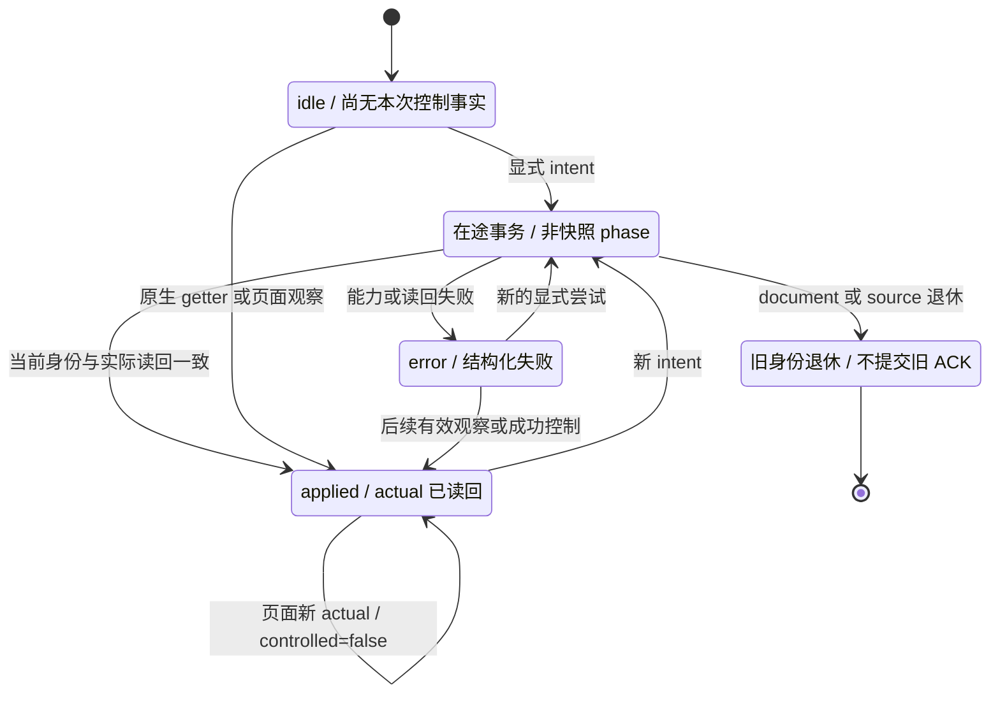
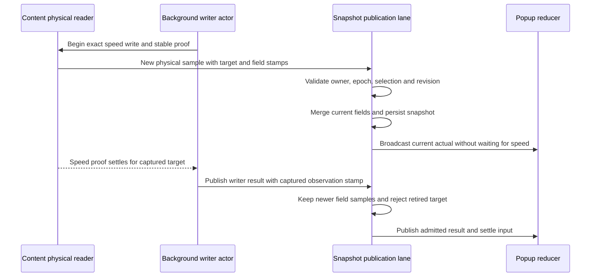

# 05. Control state (Field states, volume/mute, audio processing)

> 主题 owner 段: §10 Control state · §11 Volume and mute · §12 Audio processing
> 完整目录: [README.md](README.md)

## §10 Control state

`ControlCoordinator` 负责意图排序与快照权威。全字段绑定 `tabId + documentId + generation + revision + intentId`:

```ts
interface ControlFieldState<T> {
  desired: T | null;
  actual: T | null;
  restoreBaseline?: T;
  revision: number;
  phase: 'idle' | 'applied' | 'error';
  writeState?: 'written' | 'confirmed' | 'drifted' | 'unconfirmed';
  strategy: 'observe' | 'capture-observe' | 'page-native' | 'dom-native' | 'chrome-native' | 'extension-state' | 'extension-css' | 'extension-overlay' | 'media-webaudio' | 'capture' | 'unsupported';
  coverage: 'full' | 'active-target' | 'partial' | 'opaque';
  controlled: boolean;
  mediaObservation?: MediaObservationStamp;
  intentId?: string;
  lastError: ControlError | null;
}
```

### Field transaction state

`ControlFieldPhase` 的闭合集合由 contracts 拥有；没有 `applying` phase。
下图的 `InFlight` 是正在执行的串行事务，不是已发布的快照状态。运行中的请求
不能覆盖最后一次 actual；身份/epoch/revision 过期的 ACK 不能提交到新目标。



`applied` 不等于扩展仍持有字段：页面观察、目标切换读回和释放页面设置也可以
产生 `applied + controlled=false`。失败字段可用 `actual:null` 表达没有本次成功
证据，`restoreBaseline` 是补偿线索，不能当作失败后已确认的 current actual。
`ControlSnapshot`、native field ownership、document desired 模板与 tab session
是四个不同职责：快照投影实际值，ownership 保管精确源 baseline，desired 只驱动
允许的后继目标重放，session 持久化已确认且可恢复的字段。后两者不是 actual。

- **Echo Correlation Token**: `{ intentId, fieldRevision, expectedValue, tolerance }`（禁止时间窗口布尔标记）。
- **Playback actual**: 被动读回的 `playing` 始终优先于历史 controlled ACK；每次
  toggle 在当前事务内重新读原生 baseline。字段未知也要触发既有有界恢复。
  详见 [播放按钮与缓冲](06-media-and-video.md#playback-button-and-buffered-play)。
- **Stale-base-revision recovery**: Background 拒绝 `baseRevision` 与权威快照 revision 不一致的 intent/operation，返回 `control_stale_revision`。Popup 先刷新权威投影；允许重试的赋值操作只按原意图有界重试。`playback-toggle` 不得把旧点击盲目重放给另一个目标；当前媒体的读取、toggle 和稳定证明见 [播放按钮](06-media-and-video.md#playback-button-and-buffered-play)。
- **Continuous Popup transport**: 离散 intent/operation 保持上述 v2 RPC 合同。连续 volume/DSP 只使用一条私有 typed Popup→Background 通道；Background 按目标/字段保留 latest slot，以 50 ms 窗口合并后调用同一 `ControlCoordinator`。Popup 断连只退役返回通道，不取消已被 Background 接收的最新意图，也不建立第二个状态 owner。
- **Disconnected flush**: 通道关闭时拒绝所有尚未结算的等待；关闭后对未结算 revision 的 `flush` 同样立即拒绝，不得创建无人结算的 waiter。已结算 revision 保持完成语义。保存、全局预设与重置必须能从该失败退出，不能永久停留在等待状态。
- **Channel readiness**: 私有连续通道必须收到匹配 session 的 `ready` 确认；5 秒内未收到则明确报告后台未就绪并断开。旧后台仅接受 Port 连接不代表支持控制。通道失效时清除未确认字段、恢复最后实际值并显示错误，不得无限保留乐观数字。
- **Settlement ordering**: 通道确认的 `throughRevision` 必须结束对应本地输入的 pending，即使其 ACK 比已接受的页面 snapshot 更旧。旧 ACK 不能覆盖较新的实际值；也不能让已结算输入永久遮挡后续页面音量。更晚的本地输入继续保留各自 revision 的乐观投影。
- **Failure presentation**: 通道通知、待完成 flush 和后续 stage 共享同一个失败对象；卡片负责一次回滚、提示与权威状态刷新，按钮消费者不得重复呈现该失败。主动销毁先移除监听与就绪计时器，再断开 Port，不投影断线错误。
- **Card transient-unknown recovery**: 结构、绑定与 actual 有不同完成点。无身份预绘制节点保持 inert，未知 actual 不伪造音量或播放状态。绑定后的 `controlSnapshotKnown` 是瞬时闩锁：被接受的广播、恢复读取或已提交 ACK 都可把它变为已知；失败须可见并使用现有有界恢复。冻结、丢弃或 unloaded 成员是 availability 分支，不是重试读取分支：只保留元数据，Chrome 恢复为 runnable 后才重新绑定控制。详见 [首帧 owner](../architecture/runtime.md#presentation-and-actual-confirmation)。
- **Processor Handoff (three-owner)**: 无双重增益/DSP，无虚假 active ACK。MediaElement WebAudio/Capture 候选必须先得到 running/readback ACK；旧 owner 先中性化，候选验证成功后才释放，失败则恢复最后一个已确认 owner。

### Ordered physical observations

全局 snapshot revision 排序已发布投影，不替代媒体采样顺序。完整 Content runtime
对当前选择发出 `mediaObservation: { owner, epoch, selection, revision }`；每个实际
字段保留自己的 `mediaObservation` stamp。新 runtime 的 epoch、新选择访问和采样 revision 分别
防止旧 owner、旧播放器与旧字段样本回流。同 epoch 不同 owner 是冲突，不以时间戳
猜胜者；document、generation 和完整 `MediaTarget` fence 仍须同时成立。
冷态 bootstrap 与完整 registry 共用 `chooseInitialMedia`，不能在第一次读取与
runtime 接管时选中两个不同播放器。协议形状由 [protocols](../reference/protocols.md#ordered-media-observations-and-restore-tokens) 拥有。

Background 的短 snapshot publication lane 校验、合并、持久化并广播物理样本；
长时间 speed writer 仍由事务 actor 串行执行。页面新音量、暂停或速度样本不必等待
无关 speed ACK。writer 结束时按目标与各字段 `mediaObservation` 合并，不能用旧 ACK
覆盖期间已接受的较新 actual；控制意图的结算与物理事实的采纳也不能相互冒充。

复合操作必须保留每个物理 stage 原有的字段 stamp，并透传最新 producer sample；
Background 不能为收集到的字段重造观察序号，也不能在合成 `effective-volume` 时丢掉
顶层证明。最终 ACK、音量结果和 OSD 读取已提交字段，不能把尚未进入 canonical
snapshot 的 prepared 值冒充提交结果。连续增减音量在没有页面事件回声时也必须闭环。

<!-- mermaid:id=physical-observation-lanes -->


## §11 Volume and mute

```text
control.volumeBase = page-native 0..800 | standard DOM 0..100
AudioConfig.volumeBase = portable fallback 0..100
boost = 1..8
AudioConfig.volume = clamp(volumeBase * boost, 0, 800)
effective output ~= volumeBase / 100 * boost
```

- **原生优先分配**: 协调器先把 `0–800` 的精确值交给 exact page controller。setter + getter ACK 一致时提交 `volumeBase=actual, boost=1`，不创建处理器。标准 `HTMLMediaElement.volume` 只承接 `0–100`；高于 100 且页面拒绝时，在同一事务内回退为 `volumeBase=100, boost=desired/100`，完整安全媒体覆盖使用低成本 MediaElement WebAudio，只有覆盖不完整/不安全或绑定失败才使用 Capture。
- **Mute**: 仅修改原生静音属性，保持数值音量与处理器 DSP 状态不变。
- **Reset**: 同一协调器事务把音量恢复到 100%、取消静音、速度恢复到 1，并释放 DSP；速度必须由原生 writer 回读确认后才显示成功。处理器阶段失败时，速度与音量一起补偿回重置前的实际值。
- **无隐式 Limiter**: 禁用隐式限幅器，Compressor 为独立显式能力。

### §11.1 写入与确认分离 (Split acknowledgement)

对原生字段，**物理写入**与**稳定证明**是两个不同事实。当前仅 optimistic 模式
的标准 DOM `volumeBase` / `mediaMuted` 可以分开作答；`speed` 是离散设置，始终
在同一事务内等待稳定证明，避免把源切换抹掉的值当作成功。

```text
desired -> 物理写入(同步) -> written
                          -> 稳定证明(可取消后台任务) -> confirmed | drifted | unconfirmed
```

### Native write proof state


- `written`：setter 已执行且元素当前反映请求值。事务据此作答。
- `confirmed`：经过事件静默窗（`NATIVE_EVENT_QUIET_MS = 64`）与两个渲染边界后值仍成立。
- `drifted`：页面在我们写入后恢复了别的值。这是静默窗存在的理由，现在作为**可观测信号**输出，而不是被当作延迟花掉。
- `unconfirmed`：稳定化未结束（生命周期中止 / DRM 不触发事件 / 超时）。**不是失败**：不报错、不补偿。

约束：

- `phase` 保持原义（`applied` 表示读回判定）；表达写入阶段必须 `ControlWriteState`，**不得复用 `applied`**。
- 证明在事务作答之后运行；更新的写入取消上一个写入的证明，避免乱序覆盖。
- `drifted` 回写 observed actual，并按站点计入 ledger；窗口内累计达阈值即降级为历史 verified 路径（先证明后作答）。`unconfirmed` 不计 drift。策略归属 `native-write-policy.ts`，证明的挂起与取消归属 `native-write-confirmation.ts`。
- 稳定证明发现 drift 时，必须通过同一原生事件处理入口发布当前相干 volume/mute 对，经过目标、pending 与 ownership 检查；不能只更新内部 observed 缓存，否则下一次事件会被误认为重复而丢失。
- 写入仍串行；被降级的是**等待**，不是**顺序**。
- 适用边界：仅获准 split ACK 的标准 DOM 音量/静音字段。speed、page controller 的能力发现与回退、Capture/WebAudio 增益、处理器生命周期、跨 100 路由边界**仍完全事务化**。`confirmed` write state 不能冒充菜单、音频处理器或实际视频时间推进的证明；各自证据由相应 owner 负责。
- 数值显示永不冻结：`resolveVolumePresentation` 的数值恒取 `state.config` 的实时值。路由事务只管辖**色调**（`actualMode` / `phase`）与 `muted`，避免新数值配上一条未确认路由的色调。冻结数值曾使 0–800 滑块在跨过 100 后整个手势停在起始值。

页面观察从当前文档的 MediaRegistry 就绪时开始，不依赖此前执行过控制请求或
绑定过 tabId。与冷态 bootstrap 一样，Content 不自报 page observation 的 tabId；
Background 从 Chrome sender 确认 tab、顶层 frame 与精确 target document。完整
runtime 接替 bootstrap 后仍须持续发布页面变化。回归证据见
[直播音量与 Popup 修复记录](../../../../docs/research/2026-11-01-spectra-live-volume-popup-repair.md)。

### §11.2 Tone ownership

音量条与 Action 角标共用 `resolveVolumeTone`，但证据分为两层：

| Layer | Owner | Predicts |
| --- | --- | --- |
| Acknowledged volume state (silent / native / capture) | `resolveAudioVolumeState` | never |
| Presentation tone (muted / native / capture) | `resolveVolumeTone` | only for a live gesture |

`resolveVolumeTone` 输入 `volume`、`muted`、`enabled`、`captureActive`（已确认 lifecycle），以及可选的 `predict`、`nativeRoute`、`boostRoute`：

1. 静音或 0 → `muted`；
2. 已确认 active Capture → `capture`，与数值无关：100 与 110 同色；
3. 非手势帧，或数值不超过 `CONTROL_VALUE_LIMITS.volumeBase.max` → `native`；
4. 手势预测时，已确认的 Boost 路由优先于页面级猜测：`capture` → `capture`，`media-webaudio` → `native`；
5. 只有在没有已确认 Boost 路由、且页面级路由为 `dom-native` 时，越界才预测 `capture`；`page-native` 与未回答的路由一律 `native`。

`shouldHoldVolumeTone` 仍决定已结算投影是否保留上一路由证据（跨 100，或同一 patch 同时改变 mute），但手势路径不等待它：卡片把正在绘制的 tone 随 `stage` 消息发布，Background 在同一 turn 用它重绘角标。预测的紫色只是 tone——`isCapture` 仍只来自 ACK，角标不会因此声称处理器已运行。

## §12 Audio processing

所有显式 DSP 都走同一稀疏图语义，但物理 owner 按成本选择：完整精确媒体覆盖用 MediaElement WebAudio，否则用 Capture。原生音量、静音和倍速仍由原生 writer 负责。可见前台 Popup Visualizer 是独立、非持久化的安全页面 analyser demand，只能观察 DSP 已经需要的 Capture，不能单独启动或保留 Capture；后台卡片与普通状态读取无权触发 analyser 或 Capture。

### §12.1 Media WebAudio / Capture admission and ACK

1. `CaptureAdmission` 必须绑定 `tabId`、`frameId: 0`、`documentId`、`documentEpoch`、`workerEpoch`、过期时间和 `oneShot: true`。普通页面状态不能伪造或续用它。
2. `WebAudioController` 是完整安全媒体的页面处理器 owner；`offscreen/audio-host.ts` 是全标签 Capture owner。两者共享同一 `AudioGraphRouter` 语义，但不共享物理 source。
3. candidate 先构造图，再确认上下文 `running`、`graphSignature`、`normalizedActualConfig` 和所需 source coverage/count。未通过 readback 不得发布 active。
4. Background 只接受同时匹配 `tabId`、`generation`、`controlRevision`、`phase: 'active'`、`contextState: 'running'` 且 `audioGraphSignature(normalizedActualConfig) === graphSignature` 的 ACK。
5. 停止只接受 `phase: 'idle'`、`contextState: 'closed'`、`graphSignature: 'none'` 和 `normalizedActualConfig: null`。错误或 stale ACK 保留原有实际状态并可重试。
6. `AudioSessionSnapshot` 是 Popup、Badge、Content 和 Remote 的生命周期事实源；兼容 Capture 事件只能在 snapshot commit 之后发送。`generation`、`configRevision`、`phase` 和 document identity 必须单调且一致。

### §12.2 DSP 节点与精确参数

```text
tab capture -> commit gate -> mix bus -> master gain -> [Bass] -> [non-zero EQ] -> [Compressor] -> [Mono] -> [Pan] -> [Delay] -> output (+ optional analyser)
```

Sparse-topology changes hand off graph lanes with a `40ms` complementary linear crossfade; parameter-only changes ramp in place and do not allocate a second lane. The Visualizer tap is read-only and exists only while a subscriber observes an acknowledged MediaElement WebAudio or Capture processor. Releasing the final transient subscriber returns neutral configuration to bypass unless independent DSP demand remains.

| Algorithm | Exact definition |
| --- | --- |
| Boost | 线性 master `boostGain` `1–8`（无 0 增益代换与隐式限幅） |
| 10-band EQ | peaking filters at `32/64/125/250/500/1000/2000/4000/8000/16000Hz`, `Q=1.4`, gain `-12..+12dB` |
| Bass | `lowshelf`, `200Hz`, `+10dB` |
| Compressor | threshold `-24dB`, knee `30dB`, ratio `12:1`, attack `0.003s`, release `0.25s` |
| Mono | `M=0.5L+0.5R`, `L'=M`, `R'=M` |
| Pan | `StereoPanner`, `-1..1` |
| Delay | `0–500ms`, 100% wet |
| Visualizer | 显式订阅才分配主 Tap, `fftSize=256`/128 byte bins |
