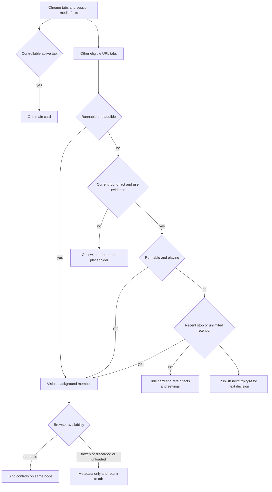
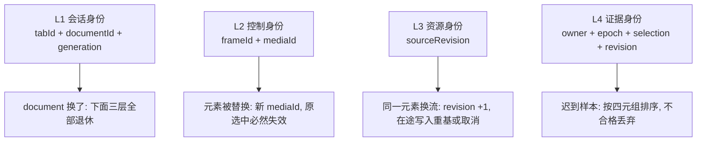
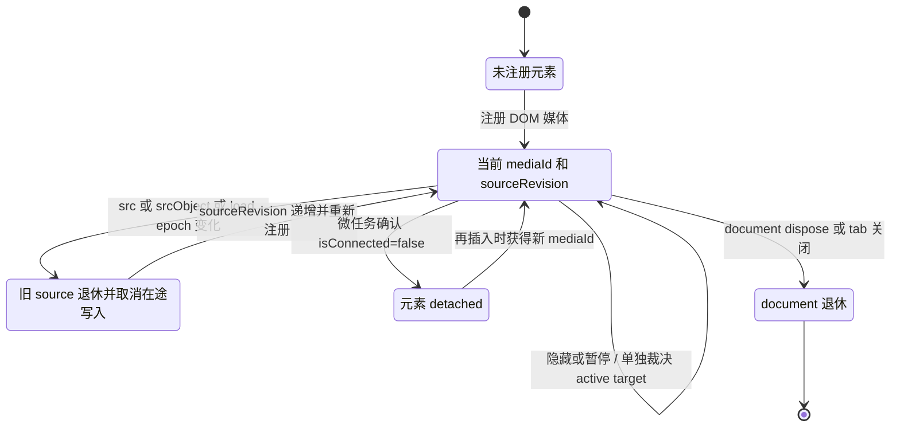
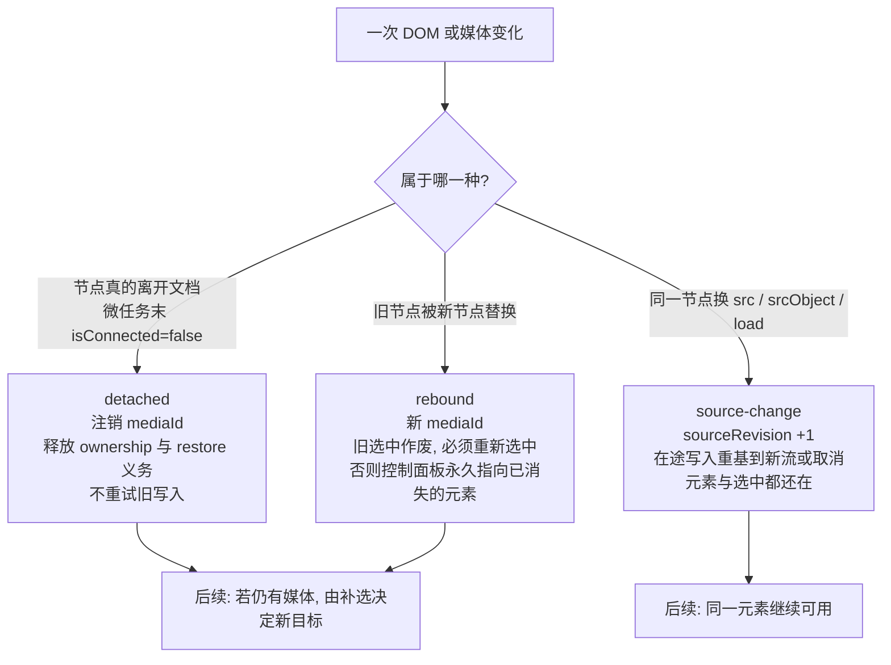
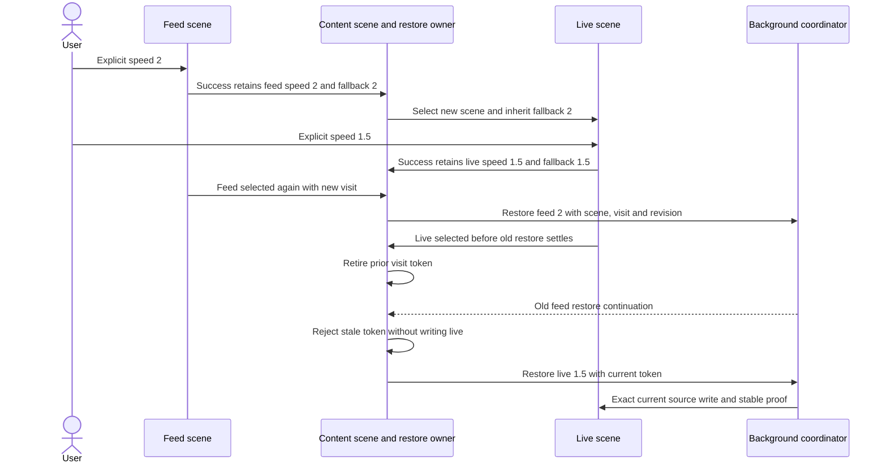
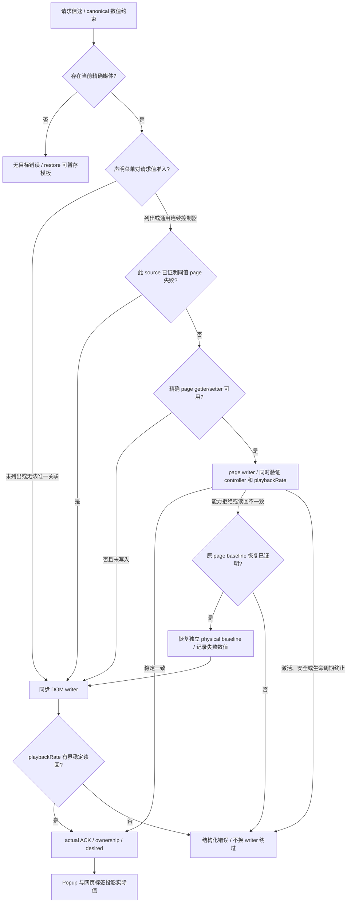
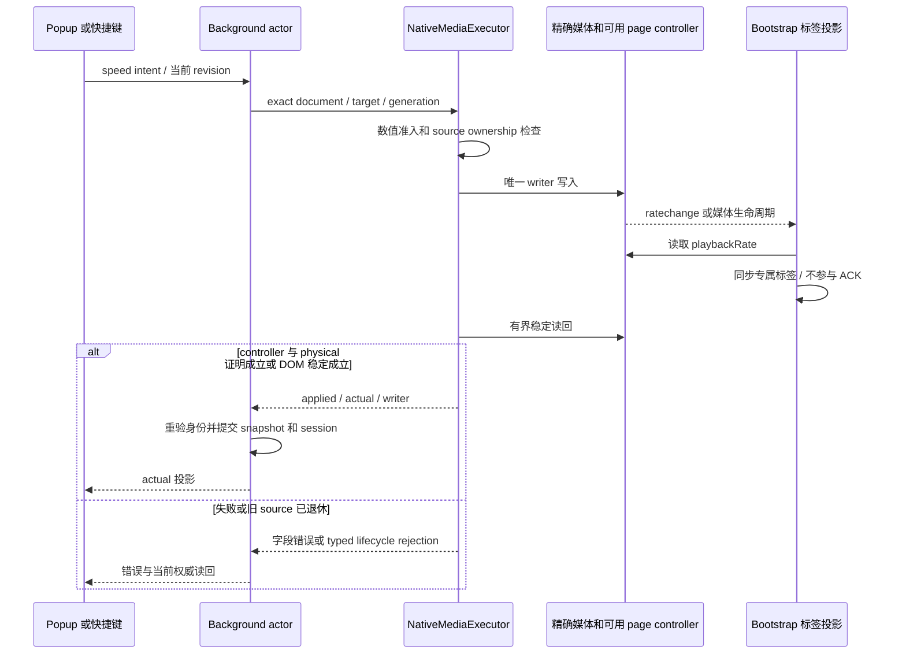

# 06. Media & Video (Active media, media controls, video effects)

> 主题 owner 段: §13 Active media · §14 Media controls · §15 Video effects and screenshot
> 完整目录: [README.md](README.md)

**本篇符号**（只解释名字之间的关系，不改变任何规则）：

| 符号 | 一句话职责 | 谁用它 |
| --- | --- | --- |
| `mediaId` | 元素实例身份；元素被替换就换新 id，永不复用 | 注册表与目标选择 |
| `sourceRevision` | 资源身份；同一元素换 `src`/`srcObject`/load 才 +1 | 源安全证明与写入栅栏 |
| `MediaTarget` | 精确目标三元组：frame + mediaId + 资源版本 | 执行器与快照 |
| `MediaObservationStamp` | 证据身份四元组：owner + epoch + selection + revision | 观察准入 |
| `MediaRestoreToken` | 自动重放三元组：scene + visit + revision | 自动恢复 |
| `selectionVisit` | 选中访问计数；用来拒绝"旧选中下发出的在途工作" | 执行器栅栏 |

## §13 Active media

每个注册媒体具备文档级目标标识 `MediaTarget`:

```ts
interface MediaTarget {
  frameId: number;
  documentId: string;
  mediaId: string;
  sourceRevision: number;
  kind: 'audio' | 'video';
}
```

- **目标选择**: 显式媒体选择保持粘性；新 `play` 事件按 `有效用户指针交互 -> 可见、未结束且已确认的直播 -> 当前播放中 -> 可见面积 -> 最近播放 -> 注册顺序` 比较自动候选。直播因启动或广告过场暂时 paused，仍应在证据成立时获得控制，不能等第二次播放才找到它。有限时长广告不能因正在播放或面积更大抢走该直播，隐藏预览也不能因最后触发 `play` 就覆盖主播放器。已结束媒体、暂停或不可见视频的历史指针交互不阻止新播放器接管；纯音频不受可见面积限制。实际选择变化通过唯一 `selected` 通知同步 Background。
- **观察与恢复边界**: `volumechange`、`ratechange`、`seeked` 即使由浏览器标记为 trusted，也可能来自网页脚本，不能据此切换控制目标。恢复已确认的音量/速度只作用于当前选中媒体；后台预加载元素的恢复 ACK 不得夺取当前目标。
- `activeMedia` 与 `activeVideo` 独立关联，音频元素选择不清除视频目标。控制写入作用域限定为 top-level document only (`frameId: 0`)；媒体列表读取自然报告与 Chrome 事实，不为打开 Popup 注入 frame census。

### §13.1 Document-level inventory

主卡只有当前可控标签页的一张；后台卡没有固定名额。用户主动访问页面后，
bootstrap/runtime 自然登记当前 document 的媒体事实。唯一
`shared/media-card-policy.ts::projectMediaCardMembership` 结合 Chrome tab 状态、
`audible`、有序媒体报告和 `pauseRetentionSeconds` 决定后台成员及 `nextExpiryAt`。
Background inventory、Popup 本地首份投影和公告数量复用这个策略，卡片层不再
另裁 retention，也不维护旧媒体待看库或另一套折叠计数。

runnable 且 audible 是即时证据；否则必须有当前 document 的 found 事实，且有
有效使用记录，再根据 playing 或最近暂停/不可用时间判断资格。retention 为零
表示不设这个时间上限。资格到期或事实失效隐藏卡片，不删除该标签页设置或把暂停
伪装成 source 退休。`nextExpiryAt` 驱动一次到期重投影，无须轮询网页。
未知或从未加载的页面没有媒体证据，直接不入列；不注入、不探测，也不生成
“待查”空框或折叠数量。新 document/新媒体的真实报告可以改变成员，这与正常
Popup 打开时已知成员应当同时首帧出现是两个边界。

`media-facts.ts` 在 `chrome.storage.session` 保存事实，跨 worker replacement
水合，不承诺跨浏览器重启。schema v2 report 必须有单调 `reportRevision`；同一
document 的高水位不被旧时间戳或旧 report 覆盖，使用记录只作单调合并。导航和
关闭删除事实；水合前退休的 tombstone 阻止迟到存储行复活旧 tab。retention 仅
决定展示资格，不删除事实。冻结、discarded 和 unloaded 是浏览器可运行性，
已知且仍合资格者可保留 metadata-only 卡；不能因此唤醒或探测网页。

<!-- mermaid:id=media-card-membership -->


### §13.2 Edge Case & ACK Projection Table

| Edge | Required result | Owner and purpose |
| --- | --- | --- |
| 重复 `load()` 同 URL | `emptied`/`loadstart` 递增 `sourceRevision`；`loadedmetadata` 闭合 epoch | `MediaRegistry::refreshSource`（防状态泄露） |
| `srcObject` 替换 | 相同 URL 下不同流递增 `sourceRevision` | `MediaRegistry::sourceIdentity` |
| 框架节点重排 | `isConnected === false` 时在微任务确认销毁 | `MediaRegistry::queueRemovalTree` |
| SPA 预渲染 Modal | 注册时同步记录可见面积，仅成为当前目标后重放设置 | `MediaRegistry::register` / `NativeMediaExecutor::replayDesired` |
| 镜像快照读取 | `peek`/`resolve` 保持纯净；显式选择或自动播放候选胜出才切换 | `MediaRegistry::selectRecord` |
| 全屏播放器容器 | 精确媒体匹配优先，否则显式全屏视频优先 | `MediaRegistry::fullscreenRecord` |

| Contract scope | `activeMedia` projection | `activeVideo` projection |
| --- | --- | --- |
| `active-media`, `media-source`, `requested-audio-scope` | 替换为实际 ACK 目标 | 仅当目标为视频时同步替换 |
| `active-video` | 保持原状 | 替换为实际视频 ACK 目标 |
| `tab`, `document`, `extension-ui`, `sandbox` | 保持原状 | 保持原状 |

### §13.3 SPA identity and source lifecycle

在讨论任何"变化"之前，先把"身份"分成四层。绝大多数误判都来自拿一层的编号去回答
另一层的问题，例如用资源版本证明控制目标还活着。



四层的存活条件不同，所以它们的编号也不能互相替代：`sourceRevision` 变化不代表
控制目标变了，`mediaId` 变化也不代表用户换了页面。为什么这样分层、以及被否决的
替代方案，见 [Control identity decisions](../../../../docs/decisions/control-identity.md)。

浏览器 document、页面 route、媒体 source 是三条独立生命线。SPA 可以用
`history.pushState/replaceState` 更新地址栏，再由页面框架新增、隐藏或复用播放器，
无需重新载入 document；后退/前进也可能仍在同一 document。机制参见
[History API](https://developer.mozilla.org/en-US/docs/Web/API/History_API/Working_with_the_History_API)（MDN，2026-11-09 访问；页面随浏览器版本更新，引用的是当时描述的 `pushState`/`replaceState` 语义）。
这解释这种交互方式，不证明某个在线抖音版本的内部路由或流类型。

| 变化 | 身份和控制后果 |
| --- | --- |
| 仅 route/history/hash 变化 | Chrome `webNavigation` 通知精确 document；Background 同步 fence 旧事务，再推进 generation/revision 并保留稳定字段。Content 不给页面 history 打补丁；URL 本身不生成新 mediaId/sourceRevision，不把速度重置成 1 |
| 同元素换 `src` / `srcObject` / load epoch | 旧 source 发 `removed(source-change)`，取消异步写入；同 mediaId 的 sourceRevision 递增，再注册新 source。相同 URL 的重新 load 也可构成新代 |
| React 新建 video | 新 mediaId；是否继承 desired 由当前目标选择与恢复策略决定，不能给所有预加载元素广播写入 |
| DOM 节点同批重排 | 微任务末仍 connected 则不退休；真正 detached 才注销 |
| 整页 reload/navigation | 新 documentId，旧事务与媒体身份退休；恢复来源按 [runtime 的 session 规则](../architecture/runtime.md#settings-and-hotkey-target-state) 重新裁决 |
| tab 关闭 | 退休并删除 tab 的 session、快照、媒体事实和处理器；不存在可继续写入的旧页面 |



实现入口是 `MediaRegistry::refreshSource/queueRemovalTree`、Background
`invalidateNavigation` 与 `NativeMediaExecutor::handleMediaEvent`。源退休清除
pending、observed、replay/maturation 状态及失败数值 memo。复用同一元素时直接丢弃
旧 ownership，不能把旧 source 的 baseline 写进已经切换的新 source。

三种身份事件必须分开处理，因为它们的"该做什么"完全不同：



`detached` 与 `rebound` 的区别是"页面还有没有另一个能播的东西"：前者只注销一个
目标，后者意味着控制面板必须重新选人。把 `rebound` 当成 `detached` 处理，就会出现
"视频切到直播后自动控制不了"——面板守着一个已经不存在的 mediaId，而页面在放新的
流。把 `source-change` 当成 `detached` 处理，就会出现
`stale-media-source`：元素明明还连着，写入却因为资源版本变了被判过期。

### §13.4 Closing live players and speed inheritance

document 内 successful desired、媒体场景 speed 与精确 source ownership 分离。
成功显式调速同时更新 document fallback 和当前场景 speed；返回已有场景优先使用
该场景 speed，新场景才继承 document fallback。失败的新请求
不会替换此前成功的 desired。页面自己调整的 actual 只属于该 source，不变成
后继视频的 document-wide 模板。写入中 source 被替换的 `stale-media-source`
是生命周期竞态；未成功的显式字段不能因此写成模板。合法恢复模板由 Content 接续，
显式原生音量操作由下述 Background 事务接续，与能力失败区分。

原生有效音量请求若在物理 ACK 前遇到 `stale-media-source`，Background 保留错误码，
不能先向退休 source 补偿旧音量。仅当请求未指定固定 target、请求值在 0–100 范围、
Boost 中性且 processor stage 尚未开始时，可在同一串行操作内最多接续三次：每次核对原 document、
generation 和导航 fence，重新读取 volume/mute/Boost，必须证实当前 target 已替换。
旧播放器销毁与新播放器插入不必同一任务完成；遇到短暂无目标/旧目标读回，当前操作
只允许 25/75/150 ms 三次有界重新采样，每次再次校验原文档 fence。这段等待不写媒体，
只在获得完整且不同的当前目标后续写；正常读回没有额外延迟，不安装常驻轮询。
全部接续共用首次失败时起算的 1 秒准入预算，递归不能重置；失败/超时 RPC 不重复等待。
已发出的物理操作仍须结算，预算只限制下一次读取/写入的准入，不用超时竞速遗留后台写入。
新目标若已是 Capture、Boost 非中性或无原生音频且无页面控制器，不在此路径升级处理器。
首次计算的绝对音量是本次请求的目标，快捷键 delta 不因新播放器默认值而重复计算。
即使新源已是目标音量，也必须取得新源 ACK 并提交目标/actual/ownership，不能走空确认。
相同 target、读回缺失、显式 target、跨 document 或超过接续预算均报告失败；能力错误
不进入这条恢复路径。Capture 与已开始的 processor 事务沿用原有授权和结算规则。
规格见 `control-coordinator.spec.ts` 与 `smoke/live-target-restart.spec.ts`；浏览器规格
在页面控制器写入期间连续替换 video；同时覆盖首次真实 Popup 滑条输入，核对最终目标
ACK、物理音量、角标与无错误 Toast，不能用第二次输入替第一次完成接续。

| “关闭”实际做了什么 | 当前目标与倍速处理 |
| --- | --- |
| 只是暂停且 video 仍可见 | 保留可控目标；暂停不等于释放倍速，也不由后台预览抢走控制 |
| 直播浮层隐藏、保留 DOM | IntersectionObserver 完整批次、pause/ended 等事件由 registry 统一协调选择。原目标隐藏或结束且有可用替代者时选中返回的播放器，发送一次 `selected`；无需 URL 改变或 feed 再次 play |
| 直播 video 真正移除 | 微任务确认注销后协调替代目标并发送 `selected`；返回的已存在 feed 也能触发 desired 恢复。旧 detached 对象只在 actual 仍等于 lastApplied 时尽力恢复原 baseline，随后丢 ownership |
| 画中画/全屏中的 video 在页面不可见 | 实际 PiP/fullscreen owner 保留选择；退出后才按可见替代者裁决。独立 active audio 不因视频几何变化被替换 |
| 隐藏后没有可用替代者 | 不猜另一个隐藏预览，不伪造 source 退休；保留仍存在的旧目标。无元素时 active target 为空，不能宣称倍速已实际应用 |
| 用户显式调速时没有可解析的媒体或目标已过期 | 字段返回 `capability-unavailable`、`actual:null`、`controlled:false`；失败新值不进入 desired，不以“已保存”伪装实际成功 |
| restore 时尚无媒体 | 先保留恢复模板，当前请求仍报告无目标；以后注册并成为当前目标才通过协调器重新应用 |
| 仅关闭扩展 Popup | 释放观察订阅，已收到的意图继续由 Background 处理；不会重置速度或释放页面设置。已控制字段的 runtime lease 独立存活 |
| 明确 restore-page-settings | 只恢复仍由本写者持有且 actual 未被页面改动的 baseline；已被页面接管的字段不覆盖。清空 document desired 与各场景 speed；`1x` 只是数值设置，不等于释放 |

选择变化由 `MediaRegistry::reconcileRetiredSelection/selectRecord` 唯一通知，
`peek/resolve` 保持纯读，不在每次调速时扫描 DOM。控制身份只由
`documentId + frameId + mediaId` 决定；`sourceRevision` 只界定资源作用域。
同一元素换 `src`/`srcObject`/`load()` 时，注册表先按旧 revision 发
`removed(source-change)` 释放资源态，再以新 revision 发 `registered` 并重新选取；
在途写入不被取消，在下一个 `await` 点重校验。只有元素 `detached` 才取消在途操作。
元素替换等于控制身份退役：`unregister` 先完成全部状态转移（含把 mediaId 记入
`retiredControlIds`）再通知观察者，观察者异常不能留下半注销状态；携带已退役
`mediaId` 的请求（Background 投影落后于页面替换时必然发生）由 `recordForTarget`
解析到当前选中目标，因此视频页→直播页后的第一次快捷键直接生效。写入已在旧元素
开始、替换落在其 `await` 窗口内时，`execute` 对已退役身份做一次继任重试；
仅失去选中的目标不重试。`requestedCoverage = 'active-target'` 的意图描述的是"这个
标签页当前的控制目标"而不是某个历史身份：当它携带的 `mediaId` 在本 document 的注册表
里根本不存在（同一 document 内 runtime 重建后计数器重新发号，旧投影必然如此）时，
`normalizeIntentTarget` 直接把意图应用到当前选中目标，不再用第一次写入报错来换一次
重试；stale 诊断同时打印 requested 身份与注册表快照。选中为空（旧目标已注销）时，补选退回冷态排序：只要求
`isConnected`，不要求面积，因此替换直播元素即使尚未布局也会立即成为目标并发布 `selected`。
`compare` 先比较呈现类别（直播 vs 有限视频），再比较交互证据，然后才是播放态与面积：
页面换页后仍留在文档里的旧播放器不能凭历史点击压制正在播放的直播；同类呈现内
交互证据仍然决定哪个播放器归用户。当前选中停止呈现（`paused`/`ended`/面积归零）时，
同一呈现作用域内**最近注册**的可见视频直接接管，不再要求它已经在播放：直播元素在
首帧前普遍是 `readyState = 0` 且 `paused`，把"正在播放"当作准入条件会让控制权停在
已退场的旧播放器上，直到用户点一次新画面。全屏/PiP 拥有者与显式选择/暂停固定仍然
优先于这条交接。`replayDesired`
只对当前选中的精确 source 发恢复请求，并经 Background actor 排序；隐藏预载
的 `volumechange/ratechange` 不能切换目标。源相同且已失去扩展 ownership 时，
自动成熟探测不能覆盖页面的新手势。

### §13.5 Document replay intent lifetime

`NativeMediaExecutor` 是 document desired 的唯一值 owner；运行时状态协议只报告
`mediaIntentState`，不复制 desired 值。当前 source 的 `controlled=false` 或直播
物理 1x，均不能证明这个 document 的 2x 恢复模板已被用户取消。

| 模板状态 | 进入和离开条件 | 生命周期结果 |
| --- | --- | --- |
| `unset` | 新 executor 尚未保存模板；成功的可恢复字段写入或授权 restore 暂存进入 `retained` | 初始化仍可按现有 session/preset 规则裁决 |
| `retained` | `volumeBase/mediaMuted/speed/preservePitch/loop` 的 document desired 非空；页面改变 actual、切换 source、直播能力失败均保持 | 初始化、显式成功控制和 worker 恢复共用 `restore:document-media-intent` 租约；不能随当前字段 ownership 一起卸载 |
| `released` | `restore-page-settings` 清空模板并释放上述同一租约；新成功显式写入可重新进入 `retained` | 存活 document 的 worker 恢复不能根据旧 resource actual/session 重新创造模板；新 document 独立初始化 |

每次真正 `selected` 都是一次新的选择访问：该 source 以前应用过同一 desired
revision 的缓存证明失效，返回已被页面重置的原 video 也必须重新经协调器恢复。
选择访问未变时，重复 `play/loadedmetadata` 仍受 ownership 和有界成熟探测约束，
不会持续覆盖页面新手势。旧访问的异步回复不得重建本次访问的已应用证明。

场景由精确唯一媒体根和当前 route 绑定；无可证明的声明根时以元素、route 和
物理 source 绑定，不能用站点名或播放器顺序猜身份。场景记录有界，物理 baseline
仍属于精确 source ownership。自动恢复携带 `mediaRestore: { scene, visit,
revision }`，执行前重新检查当前场景、选择访问和 desired revision。选择、source、
route 或释放使旧恢复失效；同文档 route settled 通知唤醒最新恢复义务，不复活旧
token，也不把 URL 变化当作新媒体。协议见 [restore tokens](../reference/protocols.md#ordered-media-observations-and-restore-tokens)。

该 token 必须完整穿过 Background `resolveSubmitRequest` 与 `createIntent`，
不能在字段路由时降成无 token 的首次恢复。coordinator 的转发规格与执行器的
过期 scene/visit/revision 拒绝规格共同保护此边界；只把 Content 发送直接接回
执行器的测试不能证明真实跨上下文链已接通。

target 缓存命中仍须复核 root、完整 route 与适用的 source 身份。页面复用同一个
video 和 source 从 A 切到 B，不代表同一个场景：A 的 speed 不能被 B 的显式值覆盖。
真实场景重绑清除该 target 的 applied desired 和自动成熟证明；保留已排队的最新
恢复提示，供旧请求结算后接续。重复通知同一 URL 不清证明，不夺回页面已接管的值。
原生同页复用的五字段为 volumeBase、mediaMuted、speed、preservePitch、loop；
只有 speed 保存场景值，其余字段继续使用最新 document desired。DSP 仍属于文档
音频 owner，不能从此规则推导每个视频具有独立 DSP 或自动继承所有 CSS 效果。

Background 同文档导航 fence 比较完整 URL 和 documentId；同一 document 重复
replaceState 到相同 URL 不撤销正在提交的控制。路径、query、hash 的真实变化、
跨 document 和 A→B→A 仍撤销旧事务。异步 getFrame 读回不能覆盖较新的导航身份。
冷启动自动 restore 遇到暂时只有 video track 的 MediaStream，保留原生恢复目标，
不因此新启 Capture；已确认的 Capture owner 按既有生命周期恢复。显式手势与
已具备严格能力事实的文档输出准入不变。

<!-- mermaid:id=media-scene-speed-return -->


runtime status probe 是纯读。只有仍持有 loading/initialization 身份的调用方才能
恢复租约；导航或 tab 关闭退休旧身份。恢复网页设置的同文档释放决定也必须挡住
此前已读到 `retained` 的迟到回复，直到新的成功显式控制重新建立模板。释放记录
随 document/tab 一起清理；它不保存第二份 desired。所有其它消费者释放后才允许
唯一 runtime owner 发 RELEASE。

初始 IntersectionObserver 面积送达只补几何事实，不能伪造一次目标切换并把
尚在提交的 portable restore 降为页面观察。隐藏、结束或退出 PiP/fullscreen 时，
先协调选择，再投递相应媒体状态事件。source retirement 仍先发 `removed` 取消
旧源，再完成身份更新或删除。排队的 page observation 在微任务发送前重新核对当前完整目标身份，
旧但仍注册的隐藏播放器不能用迟到观察把 Background 的目标改回去。

IntersectionObserver 的视口相交面积和元素布局尺寸是不同事实：普通滚动出视口
只改变 `intersectionRect`，不能创建新 visit 或重放旧音量/倍速。仅确实失去
`boundingClientRect` 布局框后恢复，才触发同元素再次呈现；切换到另一播放器再
返回仍由正常目标选择处理。回归同时保护普通滚动不覆盖页面设置和 SPA 隐藏返回恢复。

## §14 Media controls

### §14.1 Playback button and buffered play

`playing` 的实际布尔定义为 `!HTMLMediaElement.paused`。Popup 打开时必须通过
当前 document 的 passive getter 异步确认；所有可见 slot 结构和当前语言不等待这个读取，
绑定前保持无身份且 inert，绑定后原位确认。持久控制 ACK 和 Popup cache 只能预测其它
已确认字段，不能遮住新读取的暂停状态。当前读取失败或没有播放字段时，按钮
显示未知（`aria-pressed=mixed`），由既有有界快照恢复继续确认，不能伪造播放/暂停。

Popup 播放按钮明确呈现播放或暂停动作，提交当前媒体操作，不冻结缓存中的旧 modal target。
Content 在本次执行中只 resolve 一次当前目标，读取其物理 `playing`，执行一次
toggle 并在同一目标证明稳定值；新鲜 baseline 优先于历史快照。stale 失败不能
把这个相对操作盲目重放到新播放器。
ACK 和页面广播共用相同的 document/generation/revision 入场规则，按钮只渲染
被接受的快照，旧 ACK 的 `result.playing` 不能旁路重绘。

播放/暂停由专用 `writePlaybackWithStableAck` 做一次原生写入，再经过既有 64ms
稳定窗和两个有界渲染边界读取物理 `!paused`；ACK 类别是 `dom-stable-getter`。
网页可拦截 `pause` 事件，不能因此否认已暂停的事实；网页若恢复播放，稳定值不符
仍明确失败，不能重试写入或循环强制暂停。通用 volume 等事件 ACK 不放宽。
数据不足时 `paused` 已为 false，但 `playing` 事件和 `play()` Promise 可能等待缓冲；
物理证明必须能先结算，使下一次暂停可执行。早到的原生写入拒绝仍失败，晚到的
play rejection 被消费。稳定等待、executor 续体和最终 ACK 都核对 source/document
及当前选择；旧媒体仍注册不能代替“仍是当前目标”。后续真实状态仍由事件同步，
此 ACK 不宣称视频已解码出首帧。

### §14.2 Physical readback and autoplay admission

倍速 actual 始终来自精确媒体的 `playbackRate`；页面控制器 getter 是写入证人，
不能单独签发成功。page speed 写入在有界稳定窗内同时验证 controller 与 DOM；
允许异步追上，永久不一致则按能力失败处理。冷态 bootstrap、完整 runtime 和释放
后的观察都以 `dom-native` 归因实际倍速，写入归因仍保留实际 page/DOM writer。

声明注册表的 `projection.optionSelector` 是 page speed 的数值准入边界：只读取
精确播放器根内、唯一媒体对应的可用档位，文本解析与独立菜单证人共用同一函数。
未列出、菜单未挂载或无法唯一关联时，直接由既有 DOM writer 同步写入实际倍速；
不先试网页 setter，不等待能力超时，不先写其它速率，也不写乐观标签。该无页面
写入的证明允许精确旧 ownership 交接并保留原物理 baseline。后续档位真实挂载时
可重新准入；通用连续控制器保留既有发现与稳定确认语义。

已准入的页面控制器仍不能承接请求值时，分别保留尝试前的 controller 与 physical baseline；先经
原 page writer 证明其自身基线已恢复，再由既有 DOM writer 恢复物理基线，才应用
新的 DOM speed。不得要求页面支持此前由 DOM 承接的自由值。已持有的 page speed
也可按此证明交接；保留
原始 baseline 与旧 ownership 的精确身份。终止性的激活、安全和生命周期错误
不得以 DOM 绕过。每源只记住最近一次**实际 page 写入失败**的数值，避免对同值
显式或自动反复升级；菜单仍有该档位也不能覆盖已证明的物理拒绝。未试写的数值
不计入失败 memo；不同数值仍按准入规则探测，源退休时清除。音量/静音不因该
speed 交接扩大降级权限。

### §14.3 Speed decision and failure



这是准入与失败分支图，不能替代 §14 上文的精确 ownership 交接条件。已 page-owned
字段的 capability 消失不构成通用降级许可；只有 speed 的无试写准入或已证明回滚
可以交接。失败补偿也须保持源身份、激活和 writer 边界，且只在当前值仍属于这次
尝试时恢复，不能覆盖同时发生的网页修改。补偿失败不能被报告成已恢复。

错误字段保留请求 desired 和结构化错误，不保存成成功的 session 值。Popup 请求
层的 `ok:true` 只代表响应 envelope 正常，**每个字段的 phase/actual/lastError**
才决定调速是否成功；一次 patch 可以有独立成功和失败字段。speed 不通过 Capture
或 WebAudio 伪装成可用能力，也不以缩短稳定窗、夹取最近菜单值或乐观标签隐藏失败。

### §14.4 Live transport limits

| 媒体机制 | 能证明什么 / 当前处理 |
| --- | --- |
| 普通文件或可调速的缓冲媒体 | 允许走既有 page/DOM 路径，以物理 playbackRate 稳定读回为字段 ACK；菜单不存在不等于没有 DOM 能力 |
| `srcObject` 为 MediaStream 的实时流 | [W3C Media Capture and Streams](https://www.w3.org/TR/mediacapture-streams/#mediastreams-in-media-elements)（2026-11-09 核对 §MediaStreams in media elements）规定播放速率恒为 1，写入被忽略且不产生 ratechange；当前写入在有界读回失败后返回错误，不伪造 2x，不把失败值重放给下一媒体 |
| 直播边缘缺少可加速的积压 | 即使速率属性可设置，也不能播放尚未到达的数据。高于 1 的速度只能消费已有积压；持续的播放表现还取决于数据到达、buffer、解码与页面追帧策略 |
| 网页随后主动恢复另一速率 | ratechange 观察真实 actual 并释放被页面接管的字段；标签跟随 actual，不以循环强写和页面对抗 |

属性 ACK 不等于墙钟时间上的持续快放证明。当前系统没有为每个直播源签发
`currentTime / elapsed`、有效缓存、解码帧率或端到端直播延迟的能力证书，也不能
仅凭 live 域名、`duration=Infinity` 或一个 `blob:` URL 推断传输类型。在线抖音
必须观察当时精确源的 `srcObject`、可用时间范围、速率变化及实际时间推进，才能
判定是能力限制、页面回写还是实现缺陷；夹具测试不能替代该实机证据。

取消静音区分显式请求和自动恢复。Popup、快捷键、Remote 的显式请求通过唯一
page/DOM writer 交给浏览器执行；`userActivation.hasBeenActive` 不是完整的浏览器
自动播放许可，不能据此提前拒绝显式调音量。取消静音必须等待稳定读回，不能使用
optimistic ACK；若原本正在播放的同一 source 在稳定窗口内暂停且未结束，则返回
`policy-denied` 并尽力恢复静音 baseline，不调用 `play()` 补偿。浏览器实际抛出的
`NotAllowedError` 仍映射 `user-activation-required`。

自动恢复、退出与回滚默认保留文档激活检查，避免无交互恢复打断 muted autoplay；
自动重放跳过仍受限的 unmute。mute、已取消静音的幂等读回，以及其它音量或倍速
恢复独立处理。显式准入只属于本次请求，不改变浏览器权限或自动恢复策略。

### §14.5 Actual speed label

声明站点的工具栏倍速文字由 isolated bootstrap 的
`createSiteSpeedLabelProjection` 唯一投影，事实源是同一声明播放器根内唯一媒体的
`playbackRate`。首次 DOM ready、暖注入、pageshow 主动读回；媒体生命周期和
`ratechange` 同步真实数值。仅观察已发现的播放器根，覆盖标签晚挂载和 React
重渲染；不观察整个文档，不写媒体/控制器，不依赖重级 runtime、菜单展开或档位
存在。`1x` 也必须显示数值；`1.3x` 等未列出的速率直接显示，不夹取最近选项。

注册表 `projection.labelSelector` 只指定专属文本节点，`rootSelector` 限定绑定。
多个根独立同步，同根多个媒体时拒绝猜测。保留 React 文本节点与其它控件；
bootstrap dispose 断开观察并仅恢复仍由本写者持有的文本。菜单选中项仍是独立的
页面控制器证人，扩展写出的标签不得用来签发 controller ACK。

修复证据与验证进度见 [toolbar 同步记录](../../../../docs/research/2026-11-01-spectra-speed-toolbar-sync.md)。

### §14.6 Speed intent and projection sequence



图中只画一次最终 writer；page 能力失败后的有条件补偿/交接见决策图。
首次标签同步也可由 DOM ready、暖注入和 pageshow 直接读回，无需先有用户 intent。

### §14.7 Regression coverage map

这张表回答"哪条业务分支由哪个规格盯着"，**不是覆盖率**，也不回答"哪条 `SCTRL` 有测试"。
按主题列的映射必然漏项，所以它只作为入口：要判断某条不变量有没有测试，读 08 里那一条
自己的 Anchor 与测试引用。

证据层只有三种，混用会让结论失效：

| 层 | 位置 | 能证明什么 | 不能证明什么 |
| --- | --- | --- | --- |
| 静态 | `scripts/verify/*` | 符号存在、结构未漂移、被禁写法没有出现 | 运行时行为 |
| 单测/夹具 | `test/*.spec.ts` | 纯值与状态机在合成事件下的行为 | 真实站点的 DOM 与播放器 |
| 真实 Chrome | `test/smoke/*`、`*-chrome.spec.ts` | 扩展在浏览器里的实际装配与几何 | 具体站点的私有控制器 |

业务分支 → 规格：

| 业务边界 | 可执行规格 |
| --- | --- |
| 选择、可见性、移除、source epoch、pure read、PiP/fullscreen/audio 保护 | [media-registry.spec.ts](../../test/media-registry.spec.ts) |
| 自然事实资格、动态成员、到期时间、休眠状态与 session report 高水位/水合退休 | [media-card-policy.spec.ts](../../test/media-card-policy.spec.ts) · [media-facts.spec.ts](../../test/media-facts.spec.ts) |
| 物理样本 owner/epoch/selection/revision、字段合并与迟到 ACK | [media-observation.spec.ts](../../test/media-observation.spec.ts) |
| 失败不传播、无目标 actual、延迟 restore、激活、baseline、稳定读回 | [native-media-executor.spec.ts](../../test/native-media-executor.spec.ts) |
| 未列出值零试写、迟挂载选项、失败值 memo | [page-media-declared-adapter.spec.ts](../../test/page-media-declared-adapter.spec.ts) |
| SPA 打开/关闭反向交接、原 video 重置后两次直播返回及 worker 重启、释放模板、真实 MediaStream 拒绝 | [page-media.spec.ts](../../test/smoke/page-media.spec.ts) |
| Popup 首次/缓存播放读回、缓冲未完成时连续播放暂停 | [popup-ui.spec.ts](../../test/smoke/popup-ui.spec.ts) |
| 全部已公告主/后台 slot 首帧、同节点绑定、未知 actual 与 live frame 几何 | [popup-frame-geometry-chrome.spec.ts](../../test/popup-frame-geometry-chrome.spec.ts) |
| 模板租约、迟到 probe 对导航/释放的隔离、后台重启恢复 | [runtime-loader.spec.ts](../../test/runtime-loader.spec.ts) · [runtime-restart-startup.spec.ts](../../test/runtime-restart-startup.spec.ts) |
| 首次 actual 标签、React 文本替换、多根/歧义根、真实 Action Popup 自由值 | [speed-toolbar.spec.ts](../../test/smoke/speed-toolbar.spec.ts) |
| 跨 document 的 exact-resource / same-origin portable / cross-origin 退休 | [tab-session.spec.ts](../../test/tab-session.spec.ts) |

真实站点的在线直播与公开发布是第四层证据，不在本表内。它们的结果按
[Evidence contract](../../../../docs/research/README.md#evidence-contract) 单独记录；
日期化报告见 [2026-11-01 修复记录](../../../../docs/research/2026-11-01-spectra-live-volume-popup-repair.md)。

| Field | Preferred implementation | Escalation |
| --- | --- | --- |
| speed | 精确元素控制器 getter/setter -> DOM `playbackRate` | 拒绝/限幅则还原 baseline 后降级 DOM |
| preserve pitch | `preservesPitch` 属性读回 | 无属性时为 unsupported |
| play/pause | 一次 `play()` / `pause()` 后稳定读取物理 `!paused` | 失败报错，严禁绕过自动播放限制或跨目标盲重放 |
| seek | `TimeRanges` + `seeked` 读回 | 无时间轴时为 unsupported |
| frame step | `requestVideoFrameCallback` / 原生 seek | 必须标记 `approximate:true` |
| loop | `media.loop` | unsupported |
| PiP / Fullscreen | 原生 PiP / Fullscreen API | 失败报错，需真实 user activation |

### §14.8 PiP policy attributes are held for the session, not restored eagerly

`disablePictureInPicture` is a **site policy attribute**, not a transient switch. Per
[W3C Picture-in-Picture §3.4](https://w3c.github.io/picture-in-picture/#dom-htmlvideoelement-disablepictureinpicture)（2026-11-09 核对；该草案仍会改动，以当时的 `disablePictureInPicture` 算法为准），
adding it to a video that is already the `pictureInPictureElement` lets the user
agent run its own *exit* algorithm. The old implementation lifted the attribute,
awaited `requestPictureInPicture()`, and restored it in `finally` — so the window
appeared and the browser closed it again in the same task, which then read back as
`Picture-in-Picture readback mismatch after the stable boundary`.

The contract now (`SCTRL-051`):

- `holdPictureInPictureDisable` takes ownership of the lifted attribute and hands it
  back only when the session ends (`leavepictureinpicture`) or the element's async
  state is cleared. `releasePictureInPictureDisable` is idempotent and refuses to
  restore while this element still owns the session.
- A failed `requestPictureInPicture()` restores the site's preference immediately:
  no session exists, so there is nothing to protect.
- A session the page terminates is reported as `policy-denied` (`PictureInPictureVetoedError`),
  never as a readback mismatch, and it is terminal (`retryable: false`): retrying
  would only reopen and re-close a window.
- The explicit extension click passes the Popup's own `target` all the way into the
  executor, so a feed with several videos cannot open the wrong one.
- The Popup resolves that target from the **live** snapshot, not from its first-paint
  forecast. The forecast is assembled from durable facts before Content answers and
  can legitimately have no `activeVideo` on a tab that plainly has one; trusting it
  made the first PiP click report `No active video target` and only the second one
  work. `resolveVideoTarget` asks once when the forecast is empty — one message round
  trip still fits inside the click's transient activation — and pays nothing when the
  forecast already carries a target.

### §14.9 Write, acknowledgement and proof are three different facts

`SCTRL-045` separates them. Eligible native writes can acknowledge before proof;
speed keeps awaited stabilization so a source swap cannot erase its ownership:

| Field | Acknowledgement | Proof (deferred) |
| --- | --- | --- |
| volume / mute | DOM setter + immediate read | `volumechange` + 64 ms quiet window |
| speed (DOM writer) | awaited stable `playbackRate` readback | — |
| speed (page controller) | awaited dual witness (controller **and** `playbackRate`) | — |
| play / pause | `play()`/`pause()` (both settle `paused` synchronously) | `play`/`pause` + quiet window |
| PiP | `request/exitPictureInPicture()` resolved = session owner changed | both PiP events + quiet window |
| fullscreen | `request/exitFullscreen()` resolved = `fullscreenElement` changed | `fullscreenchange` + quiet window |
| preserve pitch / loop | two-frame readback (no native event to defer to) | — |

A **page-controller speed write stays awaited** even though it is the slowest
field: a controller that claims a rate the media never plays looks exactly like one
that applies it 150 ms later, and only the awaited settle window can tell them
apart and fall through to the DOM writer. Deferring it would have silently removed
that fallback (`test/native-media-executor.spec.ts`, "falls back for a free speed the
controller claims but never plays").

The detached proof never fails the transaction. A rollback is published as the
page's real value through the same observation path the native event uses, and it
feeds the per-site ledger (`SCTRL-046`).

A/B State 与 Marker 均以 `mediaId + sourceRevision` 为 Key。禁用后清理所有 Timer/rAF/Listener。

### §14.10 Live streams: withhold the field, publish the fact

`isLiveMedia` decides "this element is a broadcast" from the element alone, and the
answer is a fact rather than a per-site list: an unbounded `duration` means there is
no timeline, so a rate change has nothing to act on. Writing it anyway produced a
`Native volumechange event readback did not acknowledge the requested value`-style
mismatch that described the symptom and hid the cause — the player accepted the value
and reverted it, and the slider looked broken.

The executor therefore refuses `speed` on a live element **before touching it**
(`isLiveUnsupportedField`), reported as `capability-unavailable` with
`retryable: false`, because retrying the same write can never succeed. Volume is
untouched by this rule: a live stream has a volume.

The fact travels: `live` is part of the control snapshot, the page observation and the
submit request. It describes **`activeMedia` only** — never "the page", never the
video target. A read can pick an element of its own (a targetless bootstrap read names
none at all), so the proof is stored with the target that produced it (`liveTarget`)
and is reused only while `activeMedia` still is that same target. When the target
changes, the new publication omits `live` instead of inheriting the old value: a finite
advertisement that follows a broadcast must not arrive already reported as live.
Merging reads the proof, never a default — `mergeSnapshotPublication` has no fallback
that copies `proposed.live` over a target change, `publishSnapshot`'s unchanged test
compares `live` too, and a new document generation starts with no measurement at all.
The popup disables the speed control from it, so the control disappears instead of
failing.

`publishPresentationKind` sends the fact when metadata, selection or playback makes it
one, and only when it is `true`: "on demand" is the default and costs no message.

**Evidence `[E-anecdotal]`** — one ad-hoc observation on `live.douyin.com`, recorded without
the fields the [Evidence contract](../../../../docs/research/README.md#evidence-contract)
requires: no observation date, no build identity, no sampling method beyond "after a real
gesture", no competing explanation. It stays because it is the only real-site observation of
this refusal path, and because a claim with no date cannot be upgraded by editing it later.

What it showed, once: `speed` → `{"phase":"error","error":"capability-unavailable","message":"A live stream has no playback rate to change"}`
with `playbackRate` still `1`; `volume 40` → `applied`, page `volume 0.4, muted false`; the
same tab's VOD fixture still reports `live: false` and applies `1.5x`.

To upgrade it to `[E-current]`: repeat on a named build with a recorded script (CDP
`Extensions.loadUnpacked` with an explicit `chrome.exe`, MutationObserver timeline plus
`paused`/`readyState`/`documentId`), then record date, scope, method and the competing
explanation. Until then this paragraph is a reason to test the rule, not proof that it holds.

### §14.11 A mute the page set is not a preference

Autoplay policy silences most media at load, and a live player under a pre-roll is
muted at volume zero. That observation is true and has to be published — the surfaces
must show the element is silent — and the resource row records it, because that row
describes what this resource does.

What must never happen is replaying it: the row is what an exact-resource reload and a
same-document route change restore from, so restoring an observed mute made the next
visit start silent. The proof that a mute is a choice is the origin-portable row, which
only an extension gesture writes (`hotkey`, `popup`, `remote`); a page observation is
resource-scoped and never reaches it. `rebindTabControlSession` drops a
resource-scoped `mediaMuted: true` **and** a resource-scoped `volumeBase: 0` that the
portable row does not corroborate, and rewrites the row without them, before any
restore plan can read it. Zero is the second half of the same silence: a player parked
at volume zero without setting `muted` (a live element under a pre-roll) is just as
inaudible, and it needs the same proof before it becomes a preference.

So the row stays informative and the replay stays honest: explicit extension value →
both rows → survives a reload; page-set mute or zero volume → resource row only → gone
at the next document boundary. A page-set volume above zero and a page-set speed keep
their existing exact-resource restore, because those are ordinary playback facts, not
a boot-time silence.

### §14.12 Which element the controls belong to

直播和有限时长广告同时存在时，控制属于可见、未结束且已确认的直播，即使它因启动
或广告过场暂时 paused。`mediaRank` 在播放状态和面积之前采用唯一 `isLiveMedia`
判定；不依赖虎牙域名、元素 ID、构造器或广告
词汇。直播初始 `muted` 或 `volume=0` 不是把控制转交广告的理由。正数音量手势经既有
事务对直播同时应用音量与解除静音，不能只改变广告的声音就算通过。

冷态选择与 `admitBetterCandidate` 共用此顺序。选中为空时 `admitBetterCandidate` 退化为
`establishInitialSelection`，`reconcileRetiredSelection` 也用冷态排序补选，所以元素替换
（新元素先注册、旧元素后注销）不会留下空选中。已播放后才注册的媒体、稍后到达的
metadata/data/duration/geometry 都能建立正确选择；MSE 先提供无限时长、后提供首段数据
时，`loadeddata` 重新准入，不等待第二次播放。候选不再把 paused 直播过滤掉；
pause 后的普通继任路径也必须比较同一排序，不能把目标退回播放中的广告。
`smoke/live-target-restart.spec.ts` 覆盖暂停直播与播放广告的首次音量、页面自行
创建真实直播流后的零控制请求自动恢复、同元素换流重置音量和首次显式控制。
`play` 和后续准入共用
`isSelectionProtected`；隐藏预览、显式选择、暂停 pin、PiP/fullscreen
和独立 audio/video scope 的保护继续有效。
精确 fullscreen video 保持选择；若 fullscreen 是同时包含广告和直播的容器，则允许
容器内交接，容器外媒体不得抢占。未选中媒体的 metadata/data/duration 事件不能通过
`publishPresentationKind` 把 Background activeMedia 改成另一个目标，也不能预占其公告缓存。

音量事务的 fresh read 所证明的 `live/liveTarget` 随物理 ACK 一起提交到唯一快照，
由 `publishedLive` 检查其与最终 activeMedia 的完整 source identity 一致。不能只
提交音量而丢掉首次选择的直播状态，也不能把旧目标的直播标签带给新目标。

广告的页面静音/零音量只是该 source 的实际值，不是直播偏好。页面 observation 不写
document desired；跨 document 恢复继续丢弃未经显式用户选择证实的静音/零音量，
同时保留用户明确选择的 mute/zero。默认设置不主动静音其他媒体，也不盲目强制所有
媒体播放或解除浏览器 autoplay 限制。

`smoke/live-target-restart.spec.ts` 使用真实有限广告和较小的带音轨直播，验证正数音量
解除直播静音而保留广告属性，随后广告归零/静音不改变直播的增量基线或角标。
分离音频的公开直播还必须验证实际声音；仅确认 video 属性或广告音量不是声音证据。

### §14.13 Unfinished automatic source restoration

`NativeMediaExecutor` owns the unfinished fields of an authorized document template,
bound to the exact source, desired revision and selection visit. `selected`, `play`,
`loadedmetadata`, `loadeddata` and `durationchange` advance that obligation without a
Popup read or user retry. A rejected old-source operation remains rejected; recovery
issues a new fenced request for the current source. Structured `stale-media-source`
and revision conflicts receive at most three timer retries (100/300/1000 ms) when no
further maturity event arrives. There is no idle polling or site-specific route.

Successful fields and terminal failures leave the pending patch independently.
An automatic ACK updates the same snapshot and existing badge as an explicit ACK;
its non-persistent session scope must not suppress presentation or create a new preference.
A website gesture withdraws the corresponding field for this visit, including a
restore already queued but not yet executed. A successful explicit change to another
field preserves unfinished work. Failed explicit fields never create a document
template. Source retirement, release and disposal cancel pending timers; future
source visits can still consume the retained document template after page takeover.

`native-media-executor.spec.ts` checks no-click continuation, maturity events,
bounded retries, terminal failure, page takeover, queued-message cancellation,
unrelated-field changes and release/disposal. `smoke/live-target-restart.spec.ts`
uses consecutive physical player replacements and reads media volume and badge
without any post-switch control/snapshot request.

## §15 Video effects and screenshot

视频效果只拥有"这一帧怎么被画出来"，不拥有站点的播放器。所有写入必须满足两条：
站点下次重绘后仍然只作用于目标元素；撤销时不猜原值，只移除自己加的东西。

### §15.1 所有权形式：属性 + 自定义属性

- 每个控制器实例持有一个一次性 owner token：`data-spectra-video-effects-owner="<uuid>"`。
- 生效规则只由一段扩展样式表发出，选择器同时匹配 owner token 与效果属性，四条：
  `rotate:var(--spectra-rotate)`、`scale:var(--spectra-scale-x) var(--spectra-scale-y)`、
  `object-fit:cover`、`filter:var(--spectra-filter)`，全部带 `!important` 但**只对带该 token 的元素**生效。
- 撤销是移除属性：站点的 `transform`、`filter`、`object-fit` 从未被覆盖，因此不需要"恢复原值"。
- 不得写元素 `transform`、不得改 `position`/`z-index`、不得插入包裹节点。站点自身动画常写 `transform`，
  任何接管都会在两个方向上互相覆盖。

### §15.2 Rotate / Mirror

- 旋转只接受 `0 | 90 | 180 | 270`。90/270 时容器宽度小于高度，直接旋转会裁掉画面，
  因此同时写 `scale-x/scale-y`，fit = `min(w/h, h/w)`，`w`/`h` 取 `max(1, clientWidth|clientHeight)`。
- Mirror 只翻转 X：`scale-x = -fit`，`scale-y = fit`；与旋转叠加时共用同一个 fit。
- 0° 且未镜像时两条自定义属性都必须移除。留下 `scale:1 1` 同样会让读回把它判成"仍被拥有"，
  于是"关闭镜像"变成一个永远关不掉的拥有状态。

### §15.3 Fill 与 Filter

- Fill 只发 `object-fit:cover !important`，由 `data-spectra-fill` 门控；关闭即移除属性。
- Filter 启用时先捕获 computed `filter` 作为基线，再组合扩展值（brightness/contrast/saturate 百分比，
  grayscale/invert 开关）；关闭时移除属性并丢弃基线。
- "是否等于默认值"必须逐字段比较，不得用 `JSON.stringify`：键顺序不同的等价对象会被判成"已启用"，
  让一个没人开过的效果长期持有 DOM（SP-74）。

### §15.4 Dim

- Dim 使用一个闭合 Shadow Host，内含**固定 4 个**区域 `div`，`position:fixed; pointer-events:none`。
- 四块区域由视频 `getBoundingClientRect` 相对视口钳制后得出（每边 `max(0, min(size, …))`），
  拼成"视频以外"的四块；不改视频布局，也不用 `clip-path`。
- 跟随 `resize`/`scroll` 与 `ResizeObserver`。关闭时必须同时移除 host、4 个区域并停止两个 observer：
  只隐藏 host 会让它继续跟随布局并持有所有权。

### §15.5 效果读回

- 每次 apply 都在 `deadlineMs`（默认 250ms）内读回：效果属性是否存在、`--spectra-*` 的值、
  `object-fit`、4 个区域的 `left/top/width/height`、`opacity`（±0.001）、以及区域数量仍为 4。
- 不一致抛 `Video … readback failed`，按能力失败处理。写过不等于成功。
- `isCurrent()` 返回假、`AbortSignal` 取消、超过 deadline，分别抛 `cancelled` / `deadline-exceeded`，
  与媒体控制共用同一套生命周期语义，不另立错误码。

### §15.6 Screenshot

- 捕获前置条件（全部成立才允许）：元素是当前 `resolve(target)` 的元素；无 `mediaKeys`（受保护媒体）；
  `videoWidth/Height > 0`；`readyState >= HAVE_CURRENT_DATA`；完整矩形在 `visualViewport` 内（含 `offsetLeft/Top`）。
- 令牌：扩展侧生成 `captureToken`，存证 `{video, target, rect}`，TTL 10s。Background 侧用同一令牌回验：
  元素仍解析为同一 target、矩形与存证相差 ≤0.5px、帧与 DRM 条件仍成立。
- 几何在两侧各自计算一次并比对，不接受"页面说过了就裁"。
- `captureVisibleTab` 后由 Background 裁剪，等 `chrome.downloads` 的 `complete` ACK 才返回元数据；
  图像字节不得经 IPC 传输。
- 条件不成立时的错误必须可操作（"完整视频必须可见"、"受保护媒体不能截图"），不得返回空成功。
