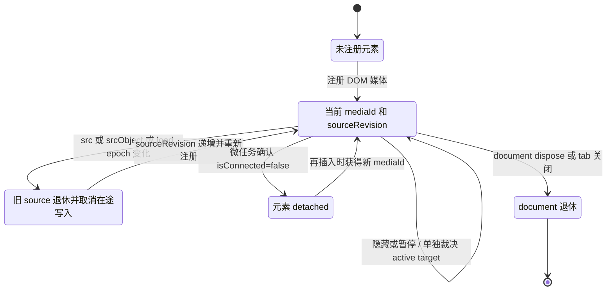
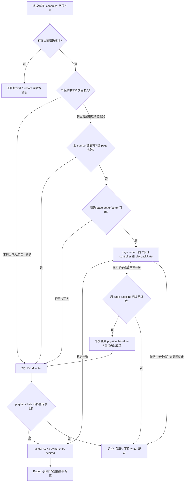
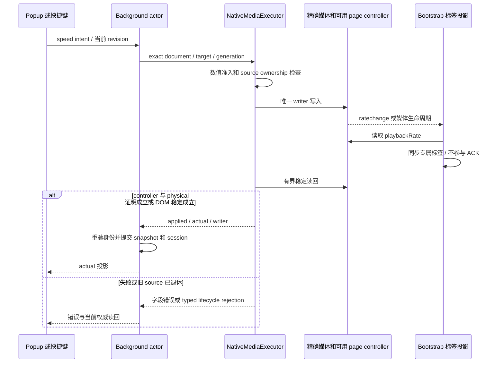

# 06. Media & Video (Active media, media controls, video effects)

> 主题 owner 段: §13 Active media · §14 Media controls · §15 Video effects and screenshot
> 完整目录: [README.md](README.md)

## §13 Active media

每个注册媒体具备文档级目标标识 `MediaTarget`:

```ts
interface MediaTarget {
  frameId: number;
  documentId: string;
  mediaId: string;
  sourceRevision: number;
  kind: 'audio' | 'video';
}
```

- **目标选择**: 显式媒体选择保持粘性；新 `play` 事件按 `有效用户指针交互 -> 当前播放中 -> 可见面积 -> 最近播放 -> 注册顺序` 比较自动候选，不能因隐藏预览最后触发 `play` 就覆盖主播放器。已结束媒体、暂停或不可见视频的历史指针交互不阻止新播放器接管；纯音频不受可见面积限制。实际选择变化通过唯一 `selected` 通知同步 Background。
- **观察与恢复边界**: `volumechange`、`ratechange`、`seeked` 即使由浏览器标记为 trusted，也可能来自网页脚本，不能据此切换控制目标。恢复已确认的音量/速度只作用于当前选中媒体；后台预加载元素的恢复 ACK 不得夺取当前目标。
- `activeMedia` 与 `activeVideo` 独立关联，音频元素选择不清除视频目标。控制写入作用域限定为 top-level document only (`frameId: 0`)；Popup 的只读媒体发现会独立检查已授权 frame，但不会把子 frame 变成控制目标。

### §13.1 Document-level inventory

Popup 枚举使用 `tabId + document generation` 隔离在途探测，并在一次轻量
`chrome.scripting.executeScript({ allFrames: true })` 前后核对 Chrome
`frameId + documentId` census。成功的 `found` 或所有当前 frame 均成功返回的
`no-media` 才是确定事实；权限拒绝、导航错代、无效响应和超时分别投影为
`denied/stale/unknown/pending`，同时返回 examined/failed coverage。
非 `http/https/file` 的标签页（扩展内部页、`chrome://` 等）不可承载可控媒体，
从可见集剔除且不计入 coverage 的 total/denied，其存在不得把完整 inventory 降级
为 degraded。

同一 v2 envelope 的新增证据保持 additive：当前 producer 必须发送单调
`reportRevision` 和完整 coverage。旧 content report 缺少 revision 时，Background
只确认收到，不能创建或覆盖有序媒体事实；只含 `tabs` 的旧 inventory 响应在新 UI
中映射为 `unknown`，不能签发 complete。轻量 DOM census 负责重新获得当前事实。

探测不加载重级 Content runtime。底层 Chrome Promise 未结束时仍占据物理许可；
重复打开 Popup 只观察同一文档操作。候选起点跨扫描轮转；当所有许可都被永久
占用时，系统明确返回 degraded，不能通过逻辑超时释放许可或伪造无媒体。

### §13.2 Edge Case & ACK Projection Table

| Edge | Required result | Owner and purpose |
| --- | --- | --- |
| 重复 `load()` 同 URL | `emptied`/`loadstart` 递增 `sourceRevision`；`loadedmetadata` 闭合 epoch | `MediaRegistry::refreshSource`（防状态泄露） |
| `srcObject` 替换 | 相同 URL 下不同流递增 `sourceRevision` | `MediaRegistry::sourceIdentity` |
| 框架节点重排 | `isConnected === false` 时在微任务确认销毁 | `MediaRegistry::queueRemovalTree` |
| SPA 预渲染 Modal | 注册时同步记录可见面积，仅成为当前目标后重放设置 | `MediaRegistry::register` / `NativeMediaExecutor::replayDesired` |
| 镜像快照读取 | `peek`/`resolve` 保持纯净；显式选择或自动播放候选胜出才切换 | `MediaRegistry::selectRecord` |
| 全屏播放器容器 | 精确媒体匹配优先，否则显式全屏视频优先 | `MediaRegistry::fullscreenRecord` |

| Contract scope | `activeMedia` projection | `activeVideo` projection |
| --- | --- | --- |
| `active-media`, `media-source`, `requested-audio-scope` | 替换为实际 ACK 目标 | 仅当目标为视频时同步替换 |
| `active-video` | 保持原状 | 替换为实际视频 ACK 目标 |
| `tab`, `document`, `extension-ui`, `sandbox` | 保持原状 | 保持原状 |

### SPA identity and source lifecycle

浏览器 document、页面 route、媒体 source 是三条独立生命线。SPA 可以用
`history.pushState/replaceState` 更新地址栏，再由页面框架新增、隐藏或复用播放器，
无需重新载入 document；后退/前进也可能仍在同一 document。机制参见
[History API](https://developer.mozilla.org/en-US/docs/Web/API/History_API/Working_with_the_History_API)。
这解释这种交互方式，不证明某个在线抖音版本的内部路由或流类型。

| 变化 | 身份和控制后果 |
| --- | --- |
| 仅 route/history/hash 变化 | Chrome `webNavigation` 通知精确 document；Background 同步 fence 旧事务，再推进 generation/revision 并保留稳定字段。Content 不给页面 history 打补丁；URL 本身不生成新 mediaId/sourceRevision，不把速度重置成 1 |
| 同元素换 `src` / `srcObject` / load epoch | 旧 source 发 `removed(source-change)`，取消异步写入；同 mediaId 的 sourceRevision 递增，再注册新 source。相同 URL 的重新 load 也可构成新代 |
| React 新建 video | 新 mediaId；是否继承 desired 由当前目标选择与恢复策略决定，不能给所有预加载元素广播写入 |
| DOM 节点同批重排 | 微任务末仍 connected 则不退休；真正 detached 才注销 |
| 整页 reload/navigation | 新 documentId，旧事务与媒体身份退休；恢复来源按 [runtime 的 session 规则](../architecture/runtime.md#settings-and-hotkey-target-state) 重新裁决 |
| tab 关闭 | 退休并删除 tab 的 session、快照、媒体事实和处理器；不存在可继续写入的旧页面 |



实现入口是 `MediaRegistry::refreshSource/queueRemovalTree`、Background
`invalidateNavigation` 与 `NativeMediaExecutor::handleMediaEvent`。源退休清除
pending、observed、replay/maturation 状态及失败数值 memo。复用同一元素时直接丢弃
旧 ownership，不能把旧 source 的 baseline 写进已经切换的新 source。

### Closing live players and speed inheritance

document 内 successful desired 与精确 source ownership 分离。用户成功设为 1.3x 后，
同文档新选中媒体可以经同一协调器以 `source:restore` 重放 1.3x；失败的新请求
不会替换此前成功的 desired。页面自己调整的 actual 只属于该 source，不变成
后继视频的 document-wide 模板。写入中 source 被替换的 `stale-media-source`
是生命周期竞态，保留这次用户意图供新选中 source 重放，与能力失败区分。

| “关闭”实际做了什么 | 当前目标与倍速处理 |
| --- | --- |
| 只是暂停且 video 仍可见 | 保留可控目标；暂停不等于释放倍速，也不由后台预览抢走控制 |
| 直播浮层隐藏、保留 DOM | IntersectionObserver 完整批次、pause/ended 等事件由 registry 统一协调选择。原目标隐藏或结束且有可用替代者时选中返回的播放器，发送一次 `selected`；无需 URL 改变或 feed 再次 play |
| 直播 video 真正移除 | 微任务确认注销后协调替代目标并发送 `selected`；返回的已存在 feed 也能触发 desired 恢复。旧 detached 对象只在 actual 仍等于 lastApplied 时尽力恢复原 baseline，随后丢 ownership |
| 画中画/全屏中的 video 在页面不可见 | 实际 PiP/fullscreen owner 保留选择；退出后才按可见替代者裁决。独立 active audio 不因视频几何变化被替换 |
| 隐藏后没有可用替代者 | 不猜另一个隐藏预览，不伪造 source 退休；保留仍存在的旧目标。无元素时 active target 为空，不能宣称倍速已实际应用 |
| 用户显式调速时没有可解析的媒体或目标已过期 | 字段返回 `capability-unavailable`、`actual:null`、`controlled:false`；失败新值不进入 desired，不以“已保存”伪装实际成功 |
| restore 时尚无媒体 | 先保留恢复模板，当前请求仍报告无目标；以后注册并成为当前目标才通过协调器重新应用 |
| 仅关闭扩展 Popup | 释放观察订阅，已收到的意图继续由 Background 处理；不会重置速度或释放页面设置。已控制字段的 runtime lease 独立存活 |
| 明确 restore-page-settings | 只恢复仍由本写者持有且 actual 未被页面改动的 baseline；已被页面接管的字段不覆盖。清空 document desired 模板；`1x` 只是数值设置，不等于释放 |

选择变化由 `MediaRegistry::reconcileRetiredSelection/selectRecord` 唯一通知，
`peek/resolve` 保持纯读，不在每次调速时扫描 DOM。Executor 的 `replayDesired`
只对当前选中的精确 source 发恢复请求，并经 Background actor 排序；隐藏预载
的 `volumechange/ratechange` 不能切换目标。源相同且已失去扩展 ownership 时，
自动成熟探测不能覆盖页面的新手势。

初始 IntersectionObserver 面积送达只补几何事实，不能伪造一次目标切换并把
尚在提交的 portable restore 降为页面观察。隐藏、结束或退出 PiP/fullscreen 时，
先协调选择，再投递相应媒体状态事件。source retirement 仍先发 `removed` 取消
旧源，再完成身份更新或删除。排队的 page observation 在微任务发送前重新核对当前完整目标身份，
旧但仍注册的隐藏播放器不能用迟到观察把 Background 的目标改回去。

## §14 Media controls

### Physical readback and autoplay admission

倍速 actual 始终来自精确媒体的 `playbackRate`；页面控制器 getter 是写入证人，
不能单独签发成功。page speed 写入在有界稳定窗内同时验证 controller 与 DOM；
允许异步追上，永久不一致则按能力失败处理。冷态 bootstrap、完整 runtime 和释放
后的观察都以 `dom-native` 归因实际倍速，写入归因仍保留实际 page/DOM writer。

声明注册表的 `projection.optionSelector` 是 page speed 的数值准入边界：只读取
精确播放器根内、唯一媒体对应的可用档位，文本解析与独立菜单证人共用同一函数。
未列出、菜单未挂载或无法唯一关联时，直接由既有 DOM writer 同步写入实际倍速；
不先试网页 setter，不等待能力超时，不先写其它速率，也不写乐观标签。该无页面
写入的证明允许精确旧 ownership 交接并保留原物理 baseline。后续档位真实挂载时
可重新准入；通用连续控制器保留既有发现与稳定确认语义。

已准入的页面控制器仍不能承接请求值时，分别保留尝试前的 controller 与 physical baseline；先经
原 page writer 证明其自身基线已恢复，再由既有 DOM writer 恢复物理基线，才应用
新的 DOM speed。不得要求页面支持此前由 DOM 承接的自由值。已持有的 page speed
也可按此证明交接；保留
原始 baseline 与旧 ownership 的精确身份。终止性的激活、安全和生命周期错误
不得以 DOM 绕过。每源只记住最近一次**实际 page 写入失败**的数值，避免对同值
显式或自动反复升级；菜单仍有该档位也不能覆盖已证明的物理拒绝。未试写的数值
不计入失败 memo；不同数值仍按准入规则探测，源退休时清除。音量/静音不因该
speed 交接扩大降级权限。

### Speed decision and failure



这是准入与失败分支图，不能替代 §14 上文的精确 ownership 交接条件。已 page-owned
字段的 capability 消失不构成通用降级许可；只有 speed 的无试写准入或已证明回滚
可以交接。失败补偿也须保持源身份、激活和 writer 边界，且只在当前值仍属于这次
尝试时恢复，不能覆盖同时发生的网页修改。补偿失败不能被报告成已恢复。

错误字段保留请求 desired 和结构化错误，不保存成成功的 session 值。Popup 请求
层的 `ok:true` 只代表响应 envelope 正常，**每个字段的 phase/actual/lastError**
才决定调速是否成功；一次 patch 可以有独立成功和失败字段。speed 不通过 Capture
或 WebAudio 伪装成可用能力，也不以缩短稳定窗、夹取最近菜单值或乐观标签隐藏失败。

### Live transport limits

| 媒体机制 | 能证明什么 / 当前处理 |
| --- | --- |
| 普通文件或可调速的缓冲媒体 | 允许走既有 page/DOM 路径，以物理 playbackRate 稳定读回为字段 ACK；菜单不存在不等于没有 DOM 能力 |
| `srcObject` 为 MediaStream 的实时流 | [W3C Media Capture and Streams](https://www.w3.org/TR/mediacapture-streams/#mediastreams-in-media-elements) 规定播放速率恒为 1，写入被忽略且不产生 ratechange；当前写入在有界读回失败后返回错误，不伪造 2x，不把失败值重放给下一媒体 |
| 直播边缘缺少可加速的积压 | 即使速率属性可设置，也不能播放尚未到达的数据。高于 1 的速度只能消费已有积压；持续的播放表现还取决于数据到达、buffer、解码与页面追帧策略 |
| 网页随后主动恢复另一速率 | ratechange 观察真实 actual 并释放被页面接管的字段；标签跟随 actual，不以循环强写和页面对抗 |

属性 ACK 不等于墙钟时间上的持续快放证明。当前系统没有为每个直播源签发
`currentTime / elapsed`、有效缓存、解码帧率或端到端直播延迟的能力证书，也不能
仅凭 live 域名、`duration=Infinity` 或一个 `blob:` URL 推断传输类型。在线抖音
必须观察当时精确源的 `srcObject`、可用时间范围、速率变化及实际时间推进，才能
判定是能力限制、页面回写还是实现缺陷；夹具测试不能替代该实机证据。

取消静音必须在公共原生写入入口、page/DOM 分支之前检查文档激活。尚未真实交互
的文档不得把媒体从 muted 改为 unmuted；返回 `user-activation-required`，保留真实
静音与播放状态，不调用 `play()` 补偿。mute、已取消静音的幂等读回、以及其它音量
或倍速恢复独立处理。自动重放跳过仍被该边界拒绝的 unmute；后续显式操作重新
检查激活，退出和回滚同样经过唯一入口。

### Actual speed label

声明站点的工具栏倍速文字由 isolated bootstrap 的
`createSiteSpeedLabelProjection` 唯一投影，事实源是同一声明播放器根内唯一媒体的
`playbackRate`。首次 DOM ready、暖注入、pageshow 主动读回；媒体生命周期和
`ratechange` 同步真实数值。仅观察已发现的播放器根，覆盖标签晚挂载和 React
重渲染；不观察整个文档，不写媒体/控制器，不依赖重级 runtime、菜单展开或档位
存在。`1x` 也必须显示数值；`1.3x` 等未列出的速率直接显示，不夹取最近选项。

注册表 `projection.labelSelector` 只指定专属文本节点，`rootSelector` 限定绑定。
多个根独立同步，同根多个媒体时拒绝猜测。保留 React 文本节点与其它控件；
bootstrap dispose 断开观察并仅恢复仍由本写者持有的文本。菜单选中项仍是独立的
页面控制器证人，扩展写出的标签不得用来签发 controller ACK。

修复证据与验证进度见 [toolbar 同步记录](../../../../docs/research/2026-11-01-spectra-speed-toolbar-sync.md)。

### Speed intent and projection sequence



图中只画一次最终 writer；page 能力失败后的有条件补偿/交接见决策图。
首次标签同步也可由 DOM ready、暖注入和 pageshow 直接读回，无需先有用户 intent。

### Executable coverage and limits

| 业务边界 | 可执行规格 |
| --- | --- |
| 选择、可见性、移除、source epoch、pure read、PiP/fullscreen/audio 保护 | [media-registry.spec.ts](../../test/media-registry.spec.ts) |
| 失败不传播、无目标 actual、延迟 restore、激活、baseline、稳定读回 | [native-media-executor.spec.ts](../../test/native-media-executor.spec.ts) |
| 未列出值零试写、迟挂载选项、失败值 memo | [page-media-declared-adapter.spec.ts](../../test/page-media-declared-adapter.spec.ts) |
| SPA 打开/关闭反向交接、同元素/后挂 controller、真实 MediaStream 拒绝 | [page-media.spec.ts](../../test/smoke/page-media.spec.ts) |
| 首次 actual 标签、React 文本替换、多根/歧义根、真实 Action Popup 自由值 | [speed-toolbar.spec.ts](../../test/smoke/speed-toolbar.spec.ts) |
| 跨 document 的 exact-resource / same-origin portable / cross-origin 退休 | [tab-session.spec.ts](../../test/tab-session.spec.ts) |

本节固化媒体控制范围内的业务分支，不宣称全扩展所有逻辑已穷尽验证。静态规则、
单测、构建 Chrome 夹具、用户在线直播与公开发布是独立证据层；具体运行结果记录
在 [本轮修复记录](../../../../docs/research/2026-11-01-spectra-live-volume-popup-repair.md)。

| Field | Preferred implementation | Escalation |
| --- | --- | --- |
| speed | 精确元素控制器 getter/setter -> DOM `playbackRate` | 拒绝/限幅则还原 baseline 后降级 DOM |
| preserve pitch | `preservesPitch` 属性读回 | 无属性时为 unsupported |
| play/pause | `play()` / `pause` 事件 | 失败报错，严禁绕过自动播放限制 |
| seek | `TimeRanges` + `seeked` 读回 | 无时间轴时为 unsupported |
| frame step | `requestVideoFrameCallback` / 原生 seek | 必须标记 `approximate:true` |
| loop | `media.loop` | unsupported |
| PiP / Fullscreen | 原生 PiP / Fullscreen API | 失败报错，需真实 user activation |

A/B State 与 Marker 均以 `mediaId + sourceRevision` 为 Key。禁用后清理所有 Timer/rAF/Listener。

## §15 Video effects and screenshot

- **Rotate / Mirror**: 使用扩展属性控制独立 CSS `rotate`/`scale`（不覆盖站点 `transform`）。
- **Fill**: 扩展 `object-fit:cover` 规则（禁用移除属性）。
- **Filter**: 捕获 computed baseline 组合扩展 Filter（禁用恢复原始 Cascade）。
- **Dim**: 闭合 Shadow Host 内 4 个固定 Overlay（不改变视频 `position`/`z-index`）。
- **Screenshot**: 校验视频可见性与帧，调用 `captureVisibleTab` 在 Background 裁剪，等待 Chrome 下载 `complete` ACK 后返回元数据（禁止通过 IPC 传输图像字节）。
