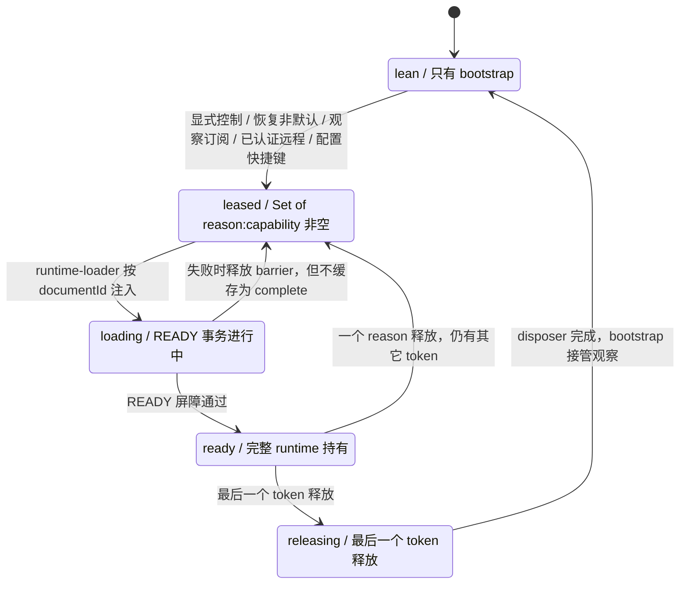
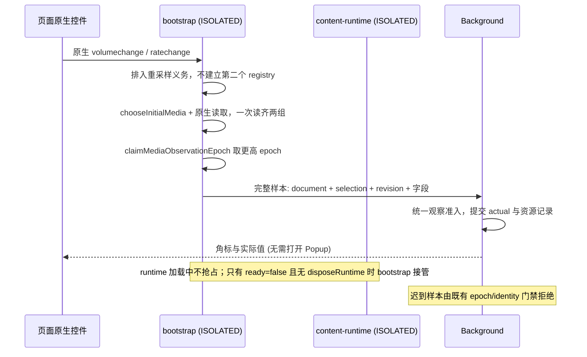
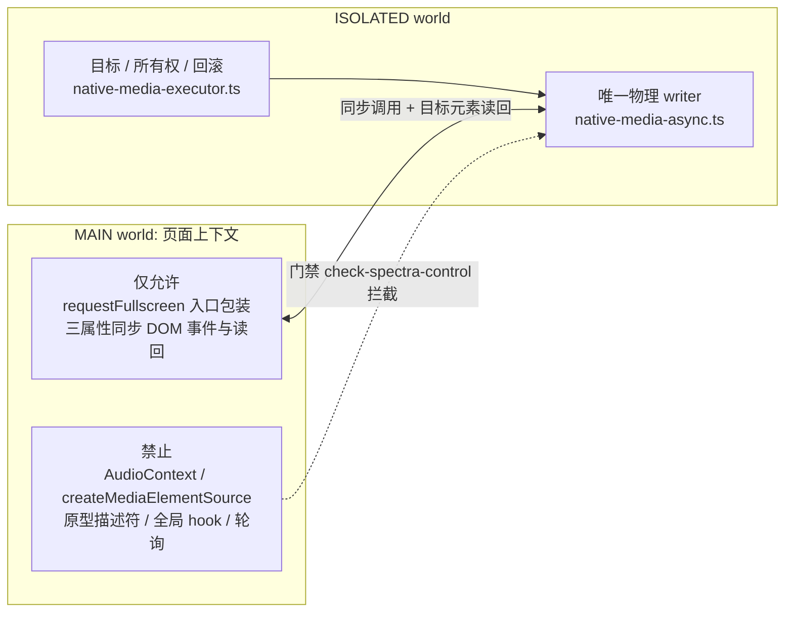

# 07. Runtime & Performance (Loading, ownership map, cross-world bridges)

> 主题 owner 段: §16 Runtime loading and performance · §17 Implementation ownership and migration map · §18 Cross-world bridges
> 完整目录: [README.md](README.md)

**本篇符号**（只解释名字之间的关系，不改变任何规则）：

| 符号 | 一句话职责 | 谁用它 |
| --- | --- | --- |
| `runtime-loader.ts` | Runtime Lease 的唯一 owner；引用计数按 `reason:capability` 记账 | Background 与 Content 的加载路径 |
| `main-runtime-manager.ts` | 两个 MAIN bridge 的幂等注入者 | 冷启动与重注入 |
| `claimMediaObservationEpoch` | 观察交接的 document-start 单调时钟 | bootstrap 与完整 runtime |

## §16 Runtime loading and performance

Manifest 仅包含轻量 ISOLATED bootstrap 与两个闭合版本化 MAIN bridge（Fullscreen V1 与 Page-Media V2）。
- 轻量 bootstrap 使用 HELLO/消息边界、原生媒体事件和有界初次读取自然登记媒体；不为 Popup 枚举注入或唤醒标签页。声明站点的实际倍速标签仅在已由媒体信号发现的精确播放器根内安装 label-specific MutationObserver；不安装 document-wide 媒体拓扑观察器或通用轮询。
- 重级 Runtime Lease 仅限定于显式控制、恢复非默认设置、观察订阅、已认证远程或配置站点快捷键。`runtime-loader.ts` 以 `Set<reason:capability>` 管理引用计数。



图中的 `Lean` 不是"没有功能"：常驻 bootstrap 仍然登记媒体、转发原生事件并投影角标。
租约只决定完整 runtime 是否存在，不决定页面是否可用。
- 获得 lease 后，对精确 `documentId` 的按需注入使用 `injectImmediately: true`，不等待页面其他资源加载。
  Chrome 的 `executeScript` 默认等待 `document_idle`（[API 契约](https://developer.chrome.com/docs/extensions/reference/api/scripting)，2026-11-09 核对，默认注入时机随 Chrome 版本变化）；
  首次控制不能被无关的阻塞脚本拖到页面加载结束。READY、导航 fence 与 runtime disposer 仍决定是否可用。
  `smoke/live-target-restart.spec.ts` 保持一个页面脚本未返回，要求在 `document.readyState=loading` 时完成真实音量写入。

Initialization's ordering barrier and its restore duty have different completion
conditions. `documentInitializations` records running, deferred, or complete: a
failed first attempt releases the barrier but must not be cached as permanently
complete. Admitted current-document media reports and DOM/history lifecycle signals
resume the same deferred owner; a signal arriving during an attempt is coalesced
and consumed after failure, using the latest resource URL. Successful initialization,
explicit media-intent release, and document retirement prevent replay. No polling or
additional retry timer owns discovery.

If initialization fails after Content may have retained its template, the loader
probes the exact document before releasing the document-media-intent lease. A
still-current `retained` response preserves it; an unavailable probe cannot prove
absence and preserves only an already-held lease. A known unset/released state,
navigation or explicit release still permits retirement. A late reply cannot undo
those fences. Content owns source-level restoration after installation (§14.13 in
[media and video](06-media-and-video.md)); a retained native template is not proof
that every video or processor restore field committed.

`smoke/live-target-restart.spec.ts` rejects the first cold restore before Content
can install a template, then supplies real playable media. DOM-only readback must
reach the saved volume without another control, Popup, or snapshot request. This
complements, rather than replaces, tests that seed desired state before changing
sources. Loader tests also fence release/navigation and a resource change during
an unfinished initialization.

### Passive observation handoff



Popup 关闭、最后一个重级 lease 释放后，网站自己的音量条和静音仍须主动同步，
不能以再次打开 Popup 读回来完成同步。bootstrap 与 `MediaRegistry` 通过
`claimMediaObservationEpoch` 使用同一个 document-start 单调时钟；bootstrap 只有在
`ready=false` 且不存在 `disposeRuntime` 时才能接管，完整 runtime 加载中也不得抢占。
每次交接分配更高 epoch，旧 runtime 或旧 bootstrap 的迟到样本继续由既有门禁拒绝。

轻量观察不建立第二个 registry：原生事件只排入重新采样义务，发送前复用
`chooseInitialMedia` 与原生读取，一次读齐合同允许的音量/静音、倍速/音调两组。
每份无 target 的完整样本具有新的 selection/revision；后台按发送 document 认证，
通过统一观察准入更新实际值、资源记录与已点亮的角标。隐藏预览事件不能把自己的
值冒充主播放器，旧 target、live 和 Boost 路由事实不跨观察者接管继承。被动 RPC
仍不推进这条事件时钟，不把部分读回伪装为新完整样本。

`smoke/badge-projection.spec.ts` 验证真实网站滑条事件、完整 runtime 退出、重复开关
Popup、隐藏预览及同时改变音量/倍速；期间只读后台存储和 Action，不调用 actual
读回来修补结果。`content-runtime-readiness.spec.ts` 每例实际安装独立 bootstrap，
覆盖 HELLO 延迟、加载期让渡、跨 epoch 接续及在途队列的最新物理值。

```text
默认静态不变式 (无显式全输出 Capture 申请时):
0 extension AudioContext
0 offscreen lease
0 generic MAIN runtime or recurring MAIN work
0 generic media-topology MutationObserver
0 recurring timer/rAF/IPC
```

Action Popup 首帧不等待新媒体检测或实际值 RPC：Background 公告一张主卡和动态数量后台成员、语言与 visualizer 形状；head script 提交主题/surface，独立 prepaint entry 使用唯一模板和 Popup catalog 同时绘制全部已公告可见 slot，结构本身决定固有窗口尺寸。观察并发上限不限制卡片名额，也不延后后台 DOM 挂载；不按历史 count 高度保留窗口。设置水合与媒体实际值在同一节点对账，不允许英文首帧后纠正。所有九种 Popup catalog 属于关键脚本闭包，必须连同 `popup-first-paint.js` 计入 Popup 静态及可能脚本统计；Options/action catalog 仍分离。机制见 [first-frame owner](../architecture/runtime.md#action-popup-first-frame)。

## §17 Implementation ownership and migration map

This is the single ownership table for the application. Other documents link here
instead of restating it: three partial copies previously disagreed about which file
owned what, and a new file had no obvious place to register.

### §17.1 File owners

| Location | Target responsibility |
| --- | --- |
| `packages/contracts/src/control.contracts.ts` | 完整字段/操作、策略类别、意图/快照/ACK guards 统一词汇表 |
| `packages/contracts/src/spectra.bootstrap.ts` | 最小常驻协议常量、极简读回与 5 组默认快捷键映射 |
| `packages/features/audio-engine/src/audio-graph-router.ts` | Offscreen Capture 使用的稀疏图、参数 ACK 与订阅式分析器 |
| `src/background/control-coordinator.ts` | 生命周期/意图 writer actor 串行，短 snapshot publication lane 独立采纳有序物理事实；代际 Revision、唯一持久化/发布、补偿与 Capture 准入 |
| `src/background/control-coordinator-values.ts` | 无 Chrome/storage 副作用的 target scope、mutation、ACK、reset 与 session projection 纯值能力 |
| `src/background/control-coordinator-ack.ts` | 无副作用的完整 intent/operation ACK 身份准入；不能提交、持久化或发布 |
| `src/background/extension-invocation.ts` | 扩展调用来源身份、前景/目标文档绑定与陈旧文档拒绝 |
| `src/background/popup-visualizer-source.ts` | Popup 观察订阅的文档级租约；借用 coordinator 的串行队列与 snapshot，不持有 revision 写入权，不授予 Capture 准入 |
| `src/background/settings-value-normalization.ts` | Global/Hotkey/Site/Preset/Audio 的纯 canonical value 与旧数据修复 |
| `src/background/settings-repository.ts` | revision/CAS、容量、迁移元数据与 durable storage 事务 |
| `src/background/runtime-loader.ts` | 文档级重级 Runtime Lease 与 READY 握手 |
| `src/background/media-inventory.ts` | 一次读取的媒体标签页投影：Chrome 的 `audible` 与该文档自身的可播放媒体事实；不注入、不探测、无 pending 状态 |
| `src/background/media-inventory-runtime.ts` | 该投影的唯一实例；`spectra.tab.visible.list` 与 Popup 卡片数公告共用，避免第二份组合 |
| `src/background/media-facts.ts` | session 内单文档媒体事实、reportRevision 高水位、使用记录单调合并与 hydration tombstone；跨 worker 水合，随导航/关闭退役，资格到期不删除 |
| `src/shared/media-card-policy.ts` | Background、Popup forecast 与数量公告共用的动态成员/availability/nextExpiryAt/expiryByTab 纯策略；匿名截止时间使关闭期间过期的 slot 在首帧前排除；无固定名额、无网页探测 |
| `src/shared/media-presence.ts` | “可控制媒体”的唯一可执行定义（readyState/currentTime/played），bootstrap 与重级 runtime 共用 |
| `src/background/popup-frame.ts` | 公告卡片数及非敏感外观；设置 RPC 在 global ACK 前等待当前 active tabs 的立即公告尝试，媒体报告仍合并；按 tab 代际防迟到覆盖，失败退回未公告状态 |
| `src/background/popup-control-port.ts` + `src/shared/popup-control-port.ts` | 连续 Popup 控制的唯一私有端口：严格 guard、每字段 latest slot、合并后调用同一 coordinator；不拥有第二个状态 owner |
| `src/background/audio-session-store.ts` | 每文档音频会话快照的 durable owner：文档 fence、250ms 合并写、最多 5 次重试、有界拒绝账本 |
| `src/shared/popup-bootstrap.ts` + `public/frame-reserve.js` | Popup 外观参数、主题键、surface 标记与 600px 上限的唯一契约；head script 提交主题/surface，不按历史高度 reserve |
| `src/popup-first-paint.ts` + `src/shared/i18n/popup-catalog.ts` | render-blocking deferred 独立 entry，复用规范模板与九种 Popup-only catalog；无身份 inert 结构原位绑定，模块同步初始化同一语言 |
| `src/background/main-runtime-manager.ts` | 幂等注入 Fullscreen V1 与 Page-Media V2 bridges |
| `src/content/core/media-registry.ts` | `mediaId`、`sourceRevision`、缓存可见性、Sticky Active Target 与 observation owner/epoch/selection/revision；导出与 bootstrap 共用的 chooseInitialMedia |
| `src/content/logic/native-media-async.ts` | 唯一标准媒体异步 ACK：`playing`/PiP/全屏以物理 setter 作答，其余字段保留既有事件+getter；`confirmStableNativeEvent` 接受多个事件并可在值已就位时立即开始静默窗；PiP 站点策略属性的会话期所有权（`holdPictureInPictureDisable`）与 source cancellation、frame cadence cache |
| `src/content/logic/native-media-executor.ts` | 精确 source ownership、page fallback/rollback、document desired 与有界 scene speed；mediaRestore token 取消旧 replay；不复制 async writer。符合条件的音量、静音及 `playing`/`pip`/`fullscreen` 写入把后续稳定化证明交给 `native-write-confirmation.ts`；DOM `speed` 等待稳定读回，page-controller `speed` 等待双证人，避免 source 切换丢失 ownership |
| `src/content/logic/native-write-policy.ts` | 每站点 `optimistic`/`verified` 策略与 drift 降级阈值：证明会回滚写入的站点被降级为“先证明后作答” |
| `src/content/logic/native-write-confirmation.ts` | 稳定化证明的独立注册表：写由 executor 拥有，证明脱钩于控制路径，可取消且不阻塞作答；证明的事件集合与读取见证由写入方提供（`NativeProofField`），注册表不推断 DOM 语义 |
| `src/content/logic/native-write-telemetry.ts` | 有界的本地 write-to-landed / landed-to-confirmed 延迟记录；不导出页面身份 |
| `src/content/video/video-effects-controller.ts` | 媒体 Keyed CSS / Overlay 归属与属性恢复 |
| `src/content/video/ab-loop.ts`, `time-marker.ts` | 媒体 Keyed A/B 循环与 Marker 算法及 disposer |
| `src/background/handlers/screenshot.ts` | 令牌校验、可见标签页截屏、裁剪与下载确认编排 |
| `src/popup/ui-event-hub.ts` | Popup 唯一 Chrome runtime listener、按 tab fan-out 与 subscriber failure isolation |
| `src/popup/control-snapshot-order.ts` | generation-first identity admission 与 same-generation revision 单调性 |
| `src/popup/bounded-card-bootstrap.ts` | cap-4 all-settled observation worker；全部成员节点先同步建立，cap 不影响展示数量，失败隔离后统一 badge/empty reconciliation |
| `src/popup/frame-height.ts` | 唯一 live frame 几何 owner：跟随完整结构的固有高度、600px cap 与单滚动面；observer 合并 rAF，取消和 revision fence，不等 actual 水合 |
| `src/popup/settings-forecast.ts` | 上次已提交 `GlobalSettings` 的首帧预测；读取时校验，首次权威投影覆盖，从不合并 |
| `src/popup/media-inventory-from-storage.ts` | session media facts 与 Chrome evidence 经 shared policy 投影首份列表，避免 service-worker 往返；RPC 对账，无第二份 retention 规则 |
| `src/remote/operation-queue.ts` | Remote 每 key 有界串行队列；不拥有 session/auth/protocol 状态 |
| `src/background/remote-sender-gate.ts` | “哪个本文档可以读远程会话状态”的唯一判定：精确文档路径集合，禁止 origin 前缀，缺 `sender.url` 即拒绝 |
| `src/shared/optional-permission-admission.ts` + `src/shared/optional-permission-click-gate.ts` | 可选权限的唯一手势入口与续体所有权；`request()` 必须是处理器首个异步调用，运行时消费者只读 `contains()` |
| `packages/nexus-kernel/src/diagnostics.ts` + `src/background/diagnostics.ts` + `src/options/diagnostics.ts` | 仅由 Options 手势触发的拉取式诊断：私有端口鉴权、标量事实、不可读 owner 报 `null`；不导出页面/标签/文档/请求身份，无诊断存储 owner |
| `src/popup/card/types.ts` | 从中性默认值与 `ControlSnapshot` 初始化字段；不持有第二份字段事实 |
| `src/popup/card/snapshot.ts` | 卡片身份重建与快照合并；缓存快照只是预测，权威投影覆盖它 |
| `src/popup/card/messaging.ts` | 卡片唯一的音频/配置投影入口；控制 revision 与音频 generation 分开应用 |
| `src/side-panel/video-controls.ts` | 视频/滤镜意图经单一 per-tab transport tail 路由到 `activeVideo` |
| `src/background/remote-commands.ts` + `src/background/remote-service.ts` | 在 Background 内调用 coordinator，缓存投影，仅在 Remote V3 授权校验后推送 |

结构拆分不得制造第二个 effect owner。协调者仍是 commit/persist/publish 唯一入口；
ACK 模块只做值验证。原生字段的相等判定由 `native-media-async.ts` 统一提供，
Executor 不再维护第二份数值/结构比较实现。产物调整必须在同一功能和探测负载下
比较真实 metafile closure；现有硬预算不可上调，零字节或把内容移到另一统计桶不算优化。

### §17.2 Owners that span files

单文件表回答"这个文件管什么"。有些职责横跨多个文件，且判据只有一条；它们在这里
统一登记，避免每个架构文档各写一份。

| Concern | Owner | Invariant |
| --- | --- | --- |
| Tab control order | `control-coordinator.ts` + pure `control-coordinator-values.ts` helpers | One serialized actor per tab; synchronous navigation fence; post-await identity/epoch/revision validation |
| Hotkey target persistence | `hotkey-target-repository.ts` | One serialized session-scoped tab target; stale tabs are cleared |
| Audio mode classification | `@nexus/contracts/audio.contracts.ts` + current registry evidence | `bypass`, proven `webaudio`, or admitted `capture`; neutral hidden work never acquires a processor |
| Capture admission | `capture-admission.ts` | One-shot document/worker fence expires or is consumed before acquisition |
| Processor lifecycle | `offscreen/audio-host.ts` + Capture handler | Only exact host ACK drives status |
| Cold native refresh | bootstrap/coordinator | Targetless 4-field obs; no badge-use fact |
| Built-in shortcut readiness | shared keyboard arbiter + transient READY lease | Exclusive ownership of 5 defaults; no document-lifetime default-hotkey lease |
| Configured-site lean ownership | `site-hotkey-owner.ts` + exact lean host + heavy projection adapter | Empty lean barrier; heavy exact suspend; revision-2 physical fence; sender-document execution |
| Worker-restart heavy recovery | `runtime-restart-startup.ts` + runtime-loader leases | Rebuild durable owners before orphan disposal; bounded retry; no direct RELEASE guess |
| Toast/OSD | Content feedback modules | One feedback owner on Popover; lean reuses existing gesture/feedback path |
| Page media semantics | page-media bridge/native executor | Exact-element readback, DOM fallback, no polling |
| PiP/fullscreen | fullscreen bridge/native executor | Actual native lifecycle preservation |
| Visualizer | Popup scheduler + subscriber registry + `popup-visualizer-source.ts`/Content demand lease | Only visible foreground card owns safe page analyser demand; observes Capture only while non-neutral DSP requires it; unsafe neutral sources settle on bypass without Capture admission or acquisition retry; background cards are passive; bounded heartbeat/tombstone/release retry |
| Media inventory truth | `shared/media-card-policy.ts` + `media-inventory.ts` + session `media-facts.ts` | One policy decides dynamic membership and `nextExpiryAt` from Chrome evidence and ordered current-document reports; expiry hides without deletion; unknown pages create no probe, placeholder or folded count; navigation retirement, report high-water and hydration tombstones protect identity |
| Popup card lifecycle | `popup/card/snapshot.ts` + `sessionBelongsToCard` + `acknowledgedProcessorLifecycle` + `messaging.ts` bounded probe | The route colour comes from the control snapshot's own processor ACK; a newer session/runtime observation may only make it fresher, never make it exist; a durable session that names this card's own document is retained even when the control read is slow or missing; a snapshot restored from the Popup's cache is a forecast confirmed once, silently, by the control projection, and may not override the durable control/session record; both the control projection and the processor lifecycle are retried on one bounded budget and settle into an explicit state instead of an endless "syncing" line |
| Card view reads | `control-coordinator.ts` `getControlViewSnapshot` + `spectra-tab-client.ts` `readSpectraTabPassively` | A view read is one-way: it asks the document's lean bootstrap what it already observes (`PASSIVE_FIELDS`) and never acquires the Content runtime, so painting a card for a tab the user is not looking at cannot wake that tab; a passive observation may not overwrite a field the extension is currently controlling, because for such a field the DOM value is the processor's input, not the effective output |
| Popup view geometry | `popup.css` + `views/navigation.ts` | The main view follows intrinsic card content and only `settings-view-active` owns the 600 px settings scroll viewport; navigation switches a mode class and never reads `offsetHeight`, writes inline height or calls `resizeTo`; `#empty-state` is an inventory result, never an initial view; the blank under the last card has one owner (`#view-main`'s asymmetric bottom padding, with the last card's own margin zeroed), so it is the same 24 px in every state; above Chrome's ceiling the whole document scrolls as one surface, never a nested list, so that 24 px is on screen when the content fits and exactly one scroll away when it does not |
| Action Popup frame | `shared/popup-bootstrap.ts` + `popup-first-paint.ts` + `popup/frame-height.ts` | All announced slots determine intrinsic first-frame CSS size; frame-height is the sole live frame/600 px cap/single-scroll owner and coalesces observer writes; no historical-height reservation or actual-RPC barrier |
| Action Popup first frame | `public/frame-reserve.js` + `popup-first-paint.ts` + `shared/popup-bootstrap.ts` | Announced appearance and packaged Popup dictionary establish structure/text before async actual confirmation; same-node binding; theme/height remain with their existing owners |
| Popup inventory forecast | `popup/media-inventory-from-storage.ts` + shared membership policy + session `media-facts.ts` | The first card list uses the same policy as Background without a worker round trip; `spectra.tab.visible.list` reconciles new facts, identity or expiry; no card-layer retention decision or second media authority |
| Favicon/QR | Popup/remote renderers | Validated payload, no undeclared capability |
| Remote transport/session | `vendor/peerjs/peerjs.min.js` + `offscreen-remote/peerjs-loader.ts` + `remote-host.ts` | One extension-owned JSON/DataChannel-only transport source projected to the static page, one lazy extension output, one Offscreen session/Peer owner, 16 KiB wire cap; epoch/command receipt/recovery remain bounded |
| UI event projection | `popup/ui-event-hub.ts` + surface/session stores | One Chrome runtime listener; subscriber isolation; identity/revision/session-token monotonicity |
| Locale assets | surface catalogs + `shared/i18n/locale-sections.ts` | Popup/Options/Actions fetch only their surface; settled loads clear; two-locale LRU bound |
| Local diagnostics | `@nexus/kernel/diagnostics.ts` + `background/diagnostics.ts` + `options/diagnostics.ts` | Pull-only collection behind an authenticated private port; scalar-only facts, `null` for an unreadable owner, no page/tab/document/request identity and no diagnostic storage owner |
| Artifact evidence | `scripts/check-production-artifacts.ts` | Typed reachability, exact set-union closures, one physical file count, measured attribution when metafiles exist, absolute hard ceilings plus non-blocking 15% planning advisories |

## §18 Cross-world bridges



图示两个箭头方向不同：MAIN 只能被动响应一次精确调用并当场读回，ISOLATED 侧才是
写者与编排者的所在地。任何需要在 MAIN 里长期持有状态的设计都违反这张图。

两个 Bridge 均为 manifest `document_start` 注册，由 `main-runtime-manager.ts` 幂等重注入:
- `__SPECTRA_FULLSCREEN_BRIDGE_V1__`: 仅包装原生 `requestFullscreen()` 入口以在 1.2s 内协调增强音频交接。
- `__SPECTRA_PAGE_MEDIA_BRIDGE_V2__`: 仅对 `volumeBase`、`mediaMuted` 与 `speed` 发起同步 DOM 事件并在请求元素上读回，不维持轮询与全局拦截。
