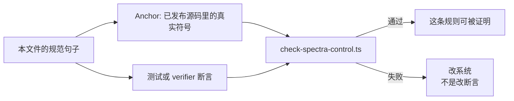
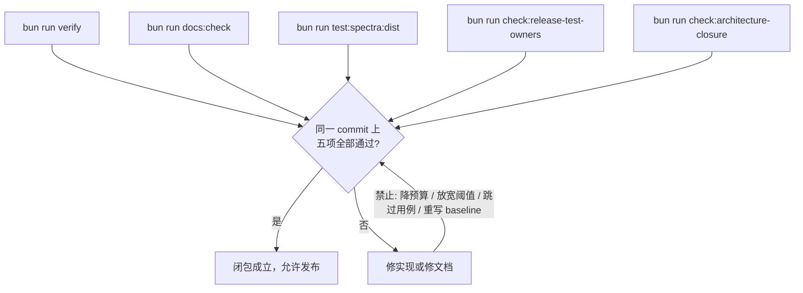

# 08. Invariants & Gates (SCTRL-001..083 and migration gate)

> 主题 owner 段: §20 Static invariants and proof map · §21 Migration and release gate
> 完整目录: [README.md](README.md)

## §20 Static invariants

一条不变量由四个部分组成，缺一个就不是不变量，而是一句愿望：

`001..024` 是散文级边界（例如 `AudioContext` 属于平台，不属于我们），没有单一符号可
跟随；`025` 起每条必须引用一个已发布的符号。这条分界本身由
`ANCHORED_INVARIANT_FLOOR` 固定在门禁里，不是在本文件里手写的一个数字。

- `SCTRL-001`: untouched pages preserve native audio/media constructor and descriptor identity outside the allowlisted fullscreen method wrapper, with zero processing/periodic work.
- `SCTRL-002`: planning is per field; no page-wide mode owns unrelated controls.
- `SCTRL-003`: one writer exists for each `{document, media, field}`; `native-media-async.ts` owns physical async setters/readback while `native-media-executor.ts` owns target and rollback orchestration, never a second setter.
- `SCTRL-004`: generic MAIN monkey-patching is forbidden; fullscreen V1 (`content-fullscreen-bridge.js`) and page-media V2 (`content-page-media-bridge.js`) are the only allowlisted manifest entries at `document_start`.
- `SCTRL-005`: only readback actual state may be acknowledged; settings/session success require physical storage confirmation.
- `SCTRL-006`: intent and ACK identity includes document, generation, revision and intent ID; Remote additionally requires `sessionEpoch + commandId`, and every post-await continuation revalidates its full ticket.
- `SCTRL-007`: 100% and 1x are literal controlled values.
- `SCTRL-008`: a typed, current-document, one-shot Capture admission is consumed before tab-stream acquisition; MediaElement WebAudio binds page sources only after complete exact source-safety evidence, while Capture never binds page media sources.
- `SCTRL-009`: extension CSS removal restores the site's current cascade; dim-target handoff preserves independent video effects.
- `SCTRL-010`: transport/video state is bound to media ID and source revision.
- `SCTRL-011`: at most one acknowledged MediaElement WebAudio or Capture processor owns DSP output; replacement handoff never double-applies DSP and preserves the acknowledged processor on candidate failure.
- `SCTRL-012`: status and observation reads do not write settings, badge, or activate processing.
- `SCTRL-013`: neutral DSP and unsubscribed analysis create no optional nodes; only an acknowledged active MediaElement WebAudio or admitted Capture owner may retain its `AudioContext`, sources and sparse graph, all of which are disposed on final release; disabled Popup Visualizer imports no visualizer chunk and owns no metrics observer/draw loop; only the visible foreground subscriber may request transient processor observation, background cards remain passive, and visualizer IPC leaves no timer wake-up loop while a batch is pending.
- `SCTRL-014`: page, Popup, remote, hotkeys and badge project one snapshot; Popup owns one tab-routed runtime event hub and one card audio/config projection; Badge renders no placeholder before complete ACK exists, has exactly one writer (`background/handlers/badge.ts`), records each decision synchronously, and paints the newest decision rather than the one that reached the Action API first - a second writer (a Popup render, a delayed session report) can therefore never repaint a stale volume or `M` over an acknowledged value.
- `SCTRL-015`: MAIN cannot bypass user activation, CORS, DRM or inaccessible media.
- `SCTRL-016`: product UX exposes outcomes, not implementation modes; records exact 28 persistent snapshot fields plus 23 momentary operations inventory.
- `SCTRL-017`: a page-native observation is admitted by the pure coordinator-value owner, commits actual state once, and never echoes a second write.
- `SCTRL-018`: control target scope is top-level-only; inventory projects natural document reports, session media facts and Chrome evidence through the shared membership policy, without frame census, tab probes or heavy-runtime acquisition. Unknown/unloaded tabs without current media evidence create no card, placeholder or folded count. Report high-water ordering and retirement tombstones protect fact identity; retention expiry hides membership without deleting facts or settings, and browser availability never grants control authority.
- `SCTRL-019`: one visualizer IPC owns the next schedule.
- `SCTRL-020`: Popup fields project only `ControlSnapshot`; audio session data owns lifecycle only.
- `SCTRL-021`: visualizer ownership is per subscriber and exact document; it expires abnormal exits, retains a bounded generation tombstone, compensates ambiguous enable/release ACKs, and cannot persist transient Capture demand across worker/session restoration.
- `SCTRL-022`: every hotkey has exactly one feedback owner on a fullscreen-safe browser top-layer surface; built-in Chrome chords cannot become site bindings, and legacy collisions are durably disabled through the canonical normalization owner.
- `SCTRL-023`: screenshot source and geometry are token-verified on both sides of browser capture.
- `SCTRL-024`: document runtime ownership counts unique consumer tokens; only the last token disposes it.
- `SCTRL-025`: `activeMedia` and `activeVideo` are independent actual identities; video-only surfaces route to `activeVideo`; UI accepts a different document only at a higher tab generation and rejects delayed old-document projections.
- `SCTRL-026`: a neutral CSS value on a never-owned target is a DOM-free no-op Anchor: `releaseDomOwnership`.
- `SCTRL-027`: native candidate admission and ACK are one-shot; rejected maturation restores page baseline & prior DOM state Anchor: `consumeCaptureAdmission`.
- `SCTRL-028`: default pages have zero audio work; no Capture processor, offscreen audio lease or audio context survives release of all explicit demands. Document-output level 0 or 100 remains a current demand; reset/restore withdraw it through `releaseDocumentOutput`, and only a real stop ACK settles release. No historical threshold or observer can retain Capture Anchor: `requiresAudioProcessor`.
- `SCTRL-029`: ACK target is projected only through contract scope; non-media operations write `target: null` Anchor: `projectControlTarget`.
- `SCTRL-030`: runtime status/read is a pure projection with no document scan or synthetic event Anchor: `getContentBootstrapState`.
- `SCTRL-031`: operations executing no media writer acknowledge `target: null` Anchor: `operationField`.
- `SCTRL-032`: native audio keeps page volume/mute outside processor configuration. An admitted document-output Capture instead uses `outputLevel` with gain `0–8` and independent mute, while physical `boostGain` stays 1; logical base/boost remain the volume vocabulary. Runtime-only `documentOutput` is not a persisted preference. Parameter ACK requires running context, stable actual AudioParam and render-clock progress, not a configuration echo Anchor: `audioConfigToProcessorConfig`.
- `SCTRL-033`: Background control consumers invoke serialized coordinator directly without SW self-RPC Anchor: `submitControlRequest`.
- `SCTRL-034`: default content bootstrap uses minimal contract; MV3 SW is self-contained ESM; build has zero redundancy; extracted pure value/ACK/queue/async capabilities are direct owners rather than aliases or re-export shims, while coordinator commit/persist/publish remains the sole effect writer Anchor: `SPECTRA_CONTENT_BOOTSTRAP_REVISION`.
- `SCTRL-035`: native event-driven writes install bounded listener before setter and ACK after quiet getter boundary Anchor: `requestVideoFrameCallback`.
- `SCTRL-036`: strategy escalation consumes canonical failure codes; security/activation failures are terminal Anchor: `capability-unavailable` Anchor: `isControlStrategyFailure`.
- `SCTRL-037`: processor actual state comes only from normalized graph/host readback (`graphSignature`).
- `SCTRL-038`: Capture generation replacement gates the candidate at zero gain, verifies running graph readback, switches once, and retires the old processor only after success Anchor: `OFFSCREEN_AUDIO_CANCEL_START`.
- `SCTRL-039`: visible Popup and authenticated remote synchronization require independent document observation tokens Anchor: `remotePublicationToken`.
- `SCTRL-040`: `CONTROL_SESSION_FIELDS` durable projection wins first, then site preset, then global preset.
- `SCTRL-041`: new Capture requires volatile Background admission (`captureAdmission: 'extension-invocation'`) Anchor: `captureAdmission`.
- `SCTRL-042`: video enhancement is a lazy capability-owned module; default control does not load it Anchor: `VideoEffectsController`.
- `SCTRL-043`: Popup, Options and remote use restricted protocol validators and cannot load Background request router; UI event routing cannot become a second settings/control protocol owner Anchor: `isSpectraResponse`.
- `SCTRL-044`: production application bundles have one esbuild optimization pass; only PeerJS vendor enters Terser Anchor: `productionMangleOptions`.
- `SCTRL-045`: physical write and stabilization proof are separate facts. Only eligible optimistic standard-DOM volume/mute writes answer `written` before cancellable deferred proof (`confirmed` / `drifted` / `unconfirmed`); speed, playing, page-controller writes and processor output remain awaited under their owners. `phase` keeps its readback meaning and is never reused for the write stage Anchor: `ControlWriteState` Anchor: `confirmStableNativeEvent`.
- `SCTRL-046`: a newer write cancels the proof of the write it supersedes, and a proven `drifted` result republishes the page's true value and feeds a per-site ledger that demotes that origin to the verified path Anchor: `NativeWriteConfirmationRegistry` Anchor: `recordNativeWriteOutcome`.
- `SCTRL-047`: within one projection surface every projection element (fill, readout, native thumb) has exactly one writing module, and no projection surface imports another Anchor: `createVolumeView` Gate: `scripts/verify/check-architecture-layers.ts`.
- `SCTRL-048`: the presented volume number is always the live optimistic value; a route transaction holds the tone and mute only, never the number Anchor: `resolveVolumePresentation`.
- `SCTRL-049`: the Popup volume bar and the Action badge consume one tone predicate, so violet always means an acknowledged active Capture or the single live-gesture case in which a `dom-native` document crosses its native ceiling; a threshold never implies Capture, a predicted tone is not a Capture fact, and no surface may derive a route from a number Anchor: `resolveVolumeTone`.
- `SCTRL-050`: the Action Popup's first frame contains every announced visible main/background slot from the sole localized template, with same-node identity binding and asynchronous actual confirmation. Normal opening waits for no fresh media detection; unknown pages create no reserved slots. Intrinsic CSS structure determines size without historical-height reservation, while frame-height remains the sole live geometry/600 px cap/single-scroll owner. Anchor: `actionPopupPath` Anchor: `POPUP_BOOTSTRAP`.
- `SCTRL-051`: a site policy attribute that gates a native session is owned by the extension for that session's lifetime and restored only when the session ends; re-adding it while the session is live is forbidden because the user agent may run the exit algorithm, and a session the page terminates is reported as `policy-denied` instead of a readback mismatch. Anchor: `holdPictureInPictureDisable` Anchor: `releasePictureInPictureDisable`.
- `SCTRL-052`: the Action badge is a projection of admitted control facts, never a second owner. Page events retain exact-resource state under `SCTRL-055`; passive reads do not write preferences. Both reach the same badge projection, including after the full runtime releases and bootstrap resumes with a newer document observation epoch. Synchronization must work with Popup closed. Untouched tabs remain hidden; usage is durable across worker restart. Control projections use `(documentId, generation, revision)` and independent media observations; equal control revisions can contain newer page facts. Audio lifecycle uses its own clock. Anchor: `projectBadgeFromSnapshot` Anchor: `isBadgeProjected` Anchor: `admitBadgeProjection` Anchor: `claimMediaObservationEpoch`.
- `SCTRL-053`: the MAIN bridge resolves bounded exact-element capabilities only. It must not intercept the document's audio graph, create output gains, or drive site sliders with synthetic pointer events. The native connect/disconnect contract remains the page's; the built-extension page-media smoke test exercises both ends of that contract. Anchor: `findCapability` Anchor: `onPageMediaRequest`.
- `SCTRL-054`: a live presentation is read from the element, never from a site list: an unbounded duration means the stream has no timeline, so `speed` is refused before the write as `capability-unavailable` with `retryable: false` instead of being written and answered with a readback mismatch, and the fact is published as `live` through the snapshot, the page observation and the submit request so the popup removes the control rather than letting it fail. The fact describes one element, so it is bound to the target that proved it and omitted when that target changes — a proof about another element is not weaker evidence, it is evidence about something else. Anchor: `isLiveMedia` Anchor: `isLiveUnsupportedField` Anchor: `publishedLive`.
- `SCTRL-055`: a mute the page set is a fact, not the viewer's choice: the resource row may record it — the row describes what this resource does — but it may never be replayed into a later document unless an extension gesture made it origin-portable. Autoplay policy, a self-muting preview and a live player parked at volume zero under a pre-roll all write that value without anyone asking, so restoring it made the next visit to the same resource start silent. The proof is the origin-portable row, which only an extension gesture writes; a resource-scoped `mediaMuted: true` or `volumeBase: 0` orphan is dropped on rebind, before any restore can read it. An explicit extension value stays in both rows and still survives a reload; a page-set volume above zero and a page-set speed keep their exact-resource restore. Anchor: `persistControlProjection` Anchor: `resolveDocumentRestorePlan`.
- `SCTRL-056`: automatic admission ranks playing, then a visible confirmed live broadcast, then area. A larger finite pre-roll must not steal the broadcast's volume/mute target; the stream's initial mute/zero is not a reason to control the ad. Cold discovery and late metadata/data/duration/geometry use the same ranking. Hidden previews cannot take the visit, and explicit selection, pause pins, PiP/fullscreen and independent media/video scopes retain their protection, including the `play` path. Page mute/zero does not become the broadcast's desired preference; a positive volume gesture reaches and unmutes its actual selected owner. Fresh presentation kind travels with its exact read target into the physical commit and cannot describe a different acknowledged source. Anchor: `mediaRank` Anchor: `admitBetterCandidate` Anchor: `isSelectionProtected`.
- `SCTRL-057`: Popup, OSD and Action badge share `resolveVolumeTone`; `resolveAudioVolumeState` is its settled wire spelling. A gesture uses the current target's prospective Boost route from the existing mode policy, with acknowledged Boost only as fallback when no newer candidate was published. Known Capture paints purple on the first gesture frame above the native ceiling; at or below it every split is Boost 1, so that same frame reads native even while the processor has not released, which keeps the ceiling symmetric. Safe page amplification stays blue; mute/zero stays gray. Pending presentation never commits actual or usage. Input/document tokens retire it on settlement, failure or navigation; older work cannot clear a newer gesture or resurrect a hidden OSD. Control and audio generations are independent clocks. Anchor: `resolveVolumeTone` Anchor: `resolveHotkeyVolumeTone` Anchor: `resolveSettledVolumeTone` Anchor: `refreshHotkeyVolumeTone` Anchor: `setVolumeRouteReporter`.

- `SCTRL-058`: every `effective-volume` gesture reads the current implicit target's volume/mute pair before planning, including same-value requests; registry epoch in media IDs prevents a recreated runtime from aliasing old targets. Raising volume above zero requests unmute through the current writer. Explicit requests reach browser policy without an extension-created activation veto; automatic restore/disposal/rollback keep activation protection. Source-bound video-only MediaStream evidence may admit existing Capture for implicit full-output volume/mute; exact-target requests and manual direct pins never expand scope. Capture output retains demand at 0/100 until explicit release and reports actual level/mute independently. Anchor: `releaseMute` Anchor: `currentMuted` Anchor: `assertUnmuteAdmitted`.

- `SCTRL-059`: retirement is decided once the queued removal settles, not when the removal callback fires: a node that is still connected at that point keeps its identity, and a same-batch move between parents is not a departure. Anchor: `queueRemovalTree`.
- `SCTRL-060`: three identity events are never substituted for one another: a detached node unregisters its target, a same-element source change increments only the resource revision, and a replaced element requires a new identity. Anchor: `handleMediaEvent` Anchor: `refreshSource`.
- `SCTRL-061`: a media id names one element instance for its whole life and is never recycled onto a replacement, because a recycled id would carry the previous element's baseline and restore duty into a different player. Anchor: `releaseDetachedOwnership`.
- `SCTRL-062`: retiring a source clears its pending, observed, replay, maturation state and failed-value memo, so a new stream never inherits a write that was planned for the old one. Anchor: `clearSourceRestores` Anchor: `rememberDesired`.
- `SCTRL-063`: site-route selection is a three-key sort: a user entry outranks an automatic one, then a more specific hostname outranks a shorter one, then a longer path prefix outranks a shorter one. Anchor: `selectMediaRouteDecisionForUrl` Anchor: `selectMediaProcessingRoute`.
- `SCTRL-064`: a path prefix matches only on its own segment boundary, so `/live` never matches `/livestream`, and query or hash never participates in a route decision. Anchor: `pathPrefixMatches`.
- `SCTRL-065`: a user `direct` route forbids the Capture fallback, so a failed page binding stays unavailable instead of violating the stated route, while a `capture` preference never mints the one-shot admission it still needs. Anchor: `resolveDesiredAudioMode`.
- `SCTRL-066`: observation identity is a four-tuple: a higher owner epoch replaces the owner, the same epoch with a different owner is a conflict, and only a greater selection then revision order a sample within one owner. Anchor: `MediaObservationStamp`.
- `SCTRL-067`: an automatic restore replays only when its scene, visit and desired revision all still match; a stale token fails closed rather than replaying onto a new target. Anchor: `MediaRestoreToken`.
- `SCTRL-068`: the document media-intent state is lifecycle evidence in exactly three values (`unset`, `retained`, `released`), and a pure status reply can never revive a retired document or an explicitly released template. Anchor: `mediaIntentState`.
- `SCTRL-069`: a gesture forecast changes the tone only: it never writes actual, usage, a success record or a persisted setting, and it expires with its input revision. Anchor: `resolveVolumeTone`.
- `SCTRL-070`: silence outranks route: a muted or zero value is grey even while an acknowledged Capture owns the output, because no sound is a closer fact than which path the sound would have taken. Anchor: `resolveAudioVolumeState`.
- `SCTRL-071`: a lit badge is a durable fact, not a worker memory: after the worker is collected the decision falls back to the session usage record, so a native volume gesture is never silently swallowed. Anchor: `hasBadgeUsage`.
- `SCTRL-072`: the continuous Popup port merges within 50 ms and requires a matching ready acknowledgement within 5 s; a missing acknowledgement is reported as not-ready rather than as an accepted control. Anchor: `POPUP_CONTROL_READY_TIMEOUT_MS` Anchor: `POPUP_CONTROL_PORT`.
- `SCTRL-073`: the per-document audio session merges durable writes at 250 ms and retries a bounded number of times; a rejected write is recorded rather than retried forever. Anchor: `STORAGE_WRITE_DEBOUNCE_MS`.
- `SCTRL-074`: site-adapter discovery starts from a 12-ancestor and 96-property default and may widen only to the published hard ceilings of 24 and 512; a row can never raise a ceiling itself. Anchor: `DEFAULT_SITE_ADAPTER_DISCOVERY` Anchor: `SITE_ADAPTER_LIMITS`.
- `SCTRL-075`: every `none | lean | full` transition is one ordered transaction: exact empty configuration, heavy `sites:{}` projection, release of the obsolete full capability, then injection or reconfiguration. Anchor: `SiteHotkeyRuntimeMode` Anchor: `resolveSiteHotkeys`.
- `SCTRL-076`: lean and full never both own the keyboard in one realm: while the lean host is active it publishes a revision-2 read-only marker and the heavy listener sees no configured sites. Anchor: `__SPECTRA_LEAN_SITE_HOTKEY_HOST__`.
- `SCTRL-077`: worker-restart recovery rebuilds source, restore and hotkey ownership from the survivor's own report before releasing its temporary lease; a failed rebuild keeps the safety lease instead of guessing an orphan. Anchor: `ownedSources` Anchor: `runtimeRevision`.
- `SCTRL-078`: the first control of a cold document injects with `injectImmediately: true` instead of waiting for `document_idle`; availability still belongs to READY, the navigation fence and the disposer. Anchor: `injectImmediately`.
- `SCTRL-079`: an optional-permission request is the first asynchronous Chrome call in the gesture handler; a pre-check consumes the activation, so the request itself is what must be issued. Anchor: `requestOptionalPermission`.
- `SCTRL-080`: runtime consumers only read permission state and never request it; a missing permission raises an actionable error instead of returning a success with no file. Anchor: `hasOptionalPermission`.
- `SCTRL-081`: a v2 listener owns an exact request-type set and never matches a prefix; the retired top-level action envelope cannot appear in a production sender. Anchor: `SpectraRequestEnvelope`.
- `SCTRL-082`: screenshot geometry is token-verified on both sides of the browser capture; a hidden or moving target fails instead of returning a confidently wrong crop. Anchor: `captureVisibleTab`.
- `SCTRL-083`: a frame step is always acknowledged as approximate, because its cadence comes from the source's own frame callbacks rather than a fixed rate. Anchor: `approximate`.

### §20.1 Executable proof map

每条不变量都必须能在不读散文的情况下被验证。这张表回答"我去哪看它是否成立"，
它记录的是**最近的证据**，不是覆盖率的数学声明：一行写着两个文件，说明两个文件都
触及同一条规则的不同侧面，不说明二者合起来是完整证明。真正没有证据的条目必须写
`none`，而不是留空。

| Invariant | Primary proof | Kind |
| --- | --- | --- |
| `SCTRL-001..046` | `scripts/verify/check-spectra-control.ts` — each ID appears in at least one gate assertion | static |
| `SCTRL-047` | `scripts/verify/check-architecture-layers.ts` | static |
| `SCTRL-048` | `test/volume-presentation.spec.ts`, `test/popup-volume-view.spec.ts` | unit |
| `SCTRL-049` | `test/volume-tone-sync.spec.ts`, `test/hotkey-volume-tone.spec.ts` | unit |
| `SCTRL-050` | `test/popup-startup.spec.ts`, `test/frame-height.spec.ts` | unit |
| `SCTRL-051` | `scripts/verify/check-spectra-control.ts` | static |
| `SCTRL-052` | `test/badge-ownership.spec.ts`, `test/smoke/badge-projection.spec.ts` | unit + smoke |
| `SCTRL-053` | `scripts/verify/check-spectra-control.ts` | static |
| `SCTRL-054` | `test/media-live.spec.ts`, `test/side-panel-speed.spec.ts` | unit |
| `SCTRL-055` | `test/tab-session-origin.spec.ts`, `test/session-current.spec.ts` | unit |
| `SCTRL-056` | `test/media-registry.spec.ts` | unit |
| `SCTRL-057` | `test/hotkey-volume-tone.spec.ts` | unit |
| `SCTRL-058` | `test/native-media-executor.spec.ts`, `test/smoke/live-volume.spec.ts` | unit + smoke |
| `SCTRL-059` | `test/media-registry.spec.ts` | unit |
| `SCTRL-060` | `test/media-registry.spec.ts`, `test/content-lifecycle.spec.ts` | unit |
| `SCTRL-061` | `test/media-registry.spec.ts` | unit |
| `SCTRL-062` | `test/native-media-executor.spec.ts` | unit |
| `SCTRL-063` | `test/media-route-rules-auth.spec.ts`, `test/settings-repository.spec.ts` | unit |
| `SCTRL-064` | `test/media-route-rules-auth.spec.ts` | unit |
| `SCTRL-065` | `test/capture-policy.spec.ts`, `test/mode-executor-actual-config.spec.ts` | unit |
| `SCTRL-066` | `test/media-observation.spec.ts` | unit |
| `SCTRL-067` | `test/native-media-executor.spec.ts` | unit |
| `SCTRL-068` | `test/runtime-loader.spec.ts`, `test/content-runtime-readiness.spec.ts` | unit |
| `SCTRL-069` | `test/hotkey-volume-tone.spec.ts` | unit |
| `SCTRL-070` | `test/volume-tone-sync.spec.ts` | unit |
| `SCTRL-071` | `test/badge-ownership.spec.ts` | unit |
| `SCTRL-072` | `test/popup-control-port.spec.ts`, `test/popup-coalescing.spec.ts` | unit |
| `SCTRL-073` | `test/audio-session-store.spec.ts` | unit |
| `SCTRL-074` | `test/site-adapter-registry.spec.ts` | unit |
| `SCTRL-075` | `test/site-hotkey-transition.spec.ts`, `test/site-hotkey-owner.spec.ts` | unit |
| `SCTRL-076` | `test/site-hotkey-lean-host.spec.ts` | unit |
| `SCTRL-077` | `test/runtime-restart-recovery.spec.ts`, `test/runtime-restart-startup.spec.ts` | unit |
| `SCTRL-078` | `test/runtime-loader.spec.ts`, `test/smoke/live-target-restart.spec.ts` | unit + smoke |
| `SCTRL-079` | `test/optional-permission-admission.spec.ts` | unit |
| `SCTRL-080` | `test/optional-permission-click-gate.spec.ts` | unit |
| `SCTRL-081` | `test/spectra-protocol.spec.ts`, `test/background-message-routing.spec.ts` | unit |
| `SCTRL-082` | `test/screenshot-handler.spec.ts` | unit |
| `SCTRL-083` | `test/hotkey-action-contract.spec.ts` | unit |

`unit` 列里的路径都在 `apps/extension-spectra/test/` 下；`smoke` 行需要构建产物与真实
Chrome，属于 `bun run test:spectra:dist` 的一半。改一条不变量时这张表必须一起改，
和 §21.3 的四件套是同一件事。

## §21 Migration and release gate

This gate is not "run a script before shipping". It is the only thing that lets anyone
say an invariant holds.

### §21.1 Criteria

A closure passes only when every command below passes on the same commit. No command may
be run against a different tree, and no result may be carried over from a previous run.

| Command | What it proves | When it fails |
| --- | --- | --- |
| `bun run verify` | static invariants, architecture closure, protocol ownership, retired-owner deletion | fix the implementation; never the assertion |
| `bun run docs:check` | frontmatter, unique owner, links and anchors | fix the document |
| `bun run test:spectra:dist` | unit suite plus the real-Chrome suite against the built candidate | fix the implementation or add the missing test |
| `bun run check:release-test-owners` | every release-level test has a declared owner | register the owner |
| `bun run check:architecture-closure` | dependency direction and layer closure | move the dependency |

图中的回边是这条门禁最容易被破坏的地方：把断言改松总能让方框变绿，但那之后
"通过"就不再回答任何问题。

公开快照一致性（`bun run check:public-parity`）是发布边界的事实，不属于闭包命令：
release owner 在记录公开快照时执行它，源码构建不得依赖同级 checkout 的发布状态。
把它放回 `verify`/prebuild 会让一次本地构建取决于另一个仓库是否已发布。

`bun run verify` is also what keeps this file honest: it parses the `SCTRL-*` entries out
of §20, asserts the numbering runs from `001` to the last ID without a gap, asserts every
documented ID appears in its mandatory inventory, and asserts that every cited Anchor
symbol still exists in the shipped sources. A rule that describes a system which no
longer exists fails here rather than being discovered a release later.

### §21.2 Closure order

`Contracts/Coordinator -> Runtime Loaders -> Native Writer -> Page Bridge -> Capture Host -> Executors -> UI -> Retired-owner deletion`

The order is not stylistic. Each later stage proves itself against a fact the previous one
already settled: the UI cannot project a field the contracts do not define, the page
bridge cannot be judged before the native writer is the only writer, and deleting a retired
owner before its replacement is proven removes the comparison the gate needs.

### §21.3 Failure handling

- A failing assertion is fixed by changing the system, never by lowering a budget,
  widening a threshold, skipping a case, or rewriting a baseline to today's output. Each of
  those converts the gate from proof into a record of what happened.
- A numeric assertion (for example the invariant range) fails only when real entries are
  added or removed. Editing a number in a document to match the verifier, or the verifier to
  match a document, is the exact failure this rule exists to prevent.
- Changing an invariant is one closure: the sentence in this owner, its Anchor symbol, its
  test recorded in §20.1, and its verifier entry. Omitting any of the four makes `verify`
  fail — either on a missing ID or on a symbol no shipped source declares.

### §21.4 Exceptions

There is no waiver channel. The repository has no `skip`, no `xfail`, and no allowlist for
this gate. If an invariant does not hold on the release candidate there are two legal
actions: fix the implementation, or delete the invariant together with its test and its
verifier entry.

A waiver list would be used before any fix is attempted, and then the gate would no longer
answer the only question it exists to answer.

### §21.5 Rollback

Roll back the closure, not the gate. A release that fails goes back to the last commit that
passed the same five commands; checks are never disabled to make a rollback candidate pass.

### §21.6 Approval

The release owner approves against the complete output of §21.1 on one commit, not against
"it passed last time". Evidence is recorded under the [research Evidence contract](../../../../docs/research/README.md#evidence-contract):
date, scope, method, and whether the claim is current, historical, inferred, or anecdotal.
