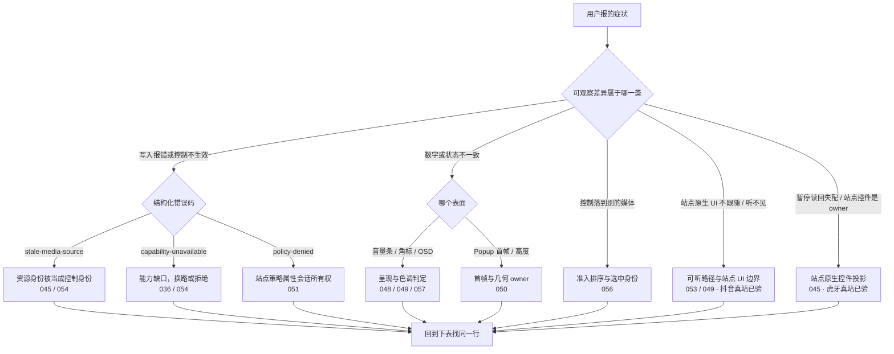

# 09. Failure index (symptom → cause → rule)

> 主题 owner 段: §22 Failure index
> 完整目录: [README.md](README.md)

这份索引只做一件事：把"用户看到的症状"直接连到"哪个判断错了、哪条规则管它、改哪里"。
它不替代任何 owner——每行的规则列指向 08 的编号，证据列指向日期化报告。

## §22 Failure index

### §22.1 用法

先按症状找到行，再看"状态"列：

| 状态 | 含义 |
| --- | --- |
| `rule` | 规则已存在且被门禁保护，问题只可能是实现漂移 |
| `open` | 根因已定位到代码，规则尚未写成或实现尚未改；修复前不要把结论当已修 |
| `guarded` | 曾经的事故，现由明确规则与测试双重看住 |

排查顺序固定：先读症状行 → 打开"代码位置"确认当前行号是否还成立 → 再看证据文档里的
完整时间线。**不要从 3000 行 research 开始读。**

### §22.2 索引

图里的编号是 08 的不变量号，不是本文件的章节号。先定位分支，再读下表该行的
"根因 / 状态"，不要从证据文档的长篇时间线开始读。

| 症状（用户怎么说） | 根因（哪个判断错了） | 规则 | 状态 |
| --- | --- | --- | --- |
| `stale-media-source: The media source changed before the asynchronous native operation committed`，直播里尤其频繁 | 资源身份 `sourceRevision` 被当成控制身份用：同一个元素换流后，在途写入被判过期 | 045、054 | guarded |
| 视频页切到直播后第一次快捷键必报 `stale-media-source`，再按一次才生效 | Background 投影落后于元素替换：请求携带已注销的 control identity，在途写入又跨过注销 | 045、054、056 | guarded |
| 视频切到直播后"自动控制不了"，点一下播放器或重开 Popup 又好了 | 两类原因都要看：元素替换时选中未交接、旧播放器的历史交互压过正在播放的直播，或空选中不自愈；以及 2026-11-14 真站新确认的一链——站点移除临时小播放器后 `handleSourceReleased` 清空 `activeMedia` 且不重投影，内容侧 `selectionVisit` 未变因此不再发事件，状态永久停在 `idle`；同时主播放器在 `duration=NaN` 且几何未到达时被播放中的预览压过，短暂读到 100 | 056、O11 | guarded |
| 插件改了音量，站点自己的音量条不动；无控制器的直播页上声音也不变 | 抖音 `dom-native` 页写 `element.volume` 时站点监听原生 `volumechange` 自己同步 UI；video-only 流走 `documentOutput`/Capture。但虎牙 `102411` 的 `vplayer.js` 才是可听电平与音量条的 owner：外部写 `element.volume=0.8` 只改 DOM 镜像，站点条仍 12.5px。两站不能混为一条结论 | 053、049 | guarded |
| 虎牙暂停按钮每次都报 `Playback readback mismatch: requested playing=false; after write=false; stable=true` | 站点播放器是播放状态 owner。isolated world 的 raw `element.pause()` 让元素停下，但 `vplayer.js` 内部仍是「观看中」，约 30ms 后再次 `play()`；稳定读回为 `true`，与 `requested=false` 冲突，必然抛错。不是 ACK 过严，也不是偶发时序 | 045 | guarded |
| 虎牙音量「双向都不同步」：站点拖条插件不跟，插件滑块站点条不跟 | 站点 → 插件方向本来就靠原生 `volumechange`，只是从未列为虎牙验收项；插件 → 站点方向在 `documentOutput` 下只改扩展自己的 Capture 处理器，站点条与 `element.volume` 都不动。修复是驱动站点自己的音量轨道、以站点 `.sound-bar` 宽度为证人，并把 display level 与 gain input 分离 | 053、049、045 | guarded |
| 按了暂停却还在放（或反过来） | 写入被当成成功，稳定证明没完成就作答 | 045 | rule |
| 角标显示旧音量 / 不刷新 / 必须打开 Popup 才同步 / 新开页面凭空出现角标 / 一开始永远不同步 | 角标被第二写者重绘；选中未迁移使原生 `volumechange` 被"非当前目标"过滤；媒体文档没有观察运行时（空 patch 跳过运行时，attach 也不补发已有选中）；SPA 切换选中新播放器元素后没有发布它自己的物理值；新播放器已呈现却因未选中而不被观察；注册时 `play` 已发生使元素永不入选；文档输出模式下用 delegate 的 applied 值取证；程序化配置被当成用户使用而写入 usage；把使用收紧为"仅扩展命令"后页面原生音量手势无法创建角标 | 052、014、056、I8、I9、I10 | guarded |
| 音量条不跟手、拖完回弹、数字冻结在 100 | 呈现值来自已确认快照而不是当前手势；或把阈值当成 Capture | 048、049、057 | rule |
| Popup 打开首帧空白、随后跳高，或先英文后中文 | 首帧等异步 actual；结构高度被历史值预留 | 050 | guarded |
| PiP 打开后立刻被关掉 | 站点策略属性被提前归还，浏览器在同一任务跑了退出算法 | 051 | guarded |

### §22.3 每行的证据与落点

**1. `stale-media-source` 频繁出现（guarded）**

- 抛错的唯一来源：`src/content/logic/native-media-async.ts`，`isCurrent()` 为假即抛；文案全仓只有这一处。
- 已落地的判定链：`media-registry.ts` 的 `recordForTarget` 只比较 `documentId + frameId + mediaId`；
  `sourceRevision` 只描述元素当前装载的资源。`removed(source-change)` 不再取消在途控制操作，
  写入在下一个 `await` 点对新资源重校验；只有 `detached` 才取消。
- 资源作用域仍随换流重建：`refreshSource` 先发 `removed(source-change)`，让 CSS/overlay/图表路由与
  恢复作用域按旧 `targetKey` 释放，再以新 revision 发 `registered` 并重新选取，`selected` 触发
  desired 重放。这就是"重基 + 重校验"。
- 测试：`test/native-media-executor.spec.ts` 的
  "finishes an in-flight native seek when the same element swaps its source"；
  `test/media-registry.spec.ts` 的 source-epoch 用例断言旧 revision 目标仍解析到同一元素。
- 证据：[2026-11-05 直播音量回归审计](../../../../docs/research/2026-11-05-spectra-live-volume-regression-audit.md)、
  [2026-11-09 文档质量审计](../../../../docs/research/2026-11-09-spectra-documentation-quality-audit.md)。
- 取舍与被否决方案：[Control identity decisions](../../../../docs/decisions/control-identity.md)。

**2. 视频 → 直播后自动失控 / 第一次手势失败（guarded）**

- 元素替换的同一批 DOM 变更里，新元素先注册、旧元素后注销；注销时 `active = null`。
- 已落地的补选：`reconcileRetiredSelection` 在 `!active` 时改用冷启动排序补选（只要求
  `isConnected`，不要求面积）；`admitBetterCandidate` 在空选中时退化为 `establishInitialSelection`。
  替换元素即使尚未布局，也会立刻成为选中并发 `selected`，随后 `spectra.content.target.changed`
  让后台 `activeMedia` 指向新 `mediaId`。
- 已落地的交接：`compare` 先比较呈现类别（直播 / 有限视频），再比较交互证据，最后才是
  播放态与面积。旧播放器留在文档里且仍可播放时，历史点击不再压制正在播放的直播。
- 已落地的"呈现退场"交接：当前选中暂停/结束/面积归零时，同一呈现作用域内**最近注册**的
  可见视频直接接管，不要求它已在播放。抖音直播元素首帧前是 `readyState = 0` + `paused`，
  要求播放证据会让控制权停在已退场的旧视频上，直到用户点一次直播画面。
- 已落地的身份继任：`unregister` 先完成状态转移（`byId`/选中/PiP/全屏/显式与暂停 key，
  并把 mediaId 记入 `retiredControlIds`）再通知观察者；`recordForTarget` 对已退役控制身份
  返回当前选中目标。因此 Background 投影落后一个替换时，第一次快捷键仍直接控制直播。
- 已落地的在途继任：写入已在旧元素开始、注销落在 `await` 窗口内时，`execute` 只做一次
  重试：已退役身份交给当前选中；`active-target` 意图跟随注册表的自动交接（SPA 换播放器、
  直播接管），不因后台投影落后一条消息而失败；观众显式选择、PiP/fullscreen 或播放中的
  目标保持原失败（暂停固定对运行中的直播可释放，见下条）。
  这也是角标能随原生音量变化刷新的前提：选中一旦交接，`volumechange` 不再被
  "非当前目标"过滤。
- 已落地的无声交接：选中元素已暂停时，一个**正在播放的直播**可以直接接管，即使它的
  布局框为 0 或 `visibleArea = 0`（抖音把运行中的直播挂在无布局元素上）。“暂停固定”
  只保护一个无声目标，会随之释放；显式选择、PiP/fullscreen、隐藏预览和播放中的选中
  仍不可被覆盖。若无此交接，写入会落到可见但无声的旧元素上：不报错，但观众听不到
  任何变化，直到自己点一下直播画面。
- 已落地的身份归一：`requestedCoverage = 'active-target'` 的意图一律应用到当前选中
  目标，不再信任投影携带的 `mediaId`。两种情况都曾让第一次写入报错：同一 document 内
  runtime 重建后计数器重新发号（注册表解析不到），以及播放器交接后旧 `mediaId` 仍注册
  但已被新选中替换（`requested=media:1:3`、`selected=media:1:1`）。投影可以滞后，
  document 的选中只由注册表决定；stale 诊断同时打印 requested 身份与带 `document=`
  的快照，可直接区分跨 document、跨 runtime 与同 document 内被替换。
- 已落地的访问计数：`selectionVisit` 只在控制身份变化时递增，同一元素的
  `sourceRevision` 前进只发布新的资源 target，不再开始新的选中访问。抖音直播等
  反复改写 `src` 的播放器此前每次换流都让在途写入与恢复义务失效，表现为第一次调节
  必报 stale、之后才好；`requested=none` 的意图现在也会先固定到当前选中，
  失败与继任重试因此都有一个可命名的身份。
- 已落地的恢复栅栏：自动恢复 token 的执行栅栏只比较 desired revision、场景和当前选中
  元素身份，不再比较 `selectionVisit`。单元素页面因此不再出现"requested 与 selected
  完全一致却过期"的恢复失败（`requested=media:1:1@1`、`selected=media:1:1`）；恢复
  不执行时页面音量无人接管，看起来就像原生音量变化没有同步。自动 restore 的 stale
  仍以结构化错误回传后台用于有序重试，但不再 `console.warn`：它是后台义务，不是观众
  手势失败。
- 已落地的配置传递：页面观测是资源事实，资源作用域合并只更新该资源的投影，不再从
  origin-portable 行删除同名字段。此前站点自己改一次音量/静音/倍速就会撤销用户配置，
  同站切到下一个视频时 `rebind` 的 portable patch 已空，只剩站点/全局预设——表现为
  「同网站内切视频配置变回预设」。恢复顺序固定为：本 tab 保留投影（同文档、整资源重载）
  → 同源 portable 补丁 → origin session → 站点预设 → 全局预设。
- 已落地的职责分离：同步、使用、可见性互不门闩。页面观测/自动恢复永远更新规范快照与
  资源行；只有显式来源（`popup` / `hotkey` / `remote`）的成功 ACK 点亮 sticky usage；
  没有显式使用的 tab 角标保持空。把恢复当使用会凭空造出角标，把 usage 当同步门闩会让
  原生音量事实丢失——两者都不允许。
- 测试：`test/tab-session.spec.ts` 的
  "carries explicit extension fields and never lets a page observation revoke them"、
  "keeps a configured volume when the page reports a different one"；
  `test/control-coordinator.spec.ts` 的
  "syncs an untouched tab without painting, then draws that synced value on first explicit use"。
- 测试：`test/media-registry.spec.ts` 的
  "keeps the selection visit stable when the resource revision advances"、
  "self-heals the selection when a live replacement registers before layout and the old target unregisters"、
  "hands control to a paused live replacement once the old player stops"、
  "hands control to a live broadcast beside a pre-roll the viewer clicked"、
  "hands a silent selection to a broadcast that is already running without a layout box"、
  "resolves a retired control identity to the selected successor"、
  "serves the first gesture after a player replacement from the retired identity"、
  "moves an in-flight gesture to the successor when the player is replaced mid-write"；
  `test/native-media-executor.spec.ts` 的
  "moves an active-target write to the new selection when another source becomes selected mid-write"、
  "applies an active-target intent to the selection when it names an identity this document never registered"、
  "applies an active-target intent to the selection when the projection names a superseded player"、
  "accepts an automatic restore after the same element starts a new selection visit"。
- 证据：[2026-11-01 直播音量修复记录](../../../../docs/research/2026-11-01-spectra-live-volume-popup-repair.md)。

#### 2026-11-14 第三轮真站复核（本行的 `guarded` 曾被过早收口）

上面各条都针对元素替换，且此前的真站证据都是**直接打开直播间**后的静态结果。
用户再次反馈「抖音切到直播自动完美同步还是没做到」后，过程侦察发现另一条独立因果链，
上述 `guarded` 并没有覆盖它。

- `live.douyin.com` 门户是**同一个元素换流**：video-only `MediaStream`、
  `duration=NaN`、`paused` → 带音轨、`Infinity`、播放中。站点音量控件全程是 60。
- 切换后站点挂载又移除一个 10×10 的有限时长小视频。它短暂抢到选中，后台读到
  `volumeBase=100`；移除时 `handleSourceReleased` 把 `activeMedia` 置 null、字段置 `idle`。
- 主直播从未离场，registry 的 `selectionVisit` 没变，所以不会再发 `selected` 来重绘卡片。
  九秒完全不操作后仍是 `null / idle`，手动拖一次滑块才恢复。
- 修复见提交 `8c644981`：释放后复用 `handleTargetChanged` 已在用的被动视图读；
  `mediaRank` 把挂载的 `MediaStream` 与 `isLiveMedia` 并列为呈现证据；几何为 0 时
  回退元素自身布局盒；`play` 改走 `admitBetterCandidate`。没有新增机制。
- 证据：[重审报告](../../../../docs/research/2026-11-14-spectra-douyin-video-to-live-switch.md)
  与 [真站证据](../../../../docs/research/evidence/2026-11-14-douyin-video-to-live-switch-proof.json)
  （`[E-current]`，HEAD `8c644981`）。门控用例
  `test/smoke/douyin-video-to-live-switch.spec.ts` 在修复前失败于 `activeMedia=null`，
  修复后正式轮与三轮稳定性复跑全绿，虎牙 Capture 回归 `3 pass / 65 expect()`。
- 剩余：启动阶段短暂的 `100` / `idle` 投影仍会自愈，登记为
  [未决项 O11](../../../../docs/proposals/open-items-program.md)，不写成已消除；
  `www.douyin.com` 仍是验证码中间页、0 个媒体元素，本轮无该站证据。

**3. 站点原生 UI 不同步 / 直播音量听不见（guarded，2026-11-14 真站收口）**

三个诉求互不替代。混在一起会反复产生「改了控制逻辑却没有效果」的循环：
**S-A 可听音量**、**S-B 站点 UI 数字**、**S-C ACK 诚实性**。
`applied` 只表示元素物理值写入并读回一致，不宣称响度变化。
完整重审、v2 方案与本次收口见
[2026-11-14 音量可听路径重审](../../../../docs/research/2026-11-14-spectra-volume-audible-path-reaudit.md)。

2026-11-14 用当前 HEAD 重建产物（`dist` 的 SHA-256 与 11-11 构建逐字节相同）、
本机 Chrome 157.0.8103.39 与 CDP `Extensions.loadUnpacked` 做了真站取证。
三份 `[E-current]` 证据如下。

- [形态侦察](../../../../docs/research/evidence/2026-11-14-real-site-media-shape-survey.json)：
  虎牙 `102411` 的主视频是 video-only `MediaStream`；抖音直播首页与三个房间的主视频都带
  `audioTracks=1`；`www.douyin.com` 被验证码中间页拦截，本轮没有该站证据。
- [虎牙真站用例](../../../../docs/research/evidence/2026-11-14-real-site-document-output-huya.json)：
  `documentOutput` 链路触发，策略为 `capture` 且 `live:true`。产品输出 analyser 的 RMS 在
  `volume-0` 与 `mute` 均为 0，`volume-70` 为 0.00346，`unmute` 为 0.000884，快捷键为 0.00314。
  `test/smoke/document-output.spec.ts` 完整文件为 `3 pass / 65 expect()`。
- [抖音真站可听性](../../../../docs/research/evidence/2026-11-14-real-site-dom-native-audibility-douyin.json)：
  带音轨的流留在 `dom-native`。同一轮内 `volumeBase 0 → 100` 使 `element.volume 0 → 1`，
  tab 音频 RMS 从 0 变为 0.1449。站点自身音量数字从 `0` 变 `100`，滑块 class 从
  `douyin-player-muted` 变为 `show-number`。站点监听的是浏览器原生 `volumechange`，
  不需要 declared 适配、合成手势或任何新机制。

真站用例此前两次稳定失败在 `strategy` 收到 `dom-native`。根因是 Puppeteer 默认
`800×600` 视口把播放器留在首屏之外，IntersectionObserver 的 `visibleArea` 全为 0，
`mediaRank` 的 live 优先项失效，后注册的静音广告凭 `registrationOrder` 抢走选中。
改成 `1600×1200` 并要求播放器落在视口内后，选中立即回到直播元素。
**产品源码一行未改**，本行状态变更伴随同一提交里的测试修正与真站证据，符合 §22.4。

仍然成立的边界：

- `boost > 100` 走已验证的 Capture 处理器增益，站点 UI 物理上不可能同步。
- `gain` 节点数值变化不等于可听变化。11-05 虎牙证据里 gain 到 0.25 / 0.6 而 rms 全为 0。
- 上面的三份证据只覆盖抖音直播间的站点 UI 跟随。虎牙的站点 UI 在本轮**确实没有单独采样**，
  这个边界后来被用户投诉证伪；虎牙的单独收口见下文「第四轮真站复核」。
  `www.douyin.com` 仍被验证码拦截。
- 通用三层解析与全局输出 gain 拦截已由用户在
  [11-05 回归审计](../../../../docs/research/2026-11-05-spectra-live-volume-regression-audit.md)
  授权移除，`SCTRL-053` 禁止复活。11-04 的用户确认证据采自未提交实验产物，不描述当前 HEAD。
- `capabilityFor('volumeBase')` 仍只认 `getVolume`/`setVolume` 方法对，硬编码 `declared: false`。
  `site-adapter-registry.ts` 仍只有 `douyin-speed` 一条 declared 行。这不是本行故障的原因，
  抖音直播间通过原生 `volumechange` 就完成了 UI 跟随
  （[11-01 探针](../../../../docs/research/evidence/2026-11-01-douyin-speed-probe.json)
  的 `candidateCount = 0`）。

#### 2026-11-14 第四轮真站复核（虎牙原生控件 owner）

用户反馈「为什么不做完：虎牙暂停按钮永远 `readback-mismatch`，音量同步双向都永远不行」。
上面三份 `[E-current]` 证据没有一份把虎牙自己的按钮或音量条当 oracle，所以第 3 行的
`guarded` 收早了。完整重审见
[虎牙原生控件重审](../../../../docs/research/2026-11-14-spectra-huya-native-control-parity.md)，
真站证据见
[2026-11-14 虎牙双向同步证明](../../../../docs/research/evidence/2026-11-14-huya-native-control-parity-proof.json)。

- **暂停**：isolated world `call:pause`（`content-runtime.js`）→ `event:pause paused=true`
  → 约 30ms 后 page world 的 `vplayer.js` 调 `play()` → `event:playing paused=false`。
  `writePlaybackWithStableAck` 的稳定读回必然是 `true`，于是每次都抛
  `requested playing=false; after write=false; stable=true`。站点才是播放状态 owner。
- **音量条的物主关系**：真实拖动 `.sound-btn` 到 0.12 时站点条 12.5px、
  `element.volume=0.12`，扩展已通过原生 `volumechange` 跟到 12（站点 → 插件方向没有坏，
  只是从未验收）。插件滑杆在 `documentOutput` 下只改 Capture 处理器，snapshot / 角标 70
  而站点条仍是 43.5px。外部写 `element.volume=0.8` 只把镜像改成 0.8，站点条仍 12.5px。
- **可听性证人**：同一轮 tab RMS 在站点条 43.5px / 5px / 77px 分别为
  `0.0241` / `0.000160` / `0.0726`，证明站点条控制真实输出。product 所在的 isolated world
  派发合成 pointer/mouse 输入能把站点条从 12.5px 推到 67px、`element.volume` 推到 0.78。
- **修复**：新增 `site-native-control-surface.ts`，观察优先地发现站点自己的播放按钮与音量轨道；
  `playing` 先点站点按钮再走原有稳定 ACK；`documentOutput` 的 `volumeBase` 先投影到站点轨道，
  以站点 `.bar` 宽度为证人做有界校准，处理器保持 unity，display level 与 gain input 分离。
  找不到控件或够不到目标就返回 `null`，沿用原有路由。没有复活
  `SCTRL-053` 禁止的全局输出 gain 拦截，也没有新增 declared 适配行。
  新模块不写 `element.volume`：第一次 `verify` 报 `SCTRL-003: unowned volume writer`
  后，把镜像对齐挪回唯一 canonical writer `native-media-executor.ts`，
  并加单测看住边界；门禁没有被放宽，baseline 没有改。
- **真站验收**：门控用例 `test/smoke/huya-native-parity.spec.ts` 共七轮全绿；
  从已提交 HEAD `332fe7a` 重建产物的正式两轮各 `1 pass / 16 expect()`，数值一致：
  站点 0.12 → 插件 12；插件暂停 `applied` / `lastError=null` / 站点按钮 `开始观看`；
  插件 70 → 站点 0.7 / 63px / 角标 70。单测 `test/site-native-control-surface.spec.ts`
  5 条覆盖无 DOM no-op、校准与单写者边界。
- **不写成已消除**：虎牙 90px 轨道 + 10px 手柄的物理上限约 0.944，请求 100 时如实 ACK 94；
  `boost > 100` 仍只改处理器增益；O11 启动闪动仍在；Chrome 157 之外的版本无证据。

**4. 按了暂停却还在放（rule）**

- 写入成功与稳定证明是两个事实；`speed`、`playing`、page-controller 写入与处理器输出必须在同一事务内
  等待证明，只有合格的标准 DOM 音量/静音可以先答 `written`。
- 规则位置：05 §11.1 与 [08](08-invariants-and-gates.md) 的 045。
- 虎牙的 `readback-mismatch` 不是「判据过严」而是站点重放写入：见上一段第四轮复核。
  稳定读回判据保持不动，修复的是写入对象（站点自己的按钮），不是放宽 ACK。

**5. 角标不刷新（guarded）**

- 角标是投影，不是第二 owner；它必须记录每次决策并按决策序绘制，而不是按谁先到 Action API。
- 页面事件保持精确资源状态；passive read 不写偏好；Popup 关闭时同步仍要成立。
- 已落地的观察加载边界：`NativeMediaExecutor` 是原生 `volumechange` 观测与
  `spectra.content.target.changed` 的唯一发送者，运行时不存在就没有任何观察。
  直播路由是**同源新文档**，`restoreIfConfigured` 的空 patch 曾经直接返回而不
  `ensureContentRuntime`，媒体上报的 `resumeDocumentInitialization` 对已完成初始化的
  document 又只返回旧 operation；于是观察 owner 缺失，直到 Popup 的显式读取冷启动
  运行时——这就是"必须点开 Popup 才同步"的完整根因链。
- 已落地的补建：媒体上报 `hasMediaElement` 时 `ensureMediaObservation` 以
  `document-media-observation` 能力确保运行时；观察与写入意图分离，空模板的运行时
  只观察、不写入。运行时 attach 到已有选中的文档时 `publishCurrentSelection` 立即
  发布一次该选中，并把页面上已存在的物理值（音量、静音、速度、音高保持、播放）
  作为页面观察一并提交；attach 时没有选中，则紧随其后的第一次选中补完这次发布且
  只补一次。SPA 路由切换（`/follow` → `/follow/live/<id>`，同一文档、不同播放器
  元素）在选中替换时发布新元素自己的物理值；仅同一元素上身份变化（mediaId /
  sourceRevision）的选中保持只发布目标。否则新文档或新播放器在首次原生变化或被
  显式读取前没有任何字段快照，角标仍会看起来"只在 Popup 打开时同步"。
- 已落地的重启保留：worker 重启只对存活的运行时、且 `mediaFacts` 中该 tab 的
  `documentId` 匹配、`outcome === 'found'` 时保留 observation lease；死运行时不会
  因历史媒体事实被复活。
- 同源路由 `/follow` ↔ `/follow/live/<id>` 共用同一 tab session，不涉及跨 origin
  会话迁移；不要再从 tldts/site 分组方向修这个问题。
- 已落地的观察边界：观察**不以呈现为门**。SPA 直播路由已挂载播放器、但选中尚未
  迁移时，该元素自己的原生音量/静音变化仍以它自己的 target 提交页面观察；控制所有权
  不因属性事件移动。曾经用 `isPresented`（有面积 ∨ PiP/全屏 ∨ `isLiveMedia` ∨ 正在
  出声）否决未选中元素的观察，但"点一次暂停/播放就恢复同步"正是这个判据的反证：
  `play` 会把所有权移到该元素，从而绕过整道门。真实直播页的状态并不满足任何一条
  呈现证据——`live.douyin.com` 的 `<video>` 绑定 video-only MediaStream，首次手势前
  `paused`、`readyState 0`、`duration` 为 `NaN`（不是 `Infinity`），可能还在 0×0
  布局盒里。音量是同一原生面上的物理状态，因此判据只保留一件事：**隐藏的有限时长
  预览**（feed 静音预览、pre-roll 空壳）不是用户触及的音量面，仍被否决；直播元素
  （非有限时长）无论可见性、暂停与否都提交观察。呈现证据只服务于选择与准入。
- 已落地的注册准入（I8）：SPA 在 `play` 已经发生之后才挂载的播放器，其 `play` 早于
  监听器注册，`registered` 只做 `primeObserved`、从不参与选择；于是直播元素一直停在
  未选中分支，直到用户点一次暂停/播放（`pointerdown`/`play`）才转移所有权。
  `MediaRegistry.register()` 现在对"注册时已在播放"的元素执行与 `play` 相同的
  `admitBetterCandidate(true)`；空选中仍由发现批次统一建立，注册不搅动初始选择，
  暂停钉住、显式选择、PiP/全屏保护语义不变。
- 已落地的观察证人（I9）：选中分支的 `volumechange` 曾用 `read()` 取音量，而
  `read()` 优先问 audio delegate；delegate 在文档输出（capture）生效时返回扩展自己的
  `appliedConfig`，原生手势前后不变，与 `observed` 缓存相等后直接丢弃。现在
  `volumeBase`/`mediaMuted` 一律从事件元素本身读取（`readElementVolumeFields`），
  `flushPageObservations` 的选中重读同样以元素覆盖 delegate 值；delegate 只描述扩展
  写入的归属，不能冒充页面的物理事实。
- 已落地的用途边界（I10）：内容侧的 `userHasInteracted` 曾用"非 native sync"反推，
  初始化与 `spectra.audio.runtime.configure` 都会把它置真；`session.publish` 携带该
  事实后，后台 `resolveStickyUsage` 直接 `markBadgeUsed`，之后任何页面观察都能画角标
  ——新开 douyin 未使用就出现角标。现在内容侧只在 Popup/热键命令分发前
  `markUserInteracted`；`isNativeSync` 只保留"抑制 applyState"。后台
  `updateBadgeFromSession` 只读 `hasBadgeUsage`，用途只能由已结算的显式意图写入；
  `tabs.onCreated` 与 `onRemoved` 都把 tabId 当作 usage 的生命周期边界。
- 已落地的页面手势用途证人（I10 修订）：只允许 Popup/热键创建 usage 后，观众直接
  拖站点原生音量条只会产生页面观察，`isBadgeProjected` 恒为假，角标"一开始永远
  不同步"，直到打开 Popup。document-start bootstrap 现在记录 `isTrusted` 的
  pointerdown、按住期间的 pointermove、keydown 与 wheel，时间戳写入跨 bundle 共享的
  `ContentBootstrapState.mediaUserGestureAt`；`volumechange` 若落在该输入后 1 秒内，
  内容侧把 `userGesture` 随页面观察提交（合同仅允许 `source=page`），后台在准入
  该观察前 `markBadgeUsedForTab`。自动播放初始化、SPA 脚手架、恢复写入都没有受
  信任输入，不能创建角标；观众拖动/点击静音则立即让角标出现并绘制该观察值。
  明确不使用 `navigator.userActivation`：同源导航后可能残留，自动化浏览器中也可能
  恒为真，会重新制造"新开页面就出角标"。
- 已落地的媒体边界：`hasMediaSurface` 把"有源"的媒体当作媒体面——`srcObject` 上已存在
  的轨道，或 `currentSrc`/`src` 已赋值。直播路由可在首次手势前把元素停在
  `HAVE_NOTHING`，此时 `readyState`/`currentTime`/`played` 都不成立；没有这条证据，
  观察运行时要等用户播放一次才被加载，第一轮音量手势无处可去。没有任何资源的空壳
  标记仍然不算媒体。
- 已落地的加载触发：bootstrap 在文档起点监听真实媒体元素的生命周期事件
  （`loadstart`、`play`、`pause`、`playing`、`loadedmetadata`、`durationchange`、
  `emptied`、`timeupdate`）与 `volumechange`/`ratechange`，每次重算媒体面。直播路由
  常在页面空闲后才挂载播放器：先挂载再获得源时 `loadstart` 会到达文档；先在游离元素
  上 `play()` 再挂载时，挂载后继续推进的播放时钟（`timeupdate`）会到达文档。文档级
  DOM 观察属于重运行时的 registry，bootstrap 不持有 `MutationObserver`。
- 已落地的交付收敛：媒体上报和页面观察都是义务，只有后台确认（`ok:true`）才结束。
  被重定向路由的文档身份竞态拒绝时，bootstrap 撤回去重闩锁并按
  150/400/900/1800 ms 重试；HELLO 归属握手按 150/400/900/1800/3000/5000 ms 独立重试，
  一次被拒绝的握手不会让文档永久失去观察路径。媒体上报只有在 observation owner
  真正就绪后才确认：后台 `ensureMediaObservation` 以 120/400/1200/3000/6000/10000 ms
  重试，等待中的消息通道让 worker 覆盖整个重试窗口，失败返回可重试错误并让 bootstrap
  重新上报。这样一次丢失的上报不会把文档拖到"用户点一次暂停/播放"或"打开 Popup"
  才恢复；重试受 navigation/release 退休与新文档代际约束。
- 现场证据（真实页面）：`live.douyin.com` 的直播控制是
  `douyin-player-volume-slider(-track/-thumb/-number)` 这组 DOM，页面没有 `window.player`；
  播放器 `<video>` 是 `srcObject` MediaStream。正常播放不再输出任何音量诊断：早期实现
  对每个 `volumechange` 打印 `console.warn('[SPECTRA][volume]', {...})`，控制台显示为
  `[object Object]`，被当成错误上报。现在只有真正丢弃的样本才输出一条可读的
  `console.debug('[SPECTRA][volume] dropped <reason> sample for <frame>:<media>')`
  （每文档至多 4 条，生产构建剥离 `console.debug`）。没有输出但角标不动，才需要查
  后台准入或角标投影。
- 已落地的角标展示顺序：未结算的乐观展示（快捷键/Popup）记录其 control revision；
  同一 document/generation 下出现更大 revision 的已准入投影时，展示立即让位给实际值
  并删除。旧实现让乐观展示无条件压过实际值，只有结算、打开 Popup、identity 变化或
  5 分钟 TTL 才释放——一次未收敛的写入即可把角标钉在旧数字，精确对应"点一次暂停/播放
  或打开 Popup 才同步"。相等 revision 不让位，避免手势前采样的页面值覆盖乐观投影
  （`test/badge-volume-state.spec.ts`）。
- 隐藏预览不得接管：页面可以在真实播放器旁挂一个 `hidden` 预览播放器（抖音的静音
  预览、预加载壳）。它的 `volumechange` 不是用户手势，未选中元素的样本因此被语义
  可见性否决（`hidden` 属性或祖先、`display:none`、`visibility:hidden/collapse`）。
  几何尺寸不参与判定——真实直播路由挂载中的播放器可以是 0×0、无元数据、未播放，
  这正是"未选中元素也能提交样本"存在的原因。旧实现缺少该否决，预览以自己的
  `13/M` 覆盖了正在播放的直播（`test/native-media-executor.spec.ts`、
  `test/smoke/page-media.spec.ts` 的 "keeps native volume on the visible live stream
  when a hidden preview starts"）。
- 浏览器证据：`test/smoke/live-target-restart.spec.ts` 的四条门禁——
  "follows the broadcast native volume while another player owns control"（0×0 canvas
  直播，角标 80 → 37）、"follows a finite player the page mounts without a layout box"
  （0×0 有限播放器，角标 80 → 42）、"follows a paused player the page keeps out of layout
  before playback starts"（无面积、无元数据、未播放、无播放历史，角标 80 → 31）、
  "loads the observation runtime when a live route mounts its player after the document is
  idle"（空文档 → 挂载空播放器 → 连接态赋 `srcObject` 触发 `loadstart`，运行时由该
  生命周期事件加载，旧实现停在 `ready:false`）。最后两条分别看住"观察不以呈现为门"
  和"媒体面由有界生命周期事件重算"。
- 测试：`test/runtime-loader.spec.ts` 的
  "acquires an observation runtime for a media document with no desired template"、
  "retries an observation load that lost the document-identity race"、
  "does not acquire an observation runtime after the viewer released the document"；
  `test/native-media-executor.spec.ts` 的
  "publishes an established selection when a runtime attaches after it was selected"、
  "completes the attach publication when the first selection arrives after it"、
  "publishes the replacement player values when a route switch selects another element"、
  "observes a native volume change from any registered player the selection has not reached"；
  `test/media-presence.spec.ts` 的已绑定轨道用例；
  `test/runtime-restart-startup.spec.ts` 的
  "keeps the surviving runtime as an observation owner when its document reported media"、
  "does not resurrect a dead runtime for a media observation owner"。
- 规则位置：08 的 052、014、056；投影与加载边界见
  [runtime](../architecture/runtime.md#runtime-loading-and-shortcuts) 与
  [05 §11](05-control-state.md#11-volume-and-mute)。

**6. 音量条不跟手（rule）**

- 呈现的数字始终是当前手势的乐观值；路由事务只持有色调与静音，不持有数字。
- 阈值不蕴含 Capture；预测色调不是 Capture 事实；任何表面都不得由数字反推路由。
- 规则位置：08 的 048、049、057；符号关系见 05 §11.2 的符号表。

**7. Popup 首帧空白（guarded）**

- 首帧必须包含全部已公告可见 slot，结构本身决定固有尺寸，frame-height 是唯一几何 owner。
- 规则位置：08 的 050；机制见 [runtime §Action Popup first frame](../architecture/runtime.md#action-popup-first-frame)。

**8. PiP 打开即关（guarded）**

- 站点策略属性在会话期内由扩展持有，会话结束才归还；会话期内重复添加会让浏览器执行退出算法，
  页面自己终止的会话要报 `policy-denied` 而不是读回不一致。
- 规则位置：08 的 051；实现见 06 §14.8。

### §22.4 维护规则

- 新症状先加行，再写证据；行里没有"规则"列的不许进表。
- 修复落地时把状态从 `open` 改成 `guarded`，并在同一提交里补测试；只改状态不算修复。
- 行号会漂移，所以正文只写函数名，行号最多出现在日期化报告里。
