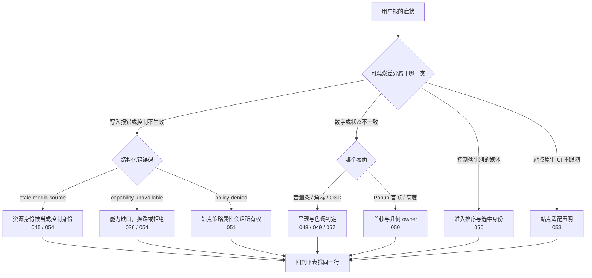

# 09. Failure index (symptom → cause → rule)

> 主题 owner 段: §22 Failure index
> 完整目录: [README.md](README.md)

这份索引只做一件事：把"用户看到的症状"直接连到"哪个判断错了、哪条规则管它、改哪里"。
它不替代任何 owner——每行的规则列指向 08 的编号，证据列指向日期化报告。

## §22 Failure index

### §22.1 用法

先按症状找到行，再看"状态"列：

| 状态 | 含义 |
| --- | --- |
| `rule` | 规则已存在且被门禁保护，问题只可能是实现漂移 |
| `open` | 根因已定位到代码，规则尚未写成或实现尚未改；修复前不要把结论当已修 |
| `guarded` | 曾经的事故，现由明确规则与测试双重看住 |

排查顺序固定：先读症状行 → 打开"代码位置"确认当前行号是否还成立 → 再看证据文档里的
完整时间线。**不要从 3000 行 research 开始读。**

### §22.2 索引

图里的编号是 08 的不变量号，不是本文件的章节号。先定位分支，再读下表该行的
"根因 / 状态"，不要从证据文档的长篇时间线开始读。

| 症状（用户怎么说） | 根因（哪个判断错了） | 规则 | 状态 |
| --- | --- | --- | --- |
| `stale-media-source: The media source changed before the asynchronous native operation committed`，直播里尤其频繁 | 资源身份 `sourceRevision` 被当成控制身份用：同一个元素换流后，在途写入被判过期 | 045、054 | open |
| 视频切到直播后"自动控制不了"，点一下播放器或重开 Popup 又好了 | 元素替换时选中变空；空选中不可自愈，也不再发 `target.changed` | 056 | open |
| 插件改了音量，站点自己的音量条不动，而且下次换流被站点覆盖回去 | 音量只写元素属性（`dom-native`），没有站点控制器适配；declared 行只有倍速 | 053、049 | open |
| 按了暂停却还在放（或反过来） | 写入被当成成功，稳定证明没完成就作答 | 045 | rule |
| 角标显示旧音量 / 不刷新 / 显示 `M` 但页面在响 | 角标被第二写者重绘，或用了过期的观察序 | 052、014 | guarded |
| 音量条不跟手、拖完回弹、数字冻结在 100 | 呈现值来自已确认快照而不是当前手势；或把阈值当成 Capture | 048、049、057 | rule |
| Popup 打开首帧空白、随后跳高，或先英文后中文 | 首帧等异步 actual；结构高度被历史值预留 | 050 | guarded |
| PiP 打开后立刻被关掉 | 站点策略属性被提前归还，浏览器在同一任务跑了退出算法 | 051 | guarded |

### §22.3 每行的证据与落点

**1. `stale-media-source` 频繁出现（open）**

- 抛错的唯一来源：`src/content/logic/native-media-async.ts`，`isCurrent()` 为假即抛；文案全仓只有这一处。
- 判当前性的链路：`native-media-executor.ts` 的 `isCurrentTarget` → `media-registry.ts` 的 `recordForTarget`，
  后者要求 `sourceRevision` 完全相等。`refreshSource` 每次 `src`/`srcObject`/`load()` 变化都 +1。
- 由此连带：`targetKey` 含 revision → 每次换流都让 `selectionVisit` +1 → executor 的 visit 栅栏、
  恢复令牌、恢复重试门一起失效；`removed(source-change)` 还会清掉未完成的恢复义务。
- 证据：[2026-11-05 直播音量回归审计](../../../../docs/research/2026-11-05-spectra-live-volume-regression-audit.md)、
  [2026-11-09 文档质量审计](../../../../docs/research/2026-11-09-spectra-documentation-quality-audit.md)。
- 修复方向（未落）：控制身份与资源身份拆开——`isCurrent` 只比 element + mediaId，换流走"重基 + 重校验"。
- 取舍与被否决方案：[Control identity decisions](../../../../docs/decisions/control-identity.md)。

**2. 视频 → 直播后自动失控（open）**

- 元素替换的同一批 DOM 变更里，新元素先注册、旧元素后注销；注销时 `active = null`，
  而补选函数在 `!active` 时早退，候选过滤又要求 `visibleArea > 0`，刚插入未布局的元素不满足。
- 结果：选中为空，`selected` 不再触发，`spectra.content.target.changed` 不再发送，后台 `activeMedia`
  仍是已消失的旧 `mediaId`；之后每次 `resolve(intent.target)` 都拿到 null。
- 只有新元素再发一次 `play`、或用户点一下，才能自救——这就是"点一下就好"。
- 修复方向（未落）：`reconcileRetiredSelection` 在 `!active` 时改用与冷启动相同的排序补选（只要求
  `isConnected`，不要求面积），并让 `admitBetterCandidate` 在空选中时退化为初始选中。

**3. 站点原生 UI 不同步（open）**

- 音量能力探测在 `src/content/injector/page-media-bridge.ts` 只认 `getVolume`/`setVolume` 方法对；
  muted 有 `.muted` 访问器兜底、speed 有 `.playbackRate` 兜底，音量没有 `.volume` 兜底。
- `src/shared/site-adapter-registry.ts` 目前只有 `douyin-speed` 一条 declared 行，没有任何音量声明。
- 所以音量永远 `dom-native`：写元素、站点控制器状态不变、下次换流被站点状态覆盖。
- 边界：`boost > 100` 走 Capture 处理器增益，站点 UI **物理上不可能**同步；只有 ≤100 且 declared 才谈得上同步。
- 证据：[2026-11-01 直播音量修复记录](../../../../docs/research/2026-11-01-spectra-live-volume-popup-repair.md)。

**4. 按了暂停却还在放（rule）**

- 写入成功与稳定证明是两个事实；`speed`、`playing`、page-controller 写入与处理器输出必须在同一事务内
  等待证明，只有合格的标准 DOM 音量/静音可以先答 `written`。
- 规则位置：05 §11.1 与 [08](08-invariants-and-gates.md) 的 045。

**5. 角标不刷新（guarded）**

- 角标是投影，不是第二 owner；它必须记录每次决策并按决策序绘制，而不是按谁先到 Action API。
- 页面事件保持精确资源状态；passive read 不写偏好；Popup 关闭时同步仍要成立。
- 规则位置：08 的 052、014。

**6. 音量条不跟手（rule）**

- 呈现的数字始终是当前手势的乐观值；路由事务只持有色调与静音，不持有数字。
- 阈值不蕴含 Capture；预测色调不是 Capture 事实；任何表面都不得由数字反推路由。
- 规则位置：08 的 048、049、057；符号关系见 05 §11.2 的符号表。

**7. Popup 首帧空白（guarded）**

- 首帧必须包含全部已公告可见 slot，结构本身决定固有尺寸，frame-height 是唯一几何 owner。
- 规则位置：08 的 050；机制见 [runtime §Action Popup first frame](../architecture/runtime.md#action-popup-first-frame)。

**8. PiP 打开即关（guarded）**

- 站点策略属性在会话期内由扩展持有，会话结束才归还；会话期内重复添加会让浏览器执行退出算法，
  页面自己终止的会话要报 `policy-denied` 而不是读回不一致。
- 规则位置：08 的 051；实现见 06 §14.8。

### §22.4 维护规则

- 新症状先加行，再写证据；行里没有"规则"列的不许进表。
- 修复落地时把状态从 `open` 改成 `guarded`，并在同一提交里补测试；只改状态不算修复。
- 行号会漂移，所以正文只写函数名，行号最多出现在日期化报告里。
