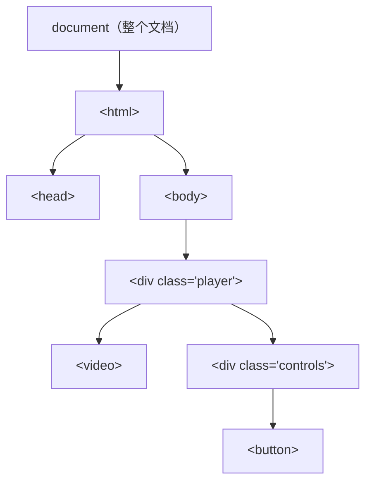
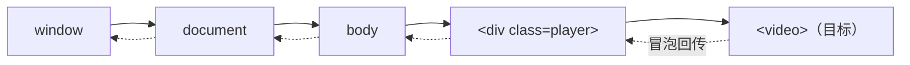
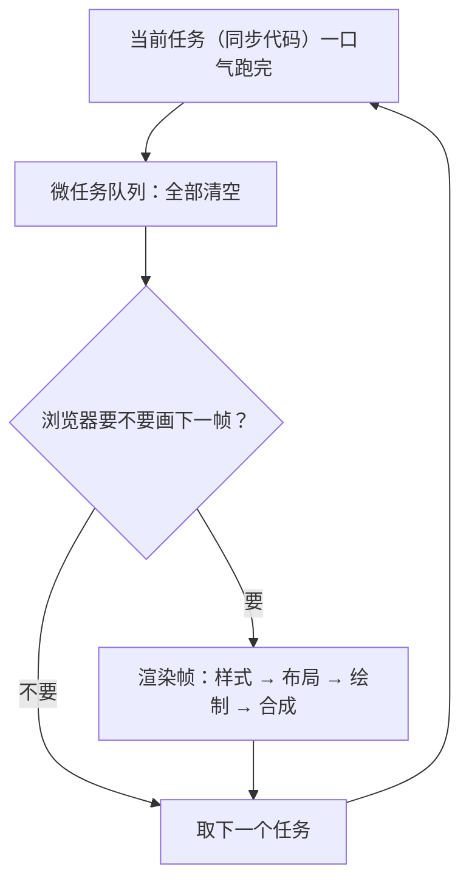
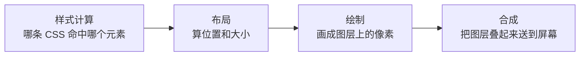
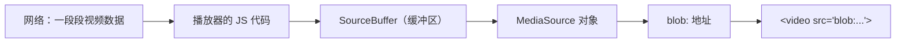
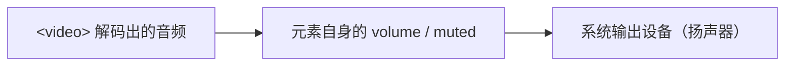
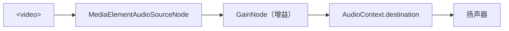

# 00. 浏览器这台机器（前端零基础）

> 本篇是教材，不是规范。规则请看 [control/](../control/README.md)。

读完之后，你应该能听懂这些句子而不发懵：

- "这个 `<video>` 被 detach 了"
- "换源会让在途写入过期"
- "微任务里拿不到布局"
- "音量超过 100% 只能靠增益，站点 UI 永远不会跟着变"

---

## 1. 一个网页，其实是三份文本

服务器发给浏览器的，本质上就是一堆文字，主要是三种：

| 文件 | 管什么 | 类比 |
| --- | --- | --- |
| HTML | **有哪些东西**（内容与结构） | 一间屋子的户型图：哪是墙、哪是门、哪是窗 |
| CSS | **长什么样**（外观） | 装修：颜色、尺寸、贴在哪儿 |
| JavaScript（JS） | **会做什么**（行为） | 屋里的电器：能开关、能调、会自己动 |

浏览器拿到这三份文本，做三件事：**解析**（读懂）、**排版**（算出位置大小）、**绘制**（画到屏幕上）。

**关键认知**：HTML 本身是死的。它只是一段文字，描述"这里应该有一个视频框"。真正会让它动起来的，是浏览器把它变成了一棵"活的对象树"。

---

## 2. DOM：浏览器把文字变成了一棵活树

浏览器读 HTML 的时候，不是把它当字符串存着，而是**逐个标签建对象**，然后按嵌套关系连起来。这棵树叫 **DOM**（Document Object Model，文档对象模型）。



树上的每一个点叫**节点（node）**。节点分几种：

| 节点类型 | 例子 | 说明 |
| --- | --- | --- |
| 元素节点 | `<video>`、`<div>`、`<button>` | 最常用的一种，就是"标签" |
| 文本节点 | 标签之间的文字 | 连空格和换行都算 |
| 注释节点 | `<!-- ... -->` | |
| 文档节点 | `document` | 整棵树的根，也是所有查询的起点 |

**为什么是树而不是列表**：因为只有树才能同时回答两个问题——"这个东西里面有什么"和"这个东西还挂在文档上吗"。第二个问题在本项目里极其重要（见第 5 节）。

### 你会遇到的三种说法，指的是同一件事

| 说法 | 意思 |
| --- | --- |
| 节点 / node | 树上任意一个点（可能是文字，也可能是元素） |
| 元素 / element | 特指标签节点（`<video>`、`<div>`…） |
| 标签 / tag | HTML 文本里的写法（`<video>` 这个字符串），不是对象 |

聊天里说"这个 video 元素"，指的是**树上那个对象**，不是 HTML 文件里那几行字。

---

## 3. 每个元素都是一个"活对象"

这一节是整篇最重要的地方。看不懂这里，后面全部会错。

浏览器建完树之后，树上每个元素在 JS 里都是一个**对象**：有属性（能读能写）、有方法（能调用）。

```js
const v = document.querySelector('video');   // 找到那个元素，拿到对象
v.volume = 0.5;                              // 写一个属性 → 声音立刻变成一半
v.play();                                    // 调一个方法 → 开始播放
v.paused;                                    // 读一个属性 → true 或 false
```

改写属性的效果是**立刻生效**的：不需要刷新页面，不需要重新解析 HTML。这就是"活"的意思。

### 属性（property）和特性（attribute）不是一回事

这是前端最经典的坑，也是"我明明改了怎么没反应"的头号原因。

| | 属性 property | 特性 attribute |
| --- | --- | --- |
| 住在哪 | JS 对象上 | HTML 文本里 |
| 怎么读 | `v.volume` | `v.getAttribute('volume')` |
| 改了会怎样 | 立即影响运行中的页面 | 只改了"初始值"，通常**不影响当前状态** |

举两个例子：

```js
// 输入框：你在里面打字，改的是 value 属性；HTML 上写的 value="默认" 是初始特性
input.value = 'hello';                 // 屏幕上立刻变成 hello
input.getAttribute('value');           // 还是 '默认' —— 它没变

// 视频：volume 根本没有对应的 HTML 特性
v.volume = 0.3;                        // 有效
v.setAttribute('volume', '0.3');       // 无效 —— 浏览器不认这个特性
```

**结论**：要控制播放器，必须改 **property**。改 HTML 字符串一辈子也控制不了声音。

这也是为什么本项目里所有"写入"都是 `element.volume = x` 这种形式，而不是拼 HTML。

---

## 4. 找元素：为什么本项目几乎不用选择器

最基本的找法有三种：

```js
document.getElementById('abc');            // 按 id 找，最快
document.querySelector('video');            // 按 CSS 选择器找第一个
document.querySelectorAll('video');         // 找全部，返回一个类数组
```

选择器长这样：`.class`（按 class）、`#id`（按 id）、`video[src]`（带某属性的 video）、`div > video`（子元素）。

**看起来很美好，但本项目不能依赖它**，原因有三：

1. **站点的 class 名是随机生成的**。今天叫 `xg-player-v3__video`，明天重构就变了。用选择器锁定等于把代码绑在别人的实现细节上。
2. **一个页面可能有很多个 `<video>`**。广告、预览、悬浮窗、真正的播放器，全都符合 `video` 选择器。选错了就是控制错对象。
3. **元素会被替换**。选择器只能"再查一次"，它不知道"还是不是刚才那个"。

所以本项目的做法是：**第一次见到元素时给它发一个编号，之后只认编号**。这个编号就是 `mediaId`，发编号的动作在 `media-registry.ts` 的 `register` 里。

> 编号只活在这一个文档里。页面一换（导航），编号全部作废——因为那是一棵全新的树。

---

## 5. "在不在树上"：isConnected

一个元素被 `remove()` 之后，会发生两件很容易被误解的事：

```js
const v = document.querySelector('video');
v.remove();          // 从树上摘下来
v.isConnected;       // false —— 它不在文档里了
v.paused;            // 仍然能读！对象还活着
```

**移除 ≠ 销毁。** 元素对象还在内存里，你手上的引用还能操作它、还能读它的属性。只是它不再被渲染，用户看不见，页面上也不存在了。真正被回收要等到没有任何代码引用它。

这就是本项目里那个词的确切含义：

> **detached** = `element.isConnected === false`，即"这个节点当前不在文档树上"。

它和"有没有视频流""是不是直播""在不在播放"**统统无关**。它只描述挂载状态。

### 为什么这在本项目里是大事

因为现代前端框架（React / Vue）更新界面时，**经常是"先删掉旧的，再插入新的"**：

```mermaid
sequenceDiagram
  participant Site as 站点代码
  participant DOM as DOM 树
  participant Ext as 扩展的内容脚本
  Site->>DOM: 移除旧的 &lt;video&gt;
  Note over DOM: 此刻扩展如果去看：isConnected = false
  Site->>DOM: 插入新的 &lt;video&gt;
  Note over DOM: 现在又有 video 了，但已经是另一个对象
  Ext->>DOM: 我来检查一下谁离场了
```

关键在于**扩展什么时候去看**：

| 时机 | 看到的结果 | 后果 |
| --- | --- | --- |
| 同一个任务内（同步） | 旧元素已经摘掉、新元素已经挂上 | 看起来什么都没发生，安全 |
| 跨任务（中间隔了一次事件循环） | 旧元素 `isConnected === false` | 判定"这个播放器离场了" |

而浏览器有个机制叫**微任务**（第 7 节讲），它专门用来"把同一批 DOM 变更合并起来再判断"。本项目就是靠它来区分这两种情况：移除请求先记下来，等这一批变更做完，再统一检查 `isConnected`。

这就是 `queueRemovalTree` 存在的理由。它不是在"等一会儿"，它是在**等这一批改动结束**。

---

## 6. 事件：页面唯一会主动说话的方式

DOM 树是静态的结构，但页面是动的。页面表达"发生了什么"的唯一方式，就是**事件**。

```js
video.addEventListener('volumechange', () => {
  console.log('音量被改了，现在是', video.volume);
});
```

三件事必须知道：

### 6.1 事件有传播路径（捕获 → 目标 → 冒泡）



- **捕获阶段**：从 `window` 一路往下走到目标。
- **目标阶段**：事件到达元素本身。
- **冒泡阶段**：从目标一路往上回到 `window`。

`addEventListener(type, fn)` 默认在冒泡阶段触发；传第三个参数 `{ capture: true }` 就在捕获阶段触发。

冒泡的用处叫**事件委托**：只在外层挂一个监听，就能处理所有子元素的事件。列表、表格常用这招。

### 6.2 但媒体事件不冒泡

这一点很多人踩坑：`play`、`pause`、`volumechange`、`loadedmetadata`、`timeupdate` 这些媒体事件，规范里**不冒泡**。

```js
document.addEventListener('volumechange', fn);   // 收不到 video 的音量变化
video.addEventListener('volumechange', fn);      // 只有这样才能收到
```

**所以本项目必须对每一个媒体元素单独挂监听**，不能委托、不能只听 document。这也解释了为什么 `MediaRegistry` 要维护"元素 ↔ 记录"的映射：它得知道每个监听属于谁。

### 6.3 用户手势（activation）：浏览器不是什么都让你做

浏览器为了防止网页乱来，规定某些能力**只有在用户真的做了动作之后的一小段时间内**才允许：

| 能力 | 需要用户手势 |
| --- | --- |
| 有声自动播放 | 是 |
| 全屏 | 是 |
| 捕获标签页音频（TabCapture） | 是，而且必须来自扩展自己的界面 |
| 剪贴板写入 | 是（部分场景） |

"用户手势"有个正式名字叫 **transient activation**，它有一个很短的存活窗口（几秒），用完就消耗掉。

**这解释了一个本项目里非常反直觉的限制**：页面里监听到的按键不是扩展调用，拿不到 Capture 的准入。绕过方式是让按键成为真正的浏览器命令：当媒体已经在原生上限、且当前文档还没有扩展调用授权时，那一次 `Alt+↑` 不阻止默认行为，交给 manifest 的 `volume_up` 命令执行，Chrome 因此授予该标签页 `activeTab`，同一个按键在 100% 以上也能启动增强（Bootstrap 会阻止页面 handler 取消该和弦）。授权属于文档生命周期，Popup 打开、命令送达或任一次成功启动的 Capture 都会锁存它直至导航；所以从 110% 回到 100% 后即使 Capture 已停止，下一次 `Alt+↑` 仍走页面快捷键通道。上限以下的按键同样走页面快捷键通道。页面自定义的其它按键没有这条通道。

---

## 7. 时间不是一条线，是三层

这一节是理解本项目所有"预算""栅栏""时序"的钥匙。

JS 是单线程的：同一时刻只有一段代码在跑。那异步是怎么做到的？靠**排队**。队列有三层，优先级从高到低：



### 7.1 任务（task，也叫宏任务）

一次事件回调、一个 `setTimeout`、一条消息到达——都是一个任务。浏览器一次只处理一个，处理完再看有没有微任务。

### 7.2 微任务（microtask）

`Promise.then`、`await` 后面的代码、`queueMicrotask()`、`MutationObserver` 回调，都是微任务。

规则很硬：**当前任务结束后，微任务队列必须被清空，才轮到渲染或下一个任务。**

由此得到三条推论，每一条都直接对应本项目的设计：

| 推论 | 后果 |
| --- | --- |
| 微任务在**渲染之前**执行 | 微任务里读不到"布局结果"——布局还没算 |
| 微任务里再加微任务，会一直排下去 | 在微任务里做重试 = 在页面还没反应过来时连续打空 |
| 微任务能看到"同一批 DOM 变更的最终状态" | 这就是合并判断"谁离场了"的正确时机 |

### 7.3 帧（frame）

浏览器大约每 16.7 毫秒画一次（60Hz；高刷屏更快）。画之前要先算布局：每个元素多大、在哪儿。

**只有在这个尺度上，"可见"才成立。** 元素刚插入 DOM 的那一刻，浏览器还没算过布局，它的宽高是 0、位置是 0 —— 这时候问"它可见吗"，答案必然是"不可见"。

这就是本项目一个反复出问题的点：**新播放器刚注册时，面积是 0**。任何"要求面积大于 0 才算合格候选"的判断，在那一刻都会把它排除掉。

想知道元素真实几何，有三种办法：

```js
el.getBoundingClientRect();   // 立刻拿到，但会强制浏览器马上算布局（性能代价）
el.offsetWidth;               // 同上
new IntersectionObserver(cb); // 让浏览器在合适的帧通知你，不阻塞
```

前两种是"逼它现在就算"，第三种是"算好了告诉我"。本项目用第三种来跟踪可见性。

### 7.4 还有一个更慢的尺度：导航

页面跳转、刷新、单页应用切换路由——这些会让整棵树作废。这个尺度比帧慢得多，但一旦发生，**所有 JS 变量全部清零**。

所以本项目不能只靠内存里的变量记状态：换页之后那些变量就没了。

---

## 8. 渲染管线：为什么"改了"不一定"看得见"

浏览器把一棵树画到屏幕上，要经过四步：



三个实用结论：

1. **改属性不一定触发重排**。改 `opacity`、`transform` 通常只走合成，很便宜；改 `width`、`top` 会触发重新布局，很贵。
2. **读几何会打断流水线**。在循环里读 `offsetWidth` 再写样式，会让浏览器反复"强制同步布局"，卡顿的经典来源。
3. **用户看到的永远是"上一帧"**。你这一刻写的值，最早下一帧才出现在屏幕上。所以"写完立刻截图验证"往往会拍到旧画面。

---

## 9. `<video>` 到底是什么

现在进入本项目的核心对象。

### 9.1 视频和音频是同一个接口

浏览器里，`<video>` 和 `<audio>` 在 JS 层共用同一个接口：**`HTMLMediaElement`**。它们的行为几乎一样，区别只是前者有画面。

所以本项目里所有"媒体"逻辑写一份就够，不用分别处理音频和视频。

### 9.2 必须记住的属性

| 属性 | 类型 | 含义 | 写入效果 |
| --- | --- | --- | --- |
| `src` | 字符串 | 媒体地址 | 写入会自动触发重新加载 |
| `currentSrc` | 字符串（只读） | 实际正在用的地址 | 经过重定向/CDN 后可能和 `src` 不同 |
| `srcObject` | MediaStream 等 | 用于摄像头/WebRTC 的流 | 和 `src` 互斥 |
| `paused` | 布尔（只读） | 是否暂停 | 要用 `play()` / `pause()` 改 |
| `currentTime` | 秒 | 播放位置 | 可写，用于跳转 |
| `duration` | 秒 | 总时长 | 直播常见 `Infinity` |
| `volume` | 0 到 1 | 音量 | **不能超过 1** |
| `muted` | 布尔 | 是否静音 | 独立于 volume |
| `playbackRate` | 数字 | 播放速度 | 通常 0.0625 到 16 |
| `readyState` | 0–4 | 有多少数据可用 | 只读，判断"能不能播" |
| `networkState` | 0–3 | 网络状态 | 只读 |

**`volume` 只能是 0 到 1，这是浏览器的硬边界。** 写 1.5 会被拒绝或截断。想要 150%，物理上必须换一条路（见第 10 节）。

### 9.3 `load()` 会重置什么

`load()` 是"重新开始加载这个媒体"。它做几件事：

- 清空当前缓冲，重新发起请求
- 触发 `emptied`、`loadstart` 等一串事件
- **把 `playbackRate` 重置回 `defaultPlaybackRate`**（通常是 1）
- **保留 `volume` 和 `muted`**

最后这条差异非常重要：

| 字段 | 换源/重新加载后 | 所以系统要做什么 |
| --- | --- | --- |
| `volume` / `muted` | 保留 | 只需要重新校验（读一次确认） |
| `playbackRate` | 被重置为 1 | 必须重新写入 |

这就是为什么"换源后倍速没了，音量还在"。它们不是同一类问题。

### 9.4 换 src 和换流

有三种"换"：

```js
v.src = 'new.mp4';        // 写法一：直接改，浏览器自动 load()
v.load();                 // 写法二：地址没变，强制重载
v.srcObject = stream;     // 写法三：换成实时流对象
```

三种都会让"这是第几段内容"发生变化。本项目用一个计数器 `sourceRevision` 记录这件事——每换一次，加一。

**重点**：`sourceRevision` 变，不代表播放器换了。同一个 `<video>` 元素，可以先后播一百段不同的流。

### 9.5 MSE：直播为什么特殊

普通的点播视频，浏览器可以直接吃一个 mp4 文件。但直播不行——直播没有"完整文件"，它是**一段一段产生的**。

于是有了 **MSE**（Media Source Extensions，媒体源扩展）：



播放器把收到的分片喂进 `SourceBuffer`，`<video>` 从一个 `blob:` 地址读数据。

**这带来一个致命的副作用**：直播播放器为了换码率、切广告、从卡顿中恢复，**经常把整个 `MediaSource` 销毁重建**，甚至把 `<video>` 元素整个换掉。

这就解释了两个现象：

| 现象 | 原因 |
| --- | --- |
| "只有直播会出问题" | 点播只在开始时建立一次 MSE；直播会反复重建 |
| "大部分时候会出问题" | 不是概率问题，是直播流一生中要重建很多次 |

### 9.6 直播的识别特征

代码里判断"是不是直播"，常见依据：

- `duration === Infinity`（最常见）
- `seekable.end(0) - seekable.start(0)` 很小但 `currentTime` 一直涨
- 站点自己声明的标记

**但要注意**：能不能调倍速，不是浏览器决定的，是**站点决定的**。很多直播站在播放器层面就禁用了调速（因为倍速会追赶直播延迟），你写 `playbackRate = 2` 可能被立刻改回 1。这不是 bug，是对端不配合。

---

## 10. 声音是怎么出门的

这一节解释"为什么插件调了音量，站点 UI 不动"。

### 10.1 正常路径



元素的 `volume`（0–1）和 `muted` 在这条路上生效。**上限就是 1.0**，也就是"原始响度"。

### 10.2 要超过 100%，只能加一条支路

浏览器的 Web Audio API 允许你把媒体的音频"接出来"，自己处理：



`GainNode` 的 `gain.value = 4` 就是 4 倍振幅。这是突破 1.0 的**唯一标准手段**（另一条是 TabCapture 抓整页音频，原理类似但更重）。

代价和副作用：

1. **一旦接出来，声音就不自动去扬声器了**，必须显式连到 `destination`，否则会静音。
2. **元素的 `volume` 仍然在这条链路之前生效**，所以两层音量会叠乘。
3. **站点完全不知道你在放大**。它以为自己的音量还是 1.0。所以它的音量条不会动——**物理上不可能动**，因为它根本没有"超过 100%"这个概念。

### 10.3 这条边界要记住

> 音量 ≤ 100% 时，如果站点自己提供了音量接口，插件可以让站点 UI 跟着变；
> 音量 > 100% 时，走的是插件自己的增益，**站点 UI 永远不可能同步**。

这不是实现偷懒，是两条不同的物理链路。任何"让站点显示 300%"的说法都是假的。

### 10.4 静音是另一条路

`muted` 是独立开关，不受 `volume` 影响。而且很多站点把静音实现成"把 volume 设为 0 并记住原值"，所以外部读到的可能是 `volume === 0` 而不是 `muted === true`。这两种表示要分开处理。

---

## 11. document、URL、同源：三个容易混的东西

### 11.1 document 是"这一份文档"

每次页面加载，浏览器创建一个新的 `document` 对象。它是整棵 DOM 树的根。

**刷新 = 新 document**。旧的树、旧的所有 JS 变量，全部作废。

### 11.2 URL 会变，但 document 不一定换

单页应用（SPA）用 `history.pushState()` 改地址栏，**不重新加载页面**：

```js
history.pushState({}, '', '/video/123');   // URL 变了
// document 还是同一个，DOM 还是同一棵，JS 变量全都还在
```

于是"页面"有了两个不同的身份：

| 身份 | 变化时机 | 本项目怎么表示 |
| --- | --- | --- |
| URL | 随时可能变（SPA 路由） | 单独跟踪 |
| document | 只有真正导航/刷新才变 | `documentId` |

**为什么必须分开**：如果拿 URL 当身份，SPA 一切路由就会把整个状态误判成"换页了"，把还在播的视频当成新页面。

### 11.3 同源（origin）

`origin = 协议 + 域名 + 端口`。三者全同才算同源。

同源策略规定：不同源的页面之间不能随便读对方的数据。扩展的权限模型也建立在它之上——"你在 A 站存的值，不应该自动出现在 B 站"。

本项目的"可移植字段"就是按 origin 判断的：同一个源内换页面，音量这些可以继承；跨源就全部作废。

---

## 12. 把这一篇压缩成十句话

1. 网页是三份文本，浏览器把它变成一棵**活的对象树**（DOM）。
2. 树上的每个元素都是 JS 对象，改**属性**才有效，改 HTML 文本无效。
3. 元素被移除后对象还活着，但 `isConnected` 变 false —— 这叫 **detached**。
4. 找元素不能靠选择器，因为站点的 class 会变、同类元素会有很多个；要靠**发编号**。
5. 事件有捕获和冒泡，但**媒体事件不冒泡**，必须逐个元素挂监听。
6. 浏览器有些能力需要**用户手势**，而页面里的按键不算数。
7. 时间分三层：任务 → 微任务 → 帧。微任务在布局之前，所以**拿不到几何**；帧才是"可见"的尺度。
8. `<video>` 的 `volume` 上限是 1；`load()` 会重置倍速但保留音量；直播会反复重建 MSE。
9. 超过 100% 只能靠 Web Audio 增益，那条路上**站点 UI 永远不同步**。
10. URL 变化不等于 document 变化，SPA 让这两个身份必须分开记。

---

## 下一步

去读 [01-extension-primer.md](01-extension-primer.md)：这些东西分别被放在浏览器的哪几个房间里，房间之间怎么说话。
