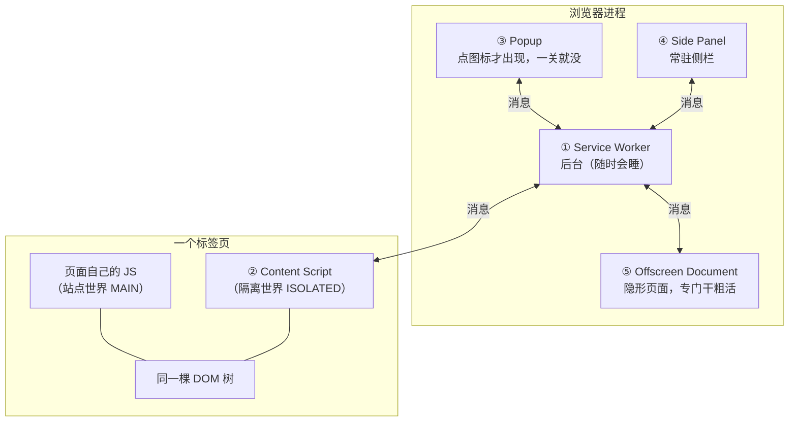
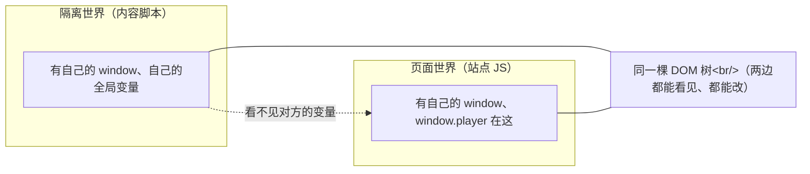

# 01. 浏览器扩展：六个房间和它们之间的小纸条

> 本篇是教材，不是规范。协议细节以 [reference/protocols.md](../reference/protocols.md) 为准。

上一篇讲的是"一个网页内部"。这一篇讲的是：**扩展是挂在浏览器上的另一套程序，它不在网页里面，而是分住在几个不同的房间里。**

---

## 1. 扩展到底是什么

一个扩展本质上是一个**压缩包**（通常打包成 `.crx`，开发时就是一个文件夹），里面有一个必需的清单文件 `manifest.json`。

```json
{
  "manifest_version": 3,
  "name": "SPECTRA",
  "permissions": ["storage", "tabCapture", "activeTab"],
  "background": { "service_worker": "background.js" },
  "content_scripts": [
    { "matches": ["<all_urls>"], "js": ["content.js"], "run_at": "document_start" }
  ],
  "action": { "default_popup": "popup.html" }
}
```

这个文件声明了五件事：

| 声明 | 意思 |
| --- | --- |
| 权限 | 我被允许做什么（读标签页、抓音频、写存储…） |
| 后台脚本 | 我常驻的那部分代码在哪 |
| 内容脚本 | 我要往哪些网站里塞代码、什么时候塞 |
| UI 入口 | 点插件图标弹什么、有没有侧边栏 |
| 资源暴露 | 哪些文件允许被页面访问 |

**关键认知**：扩展不是一个程序，而是**一组程序**。它们各自的运行环境、生命周期、能碰的东西，全都不一样。

---

## 2. 六个房间



### ① Service Worker（后台）

- **是什么**：扩展的中枢。大部分 `chrome.*` 能力只有它能用。
- **生命周期**：**随时可能被浏览器杀掉**（空闲约 30 秒后回收），下次需要时再唤醒。
- **能碰 DOM 吗**：不能。它没有页面。
- **在本项目里**：`src/background/`。所有"记账"都在这里——快照、串行队列、协议处理。

### ② Content Script（内容脚本 / 隔离世界）

- **是什么**：被注入到网页里的代码，跟着页面一起跑。
- **能碰 DOM 吗**：能，而且**和页面共享同一棵 DOM 树**。
- **能看到页面的 JS 变量吗**：**不能**。这是最容易误解的一点，见第 3 节。
- **生命周期**：跟着文档走。页面刷新，它就没了，重新注入。
- **在本项目里**：`src/content/`。所有"测量和写入"都在这里。

### ③ Popup（点图标弹出的小窗）

- **是什么**：一个迷你网页（`popup.html`）。
- **生命周期**：**点开才创建，一关就销毁**。它的所有 JS 变量随之消失。
- **能碰页面的 DOM 吗**：不能，它是个独立页面。
- **在本项目里**：`src/popup/`。

> 因为 popup 一关就没，所以它**不能自己记住状态**。它每次打开都必须去后台要一份当前快照。这就是"UI 只能读账本"的物理原因，不是架构洁癖。

### ④ Side Panel（侧边栏）

- 和 popup 类似，但**常驻**，切换标签页也不消失。
- 本项目用它放视频/滤镜这类需要长时间停留的控制。

### ⑤ Offscreen Document（离屏文档）

- **是什么**：一个看不见的页面，专门用来做"后台做不了但需要 DOM/音频能力"的事。
- **为什么需要**：Service Worker 里没有 `AudioContext`，也没有 DOM。要在后台跑音频处理，只能开一个离屏文档。
- **在本项目里**：音频处理器（Capture/增益）就跑在这里。

### ⑥ MAIN world 注入脚本（页面世界）

- **是什么**：用特殊方式注入到**页面自己的 JS 环境**里的代码。
- **为什么需要**：只有这样才能读到页面的 `window.player` 这类变量。
- **代价**：页面能检测到你、能覆盖你的函数、能改你的行为。版本一变就可能失效。
- **在本项目里**：`src/content/injector/page-media-bridge.ts` 这类桥接脚本。

---

## 3. 隔离世界：同一个 DOM，两套 JS

这是整个扩展体系里最反直觉、也最必须懂的一点。



具体表现：

```js
// 内容脚本里
window.player;                  // undefined —— 页面里明明有
document.querySelector('video'); // 有！DOM 是共享的
video.volume = 0.3;             // 有效！DOM 属性是共享的
```

所以：

| 想做的事 | 能不能直接做 | 怎么做 |
| --- | --- | --- |
| 改元素的属性（音量、倍速） | 能 | 直接改 |
| 读元素的属性 | 能 | 直接读 |
| 监听元素的事件 | 能 | 直接 `addEventListener` |
| 调站点播放器的方法（`player.setVolume()`） | 不能 | 必须注入 MAIN world 脚本 |
| 读站点的内部状态（`player.state`） | 不能 | 同上 |

**这就决定了本项目的策略顺序**：

1. 优先用标准元素属性（谁都能用，最稳）
2. 只有当站点不吃标准属性（比如它自己缓存了一份音量状态，每次渲染都覆盖回去）时，才启用站点适配器
3. 适配器要么注入 MAIN world，要么用站点暴露的全局对象——两者都比标准属性脆弱

**代价必须说清**：一旦走 MAIN world，就等于在别人家里改别人的家具。他换家具你就得跟着改。

---

## 4. 消息：房间之间只能传纸条

房间之间不共享内存，只能发消息。而且**消息必须能被序列化**。

### 4.1 三种传法

| 方式 | 场景 | 特点 |
| --- | --- | --- |
| `chrome.runtime.sendMessage` | 一次性请求 | 有返回值，简单 |
| `chrome.runtime.connect` | 长连接 | 得到 `Port`，双向持续通信，断开能感知 |
| `chrome.tabs.sendMessage` | 后台发给某个标签页的内容脚本 | 需要 tabId |

### 4.2 序列化限制：只能传"数据"，不能传"东西"

```js
sendMessage({ el: video });          // 报错：DOM 元素不能序列化
sendMessage({ fn: () => {} });       // 报错：函数不能序列化
sendMessage({ id: 'abc', rev: 3 });  // 可以：普通对象
```

只有 JSON 能表示的东西（字符串、数字、布尔、数组、纯对象、null）能过去。日期会变成字符串，`Map`/`Set` 会丢，类实例会变成普通对象。

**所以协议里传的永远是"身份证"，不是对象本身**：

```
{documentId: 'abc', frameId: 0, mediaId: 'm7', sourceRevision: 3}
```

后台拿到这四个数，就能说"我知道你指的是哪一个"。它永远拿不到那个元素。

### 4.3 广播：后台 → 所有 UI

后台不能"调用"UI 的函数（它不知道有几个 UI 开着）。它能做的是**广播事件**：

```
spectra.control.snapshot.changed  →  所有开着的 popup / side panel 都收到
```

UI 收到后自己去拉最新快照。这样"UI 显示对了但实际没变"就不可能发生，因为 UI 没有自己的事实来源。

---

## 5. Service Worker 会死，这是设计而不是 bug

这是新手最难接受的一点：

```js
// 后台
let counter = 0;
chrome.runtime.onMessage.addListener(() => { counter++; });
```

**这段代码是错的。** 因为后台随时可能被回收，`counter` 会莫名其妙归零。

Chrome 的策略大致是：空闲一段时间（约 30 秒）没有事件，就终止；有事件再来时重新启动脚本。所以：

| 存在哪 | 能活多久 | 适合放什么 |
| --- | --- | --- |
| JS 变量（内存） | 到这次唤醒结束 | 缓存、队列、去重标记 |
| `chrome.storage.session` | 到浏览器关闭 | 当前会话的临时事实 |
| `chrome.storage.local` | 一直存在 | 用户设置、持久数据 |
| 页面里的变量 | 到这次文档结束 | 元素引用、观察者 |

**推论**：任何"用户以为已经保存了"的东西，必须落到 storage 并等它确认；只放内存 = 用户关掉浏览器就没了。

这就是为什么本项目在提交快照时要等存储确认，而不是改完内存就回复成功。**内存不是承诺。**

---

## 6. 内容脚本的注入时机

`run_at` 决定代码什么时候跑：

| 时机 | 页面状态 | 适合做什么 |
| --- | --- | --- |
| `document_start` | `<html>` 刚开始解析，`<body>` 可能还没有 | 抢在站点脚本之前打补丁、装钩子 |
| `document_end` | DOM 建好，图片等资源还在加载 | 大多数 DOM 操作 |
| `document_idle` | 页面基本就绪 | 不着急的事 |

**早注入的代价**：那时页面上什么都没有，你不能立刻找元素，只能挂 `MutationObserver` 等它们出现。

本项目需要在站点播放器初始化之前就准备好，所以走的是早注入 + 观察者模式。

---

## 7. 观察者：不用轮询也能知道树变了

```js
const observer = new MutationObserver((records) => {
  // records 里是这一批变更的明细
});
observer.observe(document.documentElement, {
  childList: true,
  subtree: true,
});
```

三个要点：

1. **回调是批量送的**，不是每次改动都调一次。这正好配合"微任务"的时机——一批改动做完，回调就跑。
2. **回调里拿不到布局结果**。它在渲染之前，元素还没有尺寸。
3. **它只告诉你"变了"，不告诉你"变成什么才对"**。判断逻辑要自己写。

本项目就是靠它发现新播放器、发现播放器被移除的。

另有一个 `IntersectionObserver`，专门回答"这个元素现在可见吗、露出来多少"，它在帧的尺度上工作，不阻塞渲染。

---

## 8. 权限与用户手势：为什么有些事只有 popup 能做

Chrome 对扩展也有限制。最典型的一条：

> **`chrome.tabCapture` 必须由用户在当前扩展的界面上触发的动作调用。**

也就是说：

| 触发来源 | 能拿到 Capture 吗 |
| --- | --- |
| 用户点 popup 里的按钮 | 能 |
| 用户按扩展定义的快捷键（commands） | 能（部分场景） |
| 用户在**网页里**按键（内容脚本监听到的） | **不能** |

因为网页里的按键，浏览器认为"这是网页的动作，不是扩展的动作"。

这条限制直接塑造了本项目的行为边界：**超过 100% 的音量需要 Capture，而 Capture 又只能在特定入口拿到**。所以当媒体已经在原生上限、而当前文档还没有扩展调用授权时，那一次 `Alt+↑` 不阻止默认行为，交给 manifest 的 `volume_up` 命令执行：这是一次扩展调用，Chrome 授予该标签页 `activeTab`，同一个按键在 100% 以上也能启动增强（Bootstrap 仍会阻止页面 handler 取消这个和弦）。授权属于**文档**而不是 Capture 会话：Popup 打开、命令送达或任一次成功启动的 Capture 都会把它锁存到页面导航；因此从 110% 回到 100% 后即使 Capture 已停止，下一次 `Alt+↑` 仍走页面快捷键通道，不需要新命令。上限以下的按键同样由页面快捷键通道处理，因此命令不可用时按键在 0–100% 之间和已授权文档中照常工作。页面里自定义的其它音量按键没有这条通道，永远拿不到授予，最多到 100%。

---

## 9. 六个房间的对照表

| 房间 | 有 DOM？ | 有页面变量？ | 能调 chrome API？ | 生命周期 | 在本项目里 |
| --- | --- | --- | --- | --- | --- |
| Service Worker | 否 | 否 | 几乎全部 | 随时被回收 | `src/background/` |
| Content Script | 是（共享） | 否 | 部分 | 跟文档 | `src/content/` |
| MAIN world | 是（共享） | **是** | 否 | 跟文档 | `src/content/injector/` |
| Popup | 自己的 | 否 | 部分 | 开关即生死 | `src/popup/` |
| Side Panel | 自己的 | 否 | 部分 | 常驻 | 视频控制 |
| Offscreen | 自己的 | 否 | 部分 | 按需创建销毁 | 音频处理 |

**记住这张表，就能判断"某件事应该在哪一层做"**：碰到页面的事在内容脚本，记账的事在后台，展示的事在 UI，音频处理在离屏。

---

## 10. 压缩成八句话

1. 扩展是一组程序，不是一个程序。
2. 后台没有 DOM，内容脚本看不到页面变量，popup 一关就没。
3. 内容和页面共享 DOM，但不共享 JS 全局——这叫隔离世界。
4. 想碰页面变量必须注入 MAIN world，代价是脆弱。
5. 房间之间只传可序列化的数据，所以传的是身份证不是对象。
6. 后台随时会死，所以"记住"必须落 storage。
7. MutationObserver 批量送变更，且在布局之前，所以拿不到尺寸。
8. TabCapture 只认扩展自己的界面触发的动作，网页里的按键不算。

---

## 下一步

[02-spectra-map.md](02-spectra-map.md)：把这些积木拼成 SPECTRA，并告诉你前面那些故障到底断在哪一根线上。
