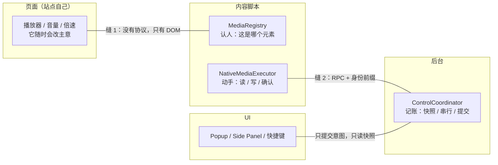

# 02. SPECTRA 全景：把积木拼起来

> 本篇是教材，不是规范。任何"必须如何"的结论以 [control/](../control/README.md) 与 [architecture/runtime.md](../architecture/runtime.md) 为准。

前两篇讲的是零件。这一篇讲这些零件怎么组成一台机器，以及**故障一般断在哪根线上**。

---

## 1. 一句话题纲

> 页面是唯一的事实来源；内容脚本是唯一能碰它的人；后台是唯一的记账人；UI 只能读账本。

这句话拆开就是四个角色、两条缝：



**所有身份类故障都发生在缝 1，所有记账类故障都发生在缝 2。**

- **缝 1（页面 ↔ 内容脚本）**：这里没有协议。页面会删元素、换流、自己改音量，而且不通知任何人。所以内容脚本必须自己"认人"。
- **缝 2（内容脚本 ↔ 后台）**：这里全是消息。后台不认识 DOM，只认识四个数字：`documentId`、`frameId`、`mediaId`、`sourceRevision`。

---

## 2. 身份有四层，不能互相顶替

这是整个系统最核心的概念。

| 层 | 名字 | 由什么组成 | 变化意味着 | 谁负责判定 |
| --- | --- | --- | --- | --- |
| L1 | 会话 | tabId + documentId + generation | 页面换代了，**整份状态作废** | 后台 `prepareIntent` |
| L2 | 控制 | frameId + mediaId | **换了一个控制对象**（另一个播放器） | 内容端 `recordForTarget` |
| L3 | 资源 | sourceRevision | **同一个对象换了第 N 段内容** | 内容端 `refreshSource` |
| L4 | 证据 | owner + epoch + selection + revision | 这条观察有多新 | 后台 `compareMediaObservations` |

### 为什么必须分开

因为它们的**正确反应完全不同**：

| 变化 | 正确反应 | 错误反应会导致 |
| --- | --- | --- |
| L1 变 | 整份作废，重新建立 | 拿旧页面的值去写新页面 |
| L2 变 | 取消在途操作，重新绑定 | 把值写到已经离场的元素上 |
| L3 变 | **重基**（重新读一次实际值），继续 | 把手势判成失败，用户看到报错 |
| L4 变 | 只影响排序，不做判决 | 把乱序样本当成过期样本丢掉 |

**本项目的核心故障，就是 L3 的变化被当成了 L2 的变化处理。**

打个比方：

- L1 = 换了一家餐厅
- L2 = 同一家餐厅里换了一桌
- L3 = 同一桌上换了一道菜

把"换了一道菜"当成"换了一桌"，就会出现"菜刚端上来就被收走"的现象——**手势刚好撞上换流，就被判为非法**。

---

## 3. 三个计数器，各管一段

系统里有三个数字在涨，它们绝不能互相借用：

| 计数器 | 什么时候 +1 | 用在哪 |
| --- | --- | --- |
| `generation` | 文档重新初始化 | 判断"这还是不是同一份会话" |
| `revision` | 每次提交快照 | 判断"UI 看到的是不是最新账本" |
| `selectionVisit` | **只在选中对象变化时** | 判断"我的手势还是不是有效" |

第三条是关键：如果 `selectionVisit` 在"换流"时也 +1，那它就不再表示"换了对象"，而是表示"任何变化"。所有基于它的判断都会误伤。

---

## 4. 状态：两套，不能混

### 4.1 系统事实：快照

后台保存的 `ControlSnapshot` 是**唯一可信的账本**。它记录：

- 这是哪个文档、第几代
- 当前选中的是哪个媒体元素（`activeMedia`）、哪个视频元素（`activeVideo`）
- 每个字段的当前实际值（音量、静音、倍速、播放状态…）
- 最近一次观察的序号

UI 显示的每个数字，都必须来自这份快照。

### 4.2 字段承诺：desired / actual / phase

单个字段（比如"音量"）在系统里不是"一个数"，而是**一组状态**：

| 名字 | 含义 |
| --- | --- |
| `desired` | 用户想要的值 |
| `actual` | 上次读回来的真实值 |
| `restoreBaseline` | 写之前的原始值（用于离场时还原） |
| `phase` | `applied`（已生效）或 `error`（失败） |
| `writeState` | `confirmed` / `written` / `drifted` / `unconfirmed` |

**`phase` 和 `writeState` 不能混用**，因为它们回答的是两个不同的问题：

- `phase=error` 意思是"我知道它没成" → 该告诉用户
- `writeState=unconfirmed` 意思是"我不知道成没成" → 只该继续观察

**把"不知道"报成"失败"，就是"必须点两次"这种观感的来源之一。**

---

## 5. 事件有四种，性质完全不同

| 类别 | 例子 | 性质 | 能做什么 |
| --- | --- | --- | --- |
| DOM 事实 | `play`、`pause`、`volumechange`、`loadedmetadata` | 页面发生的事 | 触发观察、触发自动恢复 |
| 系统解释 | `registered`、`removed`、`selected` | 内容端对事实的解读 | 驱动选中、驱动重新绑定 |
| 生命周期 | 文档创建/销毁、导航 | 纪元切换 | 作废整份状态 |
| 用户意图 | `intent.submit`、`operation.submit` | 用户想要什么 | 必须带 `baseRevision` 和 `target` |

一条铁律：

> **事实可以触发意图（自动恢复），意图不能伪造事实。**

页面观察永远不能当命令用；命令也永远不能当观察用。混了就会写出"UI 一拖动，系统就以为页面真的变了"这种自欺。

---

## 6. 一次点击要走九步，每步都有各自的死法

以"把音量拖到 40%"为例：

| 步 | 发生什么 | 这一步的检查 | 失败会怎样 |
| --- | --- | --- | --- |
| 1 | UI 打包 `target` + `baseRevision` | 无 | — |
| 2 | 后台检查基准版本 | `baseRevision === snapshot.revision`；文档一致 | `control_stale_revision` |
| 3 | 进每标签页的串行队列 | 同一标签页不并发 | 排队等待 |
| 4 | 内容端解析目标 | 文档 + frame + mediaId + **revision** 全等 | `stale-media-source` |
| 5 | 写入 → 等事件 → 稳定回读 | 每个 await 前检查"还是不是同一个" | `stale-media-source`（那句报错） |
| 6 | 字段 ACK | 相位 / 写状态 / 策略 / 覆盖度 | — |
| 7 | 后台核对 ACK 是否仍然有效 | 样本是否过期、序号是否落后 | `older selection` |
| 8 | 提交快照 | revision +1、写存储、广播 | 回滚 |
| 9 | UI 应用快照 | 同文档且更新 | 忽略旧消息 |

**第 4、5、7 步都在做"身份比对"，但比的东西不一样**：

- 第 4 步比**全等**（含 revision）
- 第 5 步比"还是不是同一个元素"
- 第 7 步比"这个样本是不是比账本新"

三处口径不一致，就会出现"第 5 步过了、第 7 步拒了"这种自相矛盾。**这就是为什么修一处不够——错误只会换个地方冒出来。**

---

## 7. 物理形态只有六种，处理方式只有三种

DOM 上的"变化"看起来很多，但归到底只有六种：

| 形态 | 元素还在树上？ | 内容变了？ | 本质 | 正确处理 |
| --- | --- | --- | --- | --- |
| A 同一元素换流（码率、广告转正、卡顿恢复） | 是 | 是 | L3 | **重基** |
| B 元素被替换（视频↔直播、换播放器） | 旧的否，新的是 | — | L2 | **重新绑定** |
| C 跨任务搬家（框架重挂） | 中途否 | 否 | 假 L2 | **重新绑定** |
| D 同一任务内搬家 | 始终是 | 否 | 无变化 | 不处理 |
| E 只是隐藏/显示 | 是 | 否 | 可见性 | 重选，不换身份 |
| F 整页导航 | 全部作废 | — | L1 | 重建 |

**只有 B 是真的换了一个对象。C 是同一个对象被误判。A 根本不是对象变化。**

而现在的实现把 A、B、C 都按"身份结束"处理——一个判断错误，产生三种症状：

| 症状 | 对应形态 |
| --- | --- |
| 写入报 `stale-media-source` | A |
| "视频→直播"后自动失控 | B |
| 换流后音量/倍速不再恢复 | A + C |

---

## 8. 为什么"视频→直播"会永久失控

这是本项目最典型的一条链，值得完整走一遍，因为它同时展示了缝 1 的三种机制。

```mermaid
sequenceDiagram
  participant Site as 站点
  participant Reg as MediaRegistry
  participant Sel as 选中状态
  participant BG as 后台

  Site->>Reg: 插入新 &lt;video&gt;
  Reg->>Reg: 注册，分配新 mediaId
  Note over Reg: 此刻旧元素还在，active 仍是旧的
  Site->>Reg: 移除旧 &lt;video&gt;
  Note over Reg: 微任务排队等这一批改完
  Reg->>Reg: 微任务：旧元素 isConnected=false → 注销
  Reg->>Sel: active = null，需要补选
  Note over Sel: 候选过滤要求"面积 > 0"<br/>新元素刚插入，还没布局 → 面积 = 0
  Sel-->>Reg: 没有合格候选 → 选中为空
  Note over Sel: 空选中之后，两条自救路径都在<br/>"active 为空"时直接 return
  Reg-->>BG: 没有 selected 事件
  Note over BG: 后台的 activeMedia 还是那个死掉的旧 id
  BG->>Reg: 下一次操作：解析目标
  Reg-->>BG: null（找不到）→ 失败
```

四步死路的本质是：

1. **注册早于布局**（新元素没有面积）
2. **注销晚于注册**（同一个微任务里才处理）
3. **补选要求面积**（于是补不上）
4. **空选中不能自愈**（两条自动路径都在 `!active` 时提前返回）

结果就是：只有"新元素再发一次 play"或"用户点一下"才能救回来。这完全符合用户的观感——**"必须点一下才好"**。

---

## 9. 协议：六条请求 + 几条广播

| 消息 | 方向 | 作用 |
| --- | --- | --- |
| `control.intent.submit` | UI → 后台 | 单字段意图（音量/静音/倍速/播放） |
| `control.operation.submit` | UI → 后台 | 复合操作（跳转、A/B、有效音量） |
| `control.actual.read` | 后台 → 内容 | 被动读，绝不写入 |
| `control.snapshot.get` | UI → 后台 | 取账本 |
| `content.target.changed` | 内容 → 后台 | 选中变了 |
| `content.source.released` | 内容 → 后台 | 源释放了 |
| `content.runtime.ensure` | UI → 内容 | 保活 |
| `snapshot.changed` | 后台广播 | 账本更新 |
| `audio.session.changed` | 后台广播 | 音频处理器状态 |

设计约束：**任何新能力都必须落在这几条上。** 绕过去就等于绕过所有检查。

---

## 10. 预算：每一个都在防一件具体的事

"预算"不是"多等一会儿"，而是**"在这个窗口内我有资格说成功，超出就承认不知道"**。

| 预算 | 防什么 |
| --- | --- |
| 原生事件静默窗口 | 把抖动当成确认 |
| 动画边界回退 | CSS transition 永远不结束 |
| 倍速稳定轮询 | 倍速读回抖动 |
| 音量换源恢复 | 播放器启动期连续换源 |
| 恢复重试 | 页面延迟应用 |
| 快照读取超时 | UI 永久空白 |
| Capture 准入 TTL | 旧页面借新权限 |
| 离屏 ACK 超时 | 离屏挂死 |
| popup 合并窗口 | 拖动风暴 |

**哲学**：调大预算通常是把"诚实"换成"侥幸"。真正的问题很少是"窗口太短"，而是"门根本不该关"。

---

## 11. 错误分四类，绝不能互相转换

| 类别 | 例子 | 正确反应 | 绝不能做 |
| --- | --- | --- | --- |
| 生命周期 | `stale-document`、`stale-media-source`、`cancelled`、`deadline-exceeded` | 重基 / 重绑 / 取消 | 当成能力失败去换策略 |
| 能力 | `unsupported`、`policy-denied`、`readback-mismatch` | 换策略或降级 | 用同一个写入器重试 |
| 协议 | `invalid_request`、`control_stale_revision` | 刷新快照后重放一次 | 无脑重放 |
| 漂移 | `drifted` | 纠正并记录 | 报错给用户 |

把生命周期错误当能力错误，会写出"重试也没用却一直重试"的循环。
把能力错误当生命周期错误，会永久放弃一个本来换个策略就能成的字段。

---

## 12. 一条判断原则

如果只能记一句话，记这句：

> **页面造成的身份变化，必须被系统吸收；只有用户造成的身份变化，才允许中断手势。**

推导出三条不变量（教材版表述，正式条目见 [08-invariants-and-gates.md](../control/08-invariants-and-gates.md)）：

- 同一文档内只要存在可控媒体，**选中不应为空**
- 换流只该**重基**，不该取消
- 未完成的恢复义务应当**随对象迁移**，而不是被丢弃

---

## 13. 音量为什么永远同步不了站点 UI

这一条单独拿出来讲，因为它是"感觉控制不进去"的另一半原因。

| 音量范围 | 走什么路 | 站点知道吗 | 站点 UI 会变吗 |
| --- | --- | --- | --- |
| 0–100%，站点有音量接口 | 调站点的接口 | 知道 | **会** |
| 0–100%，站点没有接口 | 改元素属性 | **不知道** | **不会**（下次它自己覆盖回来） |
| >100% | 插件自己的增益 | **完全不知道** | **物理上不可能** |

中间那一行是关键：**改元素属性和改站点状态是两件事**。站点如果自己维护了一份"当前音量"变量，它每次重绘都会用自己那份覆盖你写的值。

所以"控制不进去"的完整解释通常是两个问题叠加：

1. 写的是元素，不是站点的状态 → 站点 UI 不动
2. 写入过程中撞上换流 → 报错、用户需要再点一次

---

## 14. 读代码的顺序

照这个顺序读，不会迷路：

| 顺序 | 文件 | 读它回答什么 |
| --- | --- | --- |
| 1 | `packages/contracts/src/control.contracts.ts` | 所有词的定义：字段、相位、策略、快照结构 |
| 2 | `src/content/core/media-registry.ts` | 谁在认人：注册、注销、选中、换源 |
| 3 | `src/content/logic/native-media-executor.ts` | 谁在动手：写入、确认、恢复、观察 |
| 4 | `src/content/logic/native-media-async.ts` | 物理读写原语（最底层） |
| 5 | `src/background/control-coordinator.ts` | 谁在记账：串行、提交、补偿 |
| 6 | `src/popup/card/*` | 谁在读账 |
| 7 | `docs/control/06-media-and-video.md` | 媒体行为的规范 |
| 8 | `docs/architecture/runtime.md` | 运行时拓扑 |

**只读 1 到 5 就能理解 90% 的行为**；`popup` 那层几乎不产生逻辑，只是展示。

---

## 15. 一份自查清单

遇到"控制不生效"，按这个顺序问：

1. **现在选中的是谁？**（`activeMedia` 是不是那个活着的元素）
2. **这个元素还在树上吗？**（`isConnected`）
3. **它的 `sourceRevision` 在写入期间变过吗？**（变了 → 是重基问题，不是失败）
4. **写入的是元素还是站点状态？**（站点 UI 不动 → 是适配问题）
5. **值超过 100% 吗？**（超了 → 站点 UI 永远同步不了，不要指望）
6. **失败是 `phase=error` 还是 `writeState=unconfirmed`？**（后者是"不知道"，不是"失败"）

---

## 下一步

- 术语不清楚 → [glossary.md](glossary.md)
- 想知道规范原文 → [control/README.md](../control/README.md)
- 想动手改 → 先读 [06-media-and-video.md](../control/06-media-and-video.md) 与 [08-invariants-and-gates.md](../control/08-invariants-and-gates.md)，再动代码
