# SPECTRA Unified Control Runtime V3 proposal

> Historical scope: local-status, dirty-tree, count, size, and authorization
> statements are frozen to the 2026-08 repair candidate. Current behavior and
> release status come only from the normative owners and exact-candidate gates.

## 0. Decision, status, and evidence boundary

This proposal defines the migration architecture for every confirmed finding in
the [2026-08-27 business, performance, and implementation audit](../_archive/2026-Q3/business-implementation-audit-2026-08-27.md).
Waves W1–W7 are implemented in the current local working candidate and their
runtime owners, contracts, tests, and architecture guards are present. This is
not a release claim: the tree is dirty and uncommitted, and no CandidateReceipt,
extracted-ZIP replay, deployment, public
sync, or store action has been authorized. Normative current behavior remains
owned by the control, runtime, protocol, source-admission, and Remote-security
documents; this file remains the migration decision and evidence ledger until
W9 promotion archives it. The optional 15% capacity headroom remains useful
optimization evidence, but it is not a release gate and cannot justify a
business, protocol, security, or lifecycle regression.

The audit/design baseline is Git commit
`24fd7631e6417bfe6416745c2eefcc4b950656f4`. It covers all 44 confirmed audit
items: 10 P1, 30 P2, and 4 P3 findings. It preserves the existing 51-capability
product matrix unless a migration wave explicitly changes a capability and its
contract, UI, privacy projection, tests, and release evidence together.

The proposal makes five architectural decisions:

1. **Business consistency is document-scoped and single-writer.** A Background
   `TabControlActor` serializes lifecycle, commands, observations, resource
   ownership, commits, and projections for the current top document.
2. **Every asynchronous result is a capability-bearing fact, not authority.**
   It may commit only after its complete identity, epoch, revision, operation,
   and resource lease are revalidated after every asynchronous boundary.
3. **Cross-context mutation is an acknowledged transaction.** Prepare, physical
   execution, readback, commit, publication, and cleanup are separate phases;
   SPECTRA does not claim impossible cross-context ACID transactions.
4. **Unknown safety evidence fails closed.** In particular, page-owned media is
   never irreversibly attached to `MediaElementAudioSourceNode` unless its
   entire future source class is proven safe. If Chrome cannot provide that
   proof, the Media WebAudio candidate is absent and explicit Capture is the
   only full-output DSP path.
5. **A result is releasable only when source tree, artifact, browser evidence,
   public projections, and rollback identity are the same immutable candidate.**

### 0.1 Primary platform facts used by the design

- Chrome MV3 service workers are ephemeral; global state can disappear and
  unexpected termination must be survivable. See [Chrome's service-worker
  lifecycle](https://developer.chrome.com/docs/extensions/develop/concepts/service-workers/lifecycle).
- Chrome currently allows one Offscreen document per installed extension
  profile, and that document exposes only the extension `runtime` API. See the
  [Offscreen API](https://developer.chrome.com/docs/extensions/reference/api/offscreen).
  Therefore Offscreen authorities persist through a validated Background
  storage port; they do not call `chrome.storage` directly.
- Chrome `documentId` identifies a document across lifecycle changes and changes
  when a frame hosts a new document. See
  [`chrome.webNavigation`](https://developer.chrome.com/docs/extensions/reference/api/webNavigation).
  Exact Content requests use `tabs.sendMessage(..., {documentId})`; see
  [`chrome.tabs`](https://developer.chrome.com/docs/extensions/reference/api/tabs).
- Chrome extension one-time messages are JSON-serializable. The visualizer
  architecture therefore does not assume transferable `ArrayBuffer` support;
  any alternative transport requires its own measured browser proof. See
  [Chrome message passing](https://developer.chrome.com/docs/extensions/develop/concepts/messaging).
- The Web Audio specification requires a cross-origin
  `MediaElementAudioSourceNode` to output silence when the resource fetch is
  CORS-cross-origin. See [Web Audio API §1.22.4](https://webaudio.github.io/web-audio-api/#MediaElementAudioSourceNode-security).
- EME permits protected media data to be unavailable to Web APIs including
  `MediaElementAudioSourceNode`. See
  [Encrypted Media Extensions §7.6](https://www.w3.org/TR/encrypted-media-2/#media-element-restrictions).

### 0.2 Non-goals

- No generic MAIN-world runtime, prototype patch, remote code, permission
  expansion, or page-specific hard-coded dispatcher.
- No event sourcing platform, distributed database, framework dependency, or
  compatibility layer whose cost exceeds the browser-local problem.
- No claim of exactly-once distributed execution. V3 provides idempotent
  commands, durable receipts where effects require them, actual readback, and
  explicit `indeterminate` outcomes.
- No release, public sync, deployment, branch operation, or migration is
  authorized by this proposal.

## 1. First-principles model

Every audit defect is a violation of one of six missing proofs:

| Proof | Required question | Failure when absent |
| --- | --- | --- |
| Identity | Is this still the same browser document, media source, runtime, processor, Remote epoch, and UI target? | Stale writes and stale UI |
| Order | What is the single happens-before order for lifecycle and mutations? | Reordered Remote commands and navigation races |
| Authority | Which one owner may change this fact? | Legacy UI, handler, cache, and host become competing state sources |
| Admission | Who authorized the final privileged mutation, for exactly which target and operation? | Arbitrary Capture target and unsafe WebAudio binding |
| Transaction | Did the physical state pass readback before logical state advanced? | Ghost processor, false success, partial patch loss |
| Lifecycle | Which scope cancels and disposes every continuation and resource? | Leaks, hanging rAF, stale listeners, orphan leases |

The V3 safety equation is:

```text
commit allowed
  = valid authority
  ∧ exact identity
  ∧ current epoch/revision
  ∧ admitted operation
  ∧ live resource lease
  ∧ physical readback
  ∧ uncancelled lifecycle scope
```

If any term is unknown, the result cannot commit.

## 2. System context and trust boundaries

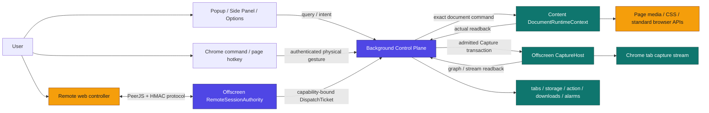

Trust is not transitive. A valid Popup request is not a Capture grant; a valid
Remote HMAC is not a media ACK; a Content response is not a Background commit;
an Offscreen graph description is not a user authorization.

## 3. Bounded contexts, owners, and dependency direction

| Context | Sole mutable owner | Inputs | Outputs | Explicitly does not own |
| --- | --- | --- | --- | --- |
| Contracts kernel | schemas, guards, capability catalog, identity vocabulary | source declarations | validated values | runtime state or policy side effects |
| Background control | `TabControlActor` | authenticated intents, browser lifecycle, actual ACKs | `ControlSnapshot`, lifecycle view, outbox | DOM, audio nodes, Peer objects |
| Settings | `SettingsCommandOwner` + repository | revisioned settings intents | durable `SettingsSnapshot` | document control state |
| Content document | immutable `DocumentRuntimeContext` | exact-document commands, page events | source facts, DOM/CSS actual ACKs | durable control snapshot or Capture |
| Content source | `SourceLifecycleCoordinator` | resource-selection events | `MediaCapability`, disposer graph | Background generation or audio graph |
| Audio graph | `AudioGraphTransactionOwner` | admitted config + source proof | normalized graph readback | document selection or user authority |
| Capture | Background `CaptureSessionOwner`; Offscreen `CaptureHost` owns physical resources | one-shot start grant / exact session updates | processor actual state | arbitrary tab selection |
| Remote | Offscreen `RemoteSessionAuthority` | transport facts and HMAC proof | dispatch tickets / state projection | media execution |
| UI | per-surface `SurfaceRuntime` | snapshots, ACKs, user intents | rendered projection, typed intents | business actual state or storage |
| Release | exact-tree release orchestrator | immutable source and evidence | candidate/promotion receipts | source mutation or public publishing authority |

Dependency direction is acyclic:

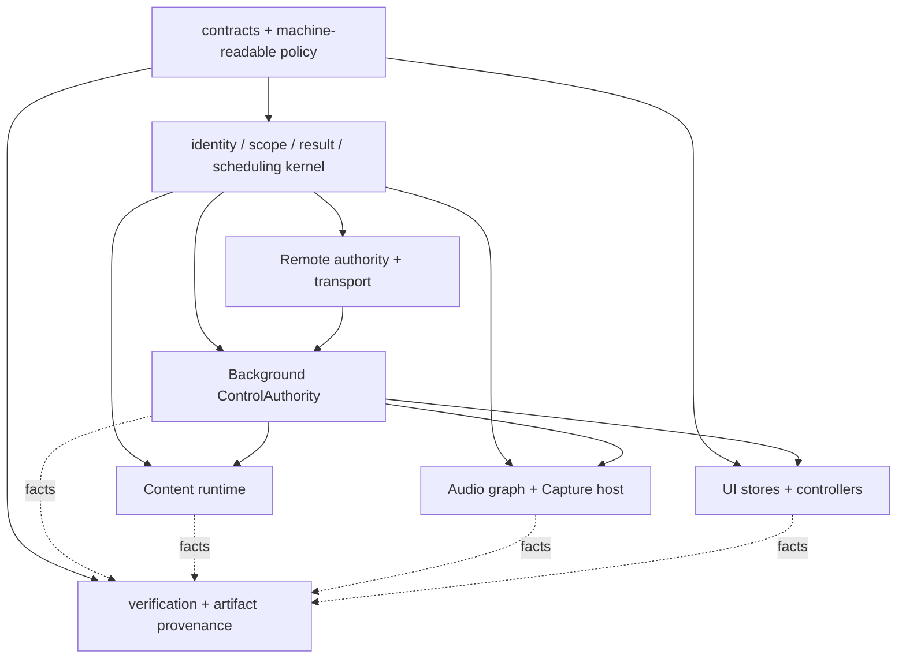

`Kernel` is a small shared vocabulary, not a shared mutable singleton. Runtime
owners keep their state inside their own context.

## 4. Canonical identity and time model

The current generic `generation` name carries too many meanings. V3 makes each
clock explicit and branded so that TypeScript and runtime guards reject mixing.

```ts
type BrowserDocumentKey = Readonly<{
  tabId: number;
  frameId: 0;
  documentId: string;
  origin: string;
}>;

type DocumentVersion = Readonly<{
  documentEpoch: number;
  snapshotRevision: number;
}>;

type MediaSourceKey = Readonly<{
  document: BrowserDocumentKey;
  mediaId: string;
  sourceRevision: number;
  selectionOrdinal: number;
}>;

type RuntimeIncarnation = Readonly<{
  workerEpoch: string;
  contentRuntimeEpoch?: string;
  offscreenEpoch?: string;
}>;

type ProcessorVersion = Readonly<{
  processorGeneration: number;
  graphRevision: number;
}>;

type RemoteVersion = Readonly<{
  sessionId: string;
  sessionEpoch: string;
  commandSequence: number;
  authorityRevision: number;
}>;
```

| Clock | Owner | Advances when | Must not mean |
| --- | --- | --- | --- |
| `documentId` | Chrome | top frame hosts a new document | SPA route or worker restart |
| `documentEpoch` | `TabControlActor` | document/route boundary invalidates old work | processor or Remote generation |
| `snapshotRevision` | `TabControlActor` | an actual control commit succeeds | attempted write |
| `sourceRevision` | Content source owner | one media element begins a new resource selection, including same-URL reload | DOM element identity |
| `selectionOrdinal` | Content source owner | resource-selection boundary is observed | CORS proof created later |
| `workerEpoch` | Background boot | service worker instance starts | business generation |
| `contentRuntimeEpoch` | Content runtime | heavy runtime instance is created | document identity |
| `processorGeneration` | Capture/session owner | a new physical processor session commits | config update |
| `graphRevision` | graph owner | a graph/config transaction commits | prepare attempt |
| `sessionEpoch` | Remote authority | a connection successfully re-authenticates | worker restart |
| `commandSequence` | Remote authority | a command is durably admitted in one session epoch | reconnect-independent global counter |

### 4.1 Identity hierarchy

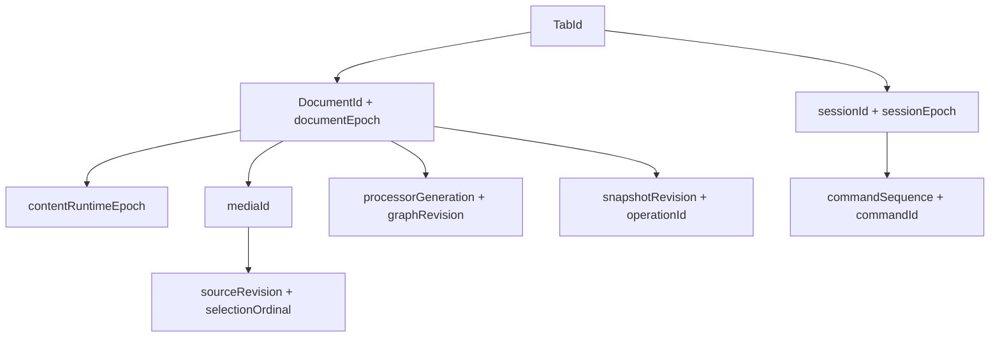

Every envelope carries the smallest complete identity needed for its effect.
`tabId` alone is never enough for a document, media, Capture, lease, UI, or
Remote mutation.

## 5. Shared protocol kernel

### 5.1 Request classes

```ts
type RequestClass =
  | 'query'
  | 'command'
  | 'observation'
  | 'lifecycle-ack';
```

| Class | May mutate? | May acquire runtime/processor? | Commit rule |
| --- | ---: | ---: | --- |
| Query | No | No | returns revisioned known/stale/unknown projection |
| Command | Yes | only through exact admission/lease | actual readback + actor commit |
| Observation | commits observed fact only | only an already-owned observation token | cannot call writer |
| Lifecycle ACK | resource bookkeeping only | exact token only | exact operation/lease match |

Static verification must reject a query handler importing runtime acquisition,
script injection, storage mutation, badge mutation, Capture, or DOM writers.

### 5.2 Operation ticket

```ts
type OperationTicket = Readonly<{
  operationId: string;
  commandId: string;
  document: BrowserDocumentKey;
  version: DocumentVersion;
  target: MediaSourceKey | null;
  workerEpoch: string;
  deadlineMonotonicMs: number;
  idempotency: 'absolute-set' | 'effect-receipt' | 'release';
}>;
```

Each asynchronous participant receives a ticket and returns it unchanged with
actual evidence. It cannot advance epochs or revisions.

### 5.3 Admission grant versus resource lease

```ts
type AdmissionGrant = Readonly<{
  id: string;
  kind: 'capture-start' | 'user-activated-browser-operation';
  operationId: string;
  document: BrowserDocumentKey;
  documentEpoch: number;
  issuer: 'control-authority';
  workerEpoch: string;
  expiresAtMonotonicMs: number;
  oneShot: true;
}>;

type ResourceLeaseToken = Readonly<{
  id: string;
  resource: 'content-runtime' | 'capture' | 'visualizer' |
    'site-hotkey' | 'shortcut-feedback' | 'remote-observation';
  ownerId: string;
  document: BrowserDocumentKey;
  documentEpoch: number;
  workerEpoch: string;
  lifetime: 'transient' | 'resident';
}>;
```

Admission answers **whether one operation may start**. A lease answers **which
owner keeps a resource alive**. Every acquisition mints a unique token; a
shared reason string is never a reference count. Release is exact-token and
idempotent. This removes the Capture bypass and the shared shortcut-feedback
lease failure.

### 5.4 Outcome and error taxonomy

```ts
type RuntimeOutcome<T> =
  | { ok: true; value: T; evidence: ActualEvidence }
  | { ok: false; error: RuntimeError };

type RuntimeError = Readonly<{
  code: string;
  phase: 'admission' | 'prepare' | 'execute' | 'readback' |
    'commit' | 'publish' | 'cleanup' | 'recovery';
  retryability: 'never' | 'same-identity' | 'after-refresh' | 'user-action';
  identity: Partial<OperationTicket>;
  messageKey: string;
  diagnosticCause?: string;
}>;
```

Errors are grouped by behavior, not transport text:

- terminal security/policy: permission, activation, protected content, CORS,
  invalid sender, missing admission;
- stale identity: document, route, source, runtime, session epoch, revision;
- transient infrastructure: receiver unavailable, host timeout, signaling
  interruption, storage temporarily unavailable;
- physical mismatch: readback/config/graph/geometry differs;
- cancellation/supersession: a newer operation or lifecycle fence won;
- indeterminate external effect: execution may have happened but cannot be
  safely replayed without reconciliation.

`undefined` is never both a success sentinel and a rejection value.

## 6. Background ControlAuthority

### 6.1 Actor hierarchy

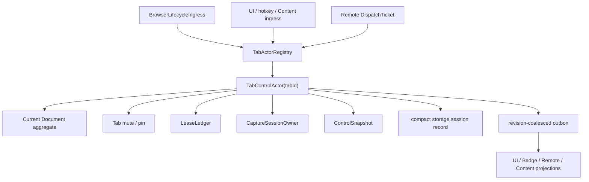

There is one mailbox per tab, not one global lock. It contains the current top
document aggregate and serializes:

- full/same-document navigation fences;
- control commands and observations;
- Capture and runtime lease transitions;
- visualizer subscription transitions;
- source-release events;
- snapshot/storage commit;
- projection intent.

Different tabs may run concurrently. Within one tab, no second queue may publish
document state. The actor may release from memory only when it has no command,
lease, pending outbox item, or recovery obligation.

### 6.2 Synchronous lifecycle fence

A mailbox alone cannot cancel a task currently waiting on Content or Offscreen.
Chrome lifecycle ingress therefore owns one synchronous, minimal fence:

```text
navigation/tab-close fact
  -> advance volatile document fence clock
  -> abort current operation scopes
  -> enqueue highest-priority lifecycle message
  -> actor performs durable carry/clear/cleanup
```

The fast fence cannot write storage or publish state. Every late response checks
the fence and becomes `stale`; only the actor performs cleanup or reconciliation.
This merges the current commit and navigation invalidation owners and fixes
`CTL-002`.

### 6.3 Command transaction

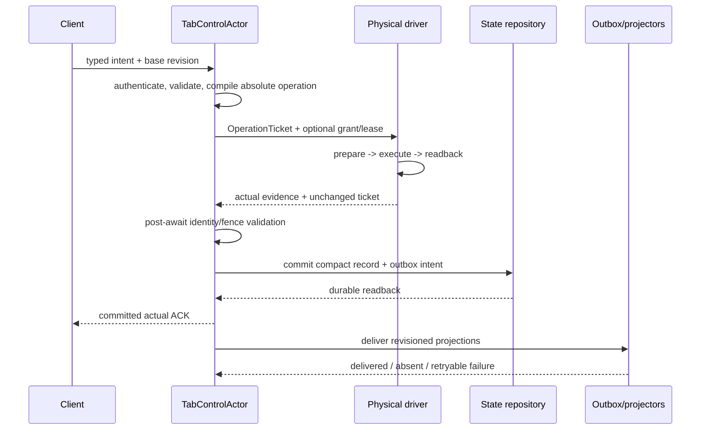

Success order is fixed:

```text
physical readback
  -> freshness validation
  -> canonical state commit and storage readback
  -> caller ACK
  -> asynchronous projection delivery
```

Projection failure never rolls back canonical state. It remains a bounded,
coalesced outbox obligation. A storage failure cannot return success; if a
physical absolute set already happened, recovery reads actual state and commits
or reports `indeterminate` rather than guessing.

Chrome Storage does not provide application-level compare-and-swap. V3 does not
pretend otherwise. Safety comes from one actor writer, one compact record per
active document, expected-version checks, post-write readback, and conflict
detection. An unknown writer or version moves the actor to recovery instead of
blindly overwriting it.

### 6.4 Idempotency classes

| Class | Examples | Recovery |
| --- | --- | --- |
| Absolute set | speed, volume, EQ band, mute target state, CSS effect | retry same `operationId` or reconcile actual; repeat has same result |
| Compiled relative | volume up, seek relative, toggle | actor first compiles to absolute desired value; executor dedupes `operationId` |
| External effect | screenshot download, open URL, user script | durable prepared/completed receipt; ambiguous completion is `indeterminate`, never blind retry |
| Release | runtime/Capture/visualizer lease release | exact token; repeated release is successful idempotence |

Receipts are bounded and compacted after terminal state/TTL. Visualizer frames,
native observations, and UI heartbeats never enter a durable event log.

### 6.5 Read model and pure queries

`ControlSnapshot` remains the only field-level actual authority.
`AudioSessionSnapshot` remains a separate processor-lifecycle authority. A
`DocumentProjection` may compose both for transport, but it is a read model, not
a new writable aggregate.

```ts
type ProjectionFreshness = 'actual' | 'stale' | 'unknown';

type DocumentProjection = Readonly<{
  control: ControlSnapshot | null;
  audio: AudioSessionSnapshot | null;
  freshness: ProjectionFreshness;
  observedAt: number | null;
  recoveryPending: boolean;
}>;
```

`snapshot.get` returns this projection without Content runtime acquisition,
script injection, storage mutation, badge mutation, WebAudio, or Capture. A user
request for a physical refresh is an explicit `actual.inspect` command with its
own lease and UI progress, never an invisible query side effect. This fixes
`PERF-001`.

## 7. Content document and source runtime

### 7.1 Immutable initialization

The invalid construction sequence

```text
new MediaRegistry() -> later setDocumentId(...)
```

is deleted. Content runtime is constructed only after the exact Chrome sender
identity is validated:

```text
runtime.ensure exact document
  -> validate sender.tab.id + sender.documentId + frameId=0
  -> create immutable DocumentRuntimeContext
  -> create MediaRegistry(context)
  -> create SourceLifecycleCoordinator(context, registry)
  -> register initial media
  -> READY(contentRuntimeEpoch)
```

This removes the empty first-document state in `CON-001`.

### 7.2 Scope tree and continuation fence

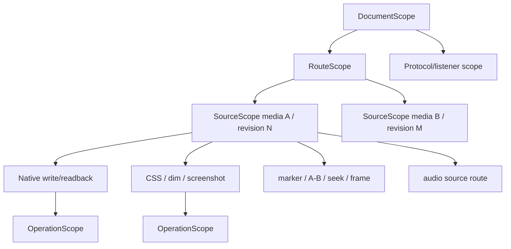

Every async operation captures a `ContinuationFence`:

```ts
type ContinuationFence = Readonly<{
  document: BrowserDocumentKey;
  documentEpoch: number;
  contentRuntimeEpoch: string;
  routeEpoch: number;
  operationId: string;
  source: MediaSourceKey | null;
  sourceToken: string | null;
  signal: AbortSignal;
}>;
```

The only accepted async pattern is:

```text
assert current
  -> start bounded async work
  -> await or abort/deadline
  -> assert current again
  -> physical write/readback
  -> assert current again
  -> local commit/ACK
```

The scope registry owns timers, rAF, rVFC, observers, ports, listeners, pending
promises, and disposers. Cancellation must settle the public promise; cancelling
the native handle while leaving a hanging promise is a lifecycle defect. This
fixes `CON-002` and `CON-004` structurally.

### 7.3 MediaCapability

Writers receive an executable capability, never a naked element:

```ts
type MediaCapability = Readonly<{
  target: MediaTarget;
  element: HTMLMediaElement;
  sourceKey: MediaSourceKey;
  sourceToken: string;
  evidence: MediaAdmissionEvidence;
  signal: AbortSignal;
}>;
```

When an element begins a new resource selection, its old capability can never
become current again even though the DOM element is reused.

### 7.4 Source lifecycle

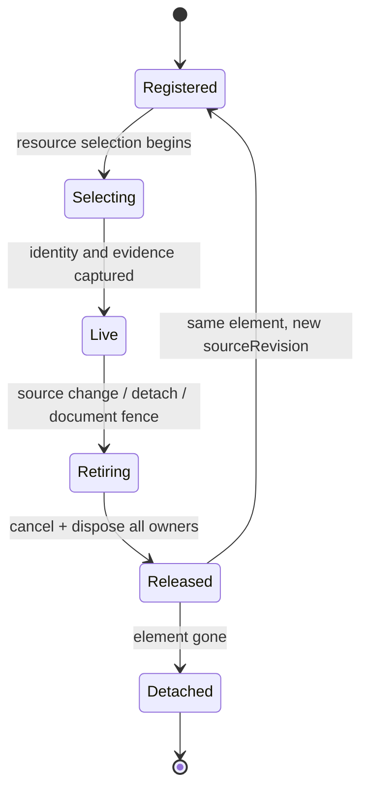

The single retirement order is:

1. mark old source retiring and deny new operations;
2. cancel its source scope and settle in-flight promises;
3. dispose native waits, A/B, markers, effects, dim/rAF, screenshot verifier,
   observers, and audio route exactly once;
4. remove owned CSS/overlay state and restore the site's current baseline;
5. emit one `source.released(oldTarget)` fact;
6. increment `sourceRevision` once, capture new evidence, and publish the new
   capability;
7. replay only still-current Background desired state.

This fixes effects leakage on element reuse (`CON-003`) without adding one
source-change listener per feature.

### 7.5 Timeline and video rules

- Marker and A/B state are keyed by full `MediaSourceKey`.
- `marker-add` validates finite current time and a usable timeline before one
  atomic state commit; no `NaN` or half-created marker is possible.
- A-only is an acknowledged field in the current document snapshot, but it owns
  no scheduler. Content owns scheduling only when a valid A/B pair is enabled.
- Seek, frame step, marker jump, and A/B boundary reuse one capability-aware,
  deadline-bound native seek executor.
- Video effects are keyed by source, not element. Neutral values on never-owned
  targets are DOM-free.
- Dim readback races one rAF against cancellation and a named deadline. Hidden
  or frozen pages return a typed timeout; they never leave an unresolved RPC.

## 8. Media and audio architecture

### 8.1 Honest Media WebAudio boundary

`createMediaElementSource()` changes the page media routing for the element and
cannot be used as a reversible probe. A URL, same-origin `blob:`, current
`crossOrigin` value, nonzero analyser output, or absence of a present
`mediaKeys` object is not proof of the source's future safety.

V3 uses this lattice:

| Evidence | Meaning | WebAudio action |
| --- | --- | --- |
| `NO_SOURCE` | no selected media resource | none |
| `UNKNOWN` | timing/provenance/future protection cannot be proven | no binding |
| `DENIED` | CORS failure, EME/protected signal, opaque/MSE/srcObject policy, stale source | terminal no binding |
| `PROVEN_IMMUTABLE` | source class, selection timing, provenance, and protection boundary are immutable and fully proven | binding may be prepared |

Merge is fail-closed: any denied source denies the set; otherwise any unknown
source makes the set unknown; only a complete `PROVEN_IMMUTABLE` set can enter
Media WebAudio.

For ordinary page-owned media, Chrome does not currently expose a complete
proof that a source will not later become MSE/EME/protected. Therefore the V3
default is:

```text
native controls for native capabilities
explicit, user-admitted Capture for requested full-output DSP
no irreversible Media WebAudio binding for unproven page media
```

If implementation research finds no production source class satisfying
`PROVEN_IMMUTABLE`, the Media WebAudio strategy is removed from the production
planner. Availability is not allowed to override page-audio safety.

### 8.2 Binding state if a proven class exists

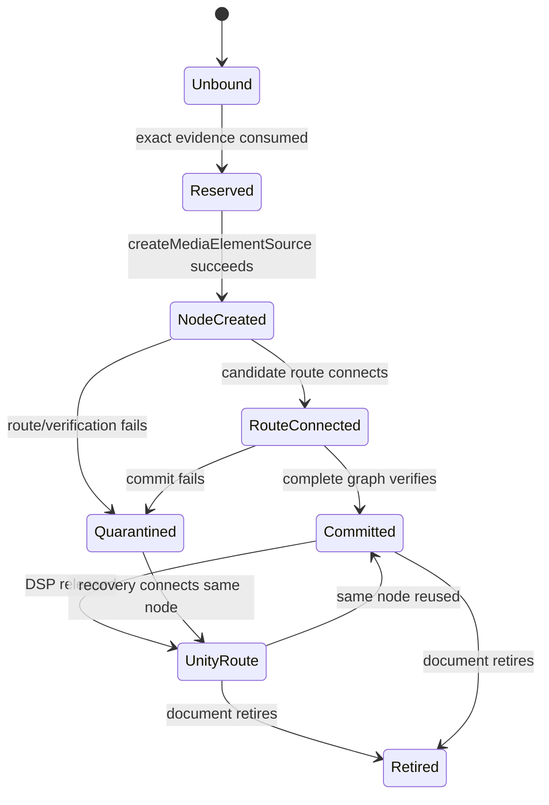

Ownership maps publish `connected` only after connection succeeds. Once node
creation succeeds, failures retain an explicit quarantined binding; they never
pretend the node was absent or call `createMediaElementSource()` again. This
fixes `AUD-004`.

### 8.3 Graph transaction

Every admitted physical graph owner must use the same transaction semantics.
The current production implementation has exactly one such owner—Offscreen
Capture. Content WebAudio remains absent because §8.1 found no admissible source
class; this section does not reserve a dormant second production owner.

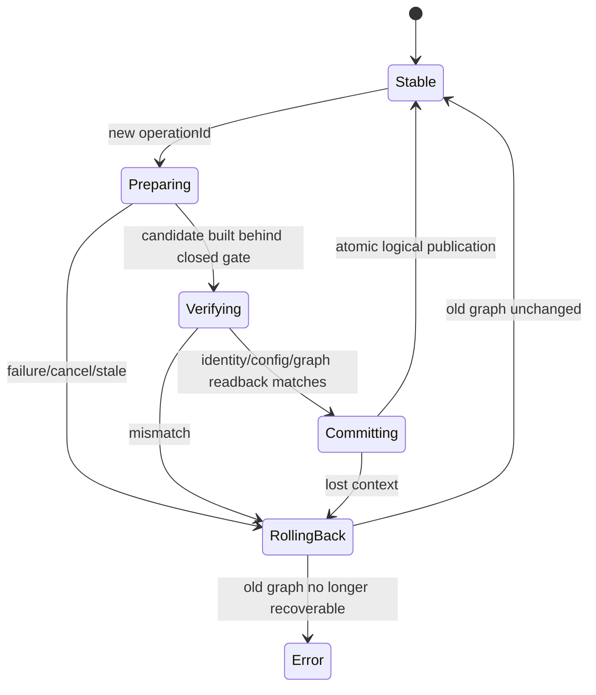

- Parameter-only changes ramp existing parameters.
- Sparse-topology changes build one candidate lane and use the existing 40 ms
  complementary linear crossfade.
- Candidate output gates begin closed.
- `processorGeneration`, `graphRevision`, normalized config, graph signature,
  source set, lifecycle phase, and lease publish together only after readback.
- Failure leaves the old committed generation and graph unchanged and disposes
  candidate nodes. A failed update cannot block the old generation's STOP.

This fixes the ghost-generation failure in `AUD-001`.

### 8.4 Capture authority and state machine

The final Capture mutation is not a public RPC. Content may report
`capture-required`; only `TabControlActor` resolves the current foreground
document and mints a one-shot `capture-start` grant. Background
`CaptureSessionOwner` owns desired/actual session state and the exact lease;
Offscreen `CaptureHost` owns streams, tracks, contexts, gates, and graph nodes.

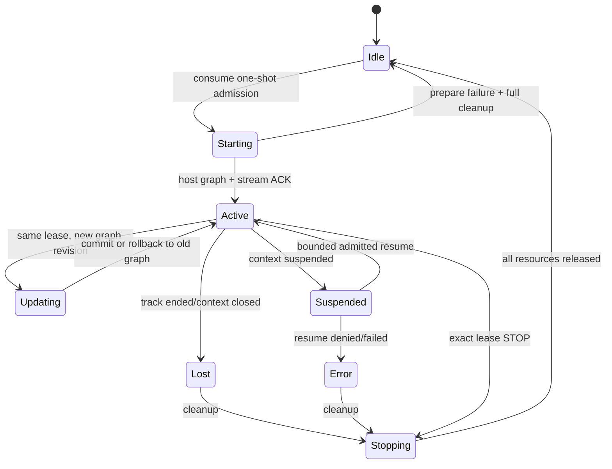

START, UPDATE, and STOP carry exact document, operation, lease, processor, and
graph versions. UPDATE never advances processor generation before graph commit.
STOP writes a tombstone first, is idempotent, and disposes visualizer, gates,
tracks, router, source, and context in owned order. Any no-tab sender carrying
an arbitrary `tabId` fails before the driver boundary, fixing `CTL-001`.

### 8.5 Visualizer

- A visible foreground Popup card owns one exact-document visualizer demand.
  That demand may consume a one-shot `capture-observe` admission and create a
  transient processor even when every DSP field is neutral and native page
  volume is anywhere in `0..100`. It never rewrites native volume or mute.
- Sampling begins only after that processor returns its exact generation,
  running-context, graph-signature, and control-revision ACK.
- One sampler exists per processor generation; maximum sampling remains 15 Hz.
- One latest-only frame is in flight per subscriber; stale generations drop.
- Subscribe/unsubscribe/navigation/tab removal all enter the actor resource
  mailbox. `receiver_absent` is distinct from transient transport failure.
- With no subscriber there is no analyser, scheduler, timer, or IPC.
- Sampling reuses a fixed typed buffer. At the Chrome JSON message boundary it
  performs at most one bounded encoding per emitted frame and fans out that
  immutable payload. `Array.from()` in multiple layers is forbidden.
- A binary/transferable transport may replace the JSON encoding only after a
  production Chrome proof demonstrates support and lower total CPU/GC cost.

This resolves `PERF-003`, `PERF-004`, and the allocation root of `PERF-006`
without relying on an unsupported transport assumption.

## 9. Remote SessionAuthority

### 9.1 Single authority

Offscreen `RemoteSessionAuthority` is the only live writer for session identity,
HMAC authentication, connection attempt, authenticated epoch, sequence,
reconnect deadline, command admission, logical observation ownership, and close.
`PeerTransport` owns only Peer/DataConnection objects and reports facts.
Background owns only the physical Content-runtime lease and control execution.
The Remote page owns only UI, its current attempt, and proposed sequence values.

Because Offscreen exposes no `chrome.storage`, the authority uses an internal
`RemoteJournalPort` serviced by Background. The port validates exact Offscreen
sender URL, authority instance, opaque capability, and expected journal
revision; it contains no Remote business decision. The journal lives in
`chrome.storage.session`, so pairing secrets do not become long-term local data.

### 9.2 Session and command state

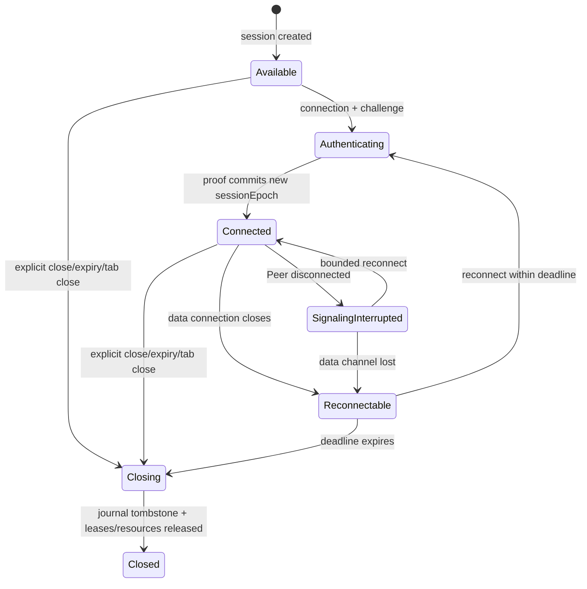

Every successful reauthentication mints a new `sessionEpoch`; sequence starts at
one inside that epoch. A Background worker restart does not reset the epoch or
sequence while Offscreen survives. An Offscreen restart creates a new authority
instance, permanently invalidates the old transport epoch, rehydrates the
journal through Background, and requires reauthentication.

```mermaid
sequenceDiagram
  participant R as Remote page
  participant S as SessionAuthority
  participant J as Background journal port
  participant B as Background executor
  participant A as TabControlActor

  R->>S: command(epoch, sequence, commandId, state revision)
  S->>S: serialize; validate auth/epoch/sequence/generation
  S->>J: persist ADMITTED receipt
  J-->>S: journal revision ACK
  S->>B: immutable DispatchTicket
  B->>S: validate ticket before runtime acquire
  B->>B: acquire exact remote-observation lease
  B->>S: validate ticket after await
  B->>A: execute operationId = commandId
  A-->>B: committed actual result
  B-->>S: commit result
  S->>J: persist terminal receipt
  J-->>S: ACK
  S-->>R: command result + latest state
```

Command admission, close, reconnect, observation, and sequence share one
per-session serial executor. Multiple sessions may run concurrently.

### 9.3 Await and close fence

Every transport attempt is an immutable tuple of authority instance, session,
peer instance, connection, attempt, and challenge. Web Crypto and Peer callbacks
revalidate the complete tuple after await. A stale attempt cannot authenticate,
close, or clear the current connection (`REM-005`).

An observation `DispatchTicket` contains session epoch, binding ID, lease ID,
capability, authority revision, and document identity. If close or replacement
occurs while `ensureContentRuntime()` waits, post-await validation returns
`stale` and Background releases exactly the lease it just acquired; it never
installs or recreates the old observation (`REM-002`).

Peer `disconnected`, data-connection `close`, and terminal Peer `close` are
distinct facts. The authority alone schedules bounded reconnect/recreate within
the existing two-minute business window and stops at its deadline (`REM-004`).

### 9.4 Remote idempotency and results

- Sequence admission and durable receipt precede dispatch.
- Duplicate `commandId` returns its receipt without physical re-execution.
- Command/sync/status work uses one bounded keyed serial primitive; the service
  retains session/auth/protocol authority while the primitive owns only queue
  admission, rejection-safe tails, and map cleanup.
- Both Offscreen and Background retain at most
  `REMOTE_COMMAND_RECEIPT_LIMIT = 512` receipts per authority scope and prune
  deterministically; command history cannot grow with session lifetime.
- Relative/toggle commands are compiled by the control actor to an absolute
  operation; the executor dedupes `operationId`.
- If execution may have happened but receipt commit is lost, the result is
  `indeterminate`; Remote synchronizes state and does not blindly replay.
- Old epoch, replayed sequence, stale control revision, unauthenticated data,
  second controller, and closed session fail without consuming new authority.
- Peer `open`, `disconnected`, `close`, delayed challenge, Web Crypto, recovery
  timer, and Content-runtime acquisition all revalidate the complete
  authority/session/peer/connection/attempt tuple before mutation.

This single model fixes `REM-001` through `REM-005`.

## 10. UI architecture

### 10.1 SurfaceRuntime

Each Popup or Options document creates one disposable `SurfaceRuntime`:

```text
SurfaceTransport
  -> pure projection reducer
  -> short-lived UiStore
  -> intent controllers
  -> selectors
  -> DOM view adapters
```

The store contains acknowledged snapshots, settings/registry projections,
pending intent overlays, busy/error/focus state, and no independent business
truth. DOM adapters render and emit typed intents; they never call Chrome,
storage, settings, or control RPC directly.

Popup cards and its Side Panel share one `PopupUiStore`. If the Side Panel later
becomes a separate extension page, it gets a separate store instance but reuses
the reducer, selectors, and controllers.

The landed Popup decomposition makes the ownership boundary concrete without
introducing a framework or a second business store:

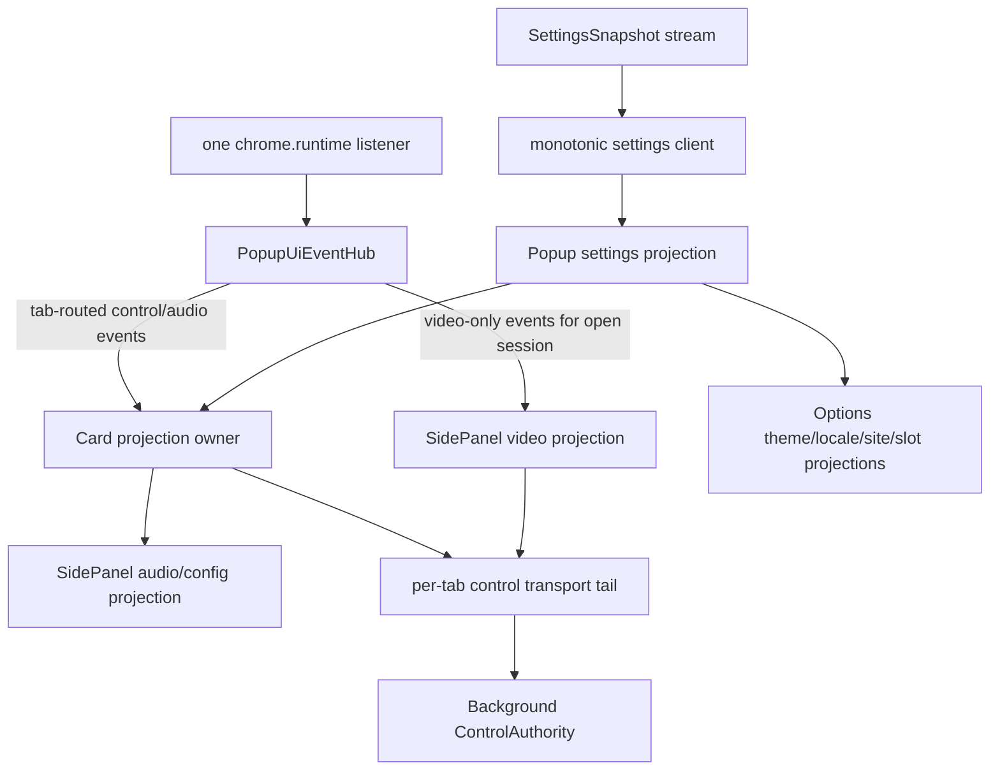

`PopupUiEventHub` is transport fan-out only: it installs one guarded Chrome
listener, snapshots the subscriber set, isolates subscriber exceptions, and
removes the listener after the final subscriber. The Card remains the sole
audio/config projection owner; the Side Panel subscriber handles video state
only. Settings uses its separate restricted protocol and monotonic cache.

One Popup startup attempt owns a disposer set. Settings, Remote UI, persistent
ports, every Card, and the Side Panel register idempotent cleanup as soon as
they acquire state. A failure after partial initialization disposes the whole
attempt before showing the accessible retry surface. Retry releases that
disposer set and re-enters `main()` in the same realm; the document is never
reloaded.

### 10.2 Projection acceptance

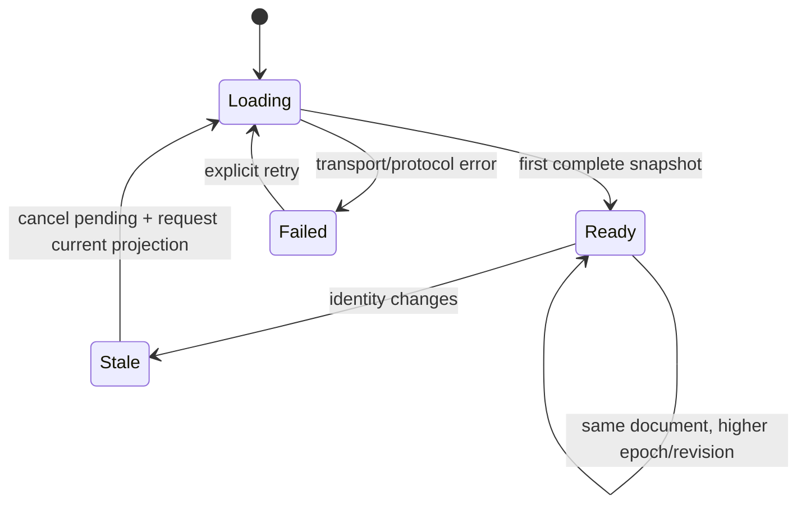

- Generation is the tab-scoped monotonic clock. A different document/origin is
  accepted only at a higher generation; a delayed old-document event cannot
  clear or replace the current identity.
- Within one generation, only a higher revision may replace the projection.
  An equal/older passive GET or ACK is a no-op, not an availability failure.
- A new accepted document replaces the complete card entity and cancels old
  pending intent presentation; it never merges merely by `tabId`.
- `AudioSessionSnapshot` is accepted only for the same complete identity and
  never overwrites control fields.
- `settings.changed` replaces only a higher Settings revision and triggers
  theme, language, cards, Side Panel, presets, and Options selectors.
- The v1 `UI_SYNC` writer is deleted at cutover; it is not given another fence
  and cannot overwrite V3 (`UI-002`).

### 10.3 Intent / ACK / rollback

```text
idle -> queued -> in-flight
  -> acknowledged
  -> failed + rollback + authoritative refresh
  -> stale/conflict + cancel + authoritative refresh
```

Background may execute independent tabs concurrently, but every UI mutation
sharing one tab snapshot revision enters one per-tab transport tail. Compound
effective volume, filter patches, per-field/DSP mutations, and non-coalescible
video operations cannot race with the same `baseRevision`. Coalescible controls
retain only the latest not-yet-admitted value before that tail; discrete user
intents are preserved in order. Closing and reopening the same tab waits the
old tail, refreshes the canonical snapshot, and then admits the new session.

A failed volume stage cannot consume an EQ/DSP patch (`UI-006`). ACK clears only
the matching intent and fields; later user input remains pending. Reset explicitly
supersedes affected queued writes. Errors always clear busy state, remove the
failed overlay, restore last ACK, refresh the authoritative projection, and emit
a localized accessible error. No promise rejection or registry/settings failure
is discarded (`UI-003`, `UI-004`, `UI-012`, `UI-013`).

For array fields such as EQ, UI submits an atomic domain mutation such as
`set-band(index, value)`; Background merges it on the current authoritative
array. A stale full array from another surface cannot overwrite newer bands
(`UI-007`).

### 10.4 Presets, Side Panel, ranges, and semantics

- Preset Apply requires a ready `TargetCapability`. With no target it is
  disabled and described accessibly. Success appears only after every required
  runtime/settings ACK; partial persistence failure is explicit (`UI-001`).
- Side Panel open creates a session token, immediately clears old identity,
  disables controls until a current projection exists, and aborts its predecessor.
- Controls bind once per surface mount; open/close does not accumulate pagehide
  or input listeners (`UI-008`, `UI-009`).
- Reset, save, passive GET, success ACK, failure recovery, and external speed
  projection all carry the full panel/session target fence. An old tab or old
  open epoch cannot update the current panel or display its error.
- All ranges and steps come from contracts. Speed is `0.1..16`, not a local
  `0.25` minimum (`UI-010`).
- The existing action is labelled **Clear A/B loop**. A Toggle label is allowed
  only if a real `ab-toggle` contract and implementation exist (`UI-011`).
- External settings revisions rerender every affected selector (`UI-005`).

### 10.5 Accessibility and lifecycle contract

- Loading surfaces are inert/disabled and expose `aria-busy`.
- Errors use a localized `role=alert`/assertive live region; normal completion
  uses a polite status region.
- Busy is field/target/surface scoped so unrelated controls remain available.
- Closing restores focus and disposes subscriptions, ports, listeners, timers,
  visualizer leases, observation leases, locale loads, and pending requests.
- Options never renders defaults as persisted truth when bootstrap fails.
- Popup main mode has intrinsic block height: the Action host follows the
  actual card stack, including the one-card case. Only the explicit
  `settings-view-active` class owns the 600px settings viewport. Navigation
  toggles that mode and never measures content into an inline `min-height`, so
  Settings -> Back restores the exact intrinsic main height and additional
  cards grow the Popup naturally.

## 11. Settings, registry, and projection truth

`SettingsCommandOwner` accepts an expected revision, normalizes a complete
value, writes one canonical record, reads it back, then appends a latest-revision
projection obligation. Projection failure never changes the committed setting.

Idle tabs are pull-on-bootstrap consumers. A settings change projects only to
actors with a live/resident owner; it does not scan and inject heavy runtime into
every tab. Every actor records the last applied Settings revision.

The historical standalone registry repository is retired, but the stable
additive `spectra.registry.*` v2 wire remains the site-route projection. The
single persistence/revision owner is `SettingsRepository`; strict full-settings
v2 remains byte-shape compatible and does not gain `mediaRoutes` or a new patch
scope. Popup and Content are typed registry-wire consumers and never own route
storage. Legacy registry storage migrates once into `siteProcessingRoutes` only
after durable readback. The document-local Card/SidePanel registration table
remains unrelated UI lifecycle state.

The public `ProjectionModel` derives semantic fact IDs from contracts, manifest,
permissions, network/provider registry, privacy owner, Remote deployment facts,
and locale registry. Store listings and locales may use natural language, but
every locale must project the same capability, limitation, permission, network,
and data-use fact set. Generated outputs change only through their generator.

## 12. Performance and scheduling

### 12.1 Zero-work default

Without an explicit owner, a page has:

```text
0 extension AudioContext
0 Capture/offscreen lease
0 heavy Content runtime
0 media MutationObserver
0 analyser
0 disabled-Visualizer chunk, metrics observer, canvas draw, or animation loop
0 recurring timer/rAF/IPC
0 read-triggered storage/badge/DOM mutation
```

### 12.2 Loading tiers

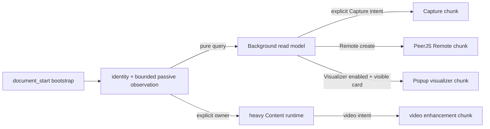

Production has no page Media WebAudio branch: no source class met the complete
future-safety proof in §8.1, so explicit Capture is the sole DSP processor path.
The Popup visualizer promise is lazy and retryable; disabled cards do not import
the chunk, create a metrics cache/ResizeObserver, draw EQ, or start a loop.

Top-level Chrome listeners remain synchronously registered; domain delegates are
lazy modules. Deferred loading must preserve event lifetime and provide an exact
error rather than silently losing an event.

### 12.3 Bounded scheduling policy

| Lane | Bound/coalescing | Failure behavior |
| --- | --- | --- |
| Same document mutation | one active; latest coalescible value pending | command never silently dropped |
| Popup card initialization | cap 4 in `bounded-card-bootstrap`; all items settle | one slow/failed card does not cancel others; badge/empty state reconcile once at the end |
| Cross-tab projections | cap 8 | stop admission on failure, await live workers, bounded retry |
| Remote restoration | cap 4 | per-session isolation |
| Visualizer | one sampler/generation, one latest frame/subscriber, 15 Hz max | stale frame drop |
| Retry | named schedule + deadline + attempt cap | terminal typed outcome |

The Popup receives one batch of passive card seeds, mounts skeletons in visual
order, and progressively resolves cards with cancellation. It never performs an
unbounded serial loop or `Promise.all` over a variable tab set (`PERF-002`).

### 12.4 Budget policy

Current hard artifact ceilings remain the executable safety floor during
migration. Capacity is evaluated from the current artifact, not by comparison
with a convenient historical build:

| Utilization | Policy |
| ---: | --- |
| `<85%` | normal evolution |
| `85–90%` | every increase requires measured explanation |
| `90–95%` | no unoffset resident/bundle growth |
| `>=95%` | capacity freeze; first reduce/lazy-load/remove |
| `>100%` | hard failure |

The target after migration is at least 15% headroom in worker, Popup, Content,
total JavaScript, and total dist before new feature growth. Raising a ceiling is
not a performance fix.

The integrated 2026-08-29 local production analysis passes every hard ceiling
but does not meet the promotion threshold. Exact measurements and terminology
are owned by [runtime architecture](../architecture/runtime.md#production-performance-budgets).
Current deficits to the 85% target are: service worker 8,952 bytes, bootstrap
311, lean hotkeys 119, Popup possible script 1,490, Content possible script
6,134, total JavaScript 26,460, and total artifact 31,048. Capture-only
(20,127), Remote possible script (50,505), and Options possible script (34,146)
now pass their targets. Video effects remains exactly at its target; it creates
no transferable headroom for another independently governed surface.

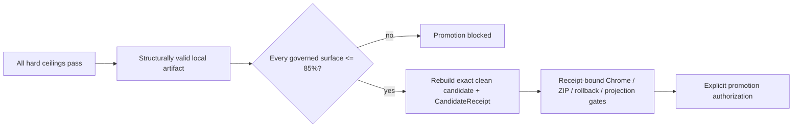

### 12.4.1 Capacity closure architecture

The remaining deficit is not a chunk-placement problem. `possible` follows
every admitted deferred/runtime edge, while total JavaScript counts every
reachable physical output once. Moving Presets, Remote, Video Effects, or a
Background owner behind another import may improve cold start, but it is not a
capacity reduction unless bytes disappear from the unique `diskClosure`.
Background owner deferral is additionally not an admissible MV3 shortcut:
[Chrome extension service workers do not support dynamic `import()`](https://developer.chrome.com/docs/extensions/develop/concepts/service-workers/basics),
and the manifest has one module service-worker entry. The worker deficit must
therefore be removed from canonical guard/value/owner code, not moved to an
unloadable deferred chunk or a second classic-worker loader.

The capacity cutover therefore has one compiler and four physical reduction
owners:

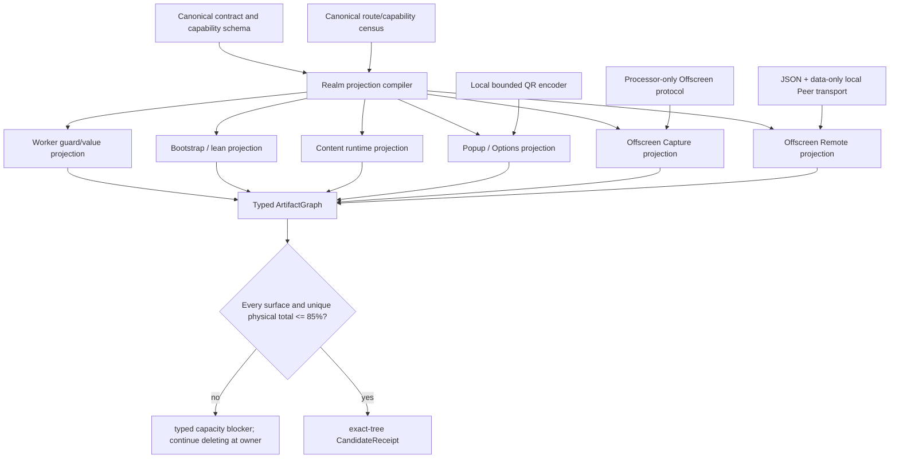

#### Canonical realm projection compiler

- Wire fields, limits, enums, capability policy, and exact-object schemas have
  one declarative owner. Types, exhaustive audit views, and realm projections
  are derived from it; generated projections are never edited by hand.
- A route census selects the exact guards and values each realm can receive or
  emit. Projection may remove an unreachable route or audit-only field, but it
  cannot weaken unknown-field, wrong-version, sender, identity, ACK, revision,
  grant, or lifecycle rejection.
- The generator is deterministic and emits source/hash receipts. A parity suite
  compares every generated guard with the canonical guard over valid,
  malformed, extra-key, boundary, and unknown-discriminant corpora.
- Runtime projection is compiled TS/JS, not fetched schema JSON. Startup has no
  new storage, network, decompression, or version-negotiation dependency.
- Full policy/adjudication tables remain the review projection. Production
  consumers use typed selectors backed by the same indexed capability data so
  audit metadata does not enter every runtime closure.

#### Physical owner reductions

1. **Capture protocol:** Background retains the complete `AudioConfig` and the
   native `volumeBase`/mute truth. Offscreen START/UPDATE accepts only
   `AudioProcessorConfig`; its ACK still returns normalized processor state,
   graph signature, context state, generation, and control revision. The dead
   single-frame visualizer wire is deleted; batch sampling remains the only IPC.
2. **Options settings projection:** full settings/preset storage remains one
   revision/CAS owner. A canonical UI projection exposes only global and hotkey
   settings to Options, with its own exact guard derived from the full schema;
   Options cannot import audio/preset validators or bypass storage through a
   local DTO.
3. **Remote transport:** the local Peer runtime becomes a pinned, licensed,
   Chrome-targeted JSON/DataChannel-only build. MediaConnection, BinaryPack,
   Raw serialization, globals, CDN fallback, and dual-serializer compatibility
   are absent. Extension and public Remote artifacts derive from one transport
   source. HMAC, epoch, sequence, command receipt, generation, reconnect, and
   stale-attempt fences remain above the transport.
4. **QR:** pairing stays offline. A bounded standards-complete byte-mode/ECC-M
   encoder replaces the general renderer only after golden and independent
   decoder interoperability cover every admitted pairing length, Unicode and
   URL boundary. The secret is never sent to a QR service.

Background owner deferral is rejected for the current Chrome extension
platform: an extension service worker cannot dynamically import an owner after
its synchronous ingress listeners run. A future proposal may revisit deferral
only if the minimum supported Chrome platform gains that capability; it would
still require one synchronous ingress dispatcher, bounded first-event queues,
and proof that chunk overhead does not grow unique physical JavaScript. It is
not an admissible W7 capacity-closure path today.

#### Measurement and stop law

Every step records before/after physical output sets from the same frozen tree.
Input attribution, source lines, gzip/ZIP ratio, or removal from one surface's
closure is not accepted as a saving. A step lands only when all of these remain
true:

- service-worker, bootstrap, lean-hotkey, Capture, Remote, Popup, Content, and
  Options script closures are each at or below their 85% targets;
- unique production JavaScript is at most 591,872 bytes and the complete
  artifact is at most 678,912 bytes;
- all real static, deferred, runtime-module, runtime-asset, Chrome-script,
  HTML, CSS, vendor, and locale edges remain typed and reachable;
- no capability, translation, QR, security guard, rollback, readback, failure
  state, or lifecycle disposer was removed to satisfy a number;
- packaged Chrome exercises first-event worker wake, navigation/restart,
  Capture visualizer, Options CAS, Remote authentication/reconnect, QR scan,
  and every dynamic import failure surface.

If a projection or replacement misses its measured target, the result is a
typed blocker for that owner. Budgets, graph reachability, assertions, and
features are not changed to make it pass.

### 12.5 Proposed user-facing SLOs

These are candidate targets to baseline on a pinned Chrome/reference machine in
Wave 0; they are not current measurements.

| Workload | Candidate p95 | Guardrail |
| --- | ---: | --- |
| passive snapshot query | 100 ms | zero heavy-runtime acquisition |
| Popup first interactive shell | 150 ms | does not wait for all cards |
| 8 visible cards settle/degrade | 500 ms | cap 4, independent failures |
| direct native control ACK | 250 ms | current identity + actual readback |
| Capture control ACK | 1 s | visible prepare/verify/commit phases |
| visualizer sample-to-render | 100 ms | queue depth 1, 15 Hz max |

Trace tests report p50/p95/p99, peak memory, allocation, IPC bytes, queue depth,
dropped/coalesced work, and cleanup latency. Average-only claims are rejected.

### 12.6 Local observability

All contexts share a privacy-safe `TraceContext`: trace/span parentage, operation,
phase, hashed identity, revision, duration, outcome, error code, queue depth,
lease count, and payload bytes. It never includes URL, title, content, secrets,
media bytes, or raw Remote payload.

Production defaults to no external telemetry: a no-op or bounded local ring
buffer with TTL. Tests use an in-memory sink; release profiling uses local Chrome
trace/CDP evidence. Public performance claims cite a receipt-bound workload.

## 13. Update and browser lifecycle

One `ContentDocumentUrlPolicy` owns `http`, `https`, user-enabled `file`, and
explicitly unsupported schemes. Runtime admission, bootstrap, site hotkeys,
Remote target validation, warm update, manifest fixtures, and tests import or
derive from the same policy.

Warm update enumerates tabs once, applies the canonical predicate locally, and
runs a bounded exact-document reconcile/reload. `file:` without user access is
`skipped-by-permission`, never hidden success. This fixes `UPD-001`.

Lifecycle scenarios—full navigation, SPA history/hash, BFCache, prerender,
hidden/frozen, tab close, worker restart, extension update, and Offscreen
restart—enter one `BrowserLifecycleIngress` and the same actor/source/lease
fences. Neighbor modules do not register competing cleanup ownership.

## 14. Security and privacy architecture

| Principle | V3 enforcement |
| --- | --- |
| Least privilege | no new permission; privileged operations use one-shot scoped grants |
| Complete mediation | final physical owner validates grant/ticket/lease, not only ingress |
| Fail safe defaults | unknown CORS/EME/MSE/source evidence and stale identity deny mutation |
| Separation of privilege | Remote HMAC admits a session; ControlAuthority separately admits a media operation |
| Replay resistance | Remote epoch + sequence + command receipt; operation dedupe everywhere |
| Minimized retention | Remote secret/session journal in `storage.session`; bounded receipt TTL |
| Data minimization | Remote state remains selected-tab metadata/control only; traces omit sensitive data |
| Explicit trust boundary | runtime guards validate sender URL/context, documentId, frame, origin, and payload |
| No confused deputy | clients submit intent, never arbitrary final tab/resource identity |

STRIDE coverage is tested at each boundary: spoofed sender/grant, tampered
envelope, repudiated external effect receipt, information disclosure in errors
and traces, queue/resource exhaustion, and elevation through Capture/MAIN/user
scripts. Threat modeling does not replace the concrete runtime guards.

## 15. Release and artifact provenance

### 15.1 Immutable candidate pipeline

```mermaid
flowchart LR
  Commit["reviewed commit + tree"] --> Isolated["isolated clean checkout"]
  Isolated --> Static["toolchain / type / lint / docs / architecture"]
  Static --> Build["one production build"]
  Build --> Candidate["CandidateReceipt"]
  Candidate --> Graph["typed artifact graph + budgets"]
  Graph --> Chrome["installed production Chrome matrix"]
  Chrome --> Projection["locale/privacy/permission/Remote projection"]
  Projection --> Zip["extracted ZIP smoke + rollback resolve"]
  Zip --> Promotion["PromotionReceipt"]
  Promotion --> Explicit["explicitly authorized promotion"]
```

The release source is an isolated exact Git tree, never the user's dirty
workspace. Preflight rejects tracked or untracked SPECTRA source drift. Build,
tests, ZIP, and promotion consume the same candidate identity.

### 15.2 CandidateReceipt

It records schema; repository/commit/tree/source manifest; package version;
Bun version and lockfile; production flags; artifact/file/ZIP hashes; typed graph
closures; actual budgets; trace summaries; Chrome/OS/locale/workload; projection
model and locale/privacy/permission/network hashes. It proves candidate identity,
not release authorization.

`test:chrome:dist` requires a matching receipt and rejects missing, stale,
development, modified, or foreign `dist` (`GATE-002`).

### 15.3 Typed artifact graph

Reachability accepts only typed edges:

```text
manifest entry | HTML script | CSS URL | static import |
deferred import | declared runtime-loader edge | explicit vendor bootstrap
```

An arbitrary string literal cannot make an orphan reachable (`GATE-003`). Every
edge report includes source, target, and kind; every artifact belongs to a real
static/eventual/runtime closure.

The report keeps four evidence classes separate:

1. physical output bytes count each emitted file once;
2. static script closure is the JavaScript set reachable without deferred or
   runtime edges;
3. possible script union adds admitted deferred/runtime/vendor JavaScript and
   still counts each file once;
4. possible payload adds reachable non-script assets to that possible union.

Neither static nor possible closure is a heap-residency or simultaneous-load
claim. A residency/CPU/IPC statement requires a named Chrome workload trace.
`outputAttribution: measured` means the build metafiles attributed emitted bytes
to source inputs; `not-measured` is valid only for structural closure checks and
cannot support source-contribution conclusions. Production build, console report,
and receipt must reuse one analysis object and one artifact-set hash.

### 15.4 PromotionReceipt

Promotion is created only after all required gates, installed/extracted Chrome,
trace budgets, live Remote bytes/headers, public projections, and rollback
artifact resolution finish. It binds the CandidateReceipt hash and complete gate
evidence and is one-use. Exact commit/tree provenance fixes `GATE-004`.

### 15.5 Locale and projection gates

Chrome command tests validate stable command identity and manifest key semantics,
not localized display text. The deterministic lane fixes locale explicitly and
a zh-CN semantic lane proves localization does not change behavior (`GATE-001`).

The ProjectionModel verifies every locale/store/privacy/permission/network fact,
not selected English/Chinese strings (`GATE-005`). Provider reachability remains
separate from deterministic product correctness.

## 16. Verification architecture

### 16.1 Safety and liveness properties

The executable model must establish:

```text
Safety
S1  one mutable owner per aggregate/resource
S2  no stale identity can write, ACK, publish, acquire, or release
S3  no logical revision advances before matching physical readback
S4  query causes zero mutation/resource acquisition
S5  every privileged mutation has a current scoped admission
S6  every resource has exactly one live owner token and idempotent disposer
S7  unknown media safety never triggers irreversible binding
S8  no old Remote epoch/sequence/attempt can execute or close current state
S9  no artifact/projection evidence crosses candidate identity

Liveness
L1  every admitted operation reaches applied, rejected, cancelled, or indeterminate
L2  every cancelled scope settles all public promises
L3  every final lease release eventually reaches physical cleanup or typed recovery
L4  projection/retry queues remain bounded and make progress before deadline
L5  worker/Offscreen recovery converges or exposes a terminal repair state
```

### 16.2 Test layers

| Layer | Proof |
| --- | --- |
| Unit | normalizers, policies, evidence lattice, reducers, codecs, budget math |
| Contract | exact envelope/sender/identity/grant/lease/error/receipt guards |
| Property | monotonic clocks, queue bounds, unique lease, no stale commit, URL-set equality |
| Model-based | tab actor, source scope, graph transaction, Remote session, UI intent state machines |
| Fault injection | every await boundary, storage failure, close/navigation/restart, lost ACK, undefined rejection |
| Production artifact | exact closures, bytes, manifests, no private/test/source-map assets |
| Installed Chrome | real documentId, activation, CORS/EME/MSE, Capture, BFCache, restart, file URL, locale |
| Provider lane | PeerJS/STUN/TURN availability, reported separately |
| Release replay | receipt/source/artifact/projection/rollback binding |

TypeScript state models and randomized event sequences are the initial formal
vehicle. A TLA+/model-checker dependency is introduced only if the executable
models cannot explore the required interleavings; architecture quality is not
measured by adding formal tooling for its own sake.

### 16.3 Required real-Chrome matrices

- Source: same-origin static, cross-origin CORS before/after selection, missing
  CORS, ordinary Blob, MSE Blob, `srcObject`, mediaKeys/encrypted/protected,
  source replacement, multiple media elements.
- Lifecycle: cold/warm navigation, SPA route, BFCache restore, hidden/frozen,
  Popup close/reopen, worker restart, Offscreen restart, update, tab close.
- Capture: permission/activation denial, START/UPDATE/STOP interleavings, graph
  failure, track ended, context suspend/closed, stale lease.
- Remote: auth, replay, reconnect, signaling disconnect, close during runtime
  acquisition, worker/Offscreen restart, second controller, expiry.
- UI: 0/1/2/8/16 cards, one slow/closed/navigated tab, all failure rollback,
  listener counts, stale side-panel session, external settings revision.
- Visualizer: 0/1/4/8 subscribers, visible/hidden, slow subscriber, unsubscribe,
  generation change, 30-second CPU/GC/IPC trace.
- Release negative cases: dirty/untracked source, stale/dev/modified dist, dead
  string orphan, missing dynamic entry/locale/fact, mismatched live Remote,
  malformed/expired/consumed receipt.

## 17. Migration DAG and cutover rules

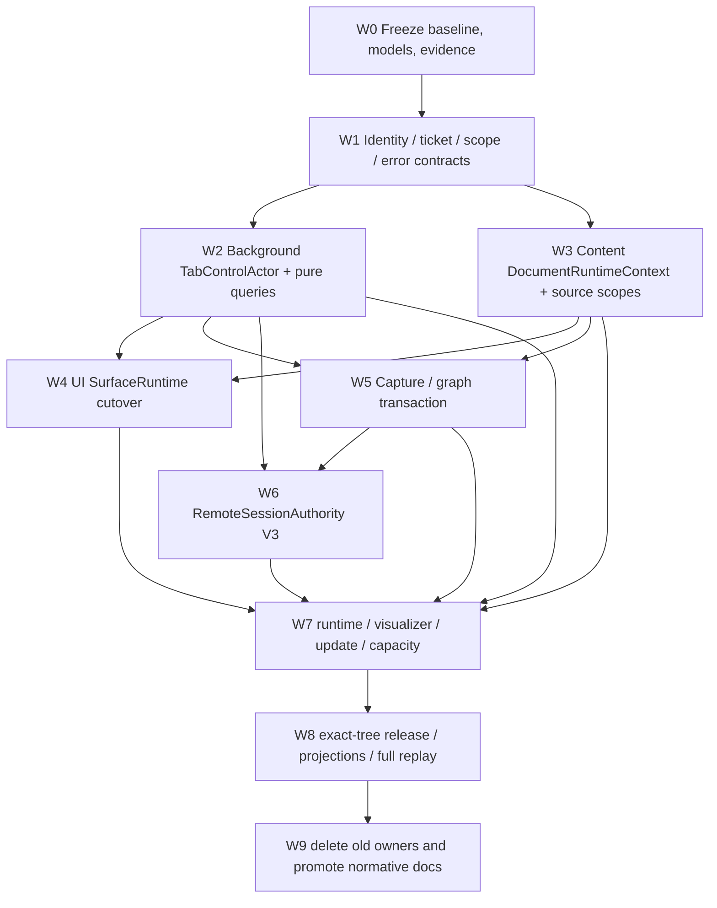

### 17.0 Local implementation ledger

| Wave | Current local state | Closure evidence / remaining boundary |
| --- | --- | --- |
| W0 | complete for this audit candidate | baseline commit, 44-finding ledger, owner map, negative evidence boundaries |
| W1 | implemented | canonical limits; identity/epoch/ticket/receipt contracts; split protocol primitives and reused Background guards |
| W2 | implemented | per-tab serialization, synchronous navigation fence, pure/passive reads, durable snapshot and bounded projections |
| W3 | implemented | immutable document runtime, source scopes, async continuation fences, single lifecycle/disposer graph, native async owner extraction |
| W4 | implemented | ACK/rollback UI, monotonic settings, Side Panel session identity, one UI event hub, transactional Popup attempt cleanup, retired UI_SYNC and standalone registry repository; stable registry v2 projects the SettingsRepository-owned route state without changing full-settings v2 |
| W5 | implemented | proven page WebAudio restored as the lower-cost complete owner, one-shot Capture admission retained for fallback, exact processor ACK/readback and navigation cleanup |
| W6 | implemented locally | Remote V3 epoch/command receipt/HMAC fences, one Offscreen Peer owner, bounded recovery, ESM PeerJS loader; public deployment remains unauthorized/unverified |
| W7 | implemented | lazy visualizer/Remote/QR/presets, bounded fanout, surface locale assets with LRU=2, typed ArtifactGraph; hard production budgets remain release gates, while the 15% headroom is advisory optimization evidence and cannot override business behavior |
| W8 | partial local evidence only | type/lint/unit/architecture/public-projection gates, production analysis, and full en-US + zh-CN installed Chrome smoke pass; exact clean-tree receipt, extracted ZIP, rollback, live provider lane, and promotion replay remain |
| W9 | blocked | cannot promote/archive the proposal or claim release without a frozen clean-tree receipt, extracted-package proof, deployment authorization, and the remaining W8 release evidence; advisory headroom alone is not a blocker |

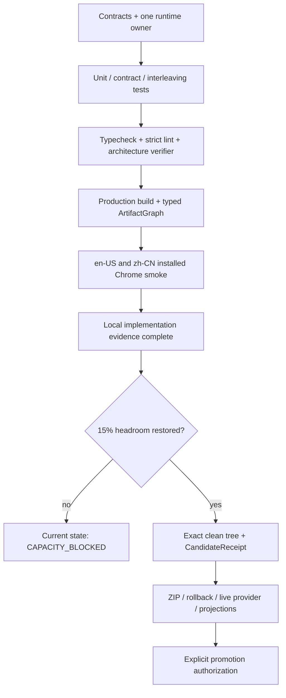

### W0 — freeze evidence

- Record exact source tree, 44-finding ledger, current production bytes, Chrome
  version/locale, current failure, and explicit browser unknowns.
- Add pure reference models and negative fixtures before changing behavior.
- Baseline candidate SLOs; do not present target numbers as current facts.

### W1 — shared contracts

- Add branded identities/clocks, request classes, tickets, grants, exact lease
  tokens, result/error taxonomy, scopes, budgets, and receipt schemas.
- Map existing `generation` uses to their intended V3 clocks.
- Gate direct query-to-mutation imports and ambiguous `undefined` results.

### W2 — Background cutover

- Introduce `TabControlActor`, lifecycle fence, compact repository/outbox, pure
  projection query, one URL policy, and tokenized leases.
- Route existing ingress through the actor; in the same cutover remove the old
  commit/invalidation/visualizer direct writers for migrated resources.
- Do not dual-write old and new state.

### W3 — Content cutover

- Require immutable document identity before MediaRegistry construction.
- Introduce source scopes, capability-only writers, unified operation gateway,
  bounded await fences, and one disposer graph.
- Cut over effects, dim, marker, A/B, seek/frame/screenshot, then audio evidence;
  remove each old feature-specific lifecycle owner in the same change.

### W4 — UI cutover

- Introduce SurfaceRuntime/store/reducers/controllers without changing visual
  design; migrate card, Side Panel, presets, then Options.
- Delete legacy UI_SYNC and local writable AudioConfig/Settings owners.
- Complete accessibility, failure, lifecycle, and multi-card gates.

### W5 — audio and Capture cutover

- Enforce immutable admission lattice; remove page Media WebAudio if no
  `PROVEN_IMMUTABLE` class exists.
- Introduce binding and graph transactions, one-shot Capture admission, exact
  session lease, context/track lifecycle, and visualizer resource state.
- Delete the arbitrary final Capture RPC and pre-commit processor generation.

### W6 — Remote V3 cutover

- Move all session mutation to Offscreen authority and use Background journal/
  execution ports.
- The local extension and Remote page speak only V3. A future authorized public
  deployment must publish them together; existing V2 sessions close with
  `protocol-upgrade-required` and users re-pair once.
- Do not operate V2 and V3 authorities in parallel.

### W7 — performance and update closure

- Restore bundle headroom through deletion, lazy boundaries, passive seeds,
  bounded schedulers, and measured visualizer encoding.
- Unify warm update URL coverage and complete CPU/GC/IPC/SLO traces.

### W8/W9 — release and authority promotion

- Build one isolated exact-tree candidate, require receipt-bound Chrome gates,
  typed artifact graph, projection model, extracted ZIP smoke, and rollback drill.
- Normative owner documents may describe behavior only after local implementation
  evidence exists; release/promotion status still waits for the exact receipt-bound
  replay. Only after that replay may W9 archive this proposal and classify the
  migration record as promoted.

### 17.1 Cutover law

Each wave is a vertical owner cutover:

```text
new contract + new owner + implementation + tests + projection
  -> switch all consumers
  -> delete old writer in the same closure
```

Read-only schema migration may be one-directional and bounded. Business dual
write, permanent aliases, feature flags with two owners, or fallback to the old
writer are prohibited. Rollback selects the previous immutable artifact; it does
not keep two live architectures.

## 18. Finding-to-control traceability

| Findings | Structural control and acceptance proof |
| --- | --- |
| `REM-001`, `REM-002`, `REM-003`, `REM-004`, `REM-005` | one Offscreen Remote authority; authenticated epoch/sequence/attempt; journaled command receipt; post-await ticket validation; bounded transport recovery |
| `AUD-001` | graph prepare/verify/commit; generation publishes only after readback; failed update preserves stoppable old lease |
| `AUD-002`, `AUD-003` | `PROVEN_IMMUTABLE` lattice; EME/MSE/blob/srcObject/late-CORS unknown or denied; remove Media WebAudio if proof unavailable |
| `AUD-004` | reserved/node-created/connected/committed/quarantined binding states; no phantom map or second node |
| `CON-001` | immutable document context before registry/initial media |
| `CON-002` | MediaCapability + scope + continuation fence around every await/write/ACK |
| `CON-003` | one source retirement/disposer graph; effects keyed by source |
| `CON-004` | rAF + abort + deadline; every promise settles |
| `UI-001` | target capability required; disabled no-target Apply; ACK-driven success |
| `UI-002` | legacy UI_SYNC removed; one reducer gates full identity/revision |
| `UI-003`, `UI-004`, `UI-005` | shared error/rollback task runner; revisioned external settings replaces complete projection |
| `UI-006` | independent volume/DSP/operation lanes and field-specific ACK correlation |
| `UI-007` | atomic EQ band command merged on authoritative array |
| `UI-008`, `UI-009` | Side Panel session token, identity clear, bind-once disposable lifecycle |
| `UI-010`, `UI-011` | contract-owned ranges and label-to-operation semantic gate |
| `UI-012`, `UI-013` | Registry/Options/Save errors enter one accessible failure owner |
| UI post-audit races | generation-before-identity admission; one per-tab UI transport tail; Side Panel open-epoch fence; transactional Popup attempt disposer; one runtime event hub |
| `CTL-001` | internal one-shot Capture grant; physical boundary validates; arbitrary target RPC deleted |
| `CTL-002` | one tab actor plus synchronous navigation fence and post-await freshness |
| `PERF-001` | pure projection query; explicit physical inspect command only |
| `PERF-002` | one seed batch + cap-4 progressive card scheduler |
| `PERF-003`, `PERF-004` | visualizer subscription actor; exact revision/operation ACK; absent versus transient error |
| `PERF-005` | unique feedback lease token per invocation |
| `PERF-006` | one sampler/buffer/encoding per emitted frame; latest-only queues; measured transport |
| Visualizer disabled-state cost | lazy retryable visualizer import; card/SidePanel metric observers and loops disposed at the attempt boundary; no draw while disabled |
| Settings/Options concurrency | monotonic shared snapshot replay; locale request token; latest-keyed slot intent; serialized theme toggle; canonical refresh on failure |
| `UPD-001` | one URL policy used by runtime and update; real enabled/disabled file tests |
| `GATE-001` | stable command semantics; fixed-locale baseline + zh-CN semantic lane |
| `GATE-002` | `test:chrome:dist` requires matching CandidateReceipt |
| `GATE-003` | typed loading edges; dead-string negative fixture |
| `GATE-004` | isolated clean commit/tree build and immutable receipts |
| `GATE-005` | ProjectionModel fact-set completeness for all locales/privacy/permissions/network |
| P3 budgets | capacity freeze ≥95%; migration restores ≥15% headroom before growth |
| P3 EQ alpha | parse canonical color type or use CSS color API; visual regression test, no string-format assumption |
| P3 hotkey formatter | one code-to-localized-display formatter |
| P3 bounded fanout | discriminated results; rejected `undefined` remains failure |

## 19. Principles and explicit trade-offs

This architecture applies principles only where they resolve a real force; it
does not accumulate fashionable patterns.

| Principle | Application | Trade-off accepted |
| --- | --- | --- |
| SSOT / single writer | one owner per snapshot, source, graph, session, UI store, artifact | owner cutovers are larger than local patches |
| DDD bounded contexts | control, content, audio, Remote, UI, release have explicit language and ports | cross-context contracts become stricter |
| Actor model | serialize one tab/session/resource, parallelize independent ones | mailbox and recovery states must be tested |
| CQRS | pure passive reads; explicit commands for inspection/mutation | UI may show honest stale/unknown state |
| Capability security | unforgeable one-shot grants and exact leases | more explicit identity fields |
| Least authority | physical drivers cannot choose targets or publish business truth | coordination stays in Background |
| Fail-safe defaults | deny unknown irreversible media and stale work | some DSP availability moves to explicit Capture |
| ACID where real, saga where distributed | compact storage commit; cross-context prepare/readback/compensation | `indeterminate` is exposed instead of fabricated atomicity |
| Idempotency | absolute commands, operation receipts, exact releases | toggles/relative commands require compilation |
| Structured concurrency | scope tree owns every async/resource lifetime | legacy module-level tasks must be removed |
| Backpressure | bounded lanes, latest-only observations/frames, command preservation | old optional frames may be dropped |
| Bulkheads | per-tab and per-session actors isolate slow targets | global ordering is intentionally absent |
| Monotonicity | specialized epochs/revisions never regress | migrations must rename ambiguous clocks |
| Observability without surveillance | local bounded traces and receipt hashes | no fleet telemetry by default |
| Progressive enhancement | native behavior first, augmentation only when proven | unsupported stays unsupported |
| KISS/YAGNI | no generic event bus, distributed DB, framework, or formal tool by default | small domain-specific primitives do more work |
| Evolutionary architecture | executable fitness functions and vertical cutovers | proposals cannot claim completion early |
| Reproducibility / supply-chain integrity | exact tree, one build, receipts, typed graph, rollback | dirty workspace cannot be a release input |
| Accessibility / i18n by construction | state/error/focus semantics and locale schema are contracts | UI implementation must expose intermediate states |
| Privacy by design | session-scoped secrets, minimal Remote state, local traces | less diagnostic payload by default |

Classical CAP is stated precisely: cross-context partitions are possible. V3
chooses consistency and fail-closed mutation over availability, while pure reads
may serve a clearly labelled stale projection. It never labels a stale read as
actual merely to keep the UI populated.

## 20. Definition of done

V3 is complete only when all conditions hold on one frozen candidate:

1. Every finding in §18 has a contract/invariant, one owner, implementation,
   positive/negative/boundary tests, and current owner documentation.
2. Static verification proves no duplicate writer, legacy UI/Remote/Capture
   route, query-to-mutation import, ambiguous generation, or generated drift.
3. Model/property/fault-injection suites prove the safety and liveness properties
   in §16 under randomized interleavings.
4. Installed production Chrome proves document/source lifecycle, activation,
   Capture, worker/Offscreen restart, UI rollback, file update, and locale
   semantics. CORS/EME/MSE/protected behavior is never inferred from unit tests.
5. Idle pages meet zero-work invariants; Popup/commands/visualizer meet baselined
   SLO and CPU/GC/IPC budgets; frozen bundles regain required capacity.
6. `test:chrome:dist`, artifact graph, projections, live Remote verification,
   extracted ZIP smoke, and rollback all consume the same CandidateReceipt.
7. Normative control/runtime/protocol/source/Remote owners are updated only after
   implementation evidence exists; this proposal then becomes archived decision
   evidence rather than a competing authority.
8. The final diff has no broken link, unexplained file, stale generated output,
   privacy/store overclaim, unresolved lifecycle leak, failing required gate, or
   protected user work.
9. Submission, push, public sync, deployment, and store release remain explicit
   independently authorized actions with their own readback.

Current accurate status is **LOCALLY IMPLEMENTED, CAPACITY-BLOCKED, NOT
PROMOTED**. W1–W7 behavior exists in the shared working candidate and the local
type/lint/unit/architecture/build/browser evidence is green. V3 is not complete
under this definition until the current headroom deficits are removed and W8/W9
run from one clean immutable candidate with receipts, remaining trace/model and
real-Chrome matrices, extracted ZIP, rollback, public projection/live-provider
evidence, independent review where required, and explicit promotion authority.
