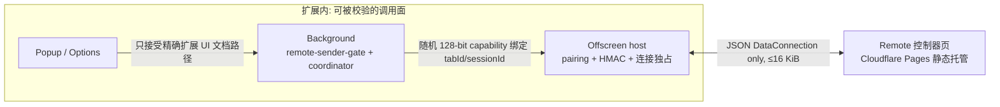
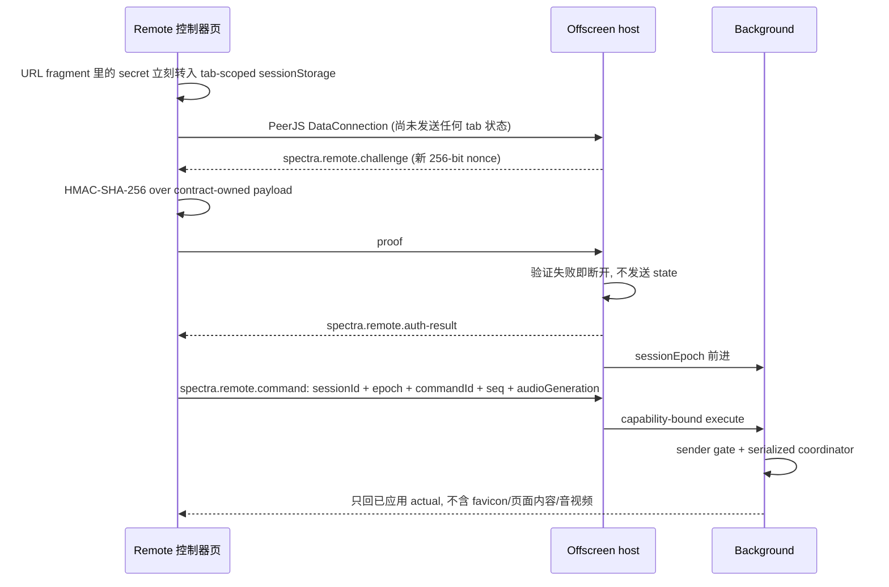

# SPECTRA authenticated remote protocol V3

This document is the sole owner of remote pairing, HMAC authentication, PeerJS/offscreen session binding, reconnect expiry, and network disclosure. Cross-context envelopes remain owned by [runtime protocols](../reference/protocols.md); media-control semantics remain owned by [control architecture](../control/README.md).

## Trust boundaries

图的三个箭头各有一条拒绝规则：`origin` 前缀匹配被拒绝（会放进任何同源文档）、
缺失 `sender.url` 被当成拒绝而不是准入、非 `offscreen.html` 或错 capability 的
命令事件一律丢弃。

- Popup creates, inspects, or closes a session only for an explicit `tabId`; closing also requires the matching `sessionId`.
- `spectra.remote.session.*` is admitted only from an exact extension-UI document. `remote-sender-gate.ts` requires this extension's id, no owning tab, a `chrome-extension:` URL, and a pathname in exactly `{ popup.html, options.html }`. An origin-prefix match is forbidden because it would admit every same-origin document added later for unrelated reasons, and a missing `sender.url` is a rejection rather than an admission.
- Background binds a random internal capability to `{tabId, sessionId}` and accepts command/sync events only from `offscreen.html` with that capability.
- The offscreen host owns the live Peer transport, pairing secrets, HMAC verification, connection exclusivity, command sequences, and reconnect expiry. Both controller and host consume the same workspace-owned PeerJS 1.5.5-derived data-only ESM source; it admits JSON DataConnection traffic only, enforces a 16 KiB UTF-8 limit before parsing or sending, and contains no media, binary/raw serializer, runtime package, CDN, or global-owner path.
- The remote page receives the secret through a URL fragment, which is absent from the Cloudflare Pages HTTP request, and moves it into tab-scoped `sessionStorage` immediately.
- The static controller owns no wire implementation. `remote-site/dist/protocol.js` is generated from `src/remote/protocol.ts` and exposes `globalThis.SpectraRemoteProtocol`; version, challenge payload, HMAC proof, and wire validators therefore have one implementation.

## Pairing and authentication

Each session has independent Web Crypto values: 128-bit session ID, 128-bit PeerJS ID component, 128-bit secret, and 128-bit Background capability. An unused pairing expires after five minutes.

图中的顺序是唯一顺序：challenge 之前的任何 tab 状态发送都是泄漏，auth-result
之前的任何 command 都是未授权数据，验证失败之后不存在"降级为只读"的分支。

1. Host accepts a PeerJS data connection but sends no tab state.
2. Host sends `spectra.remote.challenge` with a fresh 256-bit nonce.
3. Controller signs the contract-owned payload `spectra-remote-v<version>\n<sessionId>\n<nonce>\n<version>` with HMAC-SHA-256. `REMOTE_PROTOCOL_VERSION` in `@nexus/contracts` is the only version source; `src/remote/protocol-core.ts` derives the payload from it.
4. Host verifies the proof and sends `spectra.remote.auth-result`.
5. Only then may the host send `spectra.remote.state` or accept `spectra.remote.command`.

Successful authentication advances `sessionEpoch`. Commands carry the exact session ID and epoch, a bounded `commandId` receipt identity, a strictly increasing safe-integer sequence, and current audio generation. Unknown commands, duplicate receipts, replays, old epochs, stale generations, a second controller, and unauthenticated data are rejected. Receipt/pending-connection sets are contract-bounded. A disconnected authenticated controller has two minutes to reconnect. Connection exclusivity is evaluated when a transport actually opens and again when its proof commits: a candidate signaled while the old controller is connected may use the reconnect window if the old transport closes before the candidate opens, but it cannot displace a controller that is still authenticated at either check. Delayed open/disconnect/close callbacks prove the complete current Peer tuple before they may recover or retire transport.

## Unified offscreen integration

`src/offscreen-remote/remote-host.ts` exports `createRemoteHostController()` and does not register global listeners. Unified `src/offscreen/index.ts` owns integration and delegates exact message families. Capture/HELLO and empty Remote queries do not load the controller or transport. The first explicit `REMOTE_HOST_CREATE_SESSION` dynamically loads the Remote module. Its offscreen-local single-flight loader imports exactly one local `peerjs-vendor.js` ESM default export built from the extension-owned `vendor/peerjs/peerjs.min.js`, the canonical source projected to the Remote page. The loader rejects a missing/non-callable export and never assigns `globalThis.Peer`; there is no CDN fallback, polling, background retry, compatibility global, runtime `peerjs` package, or second session owner. Timeout, disposal, and attempt fences settle only the initiating/current load.

The unified runtime calls the lazy Remote disposer during `pagehide`, aborting an in-flight vendor load before destroying pending/active sessions. Background owns the remote offscreen lease for the entire session and releases it only after explicit close, tab close, pairing expiry, or reconnect expiry.

## Internal host messages

| Message | Required fields | Result |
| --- | --- | --- |
| `REMOTE_HOST_CREATE_SESSION` | `tabId` | internal session including capability |
| `REMOTE_HOST_GET_STATUS` | `tabId` | exact session or `null`; no fallback |
| `REMOTE_HOST_CLOSE_SESSION` | `tabId`, `sessionId` | closes only an exact match |
| `REMOTE_HOST_SEND_STATE` | `tabId`, `sessionId`, validated state | sends only to an authenticated connection |
| `REMOTE_HOST_DESCRIBE` | none | sessions for service-worker recovery |

The host emits capability-bound execute, sync, status, and closed events so Background can validate command ownership and clean leases. Execute, sync, and status events retain an internal Chrome response channel until restoration, authorization, Content READY, and handling settle; this channel is a worker-lifetime barrier, not a remote command success ACK.

## Release evidence boundary

The installed-Chromium gate loads the production extension and the checked-in Remote page. It observes the exact local PeerJS ESM request and default-export validation, then uses a DevTools call-frame breakpoint at the loader's `createPeer` boundary to replace only the external signaling constructor with a deterministic, in-process Peer-compatible transport. No production file, module graph, protocol handler, or runtime global is rewritten. The gate still executes the production HMAC challenge, authenticated epoch/command envelope, unified offscreen host, Background authorization, exact-state delivery, Content control, two service-worker restarts, and lease cleanup. A passing gate therefore proves product code and lifecycle behavior without turning availability of public `0.peerjs.com` into a source-code verdict. The separate provider lane owns real PeerJS/STUN/TURN availability.

The release gate separately verifies the deployed Remote site's files, CSP, canonical local transport source, MIT provenance, JSON-only/16 KiB boundary, disclosure, and build identity, including the generated `dist/protocol.js` and `vendor/` projections. It also proves that every projection matches its extension-owned source byte-for-byte, that the page consumes the protocol before its own scripts, that the extension output is derived from that transport source, and that neither surface imports the retired `peerjs` package or `uqr` runtime. Public PeerJS/STUN/TURN reachability remains an external service-availability fact: an outage is reported as transport infrastructure, not converted into a product failure or a fabricated product pass.

## Network disclosure

The static controller is served by Cloudflare Pages. PeerJS uses `0.peerjs.com` signaling, Google STUN, and PeerJS TURN relays when necessary. These services may observe IP addresses and connection metadata. After authentication, only selected-tab title/domain and media-control state/commands travel between paired devices; favicon, page content, browsing history, audio, and video are excluded.

Any provider, endpoint, retention, or transmitted-field change updates this document, the privacy policy, permission/data-use declarations, remote-site CSP and disclosure, store copy, tests, and release gate in one change.
