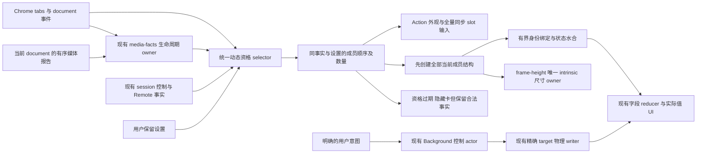
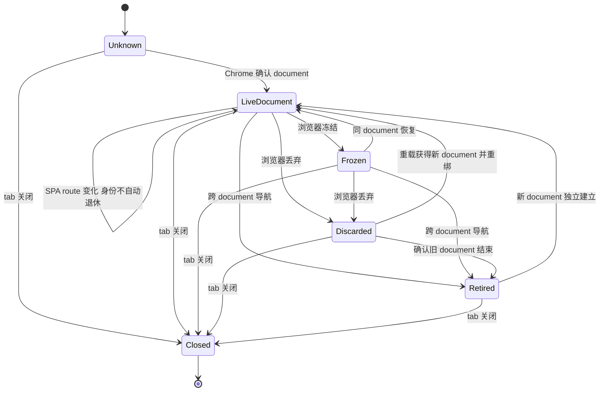
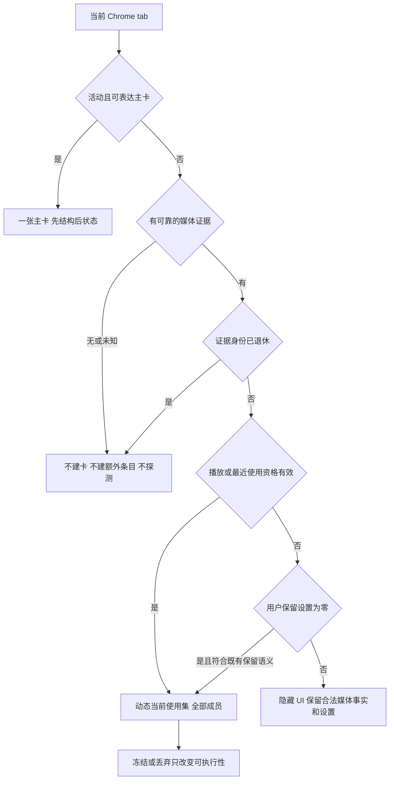
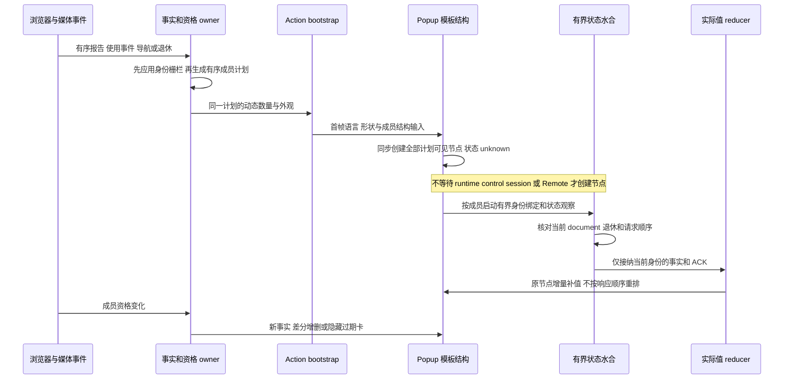
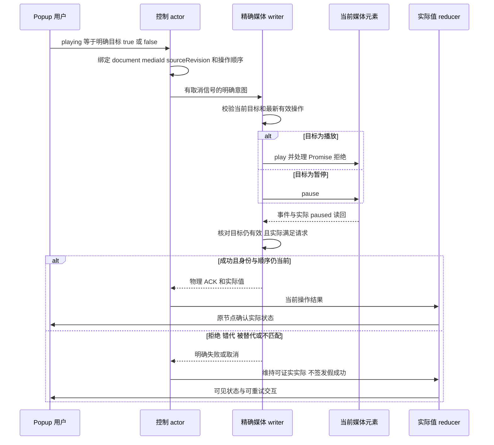

# SPECTRA 标签页生命周期、动态卡片与 Popup 首帧闭环记录

## 范围、权威与当前进度

本记录保存 2026-11-02 用户约束、源码审计、反例和实施检查单。它是任务研究与进度记录，**不签发实现 authority，不表示下面的目标已经全部实现**。审计基线为 `dd3c18f7`；实施进度另列，最终以主线程冻结树和证据为准。中间开发包的首帧浏览器证据只覆盖明确列出的用例，不签发生产包或发布 PASS。

当前行为 authority 仍为[控制架构](../../apps/extension-spectra/docs/control/README.md)、[媒体与视频](../../apps/extension-spectra/docs/control/06-media-and-video.md)、[运行时架构](../../apps/extension-spectra/docs/architecture/runtime.md)、可执行 contracts、实现和真实机制测试。规范更新须回到这些唯一 owner，不能把本记录变成第二份长期规范。

本任务只根治同一 SPECTRA 工作区的事实排序/退休、卡片资格与首帧、媒体切换后倍速恢复和显式播放控制。复用现有 Chrome API、事实存储、控制 actor、模板和 reducer；不引入包、通用框架、站点特例或 HTML 快照注入。

## 最新用户约束

- 主卡表达当前活动标签页，正常可控上下文只有一张；限制页面继续遵守已有可控边界。
- 后台按正在播放、最近实际使用、仍有效的暂停保留等资格，动态渲染实际成员。**不能固定两张、固定总数、固定展示容量或只取前若干张**。数据验证、队列和并发安全上限不等于 UI 名额；成员多时沿用整个文档滚动和 Chrome 600px 高度边界。
- 数十个已知旧媒体不能全部展开。最近资格过期仅隐藏当前 UI 卡，保留合法媒体事实、设置和意图；不增加旧媒体待看库、折叠列表或历史列表。再次主动访问使合法成员重新获得资格。`pauseRetentionSeconds=0` 沿用用户已有的持续保留语义，不能硬编码新的超时。
- 真正从未打开、未加载且没有媒体证据的标签页不探测、不创建卡或其它列表条目。Chrome audible 的真实证据与有效 document 报告可使其获得资格；未知不是待发现列表。
- frozen/discarded 是浏览器执行和驻留状态，不等于 paused、无媒体或事实退休。丢弃后的旧控制 target 必须失效；可保留有来源的历史资格，但不得向旧 document 发写入或显示旧 actual 为当前实值。
- 所有已计划可见卡先创建结构，再异步确认状态；状态 RPC、Remote、Capture 和单卡慢响应不得延迟结构。首帧语言正确，不能先显示英文再纠正；节点水合后复用，不靠隐藏整页、增加延时或重建 HTML 消除闪动。
- 视频 A 的 2x、直播 B 的 1.5x、返回 A 的 2x 必须隔离；直播能力失败也不能污染 A 的恢复意图。SPA 地址改变不自动产生新 document/source，也不能自动清空倍速。
- `playing` 用明确的 play/pause 目标表达。未知实际状态不得参与盲目反转；实际确认前保持可见 pending/unknown，拒绝和过期结果不能签发成功。

## 审计基线路径与已证实根因

| 机制 | 当前真实入口 | 缺口及证据边界 |
| --- | --- | --- |
| 成员发现 | [media-inventory.ts](../../apps/extension-spectra/src/background/media-inventory.ts)、[media-inventory-runtime.ts](../../apps/extension-spectra/src/background/media-inventory-runtime.ts) | 已是 durable media-facts 与 Chrome audible 的投影；不是全标签 DOM 扫描。当前 sorted tabId 不表达最近使用排序；当前 controllable 排除 discarded，不能据此推导其无媒体 |
| 报告顺序 | [handlers/tab-state.ts](../../apps/extension-spectra/src/background/handlers/tab-state.ts)、[media-facts.ts](../../apps/extension-spectra/src/background/media-facts.ts) | reportRevision 在 tabAudioStates，事实在另一 Map；inventory 的 bookkeeping 清理可以删除排序见证。顺序不能依赖展示/音频近期清理 |
| 水合与退休 | [media-facts.ts](../../apps/extension-spectra/src/background/media-facts.ts)、[lifecycle.ts](../../apps/extension-spectra/src/background/lifecycle.ts) | 水合只比较已有 fact.at；forget 后没有退休见证，旧持久事实可被异步水合复活。report 时间不是 document 代际或暂停起点 |
| 预留窗口 | [popup-frame.ts](../../apps/extension-spectra/src/background/popup-frame.ts)、[popup-bootstrap.ts](../../apps/extension-spectra/src/shared/popup-bootstrap.ts) | URL 提供 cards/main/lang/viz；数量只决定形状，没有传递完整后台成员计划。count 与最终 card 的保留判定不是一次决策 |
| 首帧结构 | [popup-first-paint.ts](../../apps/extension-spectra/src/popup-first-paint.ts)、[popup.html](../../apps/extension-spectra/public/popup.html) | 仅预绘制主卡；后台 header/badge/stack 初始为空。预留高度不能证明卡片已存在 |
| 后台初始化 | [index.ts](../../apps/extension-spectra/src/popup/index.ts)、[bounded-card-bootstrap.ts](../../apps/extension-spectra/src/popup/bounded-card-bootstrap.ts)、[card/init.ts](../../apps/extension-spectra/src/popup/card/init.ts) | Popup storage forecast 和后台 inventory RPC 都启动；后台等待 readCardSnapshot，再做 retention，最后 clone DOM。8 路并发约束不能解释两张卡彼此串行，但每张都会独立等状态 |
| 缓存与实际读取 | [card/snapshot.ts](../../apps/extension-spectra/src/popup/card/snapshot.ts) | 后台 cache 命中仍 await live control；cache miss 等 runtime/control/session/Remote，单路观察预算 5s。主卡 readInitialCardSnapshot 已不等待这些 RPC |
| DOM 身份与状态 | [dom-init.ts](../../apps/extension-spectra/src/popup/card/dom-init.ts)、[messaging.ts](../../apps/extension-spectra/src/popup/card/messaging.ts)、[top-document.ts](../../apps/extension-spectra/src/shared/top-document.ts) | 应复用模板节点、exact document fence 和 reducer；不能为了快而删除身份核对或把缓存 playing 当实读 |
| 倍速与播放 | [media-registry.ts](../../apps/extension-spectra/src/content/core/media-registry.ts)、[native-media-executor.ts](../../apps/extension-spectra/src/content/logic/native-media-executor.ts)、[media-route-projection.ts](../../apps/extension-spectra/src/background/media-route-projection.ts) | document、route、mediaId、sourceRevision、选择访问分别处理；恢复与物理 ACK 必须落在精确目标。具体改动和验证尚待完成 |

主线程于本任务执行的 Bun stdin 反例（未生成测试文件）已经证实：

| 反例 | 操作与观测 | 状态 |
| --- | --- | --- |
| `inventory_read_drops_ordering` | found rev2 → 读取 inventory → `first listed=[881]`、`orderingRowSurvived=false` → 旧 no-media rev1 → `afterOlderReport='no-media'` | 排序根因已证实；永久回归和修复待完成 |
| `forget_before_hydrate` | ready 水合悬挂 → forget(882) → 存储返回旧 retired-document found → `retiredFactRestored=true` | 退休根因已证实；永久回归和修复待完成 |
| `cached_background_card` | 已有 cache，live RPC 人为 gate；20ms 后 `returnedBeforeLiveRead=false, rpcReads=1`；改读 readInitialCardSnapshot 时 `additionalRpcReads=0` | cache 命中仍阻塞已证实；不能单独换函数而绕过 retention |

以上是主线程报告的定向反例结果，不是本记录签发的修复 PASS。旧 owner 文档还有明确漂移：[媒体与视频 §13.1](../../apps/extension-spectra/docs/control/06-media-and-video.md#131-document-level-inventory) 仍描述 Popup allFrames census，而当前 inventory 已取消扫描；[运行时首帧描述](../../apps/extension-spectra/docs/architecture/runtime.md) 明确保留后台 bounded read/retention 例外。实施后须由主线程同步这些 owner。

## 统一所有权与实施边界

先修事实生命周期，再由同一资格投影得到当前可见与不展示的有序成员及卡数；Popup 不再根据一次晚到的 runtime/Remote 读取二次否决成员。`inactiveTabs` 可保留为内部诊断投影，不产生额外 UI。近期资格时间和暂停时间分别有真实事件来源，不能拿 media-facts.at 或 Popup 打开时间冒充。过期只调整展示资格，导航/关闭等真实生命周期事件才退休精确身份。

冻结恢复依靠原 document 身份继续观察；discard 后等待 Chrome 给出可用的新身份，再绑定当前 target。不可执行的已知条目表达恢复/不可用状态，不伪造暂停，不为展示唤醒页面。列表读取必须纯净，不能清除报告顺序、意图或生命周期见证。

结构计划与卡数由同一纯资格 selector 及已提交保留设置计算。URL 的数量只用于同步预绘制匿名结构，不签发具体成员身份；Popup 从 session facts 使用同一 selector 获取成员，按 tabId 同步分配并稳定排序，再在精确 document 栅栏下绑定。语言、visualizer、保留设置可以作为有限外观输入；不向 URL 添加页面标题、地址或完整状态数据。并发事件形成的过期预测可以差分纠正；不存在“计划里的每张卡必须等 actual 才获得节点”的例外。

该图表达职责边界，是否完成依实施检查单和最终测试决定，不表示新增模块或全部验证通过。优先把职责收敛到现有文件；不要另建共享生命周期引擎。

## 浏览器、document 与媒体生命周期

浏览器驻留状态、document 身份和媒体 source 是不同维度。下面的状态图只表达浏览器/document 线；媒体暂停不会触发 document 退休。SPA route 切换由现有目标选择和 source 事件处理，只有证据证明 source 改变才推进 sourceRevision。

事实 owner 的退休见证要早于并发水合返回生效；旧数据即使带更晚墙钟时间，也不能越过当前 document 退休栅栏。reportRevision 只在精确 document 内比较，不能用 tabId 或 report 时间代替身份。

## 动态卡片资格决策

主卡与后台卡共用结构/水合机制，资格来源不同。后台当前使用集没有固定容量；真实使用/播放记录决定资格，当前实现按 tabId 稳定排序，不宣称按最近使用排序。稳定顺序和数据校验界限进入可执行规格，响应先后不能改变顺序。

该图是资格规则与验收目标，不把 Capture/Remote 状态猜作媒体播放。未知证据与确定 no-media 分开，禁止通过超时删除已证实事实；不把内部 inactive 结果扩展为第二套可见待看库。

## Popup 首帧与水合顺序

结构发布和实际确认分别有可观察状态。`spectraReady` 不能继续兼任“所有实时读取结束”的首帧证明。慢卡、失败卡和永久 pending 的底层操作不应阻塞其它结构；底层真实操作未结束时仍保有物理并发许可，逻辑 timeout 不得凭空释放。

## 明确播放目标与物理操作时序

快速点击须按已有 actor 的顺序与取消规则收敛到最后有效的明确目标，不再用旧 playing 快照重复反转。`play()` 的用户激活拒绝是物理失败；mute/unmute 的浏览器策略不能被归因为 UI 已成功播放。

## 倍速与场景验收矩阵

| 场景 | 要保护的业务结果 | 所需证据 |
| --- | --- | --- |
| A 视频已确认 2x → B 可调直播设置 1.5x → 返回 A | B 保持自身 1.5x；A 恢复自身 2x；直播值不成为后继视频模板 | 精确选择访问、目标 ACK、实际 speed 与页面标签 |
| A 2x → 不支持调速的直播 → 关闭直播回 A | 不伪造直播 1.5/2x；A 意图不被物理 1x 或失败覆盖 | 真实能力拒绝与 A 返回后的实际确认 |
| 关闭直播 modal、SPA 后退/前进、复用 video、创建新 video | route 与 source 分开处理；只写当前精确 source，预载媒体不偷目标 | 同 document 多 source 和多次往返测试 |
| A 元素被网页重置、冻结/恢复、discard 后新 document、worker 重启 | 同 source/新 source/新 document 各按既有恢复边界；不借旧身份写入 | 生命周期与 durable 状态联合回归 |
| 关闭 Popup、重新打开、恢复网页设置 | Popup 观察租约关闭不重置已控倍速；显式恢复网页设置后不能复活旧模板 | 意图保留/释放及 lease readback |
| 任意动态成员数，包括超过 8 张、总高度超过 600px | 全部当前成员先有结构，水合限流不等于展示名额，整页滚动 | 参数化成员矩阵与原生 Action Popup 首帧观测 |
| 数十个旧 known、最近资格过期、设置为 0、无证据 unloaded | 旧 known 超期隐藏但保留合法设置；0 遵守现有语义；unknown 无卡无额外列表且无探测 | 假时钟资格测试与请求计数 |
| 单卡控制/Remote 永久 pending，cache hit/miss | 所有计划结构不等 RPC，actual unknown；hydration 不替换节点 | gate 反例转永久测试及 document-start 观测 |
| 快速 play/pause、初始 unknown、原生拒绝、导航中切换 | 明确目标、可取消顺序、实际读回；旧 ACK 不污染新状态 | actor/writer 回归与真实媒体行为 |

已有 [popup-frame-geometry-chrome.spec.ts](../../apps/extension-spectra/test/popup-frame-geometry-chrome.spec.ts) 先等 `spectraReady` 和最终卡数再测几何，不能证明后台卡首帧已存在。[card-snapshot.spec.ts](../../apps/extension-spectra/test/card-snapshot.spec.ts) 的旧后台读取合同要求首帧前确认实际播放，实施时需按新的结构/actual 边界更新，不能保留相反断言再宣称全通过。

## Popup 子任务实施与验证进度

2026-11-02 已在当前工作树实施：render-blocking prepaint 按动态 `cards - mainCount` 创建全部后台模板 slot；index 在每卡状态读取前按成员分配同一节点，8 路并发仅限制水合。主/后台均调用不含状态 RPC 的 readInitialCardSnapshot，移除 init 内 retention 二次裁决。frozen/discarded/unloaded 的已知成员以及缺 document 的成员只提供不可用状态和显式返回入口，不建立可写 controlPort，不进行控制/运行时/会话/Remote 探测。

成员读取优先 session 同源投影，失败才 fallback visible.list；session facts 与 Chrome tabs 事件由一个串行合并 refresh owner 处理，唯一 nextExpiryAt timer 负责到期重算，不轮询。初始 retention 优先取 Action URL 的已提交值，避免 Options 改为 0 后旧 Popup forecast 仍按 60 秒计算。settings 水合若保留设置未变，不额外读取同一成员集合。

最终审计补齐关闭期间的到期反例：数量公告单独携带时，worker 未唤醒会让过期成员先产生空 slot 再删除。唯一资格 selector 现在输出 `expiryByTab`，Action 只携带排除主卡后的匿名 `expires` 时间数组；prepaint 在创建节点前按当前时间扣除到期项，不依赖 alarm 准时性，不增加页面身份或控制权限。开放 Popup 仍使用同一 selector 和一个 nextExpiryAt timer。相关纯策略、URL 与 canonical/UI guard parity 回归已加入；真实 Chrome 用例包含关闭期间到期后重开。

当前已记录证据：

- 聚焦 `card-snapshot.spec.ts`、`popup-frame.spec.ts`、`popup-volume-ux.spec.ts`：32 PASS，105 assertions；包括 retain=0、合法上限、非法 query 和 unavailable messaging 不观察边界。
- canonical strict Biome：10 个修改 TypeScript 文件 PASS，0 diagnostics、0 silent handlers。
- 一次中间 `build:dev` PASS；其产物上原生 Action Popup document-start 首帧 0/3 后台样本共 2 PASS、18 assertions。测试拦截 popup.js 与六类 live RPC，模块执行前匿名结构已存在，释放模块后保持同节点、中文与 mixed playing；样本先真正载入媒体并经 Chrome 激活记录 usedAt。
- 后续增强用例增加真实 Chrome discarded 成员、无该成员状态读/可写 port、storage 成功无 visible.list 请求的断言；增强后的浏览器结果及后续代码小修需要由最终冻结产物重新验证，不能借用上面的中间 PASS。

生命周期自查后的实现已经补齐：超过并发数、尚未进入 initCard 的预分配节点有独立 attempt cleanup；init 接管或成员退休时注销该结构 cleanup，避免重试残留或成员变化积累引用。document 替换会重新进入成员绑定，并补回缺失主卡；startup-error 清理所有未绑定 slot。

正常窗口已退役历史高度补偿：classic frame-reserve 仅处理 theme/surface，不读取 cards 或任何 height hint；完整预绘制 slot 完成即标 `data-spectra-structure-ready`。frame-height 只按当前容器 intrinsic 尺寸与 600px 上限确定窗口和单一滚动面，观察者回调依旧 RAF 合并并由退休 revision 栅栏保护；不读写旧 count/last/legacy heightcache，不等待 `spectraReady` 或 actual 水合，不保留高度动画。`data-spectra-ready` 仅表达实际成员结构已提交。

上述新增 frame 机制与现有 Popup 聚焦测试共 50 PASS、163 assertions；15 个修改源码/测试/构建注入入口文件 strict Biome PASS。head-script 回归覆盖旧 600px hint → 新一张卡、同数量 viz 开/关、未公告或非法 count，一律不读取历史高度；live frame 单测从 600px 立即按 352px intrinsic 重算，拒绝任何历史 height 读写，并保持 observer 合并、600px cap、单滚动与退休保护。最终 Chrome 首帧、不可用卡与生命周期联合验证仍待主线程冻结产物。

## 实施检查单与退出条件

### 集成验证发现与处理

首次完整单元运行发现三组失败：pause tracker 的无 DOM 调用边界、Remote fixture 仍期待旧的 Background read/negate/write 路径，以及沙箱阻止发布工具 fixture 的本地回环连接。前两组修到唯一 accessor/真实 operation 路由，回环 fixture 在授权环境重验；随后 canonical `test:unit` 的 130 个隔离文件全部通过。后续集成修改仍须验证受影响闭包。

首次生产 Chrome 联验中，匿名首帧 0/3/关闭期间到期三组通过，但同时暴露了真实控制边界遗漏：精简 Content guard 缺少已实现 playback-toggle、非媒体 PiP/release ACK 被全局 native stamp 门禁误拒、首次 native play 可能建立初始 selection 而使自己的 ACK 被判旧 visit。这些必须修到各自 owner 并保留反例，不能以单测 PASS 签发浏览器完成。

初始 selection 现由完整 discovery 批次同步建立，首次 own play 不再承担初次选择的职责；晚出现的暂停媒体同样在 Mutation 批次结束时建立并报告选择，不等 play 兜底。真实 registry/executor 冷首播放、页面抢回播放和 A→B 在途 ACK 隔离反例均已固化。快速点击另有明确 RED：页面已先报告 playing=true、前 ACK 仍 pending 时，旧 early-return 吞掉第二次暂停点击。现复用 `createSerializedToggleQueue`，以 actual 和前次结算产生后继明确目标，未知状态才用 Content 本地 toggle；不新建通用队列。真实 bind/update/RPC-guard gated 用例覆盖已知与未知 initial actual。

复用节点从 runnable 进入 frozen/discarded 时，遮罩的 class、DOM hidden、aria-hidden、inert 和 tabIndex 必须作为一个投影整体切换。`setCardMaskVisible` 统一所有入口，避免 class 已显示但旧 hidden/inert 仍锁住“返回标签页”；同对象多次恢复循环的 7 维断言已加入，真实 Chrome 的两次 discard/点击恢复循环纳入最终验证。

另有三处旧 Chrome 断言与新业务合同相反：纯 snapshot.get 不再是 restore 初始化屏障；直播自身倍速不应覆盖返回视频的倍速；route settlement 自动升级迟挂载 controller 后，后继显式写入应成为第二次写。用例已改为先建立物理基线、A2/B1.5/A2 的独立 scene 断言，以及分阶段精确写入计数，不放宽实际值或超时。

工作流收敛：先跑受影响纯机制和真实生产入口的 strict parity，再在单一冻结产物验证 UI；测试 fixture 用 HAVE_METADATA、Chrome active tab、session found/usedAt readback 证明资格，不使用固定等待或直接写媒体事实。生产构建的诊断 console 门禁还拦住了两个隐式返回 debug 调用的 catch，已改为无返回日志语句，未放宽构建规则。

公开投影曾是独立阻断：`spectra-public` 原有 8 项 dirty，canonical 同步器会全量替换目标，不支持仅补缺文件且保留 dirty 的 apply。用户随后明确授权“直接覆盖 public”“不用保留”，因此可丢弃这 8 项旧改动，再从已提交 source 经 canonical 同步器生成；不做备份、不扩大 baseline，也不把临时候选冒充实际目标。同步、最终架构检查与推送结果另列，授权本身不是 PASS。

生产构建另有非阻断体积复审信号：Popup 包含 prepaint 的可能脚本闭包约 286.7 KiB，关键入口包含九种首帧词典。后续同工作区优化应先实测模块闭包并保持“首帧正确语言、全量结构”的合同，不能把语言异步加载回退为英文闪现；本任务不以提高阈值关闭信号。

- [x] 静态审计实际入口，确认数量预留与后台节点创建分离。
- [x] 主线程定向反例证实排序见证丢失、水合复活和 cache-hit 实读阻塞。
- [x] 固化动态成员、未知无条目、冻结/丢弃独立维度和明确播放目标约束。
- [x] 事实 owner 修复 document 内有序报告与退休先于水合的约束，并将反例转为永久测试。
- [x] 统一动态资格、真实近期时间、用户保留设置、稳定顺序、count 和成员计划；移除 card 层二次资格裁决。
- [x] 全部计划结构先创建，主/后台共用原节点水合路径；count 不承载控制权限，保留设置同步进入 appearance。
- [x] 实现预分配节点 cleanup、接管注销与主卡 document 替换后重新绑定；最终浏览器生命周期验证仍待下项。
- [x] 退役所有历史 height 预测/持久化补偿；旧 600px、未公告与同 count 不同 viz 的 head/live-frame 聚焦反例通过。
- [x] 最终 Chrome 产物覆盖不可用后恢复、两轮 discard/点击返回、0/3/11 后台首帧、超过 8 路的排队水合及同成员刷新零节点移动；startup-error/重试另由单元与 bootstrap 用例覆盖，不宣称专门的 Chrome 故障注入已验证。
- [x] 单元/契约与 Chrome 组合覆盖冻结、discard、恢复、新 document、tab 关闭及 worker 重启边界；实际证据分层见下表，不把所有生命周期组合均称为实机穷举。
- [x] 实现并以最终 Chrome 验证 A2x → B1.5x → A2x、再次返回 B1.5x，以及不支持调速直播返回 A 的隔离。
- [x] 显式 play/pause、unknown UI、快速切换、取消和实际 ACK 经 actor/writer 单元及最终 Chrome 物理播放用例闭合。
- [x] 更新 runtime 与 control 唯一 owner 中过时扫描、后台首帧例外和资格描述；本记录只保留研究与进度。
- [x] 最终运行时实现通过 canonical 131 文件单元、类型与生产构建；最终生产产物通过完整 Chrome 73 场景。最终文档与公开投影门禁另列，不借用中间定向 PASS。
- [x] 开发包仅为中间证据；最终生产包、真实浏览器与未验证边界分别登记如下。

### 最终冻结实现验证记录

| 层级 | 当前证据与边界 |
| --- | --- |
| 单元/契约 | canonical `test:unit`：131 个隔离文件全部 PASS。之后只收紧可用绑定回调的类型联合、调整 Chrome fixture，无运行时行为修改。 |
| 类型 | canonical `typecheck:spectra` 四个包 PASS；最终回调类型收紧后应用 canonical `typecheck` 再次 PASS，不用裸 tsc 第二入口。 |
| 静态与文档 | 最终源码/测试写集 strict Biome：78 文件、0 diagnostics、0 silent handlers；canonical docs strict：131 Markdown PASS；runtime/control/research 共 19 个 Mermaid 图静态 PASS，未宿主渲染。 |
| 生产构建 | 最终 production build PASS，bootstrap 1.4.0 / runtime 3.7.0；88/89 可达资产，1 个已登记 release notice，0 重复。document_start 36.0 KiB、worker 291.6 KiB、JS 901.4 KiB、dist 1011.7 KiB；lean hotkeys 10385 bytes，低于 32768 bytes 门禁。 |
| 完整 Chrome | 最终生产包 `test:smoke`：73 PASS、0 FAIL、605 assertions，9 文件，90.08 秒；包含媒体场景与倍速、自由倍速 UI、音量、Playback、Capture、Remote、快捷键、OSD、visualizer、bootstrap 和 Popup。 |
| 首帧与并发 | 原生 Action Popup document-start 拦截模块与 live RPC，0/3/11 后台均在状态水合前具有全部结构；中文、mixed playing、同节点、无可写 discarded IPC、无重复 visible.list、关闭期间到期后重开均通过。11 卡样本断言实际 runnable 超过 8，约 2.3 秒完成准备、阻断、同成员零移动与清理；Chrome 实际冻结的暂停 tab 不能充当超过并发数的 runnable fixture。未提高超时或放宽节点断言。 |
| 几何与启动 | 最终运行时的 `popup-frame-geometry-chrome.spec.ts` 与 `popup-inventory-latency.spec.ts`：8 PASS、0 FAIL、69 assertions，89.46 秒；600px cap、底部 24px 空白、单滚动、viz intrinsic 高度、忽略旧高度缓存、无 ResizeObserver loop。每轮 1 主卡和 2 后台；cold 两样本平均 335.1ms、warm 两样本平均 275.1ms，仅为该机并发测试样本，不签发性能上界。 |
| 架构 | 同步后 verifier 自测 24 PASS、58 assertions；架构 0 errors、6 warnings（4 个 response coverage、2 个文件长度）；public-parity 0 errors、0 warnings。259 个 shipped app source 与实际 public checkout 字节一致，baseline 收紧到 0 differing、0 missing，未放宽规则。 |
| Public 生成 | canonical APPLY 从已提交 source 全量投影 396 文件，经 public 自身 lint、4 包 typecheck 和 production build PASS 后自动提交；原有 8 项 dirty 按用户要求直接丢弃，无备份。检查覆盖全部生成变更路径、metadata/privacy 投影和新增 probe；没有导出内部文档或 agent 目录。随后发现的既有 badge 尾空行回到源文件删除，再经生成器更新，不手改 public。 |
| 未验证层 | 用户当前登录的抖音页面未被接管；浏览器证明使用隔离 Chrome fixture。没有商店发布、正式 release receipt、所有生命周期排列的穷举或专门的 startup-error Chrome 故障注入；Mermaid 仅静态检查，未宿主渲染。 |

当前最终物理产物是 `apps/extension-spectra/dist` 的生产构建，不再用开发包覆盖。浏览器测试使用现有 fixture 和退出清理，未添加后台服务、通用监视器或临时脚本。后续公开同步只通过现有生成器；不保留用户已明确要求丢弃的 public dirty 备份。

提交闭环发现并修复 Git pre-commit 的既有降级缺陷：Windows nested MSYS 失败后，旧 shell 字符串拆分丢失 root/workspace 基址并漏跑 docs。现复用已有路径投影，使用 Git NUL 输出和原生子进程参数数组，调用原 canonical strict Biome/docs owner，并保留失败退出。该改动只影响本次必要交付入口，不改变已验证的产品运行时；路径含空格/换行、根目录资产、混合及纯文档提交均进入 hooks 回归，不绕过 gate。

交付入口聚焦验证：hooks 152 PASS；strict Biome scope/report 和 workspace coverage 联合 19 PASS、73 assertions。strict owner 直接把已校验、已过滤的文件集合传给 Biome，保留所有数量和零诊断门禁，避免外部显式 generated 路径额外进入扫描；真实子进程反例已固化。最终提交入口实际通过 80 文件 strict、131 Markdown 和 commitlint。26 个旧混合换行文件仅从 exact HEAD blob 恢复 LF，读回与 public 相同，不产生语义 diff，也未修改 verifier 来容忍字节漂移。最终推送仍以实际 pre-push 门禁和远程 readback 为准。

2026-11-02 文档更新后静态检查记录：canonical `bun run docs:check --path nexus/docs/research/2026-11-02-spectra-tab-lifecycle-popup-closure.md` PASS（1 Markdown，strict）；Mermaid skill 的 `mermaid_tool.py lint` PASS（5 图，diagnostics 为空，evidence 为 static，未生成产物）。指定 Popup 写集 `git diff --check` PASS。未进行 Mermaid 宿主渲染或发布验证。

静态 lint 只证明其覆盖的语法、结构和链接，不证明浏览器首帧或业务完成。主线程继续逐项更新本检查单，完成前不得将待办描述改写成已发布行为。
