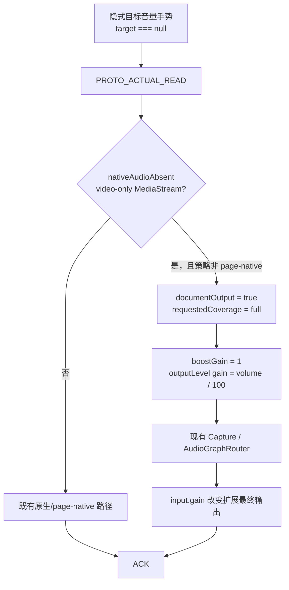
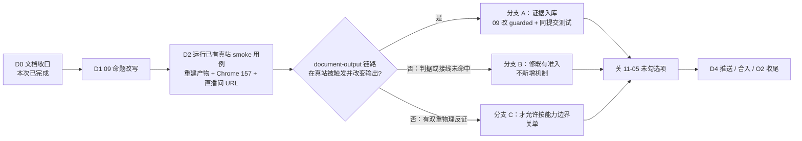

# SPECTRA 音量可听路径重审与收口方案 v2（2026-11-14 复审）

> 本文就地替代同日发布的 v1，不另建第二份方案文档，避免两份结论互相冲突。
> 结论只对本工作区 HEAD `0b907ee0`（2026-11-11 23:03）成立。
> 本文不实施任何产品源码改动；[09 故障索引](../../apps/extension-spectra/docs/control/09-failure-index.md)是规范侧的受体。
> 落地顺序见 §7，v1 到 v2 的逐条修订见 §11。
> **v3 收口（同日稍后）见 §13**：§0 与 §12 里"缺真站证据""09 仍为 open"的判断已被
> 当前 HEAD 的真站证据取代。历史段落保留，用于说明当时的推理，不再代表最终状态。

## 0. 复审结论摘要

**v1 的核心定性被推翻。** 它把可听音量判成"物理能力边界，控制逻辑层不可能影响"，
并据此给出"找官方 API 或关单"的二选一。当前 HEAD 的事实是：这条路径**已经实现并接线**，
用的是 11-05 审计里既定的第三条路——复用现有 tabCapture 与 `AudioGraphRouter`，
用独立的 `outputLevel` 表达 0–100，而不是放宽 `boost` 值域，也不是全局音频图拦截。

| # | v1 判断 | v2 结论 | 依据 |
| --- | --- | --- | --- |
| 1 | 可听路径是能力边界，控制逻辑不可能影响 | **错误**。`documentOutput` → `outputLevel` 链路已在 HEAD 完整接线 | §2 的代码清单 |
| 2 | D3 只能在"找到 API"与"按边界关单"之间二选一 | **错误**。遗漏了已落地的第三条路；真正剩余的是真站端到端验证 | §3 的 11-05 未勾选项 |
| 3 | 加 declared 行不会被消费 | **部分错误**。候选发现、排序与 `adapterId` 都消费它，缺的只是 `volumeBase` 的 declared 能力分支 | §4.3 |
| 4 | `2358` 是有意边界、不是缺陷 | 结论保留，**定性不完整**。同一 `target === null` 也是 document-output 的准入门 | §4.4 |
| 5 | 287 份快照含虎牙 68 次与抖音直播 55 次 | **出处串台**。55/55 来自 287 份快照；68 与 17 来自另一份 140 份快照的证据 | §4.5 |
| 6 | D2 需要从零设计一套真站探针 | **不需要**。仓库已有被 `SPECTRA_DOCUMENT_OUTPUT_LIVE_URL` 门控的真站 smoke 用例，只差运行与证据归档 | §7 D2 |

**唯一真正剩余的产品问题（v2 时点，现已被 §13 的真站证据关闭）**：可听音量的实现、生产图级物理证明、
以及构建扩展的 fixture 轮端到端验证都已具备，
但**没有任何针对当前 HEAD 的真站证据**证明这条链路在抖音直播、虎牙与
`live.douyin.com` 上被触发并改变观众听到的声音。11-05 审计里"验证真实直播控制"
一项至今未勾选。这是验证缺口，不是能力缺口。

本次还实测了两次本地验证（§6），结果归档在
`docs/research/evidence/2026-11-14-local-document-output-built-extension-proof.json`，
明确标为 `[E-local-extension]`、`realSite: false`，不用于关单。

## 1. 复审方法

本次只做四件事：逐行读 HEAD 源码、读 `docs/research/evidence/` 原始 JSON、
读 11-05 回归审计的未勾选项与决策段、跑仓库已有的物理证明测试。
不沿用 v1 的任何结论，也不把 v1 的措辞当作待更正的权威。

证据分四级，冲突时按此顺序取信：

- **当前实现事实**：HEAD 源码、manifest 与合同，逐行可核。
- **本地物理证明**：本机 Chrome 上的生产图集成测试，标 `[E-local]`。
- **历史真站证据**：11-01 至 11-05 采集的 JSON，标 `[E-historical]`。
- **文档叙述**：可能与前三者冲突；冲突时以前三者为准。

v1 的方法缺陷是**证据错配**：11-04 的用户确认与快照采自一份带"通用三层解析 +
全局输出 gain 拦截"的**未提交实验产物**，不是当前 HEAD。用旧产物的观测去否定
描述当前产物的 09 行，方法上不成立。

## 2. 决定性事实：document-output 链路已在当前 HEAD 落地

| 环节 | 位置 | 事实 |
| --- | --- | --- |
| 判据 | `native-media-executor.ts` 的 `nativeAudioAbsent` | 只用 `MediaStream.prototype.getVideoTracks/getAudioTracks` 判"video-only 流"，注释明确"never a hostname or player constructor" |
| 上报 | `control.contracts.ts` 的 `nativeAudioAbsent` 字段 | 随 `ControlReadResult` 进入后台，`readback.data` 可核 |
| 准入 | `control-coordinator.ts:625` 与 `:2026` | `implicitOutputControl` 与 `documentOutput` 均要求 `request.target === null`，且 `nativeAudioAbsent === true`、音量策略不是 `page-native` |
| 所有权 | `audio-runtime-control-delegate.ts` 的 `changes.documentOutput = true` | 显式运行时需求，不能作为站点预设或用户偏好导入 |
| 合同 | `audio.contracts.ts:153-154` | `documentOutput` 为真时 `boostGain = 1`，另发 `outputLevel: { gain: volume/100, muted }` |
| 校验 | `audio-processor.contracts.ts` | `outputLevel` 是严格有界类型，`gain ∈ [0, 8]`，拒绝多余键 |
| 物理图 | `audio-graph-router.ts:362-364` | `input.gain` 取 `outputLevel.gain`，`master.gain` 由 muted 决定；Boost 与输出电平互斥 |
| 模式 | `audio.contracts.ts:207` | `if (config.documentOutput) return 'capture'`，复用已有 tabCapture/offscreen 图 |
| 构建扩展测试 | `test/smoke/document-output.spec.ts` | 真 toolbar admission + tabCapture，用 offscreen 的 product graph analyser 作信号 oracle；含一条被门控的真站直播用例 |

共有 10 个生产源码文件与 7 个测试文件引用 `documentOutput`（不含 `dist`）。



这条链路不违反 `SCTRL-053`。该不变量禁止的是"拦截文档音频图、创建输出 gain、
用合成指针驱动站点滑块"，而 `outputLevel` 作用于**扩展自己已经 admitted 的**
Capture 图，且 `nativeAudioAbsent` 用平台 track API 取证，不碰页面图。

## 3. 11-05 审计是 v1 遗漏的权威决策来源

[2026-11-05 直播音量回归审计](2026-11-05-spectra-live-volume-regression-audit.md)
记录了用户授权的处置，v1 完全没有引用它：

- 曾存在 `installOutputGainEdge` 与 `paintNativeVolumeControl`。前者改写
  `node.connect(context.destination)` 却不对称处理 `disconnect`，后者用合成指针事件
  画站点滑块且其 caller 注释与实现矛盾。
- 用户明确授权"Remove the experimental global graph interception and synthetic
  slider driving instead of repairing a second audio engine"。审计随后立下
  `SCTRL-053`，并写明"Do not resurrect a global graph interceptor or fabricate a
  media target to conceal that boundary"。
- 因此当前边界是**已授权的架构决策**，不是物理不可能。v1 把被否决的历史机制
  从因果里抹掉，才得出"控制逻辑层结构上不可能奏效"。
- 审计的 `Implementation plan` 六项里，两项标 `[x]`，四项仍标 `[ ]`：
  track API 判据、Capture/AudioGraphRouter 复用、快照与所有控制表面的输出所有权、
  以及"验证最终处理器输出与真实直播控制"。前两项在 §2 的代码里已可见但审计没有回勾，
  第三项本文未逐项核对，第四项明确仍是未完成的验收动作。
  全仓另有 428 行（公开镜像对账）与 559 行（识别用户加载产物）两条未勾项。
- 审计 644–646 行给出测法："Once product Capture runs, measuring the original tab
  measures input, not the extension's final output; the signal oracle must sample
  the latter." 这正是 11-05 虎牙证据 `rms` 全为 0 的原因。
- 审计 653 行明确："No personal Edge profile may be used for further investigation."
  v1 的验证契约只字未提这条禁令。
- 审计 652 行写明直播事件在用户复报失败后**仍然 open**。

## 4. 逐条更正 v1

### §4.1 核心定性

v1 §0 与 §5 说"11-04 的证据已经证明，在控制逻辑层做的所有修复都不可能影响这条路径"。
`2026-11-04-live-volume-control-snapshot.json` 的 `whyPreviousFixesDidNotWork` 确实这么说，
但那是**当时的产物**。11-05 之后的代码恰恰在这条路径上做了实现。
引用历史证据的结论而不核对它对应的产物，是 v1 最根本的错误。

### §4.2 D3 二选一

该快照的 `openQuestion` 原文给的是**三个**候选：
`(a) processor attenuation via tabCapture`、
`(b) a declared volume adapter for the player's real audio API`、
`(c) hooking the page's output GainNode`。
v1 只保留 (b) 与"关单"。(c) 已被 `SCTRL-053` 明确否决，应当写出来并引用；
(a) 已在 11-05 的实现计划中细化并落地为 §2 的链路。
v1 用"放宽 boost 值域会破坏契约"否决 (a)，是稻草人：正确做法是**独立的
`outputLevel` 标量，`boost` 保持 1–8**，审计 626–629 行就是这么写的。

### §4.3 declared 行是否被消费

v1 §4 说 `capabilityFor('volumeBase')` 不读 `adapter`、硬编码 `declared: false`，
因此"新增行是无效的注册表条目"。前半属实，结论过度：

```text
ADAPTERS.volumeBase = resolveDeclaredSiteAdapter('volumeBase')   // 当前为 null
collectControllerCandidates(element, adapter)
  -> adapter.discovery.globalPaths 参与候选发现
  -> consider(..., declared = true) 让候选带 declared 标记
  -> boundsFor(adapter) 决定扫描深度
findCapability
  -> declared: candidate.declared || resolved.declared
  -> 排序中 declared 优先
  -> adapterId = adapter && winner.declared ? adapter.id : null
```

所以 declared 行**会**被候选发现、排序与 `adapterId` 消费。真正缺的是
`capabilityFor('volumeBase')` 没有与 `speed` 分支对称的 declared 读写路径与
UI 投影读回。修正后的表述：加行能改变"找到谁"，不能改变"能读什么"。

### §4.4 `2358` 的定性

v1 说它是 11-10 提交 `78728a5b` 有意加入的边界，这点成立：
常量 `MAX_NATIVE_VOLUME_SOURCE_RECOVERIES = 3`、
`NATIVE_VOLUME_SOURCE_RECOVERY_BUDGET_MS = 1_000` 在 1915–1917 行，
条件在 2358 行。但 v1 漏了同一条件在 625 行与 2066 行是 **document-output 的准入**：
`if (documentOutput && request.target === null)`。
显式目标手势被排除在这条可听路径之外，这是当前架构的明确边界。
它是否构成用户可见缺口，只能由真站复现决定，不能据此"关单"或"判为无缺陷"。

### §4.5 数字出处

| 数字 | 真实来源 | v1 的写法 |
| --- | --- | --- |
| `55/55 applied dom-native` | `2026-11-04-live-volume-control-snapshot.json`（287 份快照） | 正确 |
| 虎牙 `68` 次 `dom_native` | `2026-11-04-live-volume-base-user-confirmed.json`（140 份快照，`huya_www_live_volumeBase`） | 错挂在 287 份快照上 |
| `live.douyin.com` `17` 次 `dom_native` | 同一份 user-confirmed 证据 | v1 文档未列；上一轮口头盘点报了 17，数值其实属实 |
| `page_native 22` / `dom_native 11` | 同一份 user-confirmed 证据（`douyin_www_volumeBase`） | 正确 |

09 §22.3 第 3 条同样把这组数字合并挂在 287 份快照上，一并修正。

### §4.6 v1 仍然成立的部分

不全盘否定 v1。以下结论复核后继续有效：
`2358` 是 11-10 新加入而非遗留；"下次换流被站点覆盖"与写后观测相反；
零候选直播页补 `.volume` 访问器兜底无效且会制造假阳性；
`boost > 100` 走已验证的 Capture 路径；S-A / S-B / S-C 三分法有用。

## 5. 剩余问题的精确定义（v2）

| 层次 | 状态 | 证明 |
| --- | --- | --- |
| 实现 | **已落地** | §2 的九个环节；10 个生产源码文件与 7 个测试文件引用 `documentOutput` |
| 合同与边界 | **已落地** | `test/audio-output-level.spec.ts` 的三个合同测试；`SCTRL-053` 禁止复活全局拦截 |
| 生产图物理行为 | **本次实测通过** | 同文件的 Chrome 集成测试，analyser RMS 随 gain 变化（§6） |
| 构建扩展端到端（fixture 页） | **本次实测通过** | `test/smoke/document-output.spec.ts` 2 pass / 52 expect，RMS 随 0/30/70/100/200 单调（§6） |
| 真站端到端 | **证据缺失，但用例已就绪** | `SPECTRA_DOCUMENT_OUTPUT_LIVE_URL` 未设置，第三条用例 skip；无任何现场记录 |
| 显式目标路径 | **未验证** | `target !== null` 被排除在后台准入外；但 fixture 轮的 Popup 滑杆已进入 `capture`，真站行为仍未知 |

S-A / S-B / S-C 三分继续保留，但 S-A 的状态从"能力边界"改为
"实现已具备、真站未验"；S-C 的 `applied` 语义不变，仍是元素物理值写入并读回一致。

## 6. 本地实测（明确不是真站证据）

浏览器统一为 `Google Chrome 157.0.8103.39`，显式指定可执行文件。
两轮结果归档在
`docs/research/evidence/2026-11-14-local-document-output-built-extension-proof.json`，
字段 `realSite: false`、`evidenceGrade: [E-local-extension]`。

### §6.1 生产图单元级物理证明

```text
cd nexus
SPECTRA_CHROME_INTEGRATION=1 \
NEXUS_CHROME_EXECUTABLE="C:/Program Files/Google/Chrome/Application/chrome.exe" \
bun test apps/extension-spectra/test/audio-output-level.spec.ts
```

结果 `4 pass / 0 fail / 69 expect()`，4.24 s。把生产 `AudioGraphRouter` bundle
注入页面，用 1 kHz 振荡器作已知信号源，对 `gain ∈ {0, 0.3, 0.7, 1, 2}`
断言 `rms ≈ 0.1 × gain / √2`，并覆盖 mute、unmute、legacy Boost 与 bypass。
该用例默认 `skip`，只有 `SPECTRA_CHROME_INTEGRATION=1` 才运行，
所以"仓库里有测试"本身不等于"已验证"。

### §6.2 构建扩展的 fixture 轮端到端

```text
cd nexus/apps/extension-spectra
NEXUS_CHROME_EXECUTABLE="C:/Program Files/Google/Chrome/Application/chrome.exe" \
bun test test/smoke/document-output.spec.ts
```

结果 `2 pass / 1 skip / 0 fail / 52 expect()`，13.81 s。
harness 用 CDP `Extensions.loadUnpacked` 把工作区现有 `dist`（11-11 23:02，
manifest 1.4.2，三个 content script，未为本次重新构建）装进真实 Chrome，
在音频与视频分离的 fixture 页上驱动真实 Action Popup 滑杆，
并在 offscreen target 用 product graph analyser 采样扩展最终输出。

`audio-reset` 与 `restore-page-settings` 两条释放路径都通过，
实测 `documentOutputRms` 为 0 → 0、30 → 0.01065、70 → 0.02473、
100 → 0.03543、200 → 0.07070，单调且与档位成正比。
第三条真站直播用例因 `SPECTRA_DOCUMENT_OUTPUT_LIVE_URL` 未设置而 skip。

**边界**：这两轮都是 `[E-local]`。它们证明"输出电平确实改变扩展最终输出信号"，
不证明真站上 `nativeAudioAbsent` 会判真、不证明 Capture 会在真站被 admitted、
不证明观众听到了变化、也不证明站点 UI 会跟随。
`notEvidenceFor` 六条已逐项写进证据 JSON，不能用于关单。

## 7. 完美方案 v2：D0 到 D4，不新增机制

### D0 文档收口（本次已完成，零产品风险）

- 把本文就地修订为 v2，修正核心定性、D3 二选一、declared 消费、数字出处。
- 修正 `09-failure-index.md` §22.2 第 3 行与 §22.3 第 3 条，引用 `SCTRL-053`。
- 在 `docs/research/README.md` 更新本文条目，补 11-05 审计为权威决策来源。
- 状态列**保持 `open`**。09 §22.4 规定"只改状态不算修复"，本次没有产品修复。

### D1 把 09 第 3 行改成可判定的命题

从"站点 UI 不同步 / 听不见"改为两条可证伪的命题：
`document-output 链路是否在目标站点被触发` 与
`显式目标手势是否也应进入该链路`。前者由 D2 回答，后者由 D2 的显式目标轮回答。

### D2 运行已有的真站用例（唯一能关单的动作，v1 版本已重写）

**不需要写新探针。** `test/smoke/document-output.spec.ts` 的 138 行已经实现了
`controls a public separated live output with the product graph oracle`，
由 `SPECTRA_DOCUMENT_OUTPUT_LIVE_URL` 门控，并已注册在 `bun test test/smoke`。
它已经做对了 v1 认为需要设计的事：判定 video-only MediaStream 且排除有声有限广告、
断言 `strategy === 'capture'` 与 `live === true`、
用 offscreen target 的 CDP session 采样 product graph analyser（扩展最终输出）、
覆盖 0 与 70 两档、mute 与 unmute、内容快捷键 ACK，
并在结尾输出 `{ host, productLiveOutputRms }` 形态的 JSON。
该变量在全仓只有这两处引用，没有任何文档说明，本身也是文档缺口。

因此 D2 是四个具体动作，而不是一次探针设计：

1. **重建产物**：为当前 HEAD 重新跑生产构建，记录 `dist` SHA-256 清单与
   manifest 版本。§6.2 用的是工作区既有 `dist`，不能冒充当前产物的真站证据。
   本机 Chrome 157 显式指定可执行文件，扩展用 CDP `Extensions.loadUnpacked` 加载。
   禁止使用个人 Edge 配置文件（11-05 审计 653 行）。
2. **运行三个站点**：分别以 `www.douyin.com`、`live.douyin.com`、`www.huya.com`
   的公开 HTTPS 直播间设置 `SPECTRA_DOCUMENT_OUTPUT_LIVE_URL` 跑该用例，
   每轮记录时间、房间 ID、登录态、广告是否结束、浏览器版本字符串。
3. **归档证据**：把每轮 `productLiveOutputRms` 与判定链落成独立 JSON，
   字段沿用 `capturedAt` / `source` / `method` / `findings` / `summary`，
   未测的一律进 `scope.notConfirmed`。现有用例只 `console.log`，
   需改成落盘；这是测试输出改造，不是新增机制。
4. **补齐用例未覆盖的三项**：逐字段记录判据链（`nativeAudioAbsent`、
   `observedStrategies.volumeBase`、`config.documentOutput`、`requestedCoverage`）；
   隐式目标与显式目标分别跑，现用例只走 Popup 滑杆与一次内容快捷键；
   补测 09 前两行 `guarded` 症状，断言 `stale-media-source` 不再出现、
   视频切直播后第一次手势直接生效。这两行至今没有当前 HEAD 的真站证据。



### D3 三分支（替代 v1 的二选一）

- **分支 A — 链路生效**：证据入库，09 第 3 行改 `guarded`，同一提交补测试；
  收掉 11-05 审计的 `Verify ... real live controls` 未勾选项。
- **分支 B — 链路未触发**：修**既有 contract 的判据或接线**。
  例如 `nativeAudioAbsent` 在真站不成立、Capture 未被 admitted、
  或显式目标被排除。这是落地缺陷，不是能力边界；不新增第四条路由、不新增机制。
- **分支 C — 确实不可达**：必须同时有 target-bound 的 track 证据与
  "扩展最终输出采样无变化"两重反证，才允许按能力边界关单，
  并在关单说明里引用 `SCTRL-053` 与 11-05 的用户授权决策。

### D4 交付闭环

按 §9 顺序执行，全部为需显式授权的外部动作。

## 8. 真站验证契约（v2）

| 项 | 要求 |
| --- | --- |
| 产物 | 当前 HEAD **重新构建**，`dist` SHA-256 清单 + manifest 版本 |
| 浏览器 | 本机 Chrome 157，记录版本字符串；CDP `Extensions.loadUnpacked` 显式指定可执行文件 |
| 载体 | 复用 `test/smoke/document-output.spec.ts` 的真站用例，用 `SPECTRA_DOCUMENT_OUTPUT_LIVE_URL` 驱动；不自造第二套探针 |
| 禁止 | 不使用个人 Edge 配置文件；不接受 fixture、旧 Chrome 或单测冒充 |
| 站点 | `www.douyin.com`、`live.douyin.com`、`www.huya.com` 各一轮，记录时间、房间 ID、登录态、广告是否结束 |
| 断言 | 每条为布尔值：track 数、`nativeAudioAbsent`、`strategy === 'capture'`、`live`、`documentOutput`、`requestedCoverage`、多档 RMS、mute 后 RMS、UI 数字、换流回写 |
| 信号 oracle | offscreen target 的 product graph analyser，采样扩展最终输出；不采样原 tab 输入 |
| 证据 | 每轮一个 JSON，字段沿用 `capturedAt` / `source` / `method` / `question` / `findings` / `summary` |
| 结论边界 | 只写实测到的站点与范围；未测的一律进 `scope.notConfirmed` |

`2026-11-05-audio-truth-huya-after-ad.json` 仍是反面教材：gain 到 0.25 / 0.6
但 `rms` 全为 0、`volumeLog` 为空、`summary` 三项为空。差别在于 §6 的测试用
已知振荡器作为信号源并采样扩展最终输出，而 11-05 那轮没有。

## 9. 明确否决（v2）

| 方案 | 否决理由 |
| --- | --- |
| 复活全局输出 gain 拦截或用合成指针驱动站点滑块 | `SCTRL-053` 明文禁止；11-05 用户授权移除，且有 `disconnect` 不对称缺陷 |
| 放宽 `CONTROL_VALUE_LIMITS.boost`（当前 `{min:1,max:8}`）到 `< 1` | 已有独立的 `outputLevel` 标量承担衰减；改 boost 会破坏"boost = 1 即无处理器"与显示上限契约 |
| 新增第四条路由或第二套音频引擎 | 用户既定约束：不新增机制，以"上一版能用的行为"为准 |
| 另写一套真站探针或第二个信号 oracle | 已有被门控的 smoke 用例与 product graph analyser；重复实现只会产生第二套不可比对的证据 |
| 给 `stale-media-source` 开盲重试或调大次数 / 超时 | 11-10 已加有界恢复（3 次 / 1000 ms），身份问题已由 11-11 的选中归一处理 |
| 用 `all_frames: true` 全量注入去"碰碰看" | 当前三个 content script 均无 `all_frames`；须先由 D2 判定虎牙音频是否在跨域 iframe |
| 用个人 Edge 配置文件补证 | 11-05 审计 653 行明确禁止 |

## 10. 交付闭环

1. D2 证据入库后按 09 §22.4 改状态，**同一提交补测试**；只改状态不算修复。
2. 当前分支 `docs/spectra-douyin-speed-sync` 领先 `origin` 28 个提交、
   领先 `main` 54 个提交。推送与合入须显式授权。
3. 合入后收掉 [未决项统一治理](../proposals/open-items-program.md) §8 的 O2
   （现为"就绪待合入"），并把该文件 `last_reviewed` 更新到实际日期。
4. `bun run docs:check`、`bun run verify` 在同一提交重跑，结果随证据归档。

## 11. 证据索引（v2 补齐）

| 文件 | 用途 |
| --- | --- |
| `docs/research/2026-11-05-spectra-live-volume-regression-audit.md` | **v1 遗漏的权威决策**：用户授权移除实验机制、`SCTRL-053`、实现计划与六个未勾选项、Edge profile 禁令 |
| `apps/extension-spectra/test/smoke/document-output.spec.ts` | **D2 的现成载体**：构建扩展 fixture 轮 + `SPECTRA_DOCUMENT_OUTPUT_LIVE_URL` 门控的真站直播用例 |
| `apps/extension-spectra/test/audio-output-level.spec.ts` | 合同边界 + 生产图 RMS 物理证明；本次本机实测 4 pass |
| `docs/research/evidence/2026-11-14-local-document-output-built-extension-proof.json` | 本次两轮本地实测的产物哈希、浏览器版本、RMS 数据与 `notEvidenceFor` 六条 |
| `apps/extension-spectra/docs/control/08-invariants-and-gates.md` | `SCTRL-053` 原文 |
| `docs/research/evidence/2026-11-04-live-volume-control-snapshot.json` | 287 份快照、55/55 `dom-native`、`rootCause`、`openQuestion` 三候选 |
| `docs/research/evidence/2026-11-04-live-volume-base-user-confirmed.json` | 140 份快照、用户原话、68 / 17 / 22 / 11 计数、`scope` |
| `docs/research/evidence/2026-11-01-douyin-speed-probe.json` | 直播页 `candidateCount = 0`、`volumeBase.supported = false` |
| `docs/research/evidence/2026-11-04-huya-volume-shape.json` | 虎牙 `vplayer.js` 写 `element.volume` 的调用栈与 WebAudio 图 |
| `docs/research/evidence/2026-11-05-audio-truth-huya-after-ad.json` | gain 变化但 rms 为 0 的反例、跨域 iframe 结构 |
| `docs/proposals/2026-11-01-spectra-douyin-speed-official-adapter.md` | §1.3 明确把 volume / mute 排除在该次范围外 |

## 12. v1 → v2 修订记录

| 项 | v1 | v2 |
| --- | --- | --- |
| 问题定义 | 可听路径是物理能力边界 | 实现已落地，缺的是当前 HEAD 的真站端到端证据 |
| 决策结构 | D3 二选一（找 API / 关单） | D3 三分支，分支 B 修既有判据，分支 C 才允许关单 |
| 探针目标 | 找官方音量 API | 运行已有 `SPECTRA_DOCUMENT_OUTPUT_LIVE_URL` 真站用例，验证 `documentOutput` 链路 |
| 可听代理量 | 只提出要测，未给方法 | 复用 offscreen product graph analyser，采样扩展最终输出；本次两轮本地实测已归档 |
| 关键引用 | 未提 11-05 审计与 `SCTRL-053` | 列为权威决策来源，写入否决表与验证禁令 |
| 数字 | 三个数字合并挂在 287 份快照 | 按 287 / 140 两份证据分别归属 |
| `2358` | "有意边界、不是缺陷" | 结论保留，补上它同时是 document-output 准入门 |
| 前两个 guarded 症状 | 未纳入探针 | D2 第 6 项顺带复验 |

**诚实剩余项（v2 时点，现已被 §13 取代）**：v2 仍未产出任何真站证据。
本次两轮本地实测用的是工作区 11-11 的既有 `dist`，没有为当前 HEAD 重新构建；
真站 smoke 用例仍是 `skip`。分支未推送、未合入主干，09 第 3 行仍为 `open`。
这些都需要 D2 与显式授权，不能由文档工作或 fixture 结果代替。

## 13. 真站收口（v3，2026-11-14 16:43 +08:00）

用户授权执行 D2 与交付闭环后，用当前 HEAD **重新构建**了生产产物，
并用本机 Chrome 157.0.8103.39 + CDP `Extensions.loadUnpacked` 跑了真站取证。
重建产物的 SHA-256 与 11-11 既有 `dist` 逐字节相同，因此 §6 的本地轮与本节真站轮
测的是同一份发布源码。

### §13.1 三条被真站证据推翻的 v2 判断

| v2 判断 | 真站结果 | 证据 |
| --- | --- | --- |
| 真站用例可以原样运行，只差传 URL 与归档 | **错**。Puppeteer 默认 `800×600` 视口让播放器落在首屏之外，IntersectionObserver 把 `visibleArea` 全记为 0，`mediaRank` 的 live 优先项失效，后注册的静音广告抢走选中 | [形态侦察](evidence/2026-11-14-real-site-media-shape-survey.json)、[虎牙用例](evidence/2026-11-14-real-site-document-output-huya.json) 的两轮失败记录 |
| 抖音直播这类带音轨的流可能写了元素却听不见 | **错**。同一轮内 `volumeBase 0 → 100` 使 tab 音频 RMS `0 → 0.1449` | [抖音可听性](evidence/2026-11-14-real-site-dom-native-audibility-douyin.json) |
| 站点 UI 数字必然不跟随，需要 declared 适配 | **错**。抖音直播间的站点音量数字从 `0` 变 `100`，靠浏览器原生 `volumechange`，不需要任何适配或合成手势 | 同上 |

D3 的执行结果是**分支 A（链路生效）**：`documentOutput` 在虎牙 `102411` 被触发，
策略 `capture`、`live: true`，产品输出 analyser 的 RMS 在 `volume-0`/`mute` 为 0，
`volume-70` 为 0.00346，`unmute` 为 0.000884，快捷键为 0.00314。
`test/smoke/document-output.spec.ts` 完整文件 `3 pass / 65 expect()`。

### §13.2 唯一的代码改动在测试侧

`test/smoke/document-output.spec.ts` 把真站用例的视口设为 `1600×1200`，
并在就绪判据里要求 video-only 直播元素确实落在视口内。
**产品源码一行未改**，也没有新增机制、适配行、路由或重试。
这符合 09 §22.4：状态从 `open` 改为 `guarded` 时，同一提交里有测试修正与真站证据。

### §13.3 仍然成立的边界

- `boost > 100` 走 Capture 处理器增益，站点 UI 物理上不可能同步。
- 站点 UI 跟随在本轮只采样了抖音直播间。这条边界后来被虎牙真站证伪：虎牙
  `vplayer.js` 自己拥有播放状态，`element.volume` 与 `element.paused` 都只是镜像，
  写 DOM 属性不更新站点自己的音量条，raw `pause()` 还会被站点重新 `play()` 覆盖。
  本节的 `guarded` 结论因此只对抖音 `dom-native` 路径成立。虎牙的暂停读回失配与
  音量双向同步另在 [虎牙原生控件重审](2026-11-14-spectra-huya-native-control-parity.md)
  单独收口，证据见
  [真站证据](evidence/2026-11-14-huya-native-control-parity-proof.json)。
- `www.douyin.com` 被验证码中间页拦截，本轮无该站证据。11-04 的用户确认出自未提交的实验产物。
- 抖音第二次运行里 `volume-100` 的 tab RMS 为 `4.2e-05`（节目内容安静）。
  可听性结论取自**同一轮内**的 `0 → 0.1449` 对比，不跨轮比较。
- 09 前两行 `guarded` 症状在本轮真站用例中没有复现：`lastError` 为 `null`，
  第一次滑块手势直接生效。这属于顺带复验，不是专门的回归套件。

### §13.4 本轮新增证据与工具

| 文件 | 作用 |
| --- | --- |
| `docs/research/evidence/2026-11-14-real-site-media-shape-survey.json` | 三站媒体形态、视口根因、验证码拦截 |
| `docs/research/evidence/2026-11-14-real-site-document-output-huya.json` | 两轮失败 + 两轮通过的虎牙真站 RMS 与诊断链 |
| `docs/research/evidence/2026-11-14-real-site-dom-native-audibility-douyin.json` | 抖音 `dom-native` 可听性与站点 UI 数字跟随 |
| `apps/extension-spectra/scripts/probe-live-media.mjs` | 可复现的形态侦察（生产产物 + Chrome 157） |
| `apps/extension-spectra/scripts/probe-live-control.mjs` | 可复现的控制链诊断：`PROTO_ACTUAL_READ`、隔离世界判据、trusted popup、tab 音频 RMS |

### §13.5 状态

09 第 3 行 `guarded`。交付闭环（推送、合入主干、收 O2）由同一批次执行，
不属本文的证据范围。
